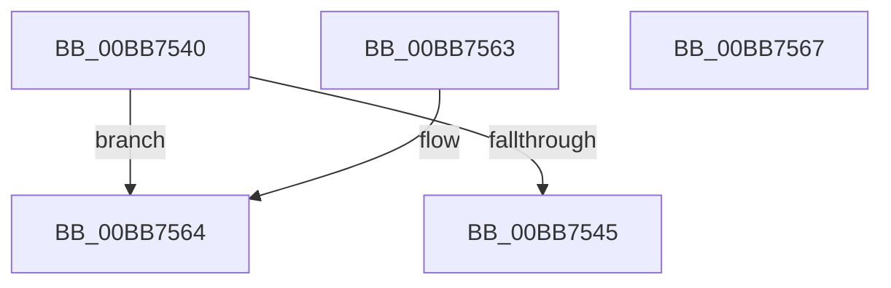

# VfIsRuleClassEnabled

- RVA: `0x00BB7540`–`0x00BB7568` (길이 `40` bytes)
- VA: `0x0000000140BB7540`
- 실행 섹션: `PAGEVRFY`
- PDB 이름 있음: `예`; PDB Function 태그: `아니요`
- unwind 정보 RVA: `0x000DB714`
- 디코드: `16`개 명령, `40/40` bytes 표시
- 미해석 바이트: `0` (있으면 어셈블리에 `.byte`로 보존)

> 이 문서는 커널 이미지의 기계어와 PDB 기호를 분석해 생성했습니다. 4번과 5번은 함수 원형과 자료형을 바이너리 사용 방식에서 추정한 C 해석이며 원본 소스 복구 결과는 아닙니다.

## 1. Dependencies

- 직접 호출 지점: **0**; 고유 호출 대상: **0**
- 직접 호출자로 확인된 함수: **2**
- RIP 상대 이미지 참조: **1**

### Outgoing calls
- 직접 디코드된 call 명령이 없습니다.

### Direct callers
- [VfIrpTrackingPluginEntry](../../text/6A/VfIrpTrackingPluginEntry_function_006AAE60.md) at `0x006AAE6B`
- [VerifierInitSystem](../../init/C4/VerifierInitSystem_function_00C4BC84.md) at `0x00C4BCCF`

### Static image references
- `0x00BB7552` → RVA `0x00E681A0` (`.data`; read)

## 2. Other-region calls and transfers

- 다른 실행 섹션으로 향하는 call: **0**
- 별도 외부 분기/꼬리 이동을 확인하지 못했습니다.

## 3. Assembly (complete function range)

```asm
00BB7540  83 F9 40                        cmp ecx, 0x40
00BB7543  73 1F                           jae 0x140bb7564
00BB7545  8A C1                           mov al, cl
00BB7547  8B D1                           mov edx, ecx
00BB7549  24 1F                           and al, 0x1f
00BB754B  48 C1 EA 05                     shr rdx, 5
00BB754F  0F B6 C8                        movzx ecx, al
00BB7552  48 8D 05 47 0C 2B 00            lea rax, [rip + 0x2b0c47]
00BB7559  8B 04 90                        mov eax, dword ptr [rax + rdx*4]
00BB755C  0F A3 C8                        bt eax, ecx
00BB755F  0F 92 C0                        setb al
00BB7562  C3                              ret
00BB7563  CC                              int3
00BB7564  32 C0                           xor al, al
00BB7566  C3                              ret
00BB7567  CC                              int3
```

## 4. C-style interpretation (structured pseudocode)

```c
__int64 __fastcall VfIsRuleClassEnabled(int a1)
{
    __int64 result;

    if (a1 >= 64) goto loc_00BB7564;
    result = (unsigned __int8)(((unsigned __int8)(a1)) & (31));
    a2 = ((unsigned int)(a1)) >> (5);
    result = (condition_is_below) ? 1 : 0;
    return result;
loc_00BB7564:
    result = 0;
    return result;
}
```

## 5. (Beta) C Style

```c
int64_t VfIsRuleClassEnabled(int32_t Arg1)
{
    int64_t result;

    if (Arg1 >= 64) goto loc_00BB7564;
    result = (uint8_t)(((uint8_t)(Arg1)) & (31));
    a2 = ((uint32_t)(Arg1)) >> (5);
    result = (condition_is_below) ? 1 : 0;
    return result;
loc_00BB7564:
    result = 0;
    return result;
}
```

## 6. Execution-region graph

[열기: 2D/3D 그래프와 함수 탐색 컨트롤 패널](../../../control-panel.html?section=pagevrfy&rva=0x00BB7540&view=graph)

- 2D 그래프는 위에서 아래로 흐르고, 3D 그래프는 빈 공간을 드래그해 회전합니다. Shift+드래그는 이동, 휠은 확대·축소, 함수 노드 선택은 대상 보고서 이동입니다.

### Static fallback


