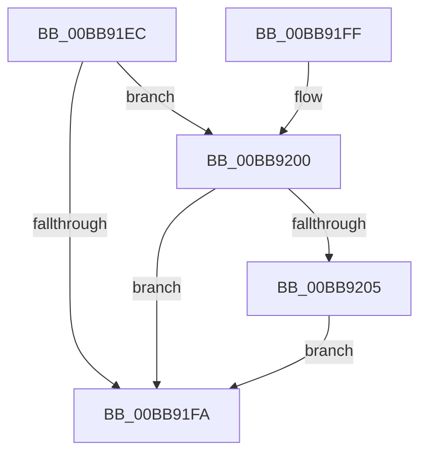

# VfKeIrqlLogLower

- RVA: `0x00BB91EC`–`0x00BB9211` (길이 `37` bytes)
- VA: `0x0000000140BB91EC`
- 실행 섹션: `PAGEVRFY`
- PDB 이름 있음: `예`; PDB Function 태그: `아니요`
- unwind 정보 RVA: `0x00063CEC`
- 디코드: `12`개 명령, `37/37` bytes 표시
- 미해석 바이트: `0` (있으면 어셈블리에 `.byte`로 보존)

> 이 문서는 커널 이미지의 기계어와 PDB 기호를 분석해 생성했습니다. 4번과 5번은 함수 원형과 자료형을 바이너리 사용 방식에서 추정한 C 해석이며 원본 소스 복구 결과는 아닙니다.

## 1. Dependencies

- 직접 호출 지점: **1**; 고유 호출 대상: **1**
- 직접 호출자로 확인된 함수: **6**
- RIP 상대 이미지 참조: **1**

### Outgoing calls
- `0x00BB920A` → [ViKeIrqlLogCommon](ViKeIrqlLogCommon_function_00BB8290.md) (function, `0x00BB8290`)

### Direct callers
- [VerifierKeReleaseQueuedSpinLock](../B9/VerifierKeReleaseQueuedSpinLock_function_00B9FF20.md) at `0x00B9FF5E`
- [VerifierKeLowerIrql](../BA/VerifierKeLowerIrql_function_00BA5660.md) at `0x00BA569C`
- [VerifierKeReleaseInStackQueuedSpinLock](../BA/VerifierKeReleaseInStackQueuedSpinLock_function_00BA5750.md) at `0x00BA5792`
- [VerifierKeReleaseSpinLock](../BA/VerifierKeReleaseSpinLock_function_00BA5850.md) at `0x00BA588E`
- [VerifierPortKeReleaseSpinLockNoXdv](../BA/VerifierPortKeReleaseSpinLockNoXdv_function_00BA5FA0.md) at `0x00BA5FD7`
- [VerifierExReleaseFastMutex](../BA/VerifierExReleaseFastMutex_function_00BABD20.md) at `0x00BABD61`

### Static image references
- `0x00BB91F0` → RVA `0x00FFDA24` (`PAGEVRFD`; read)

## 2. Other-region calls and transfers

- 다른 실행 섹션으로 향하는 call: **0**
- 별도 외부 분기/꼬리 이동을 확인하지 못했습니다.

## 3. Assembly (complete function range)

```asm
00BB91EC  48 83 EC 28                     sub rsp, 0x28
00BB91F0  8B 05 2E 48 44 00               mov eax, dword ptr [rip + 0x44482e]
00BB91F6  85 C0                           test eax, eax
00BB91F8  75 06                           jne 0x140bb9200
00BB91FA  48 83 C4 28                     add rsp, 0x28
00BB91FE  C3                              ret
00BB91FF  CC                              int3
00BB9200  48 85 C9                        test rcx, rcx
00BB9203  74 F5                           je 0x140bb91fa
00BB9205  BA 01 00 00 00                  mov edx, 1
00BB920A  E8 81 F0 FF FF                  call 0x140bb8290
00BB920F  EB E9                           jmp 0x140bb91fa
```

## 4. C-style interpretation (structured pseudocode)

```c
__int64 __fastcall VfKeIrqlLogLower(__int64 a1)
{
    __int64 result;
    __int64 v_rsp;

    v_rsp = (v_rsp) - (40);
    if ((unsigned int)((unsigned int)(*(unsigned int *)(v_rip + 4474926))) != 0) goto loc_00BB9200;
loc_00BB91FA:
    v_rsp = (v_rsp) + (40);
    return (unsigned int)(*(unsigned int *)(v_rip + 4474926));
loc_00BB9200:
    if (a1 == 0) goto loc_00BB91FA;
    result = ViKeIrqlLogCommon(a1, 1, a3, a4);
    goto loc_00BB91FA;
}
```

## 5. (Beta) C Style

```c
int64_t VfKeIrqlLogLower(int64_t Arg1)
{
    int64_t result;
    int64_t local_rsp;

    local_rsp = (local_rsp) - (40);
    if ((uint32_t)((uint32_t)(*(uint32_t *)(v_rip + 0x44482E))) != 0) goto loc_00BB9200;
loc_00BB91FA:
    local_rsp = (local_rsp) + (40);
    return (uint32_t)(*(uint32_t *)(v_rip + 0x44482E));
loc_00BB9200:
    if (Arg1 == 0) goto loc_00BB91FA;
    result = ViKeIrqlLogCommon(Arg1, 1, a3, a4);
    goto loc_00BB91FA;
}
```

## 6. Execution-region graph

[열기: 2D/3D 그래프와 함수 탐색 컨트롤 패널](../../../control-panel.html?section=pagevrfy&rva=0x00BB91EC&view=graph)

- 2D 그래프는 위에서 아래로 흐르고, 3D 그래프는 빈 공간을 드래그해 회전합니다. Shift+드래그는 이동, 휠은 확대·축소, 함수 노드 선택은 대상 보고서 이동입니다.

### Static fallback


