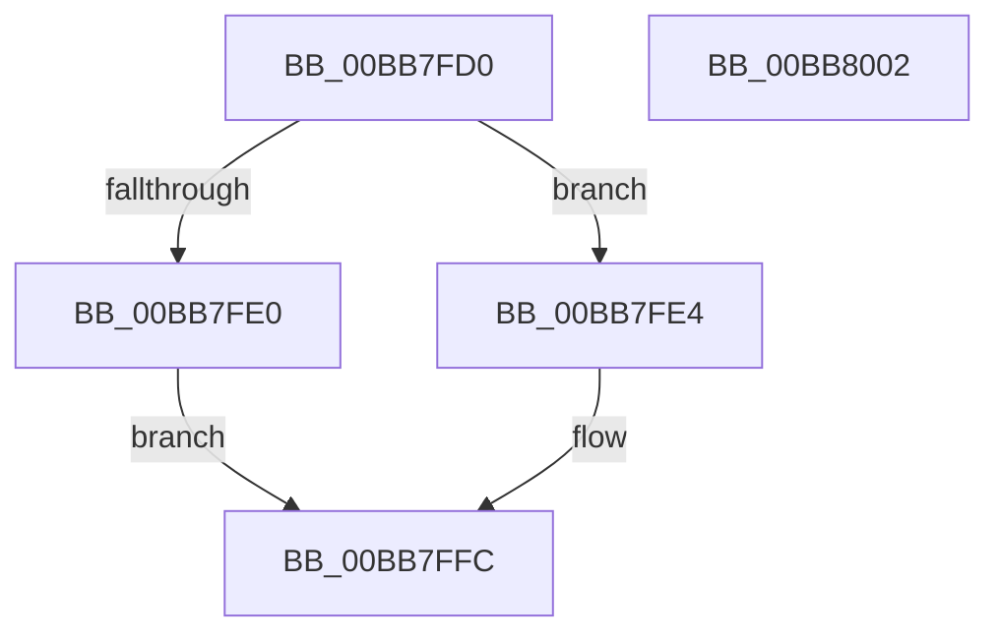

# VfKeIrqlLogRaise

- RVA: `0x00BB7FD0`–`0x00BB8003` (길이 `51` bytes)
- VA: `0x0000000140BB7FD0`
- 실행 섹션: `PAGEVRFY`
- PDB 이름 있음: `예`; PDB Function 태그: `아니요`
- unwind 정보 RVA: `0x0005CF00`
- 디코드: `17`개 명령, `51/51` bytes 표시
- 미해석 바이트: `0` (있으면 어셈블리에 `.byte`로 보존)

> 이 문서는 커널 이미지의 기계어와 PDB 기호를 분석해 생성했습니다. 4번과 5번은 함수 원형과 자료형을 바이너리 사용 방식에서 추정한 C 해석이며 원본 소스 복구 결과는 아닙니다.

## 1. Dependencies

- 직접 호출 지점: **2**; 고유 호출 대상: **2**
- 직접 호출자로 확인된 함수: **3**
- RIP 상대 이미지 참조: **1**

### Outgoing calls
- `0x00BB7FE4` → [VfKeIrqlTransitionReserveLogEntry](VfKeIrqlTransitionReserveLogEntry_function_00BB80A8.md) (function, `0x00BB80A8`)
- `0x00BB7FF4` → [ViKeIrqlLogCommon](ViKeIrqlLogCommon_function_00BB8290.md) (function, `0x00BB8290`)

### Direct callers
- [ViIrqlExAcquireFastMutex_Exit](../BA/ViIrqlExAcquireFastMutex_Exit_function_00BAD580.md) at `0x00BAD58A`
- [ViIrqlExTryToAcquireFastMutex_Exit](../BA/ViIrqlExTryToAcquireFastMutex_Exit_function_00BAD5A0.md) at `0x00BAD5B0`
- [ViKeIrqlLogAndTrimMemory](ViKeIrqlLogAndTrimMemory_function_00BB7F58.md) at `0x00BB7F7C`

### Static image references
- `0x00BB7FD6` → RVA `0x00FFDA24` (`PAGEVRFD`; read)

## 2. Other-region calls and transfers

- 다른 실행 섹션으로 향하는 call: **0**
- 별도 외부 분기/꼬리 이동을 확인하지 못했습니다.

## 3. Assembly (complete function range)

```asm
00BB7FD0  40 53                           push rbx
00BB7FD2  48 83 EC 20                     sub rsp, 0x20
00BB7FD6  8B 05 48 5A 44 00               mov eax, dword ptr [rip + 0x445a48]
00BB7FDC  85 C0                           test eax, eax
00BB7FDE  75 04                           jne 0x140bb7fe4
00BB7FE0  33 C0                           xor eax, eax
00BB7FE2  EB 18                           jmp 0x140bb7ffc
00BB7FE4  E8 BF 00 00 00                  call 0x140bb80a8
00BB7FE9  48 8B C8                        mov rcx, rax
00BB7FEC  BA 02 00 00 00                  mov edx, 2
00BB7FF1  48 8B D8                        mov rbx, rax
00BB7FF4  E8 97 02 00 00                  call 0x140bb8290
00BB7FF9  48 8B C3                        mov rax, rbx
00BB7FFC  48 83 C4 20                     add rsp, 0x20
00BB8000  5B                              pop rbx
00BB8001  C3                              ret
00BB8002  CC                              int3
```

## 4. C-style interpretation (structured pseudocode)

```c
__int64 __fastcall VfKeIrqlLogRaise(void)
{
    __int64 result;
    __int64 v_rsp;

    v_rsp = (v_rsp) - (32);
    if ((unsigned int)((unsigned int)(*(unsigned int *)(v_rip + 4479560))) != 0) goto loc_00BB7FE4;
    result = 0;
    goto loc_00BB7FFC;
loc_00BB7FE4:
    result = VfKeIrqlTransitionReserveLogEntry(a1, a2, a3, a4);
    result = ViKeIrqlLogCommon(result, 2, a3, a4);
loc_00BB7FFC:
    v_rsp = (v_rsp) + (32);
    return result;
}
```

## 5. (Beta) C Style

```c
void VfKeIrqlLogRaise(void)
{
    int64_t result;
    int64_t local_rsp;

    local_rsp = (local_rsp) - (32);
    if ((uint32_t)((uint32_t)(*(uint32_t *)(v_rip + 0x445A48))) != 0) goto loc_00BB7FE4;
    result = 0;
    goto loc_00BB7FFC;
loc_00BB7FE4:
    result = VfKeIrqlTransitionReserveLogEntry(a1, a2, a3, a4);
    result = ViKeIrqlLogCommon(result, 2, a3, a4);
loc_00BB7FFC:
    local_rsp = (local_rsp) + (32);
    return result;
}
```

## 6. Execution-region graph

[열기: 2D/3D 그래프와 함수 탐색 컨트롤 패널](../../../control-panel.html?section=pagevrfy&rva=0x00BB7FD0&view=graph)

- 2D 그래프는 위에서 아래로 흐르고, 3D 그래프는 빈 공간을 드래그해 회전합니다. Shift+드래그는 이동, 휠은 확대·축소, 함수 노드 선택은 대상 보고서 이동입니다.

### Static fallback


