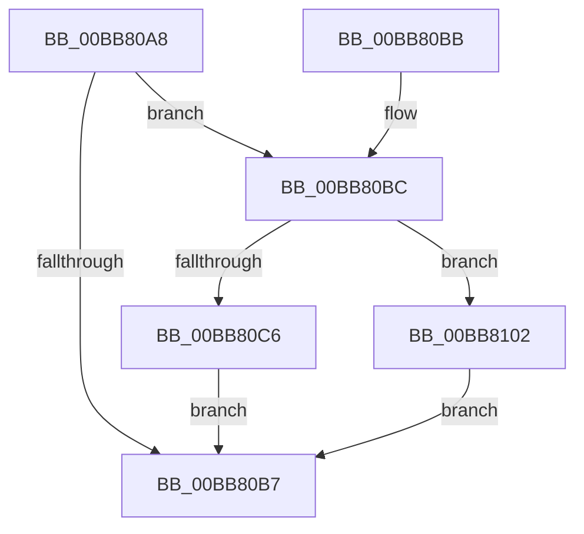

# VfKeIrqlTransitionReserveLogEntry

- RVA: `0x00BB80A8`–`0x00BB810B` (길이 `99` bytes)
- VA: `0x0000000140BB80A8`
- 실행 섹션: `PAGEVRFY`
- PDB 이름 있음: `예`; PDB Function 태그: `아니요`
- unwind 정보 RVA: `0x000DB714`
- 디코드: `25`개 명령, `99/99` bytes 표시
- 미해석 바이트: `0` (있으면 어셈블리에 `.byte`로 보존)

> 이 문서는 커널 이미지의 기계어와 PDB 기호를 분석해 생성했습니다. 4번과 5번은 함수 원형과 자료형을 바이너리 사용 방식에서 추정한 C 해석이며 원본 소스 복구 결과는 아닙니다.

## 1. Dependencies

- 직접 호출 지점: **0**; 고유 호출 대상: **0**
- 직접 호출자로 확인된 함수: **7**
- RIP 상대 이미지 참조: **5**

### Outgoing calls
- 직접 디코드된 call 명령이 없습니다.

### Direct callers
- [VerifierKeReleaseQueuedSpinLock](../B9/VerifierKeReleaseQueuedSpinLock_function_00B9FF20.md) at `0x00B9FF39`
- [VerifierKeLowerIrql](../BA/VerifierKeLowerIrql_function_00BA5660.md) at `0x00BA5678`
- [VerifierKeReleaseInStackQueuedSpinLock](../BA/VerifierKeReleaseInStackQueuedSpinLock_function_00BA5750.md) at `0x00BA576D`
- [VerifierKeReleaseSpinLock](../BA/VerifierKeReleaseSpinLock_function_00BA5850.md) at `0x00BA5869`
- [VerifierPortKeReleaseSpinLockNoXdv](../BA/VerifierPortKeReleaseSpinLockNoXdv_function_00BA5FA0.md) at `0x00BA5FB9`
- [VerifierExReleaseFastMutex](../BA/VerifierExReleaseFastMutex_function_00BABD20.md) at `0x00BABD3C`
- [VfKeIrqlLogRaise](VfKeIrqlLogRaise_function_00BB7FD0.md) at `0x00BB7FE4`

### Static image references
- `0x00BB80AE` → RVA `0x00FFDA68` (`PAGEVRFD`; read)
- `0x00BB80BC` → RVA `0x00FFDB84` (`PAGEVRFD`; read)
- `0x00BB80CB` → RVA `0x00FFDD0C` (`PAGEVRFD`; read/write)
- `0x00BB80D3` → RVA `0x00FF401C` (`PAGEVRFD`; read)
- `0x00BB8102` → RVA `0x00FFDD04` (`PAGEVRFD`; read/write)

## 2. Other-region calls and transfers

- 다른 실행 섹션으로 향하는 call: **0**
- 별도 외부 분기/꼬리 이동을 확인하지 못했습니다.

## 3. Assembly (complete function range)

```asm
00BB80A8  45 33 C0                        xor r8d, r8d
00BB80AB  44 8A D1                        mov r10b, cl
00BB80AE  4C 39 05 B3 59 44 00            cmp qword ptr [rip + 0x4459b3], r8
00BB80B5  75 05                           jne 0x140bb80bc
00BB80B7  49 8B C0                        mov rax, r8
00BB80BA  C3                              ret
00BB80BB  CC                              int3
00BB80BC  8B 05 C2 5A 44 00               mov eax, dword ptr [rip + 0x445ac2]
00BB80C2  85 C0                           test eax, eax
00BB80C4  75 3C                           jne 0x140bb8102
00BB80C6  B8 01 00 00 00                  mov eax, 1
00BB80CB  F0 0F C1 05 39 5C 44 00         lock xadd dword ptr [rip + 0x445c39], eax
00BB80D3  8B 0D 43 BF 43 00               mov ecx, dword ptr [rip + 0x43bf43]
00BB80D9  FF C0                           inc eax
00BB80DB  FF C9                           dec ecx
00BB80DD  48 23 C8                        and rcx, rax
00BB80E0  4C 6B C1 38                     imul r8, rcx, 0x38
00BB80E4  4C 03 05 7D 59 44 00            add r8, qword ptr [rip + 0x44597d]
00BB80EB  45 88 50 08                     mov byte ptr [r8 + 8], r10b
00BB80EF  41 88 50 09                     mov byte ptr [r8 + 9], dl
00BB80F3  65 8B 0C 25 A4 01 00 00         mov ecx, dword ptr gs:[0x1a4]
00BB80FB  66 41 89 48 0A                  mov word ptr [r8 + 0xa], cx
00BB8100  EB B5                           jmp 0x140bb80b7
00BB8102  F0 FF 05 FB 5B 44 00            lock inc dword ptr [rip + 0x445bfb]
00BB8109  EB AC                           jmp 0x140bb80b7
```

## 4. C-style interpretation (structured pseudocode)

```c
__int64 __fastcall VfKeIrqlTransitionReserveLogEntry(unsigned __int8 a1, unsigned __int8 a2, int a3)
{
    __int64 result;

    a3 = 0;
    if ((*(unsigned __int64 *)(v_rip + 4479411)) != 0) goto loc_00BB80BC;
loc_00BB80B7:
    return 0;
loc_00BB80BC:
    if ((unsigned int)((unsigned int)(*(unsigned int *)(v_rip + 4479682))) != 0) goto loc_00BB8102;
    result = (unsigned int)((1) + 1);
    a1 = (unsigned int)(((unsigned int)(*(unsigned int *)(v_rip + 4439875))) - 1);
    a1 = (a1) & (result);
    a3 = (a3) * (a1);
    a3 = (a3) + (*(unsigned __int64 *)(v_rip + 4479357));
    *(unsigned __int8 *)(a3 + 8) = a1;
    *(unsigned __int8 *)(a3 + 9) = a2;
    *(unsigned __int16 *)(a3 + 10) = (unsigned __int16)((unsigned int)(*(unsigned int *)(gs_base + (0 + 420))));
    goto loc_00BB80B7;
loc_00BB8102:
    goto loc_00BB80B7;
}
```

## 5. (Beta) C Style

```c
int64_t VfKeIrqlTransitionReserveLogEntry(uint8_t Arg1, uint8_t Arg2, int32_t Arg3)
{
    int64_t result;

    Arg3 = 0;
    if ((*(uint64_t *)(v_rip + 0x4459B3)) != 0) goto loc_00BB80BC;
loc_00BB80B7:
    return 0;
loc_00BB80BC:
    if ((uint32_t)((uint32_t)(*(uint32_t *)(v_rip + 0x445AC2))) != 0) goto loc_00BB8102;
    result = (uint32_t)((1) + 1);
    Arg1 = (uint32_t)(((uint32_t)(*(uint32_t *)(v_rip + 0x43BF43))) - 1);
    Arg1 = (Arg1) & (result);
    Arg3 = (Arg3) * (Arg1);
    Arg3 = (Arg3) + (*(uint64_t *)(v_rip + 0x44597D));
    *(uint8_t *)(Arg3 + 0x8) = Arg1;
    *(uint8_t *)(Arg3 + 0x9) = Arg2;
    *(uint16_t *)(Arg3 + 0xA) = (uint16_t)((uint32_t)(*(uint32_t *)(gs_base + (0 + 0x1A4))));
    goto loc_00BB80B7;
loc_00BB8102:
    goto loc_00BB80B7;
}
```

## 6. Execution-region graph

[열기: 2D/3D 그래프와 함수 탐색 컨트롤 패널](../../../control-panel.html?section=pagevrfy&rva=0x00BB80A8&view=graph)

- 2D 그래프는 위에서 아래로 흐르고, 3D 그래프는 빈 공간을 드래그해 회전합니다. Shift+드래그는 이동, 휠은 확대·축소, 함수 노드 선택은 대상 보고서 이동입니다.

### Static fallback


