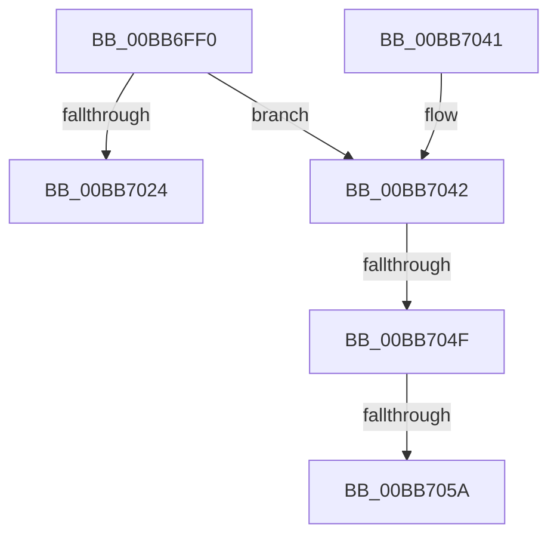

# VfPendingMoreProcessingRequired

- RVA: `0x00BB6FF0`–`0x00BB706B` (길이 `123` bytes)
- VA: `0x0000000140BB6FF0`
- 실행 섹션: `PAGEVRFY`
- PDB 이름 있음: `예`; PDB Function 태그: `예`
- unwind 정보 RVA: `0x000B0894`
- 디코드: `34`개 명령, `123/123` bytes 표시
- 미해석 바이트: `0` (있으면 어셈블리에 `.byte`로 보존)

> 이 문서는 커널 이미지의 기계어와 PDB 기호를 분석해 생성했습니다. 4번과 5번은 함수 원형과 자료형을 바이너리 사용 방식에서 추정한 C 해석이며 원본 소스 복구 결과는 아닙니다.

## 1. Dependencies

- 직접 호출 지점: **1**; 고유 호출 대상: **1**
- 직접 호출자로 확인된 함수: **1**
- RIP 상대 이미지 참조: **0**

### Outgoing calls
- `0x00BB7017` → [VfIrpDatabaseEntryFindAndLock](VfIrpDatabaseEntryFindAndLock_function_00BB7074.md) (function, `0x00BB7074`)

### Direct callers
- [IovpLocalCompletionRoutine](IovpLocalCompletionRoutine_function_00BB6B60.md) at `0x00BB6C42`
- [IovpLocalCompletionRoutine](IovpLocalCompletionRoutine_function_00BB6B60.md) at `0x00BB6CBE`

### Static image references
- 디코드된 RIP-relative 메모리 참조가 없습니다.

## 2. Other-region calls and transfers

- 다른 실행 섹션으로 향하는 call: **0**
- call이 아닌 외부 분기/꼬리 이동: **3**
  - `0x00BB7049` → [sub_00BBC208](Unknown_function_00BBC208.md) (`tail-transfer`)
  - `0x00BB7054` → [sub_00BBC208](Unknown_function_00BBC208.md) (`tail-transfer`)
  - `0x00BB7066` → [sub_00BBC208](Unknown_function_00BBC208.md) (`tail-transfer`)

## 3. Assembly (complete function range)

```asm
00BB6FF0  48 8B C4                        mov rax, rsp
00BB6FF3  48 89 58 08                     mov qword ptr [rax + 8], rbx
00BB6FF7  48 89 68 10                     mov qword ptr [rax + 0x10], rbp
00BB6FFB  48 89 70 18                     mov qword ptr [rax + 0x18], rsi
00BB6FFF  48 89 78 20                     mov qword ptr [rax + 0x20], rdi
00BB7003  41 56                           push r14
00BB7005  48 83 EC 40                     sub rsp, 0x40
00BB7009  4C 8B F1                        mov r14, rcx
00BB700C  49 8B E9                        mov rbp, r9
00BB700F  48 8B CA                        mov rcx, rdx
00BB7012  49 8B D8                        mov rbx, r8
00BB7015  33 F6                           xor esi, esi
00BB7017  E8 58 00 00 00                  call 0x140bb7074
00BB701C  48 8B F8                        mov rdi, rax
00BB701F  48 85 C0                        test rax, rax
00BB7022  75 1E                           jne 0x140bb7042
00BB7024  48 8B 5C 24 50                  mov rbx, qword ptr [rsp + 0x50]
00BB7029  8B C6                           mov eax, esi
00BB702B  48 8B 74 24 60                  mov rsi, qword ptr [rsp + 0x60]
00BB7030  48 8B 6C 24 58                  mov rbp, qword ptr [rsp + 0x58]
00BB7035  48 8B 7C 24 68                  mov rdi, qword ptr [rsp + 0x68]
00BB703A  48 83 C4 40                     add rsp, 0x40
00BB703E  41 5E                           pop r14
00BB7040  C3                              ret
00BB7041  CC                              int3
00BB7042  48 3B 98 D8 00 00 00            cmp rbx, qword ptr [rax + 0xd8]
00BB7049  0F 85 B9 51 00 00               jne 0x140bbc208
00BB704F  8B 40 38                        mov eax, dword ptr [rax + 0x38]
00BB7052  85 C0                           test eax, eax
00BB7054  0F 88 AE 51 00 00               js 0x140bbc208
00BB705A  0F BA E8 1F                     bts eax, 0x1f
00BB705E  BE 01 00 00 00                  mov esi, 1
00BB7063  89 47 38                        mov dword ptr [rdi + 0x38], eax
00BB7066  E9 9D 51 00 00                  jmp 0x140bbc208
```

## 4. C-style interpretation (structured pseudocode)

```c
__int64 __fastcall VfPendingMoreProcessingRequired(__int64 a1, __int64 a2, __int64 a3, __int64 a4)
{
    __int64 result;
    __int64 v_rsi;
    __int64 v_rsp;
    unsigned __int64 v_stack_p10;
    unsigned __int64 v_stack_p18;
    unsigned __int64 v_stack_p20;
    unsigned __int64 v_stack_p8;

    *(unsigned __int64 *)(v_rsp + 8) = v_rbx;
    *(unsigned __int64 *)(v_rsp + 16) = v_rbp;
    *(unsigned __int64 *)(v_rsp + 24) = v_rsi;
    *(unsigned __int64 *)(v_rsp + 32) = v_rdi;
    v_rsp = (v_rsp) - (64);
    v_rsi = 0;
    result = VfIrpDatabaseEntryFindAndLock(a2, a2, a3, a4);
    if (result != 0) goto loc_00BB7042;
    v_rsp = (v_rsp) + (64);
    return 0;
loc_00BB7042:
    *(unsigned int *)(v_stack_p20 + 56) = (unsigned int)((unsigned int)(*(unsigned int *)(0 + 56)));
}
```

## 5. (Beta) C Style

```c
int64_t VfPendingMoreProcessingRequired(int64_t Arg1, int64_t Arg2, int64_t Arg3, int64_t Arg4)
{
    int64_t result;
    int64_t local_rsi;
    int64_t local_rsp;
    uint64_t v_stack_p10;
    uint64_t v_stack_p18;
    uint64_t v_stack_p20;
    uint64_t v_stack_p8;

    *(uint64_t *)(local_rsp + 0x8) = local_rbx;
    *(uint64_t *)(local_rsp + 0x10) = local_rbp;
    *(uint64_t *)(local_rsp + 0x18) = local_rsi;
    *(uint64_t *)(local_rsp + 0x20) = local_rdi;
    local_rsp = (local_rsp) - (64);
    local_rsi = 0;
    result = VfIrpDatabaseEntryFindAndLock(Arg2, Arg2, Arg3, Arg4);
    if (result != 0) goto loc_00BB7042;
    local_rsp = (local_rsp) + (64);
    return 0;
loc_00BB7042:
    *(uint32_t *)(v_stack_p20 + 0x38) = (uint32_t)((uint32_t)(*(uint32_t *)(0 + 0x38)));
}
```

## 6. Execution-region graph

[열기: 2D/3D 그래프와 함수 탐색 컨트롤 패널](../../../control-panel.html?section=pagevrfy&rva=0x00BB6FF0&view=graph)

- 2D 그래프는 위에서 아래로 흐르고, 3D 그래프는 빈 공간을 드래그해 회전합니다. Shift+드래그는 이동, 휠은 확대·축소, 함수 노드 선택은 대상 보고서 이동입니다.

### Static fallback


