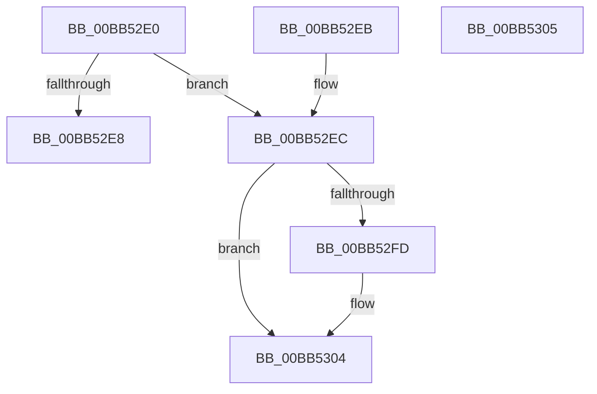

# VfPnpAdvanceIrpStatus

- RVA: `0x00BB52E0`–`0x00BB5306` (길이 `38` bytes)
- VA: `0x0000000140BB52E0`
- 실행 섹션: `PAGEVRFY`
- PDB 이름 있음: `예`; PDB Function 태그: `아니요`
- unwind 정보 RVA: `0x000DB714`
- 디코드: `12`개 명령, `38/38` bytes 표시
- 미해석 바이트: `0` (있으면 어셈블리에 `.byte`로 보존)

> 이 문서는 커널 이미지의 기계어와 PDB 기호를 분석해 생성했습니다. 4번과 5번은 함수 원형과 자료형을 바이너리 사용 방식에서 추정한 C 해석이며 원본 소스 복구 결과는 아닙니다.

## 1. Dependencies

- 직접 호출 지점: **0**; 고유 호출 대상: **0**
- 직접 호출자로 확인된 함수: **0**
- RIP 상대 이미지 참조: **0**

### Outgoing calls
- 직접 디코드된 call 명령이 없습니다.

### Direct callers
- 이 함수 시작 RVA로 연결되는 직접 call은 확인되지 않았습니다. 간접 호출은 완전히 역산할 수 없습니다.

### Static image references
- 디코드된 RIP-relative 메모리 참조가 없습니다.

## 2. Other-region calls and transfers

- 다른 실행 섹션으로 향하는 call: **0**
- 별도 외부 분기/꼬리 이동을 확인하지 못했습니다.

## 3. Assembly (complete function range)

```asm
00BB52E0  81 FA 00 01 00 00               cmp edx, 0x100
00BB52E6  72 04                           jb 0x140bb52ec
00BB52E8  33 C0                           xor eax, eax
00BB52EA  C3                              ret
00BB52EB  CC                              int3
00BB52EC  B8 01 00 00 00                  mov eax, 1
00BB52F1  41 01 00                        add dword ptr [r8], eax
00BB52F4  41 81 38 03 01 00 00            cmp dword ptr [r8], 0x103
00BB52FB  75 07                           jne 0x140bb5304
00BB52FD  41 C7 00 04 01 00 00            mov dword ptr [r8], 0x104
00BB5304  C3                              ret
00BB5305  CC                              int3
```

## 4. C-style interpretation (structured pseudocode)

```c
__int64 __fastcall VfPnpAdvanceIrpStatus(__int64 a1, int a2, __int64 a3)
{
    __int64 result;

    if (a2 < 256) goto loc_00BB52EC;
    result = 0;
    return result;
loc_00BB52EC:
    if ((*(unsigned int *)(a3)) == 259) {
        *(unsigned int *)(a3) = 260;
    }
    return 1;
}
```

## 5. (Beta) C Style

```c
int64_t VfPnpAdvanceIrpStatus(int64_t Arg1, int32_t Arg2, void *Arg3)
{
    uint8_t *arg3 = (uint8_t *)Arg3;

    int64_t result;

    if (Arg2 < 256) goto loc_00BB52EC;
    result = 0;
    return result;
loc_00BB52EC:
    if ((*(uint32_t *)(arg3)) == 259) {
        *(uint32_t *)(arg3) = 260;
    }
    return 1;
}
```

### 관측된 메모리 오프셋

구조체 형식이 확인되지 않은 접근은 인자 기준의 오프셋으로만 기록했습니다.

| 기준 인자 | 오프셋 표현 | 폭 (bit) | 접근 |
|---|---:|---:|---|
| `Arg3` | `+ 0x0` | `32` | `R` |
| `Arg3` | `+ 0x0` | `32` | `R/W` |
| `Arg3` | `+ 0x0` | `32` | `W` |

## 6. Execution-region graph

[열기: 2D/3D 그래프와 함수 탐색 컨트롤 패널](../../../control-panel.html?section=pagevrfy&rva=0x00BB52E0&view=graph)

- 2D 그래프는 위에서 아래로 흐르고, 3D 그래프는 빈 공간을 드래그해 회전합니다. Shift+드래그는 이동, 휠은 확대·축소, 함수 노드 선택은 대상 보고서 이동입니다.

### Static fallback


