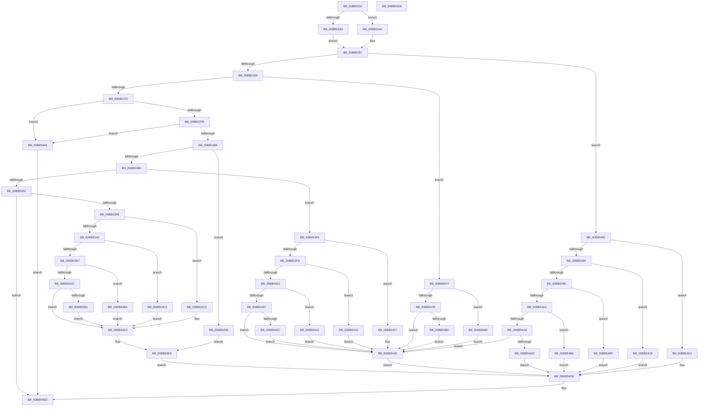

# VfPnpDumpIrpStack

- RVA: `0x00BB5310`–`0x00BB54E9` (길이 `473` bytes)
- VA: `0x0000000140BB5310`
- 실행 섹션: `PAGEVRFY`
- PDB 이름 있음: `예`; PDB Function 태그: `아니요`
- unwind 정보 RVA: `0x00065960`
- 디코드: `125`개 명령, `473/473` bytes 표시
- 미해석 바이트: `0` (있으면 어셈블리에 `.byte`로 보존)

> 이 문서는 커널 이미지의 기계어와 PDB 기호를 분석해 생성했습니다. 4번과 5번은 함수 원형과 자료형을 바이너리 사용 방식에서 추정한 C 해석이며 원본 소스 복구 결과는 아닙니다.

## 1. Dependencies

- 직접 호출 지점: **5**; 고유 호출 대상: **2**
- 직접 호출자로 확인된 함수: **0**
- RIP 상대 이미지 참조: **24**

### Outgoing calls
- `0x00BB5329` → [DbgPrintEx](../../text/35/DbgPrintEx_function_00359290.md) (function, `0x00359290`)
- `0x00BB5357` → [VfUtilDbgPrint](../../text/61/VfUtilDbgPrint_function_006122AC.md) (function, `0x006122AC`)
- `0x00BB53D6` → [VfUtilDbgPrint](../../text/61/VfUtilDbgPrint_function_006122AC.md) (function, `0x006122AC`)
- `0x00BB546D` → [DbgPrintEx](../../text/35/DbgPrintEx_function_00359290.md) (function, `0x00359290`)
- `0x00BB54D8` → [VfUtilDbgPrint](../../text/61/VfUtilDbgPrint_function_006122AC.md) (function, `0x006122AC`)

### Direct callers
- 이 함수 시작 RVA로 연결되는 직접 call은 확인되지 않았습니다. 간접 호출은 완전히 역산할 수 없습니다.

### Static image references
- `0x00BB531C` → RVA `0x00BBBB20` (` ?? ::JKADOLAD::`string'`; read)
- `0x00BB5332` → RVA `0x00BBBB40` (` ?? ::JKADOLAD::`string'`; read)
- `0x00BB533D` → RVA `0x00B8B520` (`PnPIrpNames`; read)
- `0x00BB534C` → RVA `0x00BBBB10` (` ?? ::JKADOLAD::`string'`; read)
- `0x00BB53B1` → RVA `0x00BBBAE0` (` ?? ::JKADOLAD::`string'`; read)
- `0x00BB53BA` → RVA `0x00BBBA90` (` ?? ::JKADOLAD::`string'`; read)
- `0x00BB53C3` → RVA `0x00BBBAB0` (` ?? ::JKADOLAD::`string'`; read)
- `0x00BB53CC` → RVA `0x00BBBA50` (` ?? ::JKADOLAD::`string'`; read)
- `0x00BB53DB` → RVA `0x00BBBB00` (` ?? ::JKADOLAD::`string'`; read)
- `0x00BB53E2` → RVA `0x00BBBAD0` (` ?? ::JKADOLAD::`string'`; read)
- `0x00BB540C` → RVA `0x00BBBA70` (` ?? ::JKADOLAD::`string'`; read)
- `0x00BB5415` → RVA `0x00BBBA10` (` ?? ::JKADOLAD::`string'`; read)
- `0x00BB541E` → RVA `0x00BBBA30` (` ?? ::JKADOLAD::`string'`; read)
- `0x00BB5427` → RVA `0x00BBB9E0` (` ?? ::JKADOLAD::`string'`; read)
- `0x00BB5436` → RVA `0x00BBBA00` (` ?? ::JKADOLAD::`string'`; read)
- `0x00BB543D` → RVA `0x00BBB990` (` ?? ::JKADOLAD::`string'`; read)
- `0x00BB5449` → RVA `0x00BBB9A0` (` ?? ::JKADOLAD::`string'`; read)
- `0x00BB5480` → RVA `0x00BBBBD0` (` ?? ::JKADOLAD::`string'`; read)
- `0x00BB5489` → RVA `0x00BBBBF0` (` ?? ::JKADOLAD::`string'`; read)
- `0x00BB54AD` → RVA `0x00BBBB90` (` ?? ::JKADOLAD::`string'`; read)
- `0x00BB54B6` → RVA `0x00BBBBB0` (` ?? ::JKADOLAD::`string'`; read)
- `0x00BB54BF` → RVA `0x00BBBB50` (` ?? ::JKADOLAD::`string'`; read)
- `0x00BB54C8` → RVA `0x00BBBB70` (` ?? ::JKADOLAD::`string'`; read)
- `0x00BB54D1` → RVA `0x00BBBB30` (` ?? ::JKADOLAD::`string'`; read)

## 2. Other-region calls and transfers

- 다른 실행 섹션으로 향하는 call: **5**
  - `0x00BB5329` → [DbgPrintEx](../../text/35/DbgPrintEx_function_00359290.md) (`PAGEVRFY` → `.text`)
  - `0x00BB5357` → [VfUtilDbgPrint](../../text/61/VfUtilDbgPrint_function_006122AC.md) (`PAGEVRFY` → `.text`)
  - `0x00BB53D6` → [VfUtilDbgPrint](../../text/61/VfUtilDbgPrint_function_006122AC.md) (`PAGEVRFY` → `.text`)
  - `0x00BB546D` → [DbgPrintEx](../../text/35/DbgPrintEx_function_00359290.md) (`PAGEVRFY` → `.text`)
  - `0x00BB54D8` → [VfUtilDbgPrint](../../text/61/VfUtilDbgPrint_function_006122AC.md) (`PAGEVRFY` → `.text`)
- 별도 외부 분기/꼬리 이동을 확인하지 못했습니다.

## 3. Assembly (complete function range)

```asm
00BB5310  48 89 5C 24 08                  mov qword ptr [rsp + 8], rbx
00BB5315  57                              push rdi
00BB5316  48 83 EC 40                     sub rsp, 0x40
00BB531A  33 D2                           xor edx, edx
00BB531C  4C 8D 05 FD 67 00 00            lea r8, [rip + 0x67fd]
00BB5323  48 8B F9                        mov rdi, rcx
00BB5326  8D 4A 5D                        lea ecx, [rdx + 0x5d]
00BB5329  E8 62 3F 7A FF                  call 0x140359290
00BB532E  0F B6 47 01                     movzx eax, byte ptr [rdi + 1]
00BB5332  48 8D 1D 07 68 00 00            lea rbx, [rip + 0x6807]
00BB5339  3C 18                           cmp al, 0x18
00BB533B  77 0D                           ja 0x140bb534a
00BB533D  48 8D 0D DC 61 FD FF            lea rcx, [rip - 0x29e24]
00BB5344  48 8B 0C C1                     mov rcx, qword ptr [rcx + rax*8]
00BB5348  EB 0D                           jmp 0x140bb5357
00BB534A  3C FF                           cmp al, 0xff
00BB534C  48 8D 0D BD 67 00 00            lea rcx, [rip + 0x67bd]
00BB5353  48 0F 45 CB                     cmovne rcx, rbx
00BB5357  E8 50 CF A5 FF                  call 0x1406122ac
00BB535C  0F B6 4F 01                     movzx ecx, byte ptr [rdi + 1]
00BB5360  83 E9 07                        sub ecx, 7
00BB5363  0F 84 29 01 00 00               je 0x140bb5492
00BB5369  83 E9 05                        sub ecx, 5
00BB536C  0F 84 02 01 00 00               je 0x140bb5474
00BB5372  83 E9 03                        sub ecx, 3
00BB5375  0F 84 CB 00 00 00               je 0x140bb5446
00BB537B  83 E9 01                        sub ecx, 1
00BB537E  0F 84 C2 00 00 00               je 0x140bb5446
00BB5384  83 E9 02                        sub ecx, 2
00BB5387  0F 84 A9 00 00 00               je 0x140bb5436
00BB538D  83 E9 01                        sub ecx, 1
00BB5390  74 64                           je 0x140bb53f6
00BB5392  83 F9 03                        cmp ecx, 3
00BB5395  0F 85 42 01 00 00               jne 0x140bb54dd
00BB539B  8B 4F 10                        mov ecx, dword ptr [rdi + 0x10]
00BB539E  85 C9                           test ecx, ecx
00BB53A0  74 2A                           je 0x140bb53cc
00BB53A2  83 E9 01                        sub ecx, 1
00BB53A5  74 1C                           je 0x140bb53c3
00BB53A7  83 E9 01                        sub ecx, 1
00BB53AA  74 0E                           je 0x140bb53ba
00BB53AC  83 F9 01                        cmp ecx, 1
00BB53AF  75 22                           jne 0x140bb53d3
00BB53B1  48 8D 1D 28 67 00 00            lea rbx, [rip + 0x6728]
00BB53B8  EB 19                           jmp 0x140bb53d3
00BB53BA  48 8D 1D CF 66 00 00            lea rbx, [rip + 0x66cf]
00BB53C1  EB 10                           jmp 0x140bb53d3
00BB53C3  48 8D 1D E6 66 00 00            lea rbx, [rip + 0x66e6]
00BB53CA  EB 07                           jmp 0x140bb53d3
00BB53CC  48 8D 1D 7D 66 00 00            lea rbx, [rip + 0x667d]
00BB53D3  48 8B CB                        mov rcx, rbx
00BB53D6  E8 D1 CE A5 FF                  call 0x1406122ac
00BB53DB  48 8D 15 1E 67 00 00            lea rdx, [rip + 0x671e]
00BB53E2  48 8D 0D E7 66 00 00            lea rcx, [rip + 0x66e7]
00BB53E9  80 7F 08 00                     cmp byte ptr [rdi + 8], 0
00BB53ED  48 0F 44 CA                     cmove rcx, rdx
00BB53F1  E9 E2 00 00 00                  jmp 0x140bb54d8
00BB53F6  8B 4F 08                        mov ecx, dword ptr [rdi + 8]
00BB53F9  85 C9                           test ecx, ecx
00BB53FB  74 2A                           je 0x140bb5427
00BB53FD  83 E9 01                        sub ecx, 1
00BB5400  74 1C                           je 0x140bb541e
00BB5402  83 E9 01                        sub ecx, 1
00BB5405  74 0E                           je 0x140bb5415
00BB5407  83 F9 01                        cmp ecx, 1
00BB540A  75 22                           jne 0x140bb542e
00BB540C  48 8D 1D 5D 66 00 00            lea rbx, [rip + 0x665d]
00BB5413  EB 19                           jmp 0x140bb542e
00BB5415  48 8D 1D F4 65 00 00            lea rbx, [rip + 0x65f4]
00BB541C  EB 10                           jmp 0x140bb542e
00BB541E  48 8D 1D 0B 66 00 00            lea rbx, [rip + 0x660b]
00BB5425  EB 07                           jmp 0x140bb542e
00BB5427  48 8D 1D B2 65 00 00            lea rbx, [rip + 0x65b2]
00BB542E  48 8B CB                        mov rcx, rbx
00BB5431  E9 A2 00 00 00                  jmp 0x140bb54d8
00BB5436  48 8D 15 C3 65 00 00            lea rdx, [rip + 0x65c3]
00BB543D  48 8D 0D 4C 65 00 00            lea rcx, [rip + 0x654c]
00BB5444  EB A3                           jmp 0x140bb53e9
00BB5446  8B 47 20                        mov eax, dword ptr [rdi + 0x20]
00BB5449  4C 8D 05 50 65 00 00            lea r8, [rip + 0x6550]
00BB5450  44 8B 4F 08                     mov r9d, dword ptr [rdi + 8]
00BB5454  33 D2                           xor edx, edx
00BB5456  89 44 24 30                     mov dword ptr [rsp + 0x30], eax
00BB545A  8B 47 18                        mov eax, dword ptr [rdi + 0x18]
00BB545D  89 44 24 28                     mov dword ptr [rsp + 0x28], eax
00BB5461  48 8B 47 10                     mov rax, qword ptr [rdi + 0x10]
00BB5465  8D 4A 5D                        lea ecx, [rdx + 0x5d]
00BB5468  48 89 44 24 20                  mov qword ptr [rsp + 0x20], rax
00BB546D  E8 1E 3E 7A FF                  call 0x140359290
00BB5472  EB 69                           jmp 0x140bb54dd
00BB5474  8B 4F 08                        mov ecx, dword ptr [rdi + 8]
00BB5477  85 C9                           test ecx, ecx
00BB5479  74 0E                           je 0x140bb5489
00BB547B  83 F9 01                        cmp ecx, 1
00BB547E  75 AE                           jne 0x140bb542e
00BB5480  48 8D 1D 49 67 00 00            lea rbx, [rip + 0x6749]
00BB5487  EB A5                           jmp 0x140bb542e
00BB5489  48 8D 1D 60 67 00 00            lea rbx, [rip + 0x6760]
00BB5490  EB 9C                           jmp 0x140bb542e
00BB5492  8B 4F 08                        mov ecx, dword ptr [rdi + 8]
00BB5495  85 C9                           test ecx, ecx
00BB5497  74 38                           je 0x140bb54d1
00BB5499  83 E9 01                        sub ecx, 1
00BB549C  74 2A                           je 0x140bb54c8
00BB549E  83 E9 01                        sub ecx, 1
00BB54A1  74 1C                           je 0x140bb54bf
00BB54A3  83 E9 01                        sub ecx, 1
00BB54A6  74 0E                           je 0x140bb54b6
00BB54A8  83 F9 01                        cmp ecx, 1
00BB54AB  75 81                           jne 0x140bb542e
00BB54AD  48 8D 0D DC 66 00 00            lea rcx, [rip + 0x66dc]
00BB54B4  EB 22                           jmp 0x140bb54d8
00BB54B6  48 8D 0D F3 66 00 00            lea rcx, [rip + 0x66f3]
00BB54BD  EB 19                           jmp 0x140bb54d8
00BB54BF  48 8D 0D 8A 66 00 00            lea rcx, [rip + 0x668a]
00BB54C6  EB 10                           jmp 0x140bb54d8
00BB54C8  48 8D 0D A1 66 00 00            lea rcx, [rip + 0x66a1]
00BB54CF  EB 07                           jmp 0x140bb54d8
00BB54D1  48 8D 0D 58 66 00 00            lea rcx, [rip + 0x6658]
00BB54D8  E8 CF CD A5 FF                  call 0x1406122ac
00BB54DD  48 8B 5C 24 50                  mov rbx, qword ptr [rsp + 0x50]
00BB54E2  48 83 C4 40                     add rsp, 0x40
00BB54E6  5F                              pop rdi
00BB54E7  C3                              ret
00BB54E8  CC                              int3
```

## 4. C-style interpretation (structured pseudocode)

```c
__int64 __fastcall VfPnpDumpIrpStack(__int64 a1, int a2)
{
    __int64 result;
    __int64 v_rsp;
    unsigned int v_stack_m18;
    unsigned int v_stack_m20;
    unsigned __int64 v_stack_m28;
    unsigned __int64 v_stack_p8;

    v_stack_p8 = v_rbx;
    v_rsp = (v_rsp) - (64);
    a2 = 0;
    result = DbgPrintEx(a2 + 93, a2, v_rip + 26621, a4);
    if (((unsigned __int8)(*(unsigned __int8 *)(a1 + 1))) > 24) goto loc_00BB534A;
    goto loc_00BB5357;
loc_00BB534A:
    a1 = v_rip + 26557;
    if (((unsigned __int8)(*(unsigned __int8 *)(a1 + 1))) != 255) { a1 = v_rip + 26631; }
loc_00BB5357:
    result = VfUtilDbgPrint(a1, a2, v_rip + 26621, a4);
    a1 = (unsigned int)((*(unsigned __int8 *)(a1 + 1)) - (7));
    if (condition_is_equal) goto loc_00BB5492;
    a1 = (unsigned int)((a1) - (5));
    if (condition_is_equal) goto loc_00BB5474;
    a1 = (unsigned int)((a1) - (3));
    if (condition_is_equal) goto loc_00BB5446;
    a1 = (unsigned int)((a1) - (1));
    if (condition_is_equal) goto loc_00BB5446;
    a1 = (unsigned int)((a1) - (2));
    if (condition_is_equal) goto loc_00BB5436;
    a1 = (unsigned int)((a1) - (1));
    if (condition_is_equal) goto loc_00BB53F6;
    if (((unsigned int)(a1)) != 3) goto loc_00BB54DD;
    if ((unsigned int)((unsigned int)(*(unsigned int *)(a1 + 16))) == 0) goto loc_00BB53CC;
    a1 = (unsigned int)(((unsigned int)(*(unsigned int *)(a1 + 16))) - (1));
    if (condition_is_equal) goto loc_00BB53C3;
    a1 = (unsigned int)((a1) - (1));
    if (condition_is_equal) goto loc_00BB53BA;
    if (((unsigned int)(a1)) != 1) goto loc_00BB53D3;
    goto loc_00BB53D3;
loc_00BB53BA:
    goto loc_00BB53D3;
loc_00BB53C3:
    goto loc_00BB53D3;
loc_00BB53CC:
loc_00BB53D3:
    result = VfUtilDbgPrint(v_rip + 26237, a2, v_rip + 26621, a4);
loc_00BB53E9:
    a1 = v_rip + 26343;
    if ((*(unsigned __int8 *)(a1 + 8)) == 0) { a1 = v_rip + 26398; }
    goto loc_00BB54D8;
loc_00BB53F6:
    if ((unsigned int)((unsigned int)(*(unsigned int *)(a1 + 8))) == 0) goto loc_00BB5427;
    a1 = (unsigned int)(((unsigned int)(*(unsigned int *)(a1 + 8))) - (1));
    if (condition_is_equal) goto loc_00BB541E;
    a1 = (unsigned int)((a1) - (1));
    if (condition_is_equal) goto loc_00BB5415;
    if (((unsigned int)(a1)) != 1) goto loc_00BB542E;
    goto loc_00BB542E;
loc_00BB5415:
    goto loc_00BB542E;
loc_00BB541E:
    goto loc_00BB542E;
loc_00BB5427:
loc_00BB542E:
    goto loc_00BB54D8;
loc_00BB5436:
    goto loc_00BB53E9;
loc_00BB5446:
    a2 = 0;
    v_stack_m18 = (unsigned int)((unsigned int)(*(unsigned int *)(a1 + 32)));
    v_stack_m20 = (unsigned int)((unsigned int)(*(unsigned int *)(a1 + 24)));
    v_stack_m28 = *(unsigned __int64 *)(a1 + 16);
    result = DbgPrintEx(a2 + 93, a2, v_rip + 25936, (unsigned int)(*(unsigned int *)(a1 + 8)));
    goto loc_00BB54DD;
loc_00BB5474:
    if ((unsigned int)((unsigned int)(*(unsigned int *)(a1 + 8))) == 0) goto loc_00BB5489;
    if (((unsigned int)((unsigned int)(*(unsigned int *)(a1 + 8)))) != 1) goto loc_00BB542E;
    goto loc_00BB542E;
loc_00BB5489:
    goto loc_00BB542E;
loc_00BB5492:
    if ((unsigned int)((unsigned int)(*(unsigned int *)(a1 + 8))) == 0) goto loc_00BB54D1;
    a1 = (unsigned int)(((unsigned int)(*(unsigned int *)(a1 + 8))) - (1));
    if (condition_is_equal) goto loc_00BB54C8;
    a1 = (unsigned int)((a1) - (1));
    if (condition_is_equal) goto loc_00BB54BF;
    a1 = (unsigned int)((a1) - (1));
    if (condition_is_equal) goto loc_00BB54B6;
    if (((unsigned int)(a1)) != 1) goto loc_00BB542E;
    goto loc_00BB54D8;
loc_00BB54B6:
    goto loc_00BB54D8;
loc_00BB54BF:
    goto loc_00BB54D8;
loc_00BB54C8:
    goto loc_00BB54D8;
loc_00BB54D1:
loc_00BB54D8:
    result = VfUtilDbgPrint(v_rip + 26200, a2, v_rip + 25936, (unsigned int)(*(unsigned int *)(a1 + 8)));
loc_00BB54DD:
    v_rsp = (v_rsp) + (64);
    return result;
}
```

## 5. (Beta) C Style

```c
int64_t VfPnpDumpIrpStack(void *Arg1, int32_t Arg2)
{
    uint8_t *arg1 = (uint8_t *)Arg1;

    int64_t result;
    int64_t local_rsp;
    uint32_t v_stack_m18;
    uint32_t v_stack_m20;
    uint64_t v_stack_m28;
    uint64_t v_stack_p8;

    v_stack_p8 = local_rbx;
    local_rsp = (local_rsp) - (64);
    Arg2 = 0;
    result = DbgPrintEx(Arg2 + 93, Arg2, v_rip + 26621, a4);
    if (((uint8_t)(*(uint8_t *)(arg1 + 0x1))) > 24) goto loc_00BB534A;
    goto loc_00BB5357;
loc_00BB534A:
    Arg1 = v_rip + 26557;
    if (((uint8_t)(*(uint8_t *)(arg1 + 0x1))) != 255) { Arg1 = v_rip + 26631; }
loc_00BB5357:
    result = VfUtilDbgPrint(Arg1, Arg2, v_rip + 26621, a4);
    Arg1 = (uint32_t)((*(uint8_t *)(arg1 + 0x1)) - (7));
    if (condition_is_equal) goto loc_00BB5492;
    Arg1 = (uint32_t)((Arg1) - (5));
    if (condition_is_equal) goto loc_00BB5474;
    Arg1 = (uint32_t)((Arg1) - (3));
    if (condition_is_equal) goto loc_00BB5446;
    Arg1 = (uint32_t)((Arg1) - (1));
    if (condition_is_equal) goto loc_00BB5446;
    Arg1 = (uint32_t)((Arg1) - (2));
    if (condition_is_equal) goto loc_00BB5436;
    Arg1 = (uint32_t)((Arg1) - (1));
    if (condition_is_equal) goto loc_00BB53F6;
    if (((uint32_t)(Arg1)) != 3) goto loc_00BB54DD;
    if ((uint32_t)((uint32_t)(*(uint32_t *)(arg1 + 0x10))) == 0) goto loc_00BB53CC;
    Arg1 = (uint32_t)(((uint32_t)(*(uint32_t *)(arg1 + 0x10))) - (1));
    if (condition_is_equal) goto loc_00BB53C3;
    Arg1 = (uint32_t)((Arg1) - (1));
    if (condition_is_equal) goto loc_00BB53BA;
    if (((uint32_t)(Arg1)) != 1) goto loc_00BB53D3;
    goto loc_00BB53D3;
loc_00BB53BA:
    goto loc_00BB53D3;
loc_00BB53C3:
    goto loc_00BB53D3;
loc_00BB53CC:
loc_00BB53D3:
    result = VfUtilDbgPrint(v_rip + 26237, Arg2, v_rip + 26621, a4);
loc_00BB53E9:
    Arg1 = v_rip + 26343;
    if ((*(uint8_t *)(arg1 + 0x8)) == 0) { Arg1 = v_rip + 26398; }
    goto loc_00BB54D8;
loc_00BB53F6:
    if ((uint32_t)((uint32_t)(*(uint32_t *)(arg1 + 0x8))) == 0) goto loc_00BB5427;
    Arg1 = (uint32_t)(((uint32_t)(*(uint32_t *)(arg1 + 0x8))) - (1));
    if (condition_is_equal) goto loc_00BB541E;
    Arg1 = (uint32_t)((Arg1) - (1));
    if (condition_is_equal) goto loc_00BB5415;
    if (((uint32_t)(Arg1)) != 1) goto loc_00BB542E;
    goto loc_00BB542E;
loc_00BB5415:
    goto loc_00BB542E;
loc_00BB541E:
    goto loc_00BB542E;
loc_00BB5427:
loc_00BB542E:
    goto loc_00BB54D8;
loc_00BB5436:
    goto loc_00BB53E9;
loc_00BB5446:
    Arg2 = 0;
    v_stack_m18 = (uint32_t)((uint32_t)(*(uint32_t *)(arg1 + 0x20)));
    v_stack_m20 = (uint32_t)((uint32_t)(*(uint32_t *)(arg1 + 0x18)));
    v_stack_m28 = *(uint64_t *)(arg1 + 0x10);
    result = DbgPrintEx(Arg2 + 93, Arg2, v_rip + 25936, (uint32_t)(*(uint32_t *)(arg1 + 0x8)));
    goto loc_00BB54DD;
loc_00BB5474:
    if ((uint32_t)((uint32_t)(*(uint32_t *)(arg1 + 0x8))) == 0) goto loc_00BB5489;
    if (((uint32_t)((uint32_t)(*(uint32_t *)(arg1 + 0x8)))) != 1) goto loc_00BB542E;
    goto loc_00BB542E;
loc_00BB5489:
    goto loc_00BB542E;
loc_00BB5492:
    if ((uint32_t)((uint32_t)(*(uint32_t *)(arg1 + 0x8))) == 0) goto loc_00BB54D1;
    Arg1 = (uint32_t)(((uint32_t)(*(uint32_t *)(arg1 + 0x8))) - (1));
    if (condition_is_equal) goto loc_00BB54C8;
    Arg1 = (uint32_t)((Arg1) - (1));
    if (condition_is_equal) goto loc_00BB54BF;
    Arg1 = (uint32_t)((Arg1) - (1));
    if (condition_is_equal) goto loc_00BB54B6;
    if (((uint32_t)(Arg1)) != 1) goto loc_00BB542E;
    goto loc_00BB54D8;
loc_00BB54B6:
    goto loc_00BB54D8;
loc_00BB54BF:
    goto loc_00BB54D8;
loc_00BB54C8:
    goto loc_00BB54D8;
loc_00BB54D1:
loc_00BB54D8:
    result = VfUtilDbgPrint(v_rip + 26200, Arg2, v_rip + 25936, (uint32_t)(*(uint32_t *)(arg1 + 0x8)));
loc_00BB54DD:
    local_rsp = (local_rsp) + (64);
    return result;
}
```

### 관측된 메모리 오프셋

구조체 형식이 확인되지 않은 접근은 인자 기준의 오프셋으로만 기록했습니다.

| 기준 인자 | 오프셋 표현 | 폭 (bit) | 접근 |
|---|---:|---:|---|
| `Arg1` | `+ 0x1` | `8` | `R` |
| `Arg1` | `+ 0x8` | `8` | `R` |
| `Arg1` | `+ 0x8` | `32` | `R` |
| `Arg1` | `+ 0x10` | `32` | `R` |
| `Arg1` | `+ 0x10` | `64` | `R` |
| `Arg1` | `+ 0x18` | `32` | `R` |
| `Arg1` | `+ 0x20` | `32` | `R` |

## 6. Execution-region graph

[열기: 2D/3D 그래프와 함수 탐색 컨트롤 패널](../../../control-panel.html?section=pagevrfy&rva=0x00BB5310&view=graph)

- 2D 그래프는 위에서 아래로 흐르고, 3D 그래프는 빈 공간을 드래그해 회전합니다. Shift+드래그는 이동, 휠은 확대·축소, 함수 노드 선택은 대상 보고서 이동입니다.

### Static fallback


