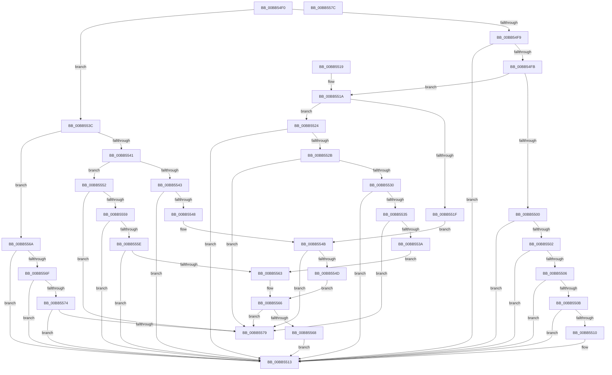

# VfPnpIsSystemRestrictedIrp

- RVA: `0x00BB54F0`–`0x00BB557D` (길이 `141` bytes)
- VA: `0x0000000140BB54F0`
- 실행 섹션: `PAGEVRFY`
- PDB 이름 있음: `예`; PDB Function 태그: `아니요`
- unwind 정보 RVA: `0x000DB714`
- 디코드: `59`개 명령, `141/141` bytes 표시
- 미해석 바이트: `0` (있으면 어셈블리에 `.byte`로 보존)

> 이 문서는 커널 이미지의 기계어와 PDB 기호를 분석해 생성했습니다. 4번과 5번은 함수 원형과 자료형을 바이너리 사용 방식에서 추정한 C 해석이며 원본 소스 복구 결과는 아닙니다.

## 1. Dependencies

- 직접 호출 지점: **0**; 고유 호출 대상: **0**
- 직접 호출자로 확인된 함수: **0**
- RIP 상대 이미지 참조: **0**

### Outgoing calls
- 직접 디코드된 call 명령이 없습니다.

### Direct callers
- 이 함수 시작 RVA로 연결되는 직접 call은 확인되지 않았습니다. 간접 호출은 완전히 역산할 수 없습니다.

### Static image references
- 디코드된 RIP-relative 메모리 참조가 없습니다.

## 2. Other-region calls and transfers

- 다른 실행 섹션으로 향하는 call: **0**
- 별도 외부 분기/꼬리 이동을 확인하지 못했습니다.

## 3. Assembly (complete function range)

```asm
00BB54F0  0F B6 51 01                     movzx edx, byte ptr [rcx + 1]
00BB54F4  83 FA 0C                        cmp edx, 0xc
00BB54F7  77 43                           ja 0x140bb553c
00BB54F9  74 18                           je 0x140bb5513
00BB54FB  83 FA 06                        cmp edx, 6
00BB54FE  77 1A                           ja 0x140bb551a
00BB5500  74 11                           je 0x140bb5513
00BB5502  85 D2                           test edx, edx
00BB5504  74 0D                           je 0x140bb5513
00BB5506  83 EA 01                        sub edx, 1
00BB5509  74 08                           je 0x140bb5513
00BB550B  83 EA 01                        sub edx, 1
00BB550E  74 03                           je 0x140bb5513
00BB5510  83 EA 01                        sub edx, 1
00BB5513  B8 01 00 00 00                  mov eax, 1
00BB5518  C3                              ret
00BB5519  CC                              int3
00BB551A  83 EA 07                        sub edx, 7
00BB551D  74 05                           je 0x140bb5524
00BB551F  83 EA 01                        sub edx, 1
00BB5522  EB 27                           jmp 0x140bb554b
00BB5524  8B 49 08                        mov ecx, dword ptr [rcx + 8]
00BB5527  85 C9                           test ecx, ecx
00BB5529  74 E8                           je 0x140bb5513
00BB552B  83 E9 01                        sub ecx, 1
00BB552E  74 49                           je 0x140bb5579
00BB5530  83 E9 01                        sub ecx, 1
00BB5533  74 DE                           je 0x140bb5513
00BB5535  83 E9 01                        sub ecx, 1
00BB5538  74 3F                           je 0x140bb5579
00BB553A  EB 27                           jmp 0x140bb5563
00BB553C  83 FA 13                        cmp edx, 0x13
00BB553F  77 29                           ja 0x140bb556a
00BB5541  74 0F                           je 0x140bb5552
00BB5543  83 EA 0D                        sub edx, 0xd
00BB5546  74 CB                           je 0x140bb5513
00BB5548  83 EA 02                        sub edx, 2
00BB554B  74 2C                           je 0x140bb5579
00BB554D  83 EA 01                        sub edx, 1
00BB5550  EB 14                           jmp 0x140bb5566
00BB5552  8B 49 08                        mov ecx, dword ptr [rcx + 8]
00BB5555  85 C9                           test ecx, ecx
00BB5557  74 20                           je 0x140bb5579
00BB5559  83 E9 01                        sub ecx, 1
00BB555C  74 B5                           je 0x140bb5513
00BB555E  83 E9 01                        sub ecx, 1
00BB5561  74 B0                           je 0x140bb5513
00BB5563  83 F9 01                        cmp ecx, 1
00BB5566  74 11                           je 0x140bb5579
00BB5568  EB A9                           jmp 0x140bb5513
00BB556A  83 EA 14                        sub edx, 0x14
00BB556D  74 A4                           je 0x140bb5513
00BB556F  83 EA 01                        sub edx, 1
00BB5572  74 9F                           je 0x140bb5513
00BB5574  83 EA 01                        sub edx, 1
00BB5577  75 9A                           jne 0x140bb5513
00BB5579  33 C0                           xor eax, eax
00BB557B  C3                              ret
00BB557C  CC                              int3
```

## 4. C-style interpretation (structured pseudocode)

```c
__int64 __fastcall VfPnpIsSystemRestrictedIrp(__int64 a1)
{
    __int64 result;

    if (((unsigned int)(*(unsigned __int8 *)(a1 + 1))) > 12) goto loc_00BB553C;
    if (((unsigned int)(*(unsigned __int8 *)(a1 + 1))) == 12) goto loc_00BB5513;
    if (((unsigned int)(*(unsigned __int8 *)(a1 + 1))) > 6) goto loc_00BB551A;
    if (((unsigned int)(*(unsigned __int8 *)(a1 + 1))) == 6) goto loc_00BB5513;
    if ((unsigned int)(*(unsigned __int8 *)(a1 + 1)) == 0) goto loc_00BB5513;
    a2 = (unsigned int)((*(unsigned __int8 *)(a1 + 1)) - (1));
    if (condition_is_equal) goto loc_00BB5513;
    a2 = (unsigned int)((a2) - (1));
    if (!(condition_is_equal)) {
        a2 = (unsigned int)((a2) - (1));
    }
    return 1;
loc_00BB551A:
    a2 = (unsigned int)((a2) - (7));
    if (condition_is_equal) goto loc_00BB5524;
    a2 = (unsigned int)((a2) - (1));
    goto loc_00BB554B;
loc_00BB5524:
    if ((unsigned int)((unsigned int)(*(unsigned int *)(a1 + 8))) == 0) goto loc_00BB5513;
    a1 = (unsigned int)(((unsigned int)(*(unsigned int *)(a1 + 8))) - (1));
    if (condition_is_equal) goto loc_00BB5579;
    a1 = (unsigned int)((a1) - (1));
    if (condition_is_equal) goto loc_00BB5513;
    a1 = (unsigned int)((a1) - (1));
    if (condition_is_equal) goto loc_00BB5579;
    goto loc_00BB5563;
loc_00BB553C:
    if (((unsigned int)(a2)) > 19) goto loc_00BB556A;
    if (((unsigned int)(a2)) == 19) goto loc_00BB5552;
    a2 = (unsigned int)((a2) - (13));
    if (condition_is_equal) goto loc_00BB5513;
    a2 = (unsigned int)((a2) - (2));
loc_00BB554B:
    if (condition_is_equal) goto loc_00BB5579;
    a2 = (unsigned int)((a2) - (1));
    goto loc_00BB5566;
loc_00BB5552:
    if ((unsigned int)((unsigned int)(*(unsigned int *)(a1 + 8))) == 0) goto loc_00BB5579;
    a1 = (unsigned int)(((unsigned int)(*(unsigned int *)(a1 + 8))) - (1));
    if (condition_is_equal) goto loc_00BB5513;
    a1 = (unsigned int)((a1) - (1));
    if (condition_is_equal) goto loc_00BB5513;
loc_00BB5563:
loc_00BB5566:
    if (((unsigned int)(a1)) == 1) goto loc_00BB5579;
    goto loc_00BB5513;
loc_00BB556A:
    a2 = (unsigned int)((a2) - (20));
    if (condition_is_equal) goto loc_00BB5513;
    a2 = (unsigned int)((a2) - (1));
    if (condition_is_equal) goto loc_00BB5513;
    a2 = (unsigned int)((a2) - (1));
    if (condition_is_not_equal) goto loc_00BB5513;
loc_00BB5579:
    result = 0;
    return result;
}
```

## 5. (Beta) C Style

```c
int64_t VfPnpIsSystemRestrictedIrp(void *Arg1)
{
    uint8_t *arg1 = (uint8_t *)Arg1;

    int64_t result;

    if (((uint32_t)(*(uint8_t *)(arg1 + 0x1))) > 12) goto loc_00BB553C;
    if (((uint32_t)(*(uint8_t *)(arg1 + 0x1))) == 12) goto loc_00BB5513;
    if (((uint32_t)(*(uint8_t *)(arg1 + 0x1))) > 6) goto loc_00BB551A;
    if (((uint32_t)(*(uint8_t *)(arg1 + 0x1))) == 6) goto loc_00BB5513;
    if ((uint32_t)(*(uint8_t *)(arg1 + 0x1)) == 0) goto loc_00BB5513;
    a2 = (uint32_t)((*(uint8_t *)(arg1 + 0x1)) - (1));
    if (condition_is_equal) goto loc_00BB5513;
    a2 = (uint32_t)((a2) - (1));
    if (!(condition_is_equal)) {
        a2 = (uint32_t)((a2) - (1));
    }
    return 1;
loc_00BB551A:
    a2 = (uint32_t)((a2) - (7));
    if (condition_is_equal) goto loc_00BB5524;
    a2 = (uint32_t)((a2) - (1));
    goto loc_00BB554B;
loc_00BB5524:
    if ((uint32_t)((uint32_t)(*(uint32_t *)(arg1 + 0x8))) == 0) goto loc_00BB5513;
    Arg1 = (uint32_t)(((uint32_t)(*(uint32_t *)(arg1 + 0x8))) - (1));
    if (condition_is_equal) goto loc_00BB5579;
    Arg1 = (uint32_t)((Arg1) - (1));
    if (condition_is_equal) goto loc_00BB5513;
    Arg1 = (uint32_t)((Arg1) - (1));
    if (condition_is_equal) goto loc_00BB5579;
    goto loc_00BB5563;
loc_00BB553C:
    if (((uint32_t)(a2)) > 19) goto loc_00BB556A;
    if (((uint32_t)(a2)) == 19) goto loc_00BB5552;
    a2 = (uint32_t)((a2) - (13));
    if (condition_is_equal) goto loc_00BB5513;
    a2 = (uint32_t)((a2) - (2));
loc_00BB554B:
    if (condition_is_equal) goto loc_00BB5579;
    a2 = (uint32_t)((a2) - (1));
    goto loc_00BB5566;
loc_00BB5552:
    if ((uint32_t)((uint32_t)(*(uint32_t *)(arg1 + 0x8))) == 0) goto loc_00BB5579;
    Arg1 = (uint32_t)(((uint32_t)(*(uint32_t *)(arg1 + 0x8))) - (1));
    if (condition_is_equal) goto loc_00BB5513;
    Arg1 = (uint32_t)((Arg1) - (1));
    if (condition_is_equal) goto loc_00BB5513;
loc_00BB5563:
loc_00BB5566:
    if (((uint32_t)(Arg1)) == 1) goto loc_00BB5579;
    goto loc_00BB5513;
loc_00BB556A:
    a2 = (uint32_t)((a2) - (20));
    if (condition_is_equal) goto loc_00BB5513;
    a2 = (uint32_t)((a2) - (1));
    if (condition_is_equal) goto loc_00BB5513;
    a2 = (uint32_t)((a2) - (1));
    if (condition_is_not_equal) goto loc_00BB5513;
loc_00BB5579:
    result = 0;
    return result;
}
```

### 관측된 메모리 오프셋

구조체 형식이 확인되지 않은 접근은 인자 기준의 오프셋으로만 기록했습니다.

| 기준 인자 | 오프셋 표현 | 폭 (bit) | 접근 |
|---|---:|---:|---|
| `Arg1` | `+ 0x1` | `8` | `R` |
| `Arg1` | `+ 0x8` | `32` | `R` |

## 6. Execution-region graph

[열기: 2D/3D 그래프와 함수 탐색 컨트롤 패널](../../../control-panel.html?section=pagevrfy&rva=0x00BB54F0&view=graph)

- 2D 그래프는 위에서 아래로 흐르고, 3D 그래프는 빈 공간을 드래그해 회전합니다. Shift+드래그는 이동, 휠은 확대·축소, 함수 노드 선택은 대상 보고서 이동입니다.

### Static fallback


