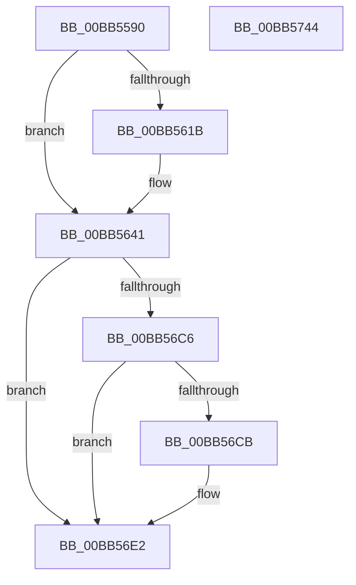

# VfPnpTestStartedPdoStack

- RVA: `0x00BB5590`–`0x00BB5745` (길이 `437` bytes)
- VA: `0x0000000140BB5590`
- 실행 섹션: `PAGEVRFY`
- PDB 이름 있음: `예`; PDB Function 태그: `아니요`
- unwind 정보 RVA: `0x000CEEA4`
- 디코드: `112`개 명령, `437/437` bytes 표시
- 미해석 바이트: `0` (있으면 어셈블리에 `.byte`로 보존)

> 이 문서는 커널 이미지의 기계어와 PDB 기호를 분석해 생성했습니다. 4번과 5번은 함수 원형과 자료형을 바이너리 사용 방식에서 추정한 C 해석이며 원본 소스 복구 결과는 아닙니다.

## 1. Dependencies

- 직접 호출 지점: **10**; 고유 호출 대상: **4**
- 직접 호출자로 확인된 함수: **0**
- RIP 상대 이미지 참조: **2**

### Outgoing calls
- `0x00BB55BA` → [memset](../../text/6C/memset_function_006C6C40.md) (function, `0x006C6C40`)
- `0x00BB55E2` → [VfIrpSendSynchronousIrp](../B9/VfIrpSendSynchronousIrp_function_00B9DEF0.md) (function, `0x00B9DEF0`)
- `0x00BB560C` → [VfIrpSendSynchronousIrp](../B9/VfIrpSendSynchronousIrp_function_00B9DEF0.md) (function, `0x00B9DEF0`)
- `0x00BB563C` → [VfIrpSendSynchronousIrp](../B9/VfIrpSendSynchronousIrp_function_00B9DEF0.md) (function, `0x00B9DEF0`)
- `0x00BB5662` → [VfIrpSendSynchronousIrp](../B9/VfIrpSendSynchronousIrp_function_00B9DEF0.md) (function, `0x00B9DEF0`)
- `0x00BB5688` → [VfIrpSendSynchronousIrp](../B9/VfIrpSendSynchronousIrp_function_00B9DEF0.md) (function, `0x00B9DEF0`)
- `0x00BB56BD` → [VfIrpSendSynchronousIrp](../B9/VfIrpSendSynchronousIrp_function_00B9DEF0.md) (function, `0x00B9DEF0`)
- `0x00BB56D3` → [ObfDereferenceObject](../../text/2F/ObfDereferenceObject_function_002F9350.md) (function, `0x002F9350`)
- `0x00BB56DD` → [ExFreePoolWithTag](../../poolcode/B8/ExFreePoolWithTag_function_00B82870.md) (function, `0x00B82870`)
- `0x00BB5728` → [VfIrpSendSynchronousIrp](../B9/VfIrpSendSynchronousIrp_function_00B9DEF0.md) (function, `0x00B9DEF0`)

### Direct callers
- 이 함수 시작 RVA로 연결되는 직접 call은 확인되지 않았습니다. 간접 호출은 완전히 역산할 수 없습니다.

### Static image references
- `0x00BB5611` → RVA `0x00F04A20` (`.data`; read)
- `0x00BB56EA` → RVA `0x00B8C0C8` (`GUID_BOGUS_INTERFACE`; read)

## 2. Other-region calls and transfers

- 다른 실행 섹션으로 향하는 call: **3**
  - `0x00BB55BA` → [memset](../../text/6C/memset_function_006C6C40.md) (`PAGEVRFY` → `.text`)
  - `0x00BB56D3` → [ObfDereferenceObject](../../text/2F/ObfDereferenceObject_function_002F9350.md) (`PAGEVRFY` → `.text`)
  - `0x00BB56DD` → [ExFreePoolWithTag](../../poolcode/B8/ExFreePoolWithTag_function_00B82870.md) (`PAGEVRFY` → `POOLCODE`)
- 별도 외부 분기/꼬리 이동을 확인하지 못했습니다.

## 3. Assembly (complete function range)

```asm
00BB5590  48 89 5C 24 08                  mov qword ptr [rsp + 8], rbx
00BB5595  55                              push rbp
00BB5596  56                              push rsi
00BB5597  57                              push rdi
00BB5598  41 56                           push r14
00BB559A  41 57                           push r15
00BB559C  48 8D 6C 24 C9                  lea rbp, [rsp - 0x37]
00BB55A1  48 81 EC B0 00 00 00            sub rsp, 0xb0
00BB55A8  33 F6                           xor esi, esi
00BB55AA  48 8B F9                        mov rdi, rcx
00BB55AD  33 D2                           xor edx, edx
00BB55AF  89 75 6F                        mov dword ptr [rbp + 0x6f], esi
00BB55B2  48 8D 4D E7                     lea rcx, [rbp - 0x19]
00BB55B6  44 8D 46 48                     lea r8d, [rsi + 0x48]
00BB55BA  E8 81 16 B1 FF                  call 0x1406c6c40
00BB55BF  48 89 74 24 30                  mov qword ptr [rsp + 0x30], rsi
00BB55C4  44 8D 76 01                     lea r14d, [rsi + 1]
00BB55C8  45 8B C6                        mov r8d, r14d
00BB55CB  48 89 74 24 28                  mov qword ptr [rsp + 0x28], rsi
00BB55D0  48 8D 55 E7                     lea rdx, [rbp - 0x19]
00BB55D4  66 C7 45 E7 1B FF               mov word ptr [rbp - 0x19], 0xff1b
00BB55DA  48 8B CF                        mov rcx, rdi
00BB55DD  48 89 74 24 20                  mov qword ptr [rsp + 0x20], rsi
00BB55E2  E8 09 89 FE FF                  call 0x140b9def0
00BB55E7  48 89 74 24 30                  mov qword ptr [rsp + 0x30], rsi
00BB55EC  48 8D 55 E7                     lea rdx, [rbp - 0x19]
00BB55F0  49 83 CF FF                     or r15, 0xffffffffffffffff
00BB55F4  48 89 74 24 28                  mov qword ptr [rsp + 0x28], rsi
00BB55F9  45 8B C6                        mov r8d, r14d
00BB55FC  44 89 7D EF                     mov dword ptr [rbp - 0x11], r15d
00BB5600  48 8B CF                        mov rcx, rdi
00BB5603  48 89 74 24 20                  mov qword ptr [rsp + 0x20], rsi
00BB5608  C6 45 E8 07                     mov byte ptr [rbp - 0x18], 7
00BB560C  E8 DF 88 FE FF                  call 0x140b9def0
00BB5611  8B 05 09 F4 34 00               mov eax, dword ptr [rip + 0x34f409]
00BB5617  A8 10                           test al, 0x10
00BB5619  74 26                           je 0x140bb5641
00BB561B  48 89 74 24 30                  mov qword ptr [rsp + 0x30], rsi
00BB5620  48 8D 55 E7                     lea rdx, [rbp - 0x19]
00BB5624  48 89 74 24 28                  mov qword ptr [rsp + 0x28], rsi
00BB5629  45 8B C6                        mov r8d, r14d
00BB562C  48 8B CF                        mov rcx, rdi
00BB562F  4C 89 7C 24 20                  mov qword ptr [rsp + 0x20], r15
00BB5634  C6 45 E8 07                     mov byte ptr [rbp - 0x18], 7
00BB5638  44 89 7D EF                     mov dword ptr [rbp - 0x11], r15d
00BB563C  E8 AF 88 FE FF                  call 0x140b9def0
00BB5641  48 89 74 24 30                  mov qword ptr [rsp + 0x30], rsi
00BB5646  48 8D 55 E7                     lea rdx, [rbp - 0x19]
00BB564A  48 89 74 24 28                  mov qword ptr [rsp + 0x28], rsi
00BB564F  45 8B C6                        mov r8d, r14d
00BB5652  48 8B CF                        mov rcx, rdi
00BB5655  48 89 74 24 20                  mov qword ptr [rsp + 0x20], rsi
00BB565A  C6 45 E8 0C                     mov byte ptr [rbp - 0x18], 0xc
00BB565E  44 89 7D EF                     mov dword ptr [rbp - 0x11], r15d
00BB5662  E8 89 88 FE FF                  call 0x140b9def0
00BB5667  48 89 74 24 30                  mov qword ptr [rsp + 0x30], rsi
00BB566C  48 8D 55 E7                     lea rdx, [rbp - 0x19]
00BB5670  48 89 74 24 28                  mov qword ptr [rsp + 0x28], rsi
00BB5675  45 8B C6                        mov r8d, r14d
00BB5678  48 8B CF                        mov rcx, rdi
00BB567B  48 89 74 24 20                  mov qword ptr [rsp + 0x20], rsi
00BB5680  C6 45 E8 13                     mov byte ptr [rbp - 0x18], 0x13
00BB5684  44 89 7D EF                     mov dword ptr [rbp - 0x11], r15d
00BB5688  E8 63 88 FE FF                  call 0x140b9def0
00BB568D  48 8D 45 6F                     lea rax, [rbp + 0x6f]
00BB5691  C6 45 E8 07                     mov byte ptr [rbp - 0x18], 7
00BB5695  48 89 44 24 30                  mov qword ptr [rsp + 0x30], rax
00BB569A  48 8D 55 E7                     lea rdx, [rbp - 0x19]
00BB569E  48 8D 45 77                     lea rax, [rbp + 0x77]
00BB56A2  C7 45 EF 04 00 00 00            mov dword ptr [rbp - 0x11], 4
00BB56A9  48 89 44 24 28                  mov qword ptr [rsp + 0x28], rax
00BB56AE  45 33 C0                        xor r8d, r8d
00BB56B1  48 8B CF                        mov rcx, rdi
00BB56B4  48 89 74 24 20                  mov qword ptr [rsp + 0x20], rsi
00BB56B9  48 89 75 77                     mov qword ptr [rbp + 0x77], rsi
00BB56BD  E8 2E 88 FE FF                  call 0x140b9def0
00BB56C2  85 C0                           test eax, eax
00BB56C4  74 1C                           je 0x140bb56e2
00BB56C6  39 75 6F                        cmp dword ptr [rbp + 0x6f], esi
00BB56C9  7C 17                           jl 0x140bb56e2
00BB56CB  48 8B 5D 77                     mov rbx, qword ptr [rbp + 0x77]
00BB56CF  48 8B 4B 08                     mov rcx, qword ptr [rbx + 8]
00BB56D3  E8 78 3C 74 FF                  call 0x1402f9350
00BB56D8  33 D2                           xor edx, edx
00BB56DA  48 8B CB                        mov rcx, rbx
00BB56DD  E8 8E D1 FC FF                  call 0x140b82870
00BB56E2  0F 57 C0                        xorps xmm0, xmm0
00BB56E5  48 89 74 24 30                  mov qword ptr [rsp + 0x30], rsi
00BB56EA  48 8D 05 D7 69 FD FF            lea rax, [rip - 0x29629]
00BB56F1  48 89 74 24 28                  mov qword ptr [rsp + 0x28], rsi
00BB56F6  48 89 45 EF                     mov qword ptr [rbp - 0x11], rax
00BB56FA  48 8D 55 E7                     lea rdx, [rbp - 0x19]
00BB56FE  48 8D 45 C7                     lea rax, [rbp - 0x39]
00BB5702  C6 45 E8 08                     mov byte ptr [rbp - 0x18], 8
00BB5706  45 8B C6                        mov r8d, r14d
00BB5709  48 89 45 FF                     mov qword ptr [rbp - 1], rax
00BB570D  48 8B CF                        mov rcx, rdi
00BB5710  C7 45 F7 FF FF 01 00            mov dword ptr [rbp - 9], 0x1ffff
00BB5717  0F 11 45 C7                     movups xmmword ptr [rbp - 0x39], xmm0
00BB571B  4C 89 7D 07                     mov qword ptr [rbp + 7], r15
00BB571F  0F 11 45 D7                     movups xmmword ptr [rbp - 0x29], xmm0
00BB5723  48 89 74 24 20                  mov qword ptr [rsp + 0x20], rsi
00BB5728  E8 C3 87 FE FF                  call 0x140b9def0
00BB572D  48 8B 9C 24 E0 00 00 00         mov rbx, qword ptr [rsp + 0xe0]
00BB5735  48 81 C4 B0 00 00 00            add rsp, 0xb0
00BB573C  41 5F                           pop r15
00BB573E  41 5E                           pop r14
00BB5740  5F                              pop rdi
00BB5741  5E                              pop rsi
00BB5742  5D                              pop rbp
00BB5743  C3                              ret
00BB5744  CC                              int3
```

## 4. C-style interpretation (structured pseudocode)

```c
__int64 __fastcall VfPnpTestStartedPdoStack(__int64 a1, int a2)
{
    __int64 result;
    __int64 v_r15;
    __int64 v_rbx;
    __int64 v_rsi;
    __int64 v_rsp;
    unsigned __int64 v_stack_m58;
    unsigned __int64 v_stack_m5F;
    unsigned __int64 v_stack_m60;
    unsigned int v_stack_m68;
    unsigned int v_stack_m70;
    unsigned __int8 v_stack_m77;
    unsigned __int64 v_stack_m78;
    unsigned __int64 v_stack_m88;
    unsigned __int64 v_stack_m98;
    unsigned __int64 v_stack_mA8;
    unsigned __int64 v_stack_mB0;
    unsigned __int64 v_stack_mB8;
    unsigned int v_stack_p10;
    unsigned __int64 v_stack_p18;
    unsigned __int64 v_stack_p8;

    v_stack_p8 = v_rbx;
    v_rsp = (v_rsp) - (176);
    v_rsi = 0;
    a2 = 0;
    v_stack_p10 = 0;
    result = memset(v_stack_m78, a2, v_rsi + 72, a4);
    v_stack_mA8 = 0;
    v_stack_mB0 = 0;
    v_stack_m78 = 0xFF1BULL;
    v_stack_mB8 = 0;
    result = VfIrpSendSynchronousIrp(a1, v_stack_m78, (unsigned int)((unsigned int)(v_rsi + 1)), a4);
    v_stack_mA8 = 0;
    v_r15 = (v_r15) | (-1);
    v_stack_mB0 = 0;
    v_stack_m70 = (unsigned int)(v_r15);
    v_stack_mB8 = 0;
    v_stack_m77 = 7;
    result = VfIrpSendSynchronousIrp(a1, v_stack_m78, (unsigned int)((unsigned int)(v_rsi + 1)), a4);
    result = (unsigned int)(*(unsigned int *)(v_rip + 3470345));
    if ((((unsigned __int8)((unsigned int)(*(unsigned int *)(v_rip + 3470345)))) & (16)) != 0) {
        v_stack_mA8 = 0;
        a2 = v_stack_m78;
        v_stack_mB0 = 0;
        a3 = (unsigned int)(v_rsi + 1);
        a1 = a1;
        v_stack_mB8 = v_r15;
        v_stack_m77 = 7;
        v_stack_m70 = (unsigned int)(v_r15);
        result = VfIrpSendSynchronousIrp(a1, a2, a3, a4);
    }
    v_stack_mA8 = 0;
    v_stack_mB0 = 0;
    v_stack_mB8 = 0;
    v_stack_m77 = 12;
    v_stack_m70 = (unsigned int)(v_r15);
    result = VfIrpSendSynchronousIrp(a1, v_stack_m78, (unsigned int)((unsigned int)(v_rsi + 1)), a4);
    v_stack_mA8 = 0;
    v_stack_mB0 = 0;
    v_stack_mB8 = 0;
    v_stack_m77 = 19;
    v_stack_m70 = (unsigned int)(v_r15);
    result = VfIrpSendSynchronousIrp(a1, v_stack_m78, (unsigned int)((unsigned int)(v_rsi + 1)), a4);
    v_stack_m77 = 7;
    v_stack_mA8 = v_stack_p10;
    v_stack_m70 = 4;
    v_stack_mB0 = v_stack_p18;
    a3 = 0;
    v_stack_mB8 = 0;
    v_stack_p18 = 0;
    result = VfIrpSendSynchronousIrp(a1, v_stack_m78, a3, a4);
    if ((unsigned int)(result) == 0) goto loc_00BB56E2;
    if (v_stack_p10 >= 0) {
        v_rbx = v_stack_p18;
        a1 = *(unsigned __int64 *)(v_rbx + 8);
        result = ObfDereferenceObject(a1, v_stack_m78, a3, a4);
        a2 = 0;
        a1 = v_rbx;
        result = ExFreePoolWithTag(a1, a2, a3, a4);
    }
    v_stack_mA8 = 0;
    v_stack_mB0 = 0;
    v_stack_m70 = v_rip - 169513;
    v_stack_m77 = 8;
    v_stack_m60 = v_stack_m98;
    v_stack_m68 = 0x1FFFFULL;
    v_stack_m98 = v_xmm0;
    v_stack_m58 = v_r15;
    v_stack_m88 = v_xmm0;
    v_stack_mB8 = 0;
    result = VfIrpSendSynchronousIrp(a1, v_stack_m78, (unsigned int)((unsigned int)(v_rsi + 1)), a4);
    v_rsp = (v_rsp) + (176);
    return result;
}
```

## 5. (Beta) C Style

```c
int64_t VfPnpTestStartedPdoStack(int64_t Arg1, int32_t Arg2)
{
    int64_t result;
    int64_t local_r15;
    int64_t local_rbx;
    int64_t local_rsi;
    int64_t local_rsp;
    uint64_t v_stack_m58;
    uint64_t v_stack_m5F;
    uint64_t v_stack_m60;
    uint32_t v_stack_m68;
    uint32_t v_stack_m70;
    uint8_t v_stack_m77;
    uint64_t v_stack_m78;
    uint64_t v_stack_m88;
    uint64_t v_stack_m98;
    uint64_t v_stack_mA8;
    uint64_t v_stack_mB0;
    uint64_t v_stack_mB8;
    uint32_t v_stack_p10;
    uint64_t v_stack_p18;
    uint64_t v_stack_p8;

    v_stack_p8 = local_rbx;
    local_rsp = (local_rsp) - (176);
    local_rsi = 0;
    Arg2 = 0;
    v_stack_p10 = 0;
    result = memset(v_stack_m78, Arg2, local_rsi + 72, a4);
    v_stack_mA8 = 0;
    v_stack_mB0 = 0;
    v_stack_m78 = 0xFF1BULL;
    v_stack_mB8 = 0;
    result = VfIrpSendSynchronousIrp(Arg1, v_stack_m78, (uint32_t)((uint32_t)(local_rsi + 1)), a4);
    v_stack_mA8 = 0;
    local_r15 = (local_r15) | (-1);
    v_stack_mB0 = 0;
    v_stack_m70 = (uint32_t)(local_r15);
    v_stack_mB8 = 0;
    v_stack_m77 = 7;
    result = VfIrpSendSynchronousIrp(Arg1, v_stack_m78, (uint32_t)((uint32_t)(local_rsi + 1)), a4);
    result = (uint32_t)(*(uint32_t *)(v_rip + 0x34F409));
    if ((((uint8_t)((uint32_t)(*(uint32_t *)(v_rip + 0x34F409)))) & (16)) != 0) {
        v_stack_mA8 = 0;
        Arg2 = v_stack_m78;
        v_stack_mB0 = 0;
        a3 = (uint32_t)(local_rsi + 1);
        Arg1 = Arg1;
        v_stack_mB8 = local_r15;
        v_stack_m77 = 7;
        v_stack_m70 = (uint32_t)(local_r15);
        result = VfIrpSendSynchronousIrp(Arg1, Arg2, a3, a4);
    }
    v_stack_mA8 = 0;
    v_stack_mB0 = 0;
    v_stack_mB8 = 0;
    v_stack_m77 = 12;
    v_stack_m70 = (uint32_t)(local_r15);
    result = VfIrpSendSynchronousIrp(Arg1, v_stack_m78, (uint32_t)((uint32_t)(local_rsi + 1)), a4);
    v_stack_mA8 = 0;
    v_stack_mB0 = 0;
    v_stack_mB8 = 0;
    v_stack_m77 = 19;
    v_stack_m70 = (uint32_t)(local_r15);
    result = VfIrpSendSynchronousIrp(Arg1, v_stack_m78, (uint32_t)((uint32_t)(local_rsi + 1)), a4);
    v_stack_m77 = 7;
    v_stack_mA8 = v_stack_p10;
    v_stack_m70 = 4;
    v_stack_mB0 = v_stack_p18;
    a3 = 0;
    v_stack_mB8 = 0;
    v_stack_p18 = 0;
    result = VfIrpSendSynchronousIrp(Arg1, v_stack_m78, a3, a4);
    if ((uint32_t)(result) == 0) goto loc_00BB56E2;
    if (v_stack_p10 >= 0) {
        local_rbx = v_stack_p18;
        Arg1 = *(uint64_t *)(local_rbx + 0x8);
        result = ObfDereferenceObject(Arg1, v_stack_m78, a3, a4);
        Arg2 = 0;
        Arg1 = local_rbx;
        result = ExFreePoolWithTag(Arg1, Arg2, a3, a4);
    }
    v_stack_mA8 = 0;
    v_stack_mB0 = 0;
    v_stack_m70 = v_rip - 169513;
    v_stack_m77 = 8;
    v_stack_m60 = v_stack_m98;
    v_stack_m68 = 0x1FFFFULL;
    v_stack_m98 = v_xmm0;
    v_stack_m58 = local_r15;
    v_stack_m88 = v_xmm0;
    v_stack_mB8 = 0;
    result = VfIrpSendSynchronousIrp(Arg1, v_stack_m78, (uint32_t)((uint32_t)(local_rsi + 1)), a4);
    local_rsp = (local_rsp) + (176);
    return result;
}
```

## 6. Execution-region graph

[열기: 2D/3D 그래프와 함수 탐색 컨트롤 패널](../../../control-panel.html?section=pagevrfy&rva=0x00BB5590&view=graph)

- 2D 그래프는 위에서 아래로 흐르고, 3D 그래프는 빈 공간을 드래그해 회전합니다. Shift+드래그는 이동, 휠은 확대·축소, 함수 노드 선택은 대상 보고서 이동입니다.

### Static fallback


