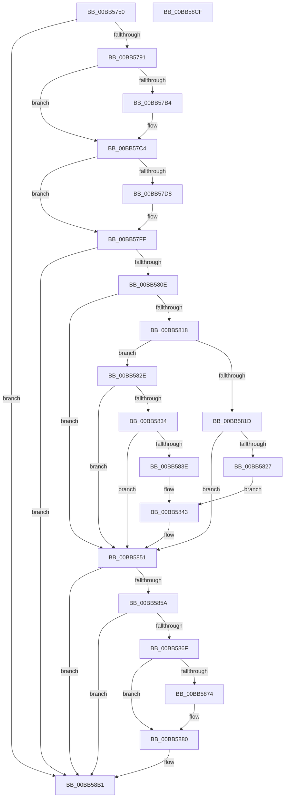

# VfPnpVerifyIrpStackDownward

- RVA: `0x00BB5750`–`0x00BB58D0` (길이 `384` bytes)
- VA: `0x0000000140BB5750`
- 실행 섹션: `PAGEVRFY`
- PDB 이름 있음: `예`; PDB Function 태그: `아니요`
- unwind 정보 RVA: `0x000A4080`
- 디코드: `103`개 명령, `384/384` bytes 표시
- 미해석 바이트: `0` (있으면 어셈블리에 `.byte`로 보존)

> 이 문서는 커널 이미지의 기계어와 PDB 기호를 분석해 생성했습니다. 4번과 5번은 함수 원형과 자료형을 바이너리 사용 방식에서 추정한 C 해석이며 원본 소스 복구 결과는 아닙니다.

## 1. Dependencies

- 직접 호출 지점: **8**; 고유 호출 대상: **5**
- 직접 호출자로 확인된 함수: **0**
- RIP 상대 이미지 참조: **1**

### Outgoing calls
- `0x00BB5784` → [IovUtilIsWdmStack](../BA/IovUtilIsWdmStack_function_00BA2C68.md) (function, `0x00BA2C68`)
- `0x00BB57BF` → [ViErrorReport1](../../text/61/ViErrorReport1_function_00614584.md) (function, `0x00614584`)
- `0x00BB57DD` → [VfGetPristineDriverInit](../B9/VfGetPristineDriverInit_function_00B9D8CC.md) (function, `0x00B9D8CC`)
- `0x00BB57ED` → [ViErrorReport1](../../text/61/ViErrorReport1_function_00614584.md) (function, `0x00614584`)
- `0x00BB5849` → [ViErrorReport1](../../text/61/ViErrorReport1_function_00614584.md) (function, `0x00614584`)
- `0x00BB5866` → [IovUtilIsDeviceObjectMarked](../BA/IovUtilIsDeviceObjectMarked_function_00BA2B34.md) (function, `0x00BA2B34`)
- `0x00BB5888` → [IovUtilIsDeviceObjectMarked](../BA/IovUtilIsDeviceObjectMarked_function_00BA2B34.md) (function, `0x00BA2B34`)
- `0x00BB58AC` → [ViPnpVerifyMinorWasProcessedProperly](ViPnpVerifyMinorWasProcessedProperly_function_00BB5BC0.md) (function, `0x00BB5BC0`)

### Direct callers
- 이 함수 시작 RVA로 연결되는 직접 call은 확인되지 않았습니다. 간접 호출은 완전히 역산할 수 없습니다.

### Static image references
- `0x00BB57C8` → RVA `0x0029B590` (`IopInvalidDeviceRequest`; read)

## 2. Other-region calls and transfers

- 다른 실행 섹션으로 향하는 call: **3**
  - `0x00BB57BF` → [ViErrorReport1](../../text/61/ViErrorReport1_function_00614584.md) (`PAGEVRFY` → `.text`)
  - `0x00BB57ED` → [ViErrorReport1](../../text/61/ViErrorReport1_function_00614584.md) (`PAGEVRFY` → `.text`)
  - `0x00BB5849` → [ViErrorReport1](../../text/61/ViErrorReport1_function_00614584.md) (`PAGEVRFY` → `.text`)
- 별도 외부 분기/꼬리 이동을 확인하지 못했습니다.

## 3. Assembly (complete function range)

```asm
00BB5750  48 8B C4                        mov rax, rsp
00BB5753  48 89 58 08                     mov qword ptr [rax + 8], rbx
00BB5757  48 89 68 10                     mov qword ptr [rax + 0x10], rbp
00BB575B  48 89 70 20                     mov qword ptr [rax + 0x20], rsi
00BB575F  4C 89 40 18                     mov qword ptr [rax + 0x18], r8
00BB5763  57                              push rdi
00BB5764  41 54                           push r12
00BB5766  41 55                           push r13
00BB5768  41 56                           push r14
00BB576A  41 57                           push r15
00BB576C  48 83 EC 40                     sub rsp, 0x40
00BB5770  48 8B 9C 24 90 00 00 00         mov rbx, qword ptr [rsp + 0x90]
00BB5778  48 8B F9                        mov rdi, rcx
00BB577B  48 8B CA                        mov rcx, rdx
00BB577E  4D 8B E1                        mov r12, r9
00BB5781  4C 8B FA                        mov r15, rdx
00BB5784  E8 DF D4 FE FF                  call 0x140ba2c68
00BB5789  85 C0                           test eax, eax
00BB578B  0F 84 20 01 00 00               je 0x140bb58b1
00BB5791  4C 8B AF F0 00 00 00            mov r13, qword ptr [rdi + 0xf0]
00BB5798  48 8B 37                        mov rsi, qword ptr [rdi]
00BB579B  8B 43 60                        mov eax, dword ptr [rbx + 0x60]
00BB579E  4C 8B B4 24 A0 00 00 00         mov r14, qword ptr [rsp + 0xa0]
00BB57A6  41 83 7D 38 03                  cmp dword ptr [r13 + 0x38], 3
00BB57AB  8B 6E 30                        mov ebp, dword ptr [rsi + 0x30]
00BB57AE  89 44 24 30                     mov dword ptr [rsp + 0x30], eax
00BB57B2  75 10                           jne 0x140bb57c4
00BB57B4  4C 8B C6                        mov r8, rsi
00BB57B7  49 8B D6                        mov rdx, r14
00BB57BA  B9 11 02 00 00                  mov ecx, 0x211
00BB57BF  E8 C0 ED A5 FF                  call 0x140614584
00BB57C4  49 8B 4F 08                     mov rcx, qword ptr [r15 + 8]
00BB57C8  48 8D 05 C1 5D 6E FF            lea rax, [rip - 0x91a23f]
00BB57CF  48 39 81 48 01 00 00            cmp qword ptr [rcx + 0x148], rax
00BB57D6  75 27                           jne 0x140bb57ff
00BB57D8  0F BA 6B 04 18                  bts dword ptr [rbx + 4], 0x18
00BB57DD  E8 EA 80 FE FF                  call 0x140b9d8cc
00BB57E2  4C 8B C6                        mov r8, rsi
00BB57E5  48 8B D0                        mov rdx, rax
00BB57E8  B9 1F 02 00 00                  mov ecx, 0x21f
00BB57ED  E8 92 ED A5 FF                  call 0x140614584
00BB57F2  48 8B 84 24 98 00 00 00         mov rax, qword ptr [rsp + 0x98]
00BB57FA  0F BA 68 04 1F                  bts dword ptr [rax + 4], 0x1f
00BB57FF  48 83 BC 24 80 00 00 00 00      cmp qword ptr [rsp + 0x80], 0
00BB5808  0F 84 A3 00 00 00               je 0x140bb58b1
00BB580E  41 BF BB 00 00 C0               mov r15d, 0xc00000bb
00BB5814  85 ED                           test ebp, ebp
00BB5816  79 39                           jns 0x140bb5851
00BB5818  41 3B EF                        cmp ebp, r15d
00BB581B  74 11                           je 0x140bb582e
00BB581D  BF 00 00 00 02                  mov edi, 0x2000000
00BB5822  85 7B 04                        test dword ptr [rbx + 4], edi
00BB5825  75 2A                           jne 0x140bb5851
00BB5827  B9 15 02 00 00                  mov ecx, 0x215
00BB582C  EB 15                           jmp 0x140bb5843
00BB582E  3B 6C 24 30                     cmp ebp, dword ptr [rsp + 0x30]
00BB5832  74 1D                           je 0x140bb5851
00BB5834  BF 00 00 00 02                  mov edi, 0x2000000
00BB5839  85 7B 04                        test dword ptr [rbx + 4], edi
00BB583C  75 13                           jne 0x140bb5851
00BB583E  B9 16 02 00 00                  mov ecx, 0x216
00BB5843  4C 8B C6                        mov r8, rsi
00BB5846  49 8B D6                        mov rdx, r14
00BB5849  E8 36 ED A5 FF                  call 0x140614584
00BB584E  09 7B 04                        or dword ptr [rbx + 4], edi
00BB5851  4D 8B 45 30                     mov r8, qword ptr [r13 + 0x30]
00BB5855  4D 85 C0                        test r8, r8
00BB5858  74 57                           je 0x140bb58b1
00BB585A  41 B9 02 00 00 00               mov r9d, 2
00BB5860  49 8B C8                        mov rcx, r8
00BB5863  41 8B D1                        mov edx, r9d
00BB5866  E8 C9 D2 FE FF                  call 0x140ba2b34
00BB586B  85 C0                           test eax, eax
00BB586D  74 42                           je 0x140bb58b1
00BB586F  41 3B EF                        cmp ebp, r15d
00BB5872  75 0C                           jne 0x140bb5880
00BB5874  45 33 C9                        xor r9d, r9d
00BB5877  4D 39 4C 24 38                  cmp qword ptr [r12 + 0x38], r9
00BB587C  41 0F 95 C1                     setne r9b
00BB5880  BA 03 00 00 00                  mov edx, 3
00BB5885  49 8B C8                        mov rcx, r8
00BB5888  E8 A7 D2 FE FF                  call 0x140ba2b34
00BB588D  F7 D8                           neg eax
00BB588F  C7 44 24 28 01 00 00 00         mov dword ptr [rsp + 0x28], 1
00BB5897  49 8B D4                        mov rdx, r12
00BB589A  4C 89 74 24 20                  mov qword ptr [rsp + 0x20], r14
00BB589F  45 1B C0                        sbb r8d, r8d
00BB58A2  48 8B CE                        mov rcx, rsi
00BB58A5  41 F7 D0                        not r8d
00BB58A8  41 83 E0 04                     and r8d, 4
00BB58AC  E8 0F 03 00 00                  call 0x140bb5bc0
00BB58B1  4C 8D 5C 24 40                  lea r11, [rsp + 0x40]
00BB58B6  49 8B 5B 30                     mov rbx, qword ptr [r11 + 0x30]
00BB58BA  49 8B 6B 38                     mov rbp, qword ptr [r11 + 0x38]
00BB58BE  49 8B 73 48                     mov rsi, qword ptr [r11 + 0x48]
00BB58C2  49 8B E3                        mov rsp, r11
00BB58C5  41 5F                           pop r15
00BB58C7  41 5E                           pop r14
00BB58C9  41 5D                           pop r13
00BB58CB  41 5C                           pop r12
00BB58CD  5F                              pop rdi
00BB58CE  C3                              ret
00BB58CF  CC                              int3
```

## 4. C-style interpretation (structured pseudocode)

```c
__int64 __fastcall VfPnpVerifyIrpStackDownward(__int64 a1, __int64 a2, __int64 a3, __int64 a4, __int64 a5, __int64 a6, __int64 a7)
{
    __int64 result;
    __int64 v_rsp;
    unsigned __int64 v_stack_m28;
    unsigned int v_stack_m38;
    unsigned int v_stack_m40;
    unsigned __int64 v_stack_m48;
    unsigned __int64 v_stack_p18;

    *(unsigned __int64 *)(v_rsp + 8) = v_rbx;
    *(unsigned __int64 *)(v_rsp + 16) = v_rbp;
    *(unsigned __int64 *)(v_rsp + 32) = v_rsi;
    *(unsigned __int64 *)(v_rsp + 24) = a3;
    v_rsp = (v_rsp) - (64);
    result = IovUtilIsWdmStack(a2, a2, a3, a4);
    if ((unsigned int)(result) == 0) goto loc_00BB58B1;
    v_stack_m38 = (unsigned int)((unsigned int)(*(unsigned int *)(a5 + 96)));
    result = (unsigned int)(*(unsigned int *)(a5 + 96));
    if ((*(unsigned int *)(*(unsigned __int64 *)(a1 + 240) + 56)) == 3) {
        a3 = *(unsigned __int64 *)(a1);
        a2 = a7;
        a1 = 529;
        result = ViErrorReport1(a1, a2, a3, a4);
    }
    result = v_rip - 9544255;
    if ((*(unsigned __int64 *)(*(unsigned __int64 *)(a2 + 8) + 328)) == (v_rip - 9544255)) {
        result = VfGetPristineDriverInit(*(unsigned __int64 *)(a2 + 8), a2, a3, a4);
        a3 = *(unsigned __int64 *)(a1);
        a2 = result;
        a1 = 543;
        result = ViErrorReport1(a1, a2, a3, a4);
        result = a6;
    }
    if (v_stack_p18 == 0) goto loc_00BB58B1;
    if (!sign_flag) goto loc_00BB5851;
    if (((unsigned int)((unsigned int)(*(unsigned int *)(*(unsigned __int64 *)(a1) + 48)))) == ((unsigned int)((unsigned int)(0xC00000BBULL)))) goto loc_00BB582E;
    if (((*(unsigned int *)(a5 + 4)) & ((unsigned int)((unsigned int)(0x2000000ULL)))) != 0) goto loc_00BB5851;
    goto loc_00BB5843;
loc_00BB582E:
    if (((unsigned int)((unsigned int)(*(unsigned int *)(*(unsigned __int64 *)(a1) + 48)))) == v_stack_m38) goto loc_00BB5851;
    if (((*(unsigned int *)(a5 + 4)) & ((unsigned int)((unsigned int)(0x2000000ULL)))) != 0) goto loc_00BB5851;
loc_00BB5843:
    result = ViErrorReport1(534, a7, *(unsigned __int64 *)(a1), a4);
loc_00BB5851:
    if (*(unsigned __int64 *)(*(unsigned __int64 *)(a1 + 240) + 48) == 0) goto loc_00BB58B1;
    result = IovUtilIsDeviceObjectMarked(*(unsigned __int64 *)(*(unsigned __int64 *)(a1 + 240) + 48), 2, *(unsigned __int64 *)(*(unsigned __int64 *)(a1 + 240) + 48), 2);
    if ((unsigned int)(result) == 0) goto loc_00BB58B1;
    if (((unsigned int)((unsigned int)(*(unsigned int *)(*(unsigned __int64 *)(a1) + 48)))) == ((unsigned int)((unsigned int)(0xC00000BBULL)))) {
        a4 = 0;
        a4 = ((*(unsigned __int64 *)(a4 + 56)) != 0) ? 1 : 0;
    }
    result = IovUtilIsDeviceObjectMarked(*(unsigned __int64 *)(*(unsigned __int64 *)(a1 + 240) + 48), 3, *(unsigned __int64 *)(*(unsigned __int64 *)(a1 + 240) + 48), a4);
    result = (unsigned int)(-(result));
    v_stack_m40 = 1;
    v_stack_m48 = a7;
    a3 = (unsigned int)(~(*(unsigned __int64 *)(*(unsigned __int64 *)(a1 + 240) + 48)));
    a3 = (unsigned int)((a3) & (4));
    result = ViPnpVerifyMinorWasProcessedProperly(*(unsigned __int64 *)(a1), a4, a3, a4);
loc_00BB58B1:
    return result;
}
```

## 5. (Beta) C Style

```c
int64_t VfPnpVerifyIrpStackDownward(void *Arg1, void *Arg2, int64_t Arg3, void *Arg4, void *Arg5, void *Arg6, int64_t Arg7)
{
    uint8_t *arg1 = (uint8_t *)Arg1;
    uint8_t *arg2 = (uint8_t *)Arg2;
    uint8_t *arg4 = (uint8_t *)Arg4;
    uint8_t *arg5 = (uint8_t *)Arg5;
    uint8_t *arg6 = (uint8_t *)Arg6;

    int64_t result;
    int64_t local_rsp;
    uint64_t v_stack_m28;
    uint32_t v_stack_m38;
    uint32_t v_stack_m40;
    uint64_t v_stack_m48;
    uint64_t v_stack_p18;

    *(uint64_t *)(local_rsp + 0x8) = local_rbx;
    *(uint64_t *)(local_rsp + 0x10) = local_rbp;
    *(uint64_t *)(local_rsp + 0x20) = local_rsi;
    *(uint64_t *)(local_rsp + 0x18) = Arg3;
    local_rsp = (local_rsp) - (64);
    result = IovUtilIsWdmStack(Arg2, Arg2, Arg3, Arg4);
    if ((uint32_t)(result) == 0) goto loc_00BB58B1;
    v_stack_m38 = (uint32_t)((uint32_t)(*(uint32_t *)(arg5 + 0x60)));
    result = (uint32_t)(*(uint32_t *)(arg5 + 0x60));
    if ((*(uint32_t *)(*(uint64_t *)(arg1 + 0xF0) + 0x38)) == 3) {
        Arg3 = *(uint64_t *)(arg1);
        Arg2 = Arg7;
        Arg1 = 529;
        result = ViErrorReport1(Arg1, Arg2, Arg3, Arg4);
    }
    result = v_rip - 9544255;
    if ((*(uint64_t *)(*(uint64_t *)(arg2 + 0x8) + 0x148)) == (v_rip - 9544255)) {
        result = VfGetPristineDriverInit(*(uint64_t *)(arg2 + 0x8), Arg2, Arg3, Arg4);
        Arg3 = *(uint64_t *)(arg1);
        Arg2 = result;
        Arg1 = 543;
        result = ViErrorReport1(Arg1, Arg2, Arg3, Arg4);
        result = Arg6;
    }
    if (v_stack_p18 == 0) goto loc_00BB58B1;
    if (!sign_flag) goto loc_00BB5851;
    if (((uint32_t)((uint32_t)(*(uint32_t *)(*(uint64_t *)(arg1) + 0x30)))) == ((uint32_t)((uint32_t)(0xC00000BBULL)))) goto loc_00BB582E;
    if (((*(uint32_t *)(arg5 + 0x4)) & ((uint32_t)((uint32_t)(0x2000000ULL)))) != 0) goto loc_00BB5851;
    goto loc_00BB5843;
loc_00BB582E:
    if (((uint32_t)((uint32_t)(*(uint32_t *)(*(uint64_t *)(arg1) + 0x30)))) == v_stack_m38) goto loc_00BB5851;
    if (((*(uint32_t *)(arg5 + 0x4)) & ((uint32_t)((uint32_t)(0x2000000ULL)))) != 0) goto loc_00BB5851;
loc_00BB5843:
    result = ViErrorReport1(534, Arg7, *(uint64_t *)(arg1), Arg4);
loc_00BB5851:
    if (*(uint64_t *)(*(uint64_t *)(arg1 + 0xF0) + 0x30) == 0) goto loc_00BB58B1;
    result = IovUtilIsDeviceObjectMarked(*(uint64_t *)(*(uint64_t *)(arg1 + 0xF0) + 0x30), 2, *(uint64_t *)(*(uint64_t *)(arg1 + 0xF0) + 0x30), 2);
    if ((uint32_t)(result) == 0) goto loc_00BB58B1;
    if (((uint32_t)((uint32_t)(*(uint32_t *)(*(uint64_t *)(arg1) + 0x30)))) == ((uint32_t)((uint32_t)(0xC00000BBULL)))) {
        Arg4 = 0;
        Arg4 = ((*(uint64_t *)(arg4 + 0x38)) != 0) ? 1 : 0;
    }
    result = IovUtilIsDeviceObjectMarked(*(uint64_t *)(*(uint64_t *)(arg1 + 0xF0) + 0x30), 3, *(uint64_t *)(*(uint64_t *)(arg1 + 0xF0) + 0x30), Arg4);
    result = (uint32_t)(-(result));
    v_stack_m40 = 1;
    v_stack_m48 = Arg7;
    Arg3 = (uint32_t)(~(*(uint64_t *)(*(uint64_t *)(arg1 + 0xF0) + 0x30)));
    Arg3 = (uint32_t)((Arg3) & (4));
    result = ViPnpVerifyMinorWasProcessedProperly(*(uint64_t *)(arg1), Arg4, Arg3, Arg4);
loc_00BB58B1:
    return result;
}
```

### 관측된 메모리 오프셋

구조체 형식이 확인되지 않은 접근은 인자 기준의 오프셋으로만 기록했습니다.

| 기준 인자 | 오프셋 표현 | 폭 (bit) | 접근 |
|---|---:|---:|---|
| `Arg1` | `+ 0x0` | `64` | `R` |
| `Arg1` | `+ 0xF0` | `64` | `R` |
| `Arg2` | `+ 0x8` | `64` | `R` |
| `Arg4` | `+ 0x38` | `64` | `R` |
| `Arg5` | `+ 0x4` | `32` | `R` |
| `Arg5` | `+ 0x4` | `32` | `R/W` |
| `Arg5` | `+ 0x60` | `32` | `R` |
| `Arg6` | `+ 0x4` | `32` | `R/W` |

## 6. Execution-region graph

[열기: 2D/3D 그래프와 함수 탐색 컨트롤 패널](../../../control-panel.html?section=pagevrfy&rva=0x00BB5750&view=graph)

- 2D 그래프는 위에서 아래로 흐르고, 3D 그래프는 빈 공간을 드래그해 회전합니다. Shift+드래그는 이동, 휠은 확대·축소, 함수 노드 선택은 대상 보고서 이동입니다.

### Static fallback


