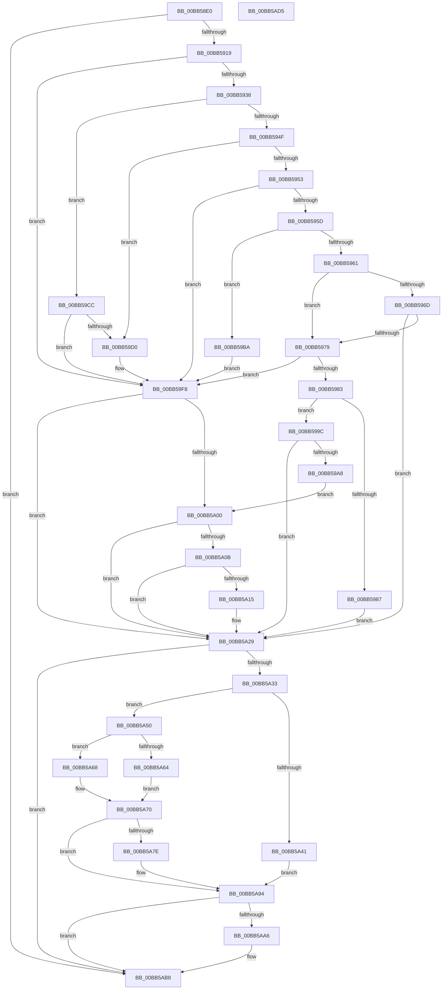

# VfPnpVerifyIrpStackUpward

- RVA: `0x00BB58E0`–`0x00BB5AD6` (길이 `502` bytes)
- VA: `0x0000000140BB58E0`
- 실행 섹션: `PAGEVRFY`
- PDB 이름 있음: `예`; PDB Function 태그: `아니요`
- unwind 정보 RVA: `0x0008C20C`
- 디코드: `138`개 명령, `502/502` bytes 표시
- 미해석 바이트: `0` (있으면 어셈블리에 `.byte`로 보존)

> 이 문서는 커널 이미지의 기계어와 PDB 기호를 분석해 생성했습니다. 4번과 5번은 함수 원형과 자료형을 바이너리 사용 방식에서 추정한 C 해석이며 원본 소스 복구 결과는 아닙니다.

## 1. Dependencies

- 직접 호출 지점: **14**; 고유 호출 대상: **9**
- 직접 호출자로 확인된 함수: **0**
- RIP 상대 이미지 참조: **1**

### Outgoing calls
- `0x00BB590C` → [IovUtilIsWdmStack](../BA/IovUtilIsWdmStack_function_00BA2C68.md) (function, `0x00BA2C68`)
- `0x00BB5992` → [ViErrorReport1](../../text/61/ViErrorReport1_function_00614584.md) (function, `0x00614584`)
- `0x00BB59B3` → [ViErrorReport1](../../text/61/ViErrorReport1_function_00614584.md) (function, `0x00614584`)
- `0x00BB59C5` → [ViErrorReport1](../../text/61/ViErrorReport1_function_00614584.md) (function, `0x00614584`)
- `0x00BB59F3` → [ViPnpVerifyMinorWasProcessedProperly](ViPnpVerifyMinorWasProcessedProperly_function_00BB5BC0.md) (function, `0x00BB5BC0`)
- `0x00BB5A20` → [ViErrorReport1](../../text/61/ViErrorReport1_function_00614584.md) (function, `0x00614584`)
- `0x00BB5A37` → [IovUtilGetLowerDeviceObjectWithTag](../BA/IovUtilGetLowerDeviceObjectWithTag_function_00BA2A84.md) (function, `0x00BA2A84`)
- `0x00BB5A49` → [ObfDereferenceObjectWithTag](../../text/2F/ObfDereferenceObjectWithTag_function_002F78E0.md) (function, `0x002F78E0`)
- `0x00BB5A57` → [IovUtilGetBottomDeviceObjectWithTag](../BA/IovUtilGetBottomDeviceObjectWithTag_function_00BA2A20.md) (function, `0x00BA2A20`)
- `0x00BB5A68` → [PpvUtilIsPdo](../B9/PpvUtilIsPdo_function_00B92C80.md) (function, `0x00B92C80`)
- `0x00BB5A75` → [ObfDereferenceObjectWithTag](../../text/2F/ObfDereferenceObjectWithTag_function_002F78E0.md) (function, `0x002F78E0`)
- `0x00BB5A8F` → [ViErrorReport10](../../text/61/ViErrorReport10_function_00614608.md) (function, `0x00614608`)
- `0x00BB5A9D` → [IovUtilIsDeviceObjectMarked](../BA/IovUtilIsDeviceObjectMarked_function_00BA2B34.md) (function, `0x00BA2B34`)
- `0x00BB5AB3` → [ViErrorReport10](../../text/61/ViErrorReport10_function_00614608.md) (function, `0x00614608`)

### Direct callers
- 이 함수 시작 RVA로 연결되는 직접 call은 확인되지 않았습니다. 간접 호출은 완전히 역산할 수 없습니다.

### Static image references
- `0x00BB5979` → RVA `0x00F04AC0` (`.data`; read)

## 2. Other-region calls and transfers

- 다른 실행 섹션으로 향하는 call: **8**
  - `0x00BB5992` → [ViErrorReport1](../../text/61/ViErrorReport1_function_00614584.md) (`PAGEVRFY` → `.text`)
  - `0x00BB59B3` → [ViErrorReport1](../../text/61/ViErrorReport1_function_00614584.md) (`PAGEVRFY` → `.text`)
  - `0x00BB59C5` → [ViErrorReport1](../../text/61/ViErrorReport1_function_00614584.md) (`PAGEVRFY` → `.text`)
  - `0x00BB5A20` → [ViErrorReport1](../../text/61/ViErrorReport1_function_00614584.md) (`PAGEVRFY` → `.text`)
  - `0x00BB5A49` → [ObfDereferenceObjectWithTag](../../text/2F/ObfDereferenceObjectWithTag_function_002F78E0.md) (`PAGEVRFY` → `.text`)
  - `0x00BB5A75` → [ObfDereferenceObjectWithTag](../../text/2F/ObfDereferenceObjectWithTag_function_002F78E0.md) (`PAGEVRFY` → `.text`)
  - `0x00BB5A8F` → [ViErrorReport10](../../text/61/ViErrorReport10_function_00614608.md) (`PAGEVRFY` → `.text`)
  - `0x00BB5AB3` → [ViErrorReport10](../../text/61/ViErrorReport10_function_00614608.md) (`PAGEVRFY` → `.text`)
- 별도 외부 분기/꼬리 이동을 확인하지 못했습니다.

## 3. Assembly (complete function range)

```asm
00BB58E0  48 89 5C 24 08                  mov qword ptr [rsp + 8], rbx
00BB58E5  48 89 6C 24 10                  mov qword ptr [rsp + 0x10], rbp
00BB58EA  48 89 74 24 18                  mov qword ptr [rsp + 0x18], rsi
00BB58EF  57                              push rdi
00BB58F0  41 54                           push r12
00BB58F2  41 55                           push r13
00BB58F4  41 56                           push r14
00BB58F6  41 57                           push r15
00BB58F8  48 83 EC 30                     sub rsp, 0x30
00BB58FC  4C 8B F1                        mov r14, rcx
00BB58FF  4D 8B E9                        mov r13, r9
00BB5902  48 8B 4A 28                     mov rcx, qword ptr [rdx + 0x28]
00BB5906  4D 8B F8                        mov r15, r8
00BB5909  48 8B FA                        mov rdi, rdx
00BB590C  E8 57 D3 FE FF                  call 0x140ba2c68
00BB5911  85 C0                           test eax, eax
00BB5913  0F 84 9F 01 00 00               je 0x140bb5ab8
00BB5919  83 BC 24 80 00 00 00 00         cmp dword ptr [rsp + 0x80], 0
00BB5921  49 8B 2E                        mov rbp, qword ptr [r14]
00BB5924  4D 8B A6 F0 00 00 00            mov r12, qword ptr [r14 + 0xf0]
00BB592B  49 8B 75 28                     mov rsi, qword ptr [r13 + 0x28]
00BB592F  8B 5D 30                        mov ebx, dword ptr [rbp + 0x30]
00BB5932  0F 84 C0 00 00 00               je 0x140bb59f8
00BB5938  41 8B 45 04                     mov eax, dword ptr [r13 + 4]
00BB593C  8B C8                           mov ecx, eax
00BB593E  41 8B 56 38                     mov edx, dword ptr [r14 + 0x38]
00BB5942  81 E1 00 00 00 10               and ecx, 0x10000000
00BB5948  83 E2 20                        and edx, 0x20
00BB594B  85 C0                           test eax, eax
00BB594D  78 7D                           js 0x140bb59cc
00BB594F  85 C9                           test ecx, ecx
00BB5951  75 7D                           jne 0x140bb59d0
00BB5953  80 7F 01 08                     cmp byte ptr [rdi + 1], 8
00BB5957  0F 84 9B 00 00 00               je 0x140bb59f8
00BB595D  85 D2                           test edx, edx
00BB595F  75 59                           jne 0x140bb59ba
00BB5961  B9 00 00 00 80                  mov ecx, 0x80000000
00BB5966  8D 04 0B                        lea eax, [rbx + rcx]
00BB5969  85 C1                           test ecx, eax
00BB596B  75 0C                           jne 0x140bb5979
00BB596D  81 FB BB 00 00 C0               cmp ebx, 0xc00000bb
00BB5973  0F 85 B0 00 00 00               jne 0x140bb5a29
00BB5979  8B 05 41 F1 34 00               mov eax, dword ptr [rip + 0x34f141]
00BB597F  85 C0                           test eax, eax
00BB5981  75 75                           jne 0x140bb59f8
00BB5983  85 DB                           test ebx, ebx
00BB5985  78 15                           js 0x140bb599c
00BB5987  4C 8B C5                        mov r8, rbp
00BB598A  48 8B D6                        mov rdx, rsi
00BB598D  B9 2E 02 00 00                  mov ecx, 0x22e
00BB5992  E8 ED EB A5 FF                  call 0x140614584
00BB5997  E9 8D 00 00 00                  jmp 0x140bb5a29
00BB599C  81 FB BB 00 00 C0               cmp ebx, 0xc00000bb
00BB59A2  0F 85 81 00 00 00               jne 0x140bb5a29
00BB59A8  4C 8B C5                        mov r8, rbp
00BB59AB  48 8B D6                        mov rdx, rsi
00BB59AE  B9 2F 02 00 00                  mov ecx, 0x22f
00BB59B3  E8 CC EB A5 FF                  call 0x140614584
00BB59B8  EB 46                           jmp 0x140bb5a00
00BB59BA  4C 8B C5                        mov r8, rbp
00BB59BD  48 8B D6                        mov rdx, rsi
00BB59C0  B9 2D 02 00 00                  mov ecx, 0x22d
00BB59C5  E8 BA EB A5 FF                  call 0x140614584
00BB59CA  EB 2C                           jmp 0x140bb59f8
00BB59CC  85 C9                           test ecx, ecx
00BB59CE  74 28                           je 0x140bb59f8
00BB59D0  45 33 C9                        xor r9d, r9d
00BB59D3  48 8B D7                        mov rdx, rdi
00BB59D6  81 FB BB 00 00 C0               cmp ebx, 0xc00000bb
00BB59DC  48 8B CD                        mov rcx, rbp
00BB59DF  41 0F 95 C1                     setne r9b
00BB59E3  83 64 24 28 00                  and dword ptr [rsp + 0x28], 0
00BB59E8  41 FF C1                        inc r9d
00BB59EB  48 89 74 24 20                  mov qword ptr [rsp + 0x20], rsi
00BB59F0  45 33 C0                        xor r8d, r8d
00BB59F3  E8 C8 01 00 00                  call 0x140bb5bc0
00BB59F8  81 FB BB 00 00 C0               cmp ebx, 0xc00000bb
00BB59FE  75 29                           jne 0x140bb5a29
00BB5A00  BB 00 00 00 02                  mov ebx, 0x2000000
00BB5A05  41 85 5F 04                     test dword ptr [r15 + 4], ebx
00BB5A09  75 1E                           jne 0x140bb5a29
00BB5A0B  41 81 7F 60 BB 00 00 C0         cmp dword ptr [r15 + 0x60], 0xc00000bb
00BB5A13  74 14                           je 0x140bb5a29
00BB5A15  4C 8B C5                        mov r8, rbp
00BB5A18  48 8B D6                        mov rdx, rsi
00BB5A1B  B9 16 02 00 00                  mov ecx, 0x216
00BB5A20  E8 5F EB A5 FF                  call 0x140614584
00BB5A25  41 09 5F 04                     or dword ptr [r15 + 4], ebx
00BB5A29  80 7F 01 17                     cmp byte ptr [rdi + 1], 0x17
00BB5A2D  0F 85 85 00 00 00               jne 0x140bb5ab8
00BB5A33  48 8B 4F 28                     mov rcx, qword ptr [rdi + 0x28]
00BB5A37  E8 48 D0 FE FF                  call 0x140ba2a84
00BB5A3C  48 85 C0                        test rax, rax
00BB5A3F  74 0F                           je 0x140bb5a50
00BB5A41  BA 56 72 66 49                  mov edx, 0x49667256
00BB5A46  48 8B C8                        mov rcx, rax
00BB5A49  E8 92 1E 74 FF                  call 0x1402f78e0
00BB5A4E  EB 44                           jmp 0x140bb5a94
00BB5A50  48 8B 5F 28                     mov rbx, qword ptr [rdi + 0x28]
00BB5A54  48 8B CB                        mov rcx, rbx
00BB5A57  E8 C4 CF FE FF                  call 0x140ba2a20
00BB5A5C  48 8B C8                        mov rcx, rax
00BB5A5F  48 3B C3                        cmp rax, rbx
00BB5A62  74 04                           je 0x140bb5a68
00BB5A64  33 DB                           xor ebx, ebx
00BB5A66  EB 08                           jmp 0x140bb5a70
00BB5A68  E8 13 D2 FD FF                  call 0x140b92c80
00BB5A6D  0F B6 D8                        movzx ebx, al
00BB5A70  BA 56 72 66 49                  mov edx, 0x49667256
00BB5A75  E8 66 1E 74 FF                  call 0x1402f78e0
00BB5A7A  85 DB                           test ebx, ebx
00BB5A7C  75 16                           jne 0x140bb5a94
00BB5A7E  4C 8B 4F 28                     mov r9, qword ptr [rdi + 0x28]
00BB5A82  48 8B D6                        mov rdx, rsi
00BB5A85  4D 8B 44 24 40                  mov r8, qword ptr [r12 + 0x40]
00BB5A8A  B9 41 02 00 00                  mov ecx, 0x241
00BB5A8F  E8 74 EB A5 FF                  call 0x140614608
00BB5A94  4C 8B 4F 28                     mov r9, qword ptr [rdi + 0x28]
00BB5A98  33 D2                           xor edx, edx
00BB5A9A  49 8B C9                        mov rcx, r9
00BB5A9D  E8 92 D0 FE FF                  call 0x140ba2b34
00BB5AA2  85 C0                           test eax, eax
00BB5AA4  74 12                           je 0x140bb5ab8
00BB5AA6  4D 8B 44 24 40                  mov r8, qword ptr [r12 + 0x40]
00BB5AAB  48 8B D6                        mov rdx, rsi
00BB5AAE  B9 42 02 00 00                  mov ecx, 0x242
00BB5AB3  E8 50 EB A5 FF                  call 0x140614608
00BB5AB8  48 8B 5C 24 60                  mov rbx, qword ptr [rsp + 0x60]
00BB5ABD  48 8B 6C 24 68                  mov rbp, qword ptr [rsp + 0x68]
00BB5AC2  48 8B 74 24 70                  mov rsi, qword ptr [rsp + 0x70]
00BB5AC7  48 83 C4 30                     add rsp, 0x30
00BB5ACB  41 5F                           pop r15
00BB5ACD  41 5E                           pop r14
00BB5ACF  41 5D                           pop r13
00BB5AD1  41 5C                           pop r12
00BB5AD3  5F                              pop rdi
00BB5AD4  C3                              ret
00BB5AD5  CC                              int3
```

## 4. C-style interpretation (structured pseudocode)

```c
__int64 __fastcall VfPnpVerifyIrpStackUpward(__int64 a1, __int64 a2, __int64 a3, __int64 a4, unsigned int a5)
{
    __int64 result;
    __int64 v_rbx;
    __int64 v_rsp;
    unsigned int v_stack_m30;
    unsigned __int64 v_stack_m38;
    unsigned __int64 v_stack_p10;
    unsigned __int64 v_stack_p18;
    unsigned __int64 v_stack_p8;

    v_stack_p8 = v_rbx;
    v_stack_p10 = v_rbp;
    v_stack_p18 = v_rsi;
    v_rsp = (v_rsp) - (48);
    result = IovUtilIsWdmStack(*(unsigned __int64 *)(a2 + 40), a2, a3, a4);
    if ((unsigned int)(result) == 0) goto loc_00BB5AB8;
    if (a5 == 0) goto loc_00BB59F8;
    a1 = (unsigned int)(((unsigned int)((unsigned int)((unsigned int)(*(unsigned int *)(a4 + 4))))) & (0x10000000ULL));
    a2 = (unsigned int)(((unsigned int)(*(unsigned int *)(a1 + 56))) & (32));
    if (sign_flag) goto loc_00BB59CC;
    if ((unsigned int)(a1) != 0) goto loc_00BB59D0;
    if ((*(unsigned __int8 *)(a2 + 1)) == 8) goto loc_00BB59F8;
    if ((unsigned int)(a2) != 0) goto loc_00BB59BA;
    if ((((unsigned int)((unsigned int)(0x80000000ULL))) & ((unsigned int)((unsigned int)(*(unsigned int *)(*(unsigned __int64 *)(a1) + 48)) + (unsigned int)(0x80000000ULL) * 1))) != 0) goto loc_00BB5979;
    if (((unsigned int)((unsigned int)(*(unsigned int *)(*(unsigned __int64 *)(a1) + 48)))) != 0xC00000BBULL) goto loc_00BB5A29;
loc_00BB5979:
    if ((unsigned int)((unsigned int)(*(unsigned int *)(v_rip + 3469633))) != 0) goto loc_00BB59F8;
    if (sign_flag) goto loc_00BB599C;
    result = ViErrorReport1(558, *(unsigned __int64 *)(a4 + 40), *(unsigned __int64 *)(a1), a4);
    goto loc_00BB5A29;
loc_00BB599C:
    if (((unsigned int)((unsigned int)(*(unsigned int *)(*(unsigned __int64 *)(a1) + 48)))) != 0xC00000BBULL) goto loc_00BB5A29;
    result = ViErrorReport1(559, *(unsigned __int64 *)(a4 + 40), *(unsigned __int64 *)(a1), a4);
    goto loc_00BB5A00;
loc_00BB59BA:
    result = ViErrorReport1(557, *(unsigned __int64 *)(a4 + 40), *(unsigned __int64 *)(a1), a4);
    goto loc_00BB59F8;
loc_00BB59CC:
    if (557 != 0) {
        a4 = 0;
        a2 = a2;
        a1 = *(unsigned __int64 *)(a1);
        a4 = (((unsigned int)((unsigned int)(*(unsigned int *)(*(unsigned __int64 *)(a1) + 48)))) != 0xC00000BBULL) ? 1 : 0;
        a4 = (unsigned int)((a4) + 1);
        v_stack_m38 = *(unsigned __int64 *)(a4 + 40);
        a3 = 0;
        result = ViPnpVerifyMinorWasProcessedProperly(a1, a2, a3, a4);
    }
    if (((unsigned int)((unsigned int)(*(unsigned int *)(*(unsigned __int64 *)(a1) + 48)))) != 0xC00000BBULL) goto loc_00BB5A29;
loc_00BB5A00:
    if (((*(unsigned int *)(a3 + 4)) & ((unsigned int)((unsigned int)(0x2000000ULL)))) != 0) goto loc_00BB5A29;
    if ((*(unsigned int *)(a3 + 96)) != 0xC00000BBULL) {
        a3 = *(unsigned __int64 *)(a1);
        a2 = *(unsigned __int64 *)(a4 + 40);
        a1 = 534;
        result = ViErrorReport1(a1, a2, a3, a4);
    }
    if ((*(unsigned __int8 *)(a2 + 1)) != 23) goto loc_00BB5AB8;
    result = IovUtilGetLowerDeviceObjectWithTag(*(unsigned __int64 *)(a2 + 40), a2, a3, a4);
    if (result == 0) goto loc_00BB5A50;
    result = ObfDereferenceObjectWithTag(result, (unsigned int)(0x49667256ULL), a3, a4);
    goto loc_00BB5A94;
loc_00BB5A50:
    result = IovUtilGetBottomDeviceObjectWithTag(*(unsigned __int64 *)(a2 + 40), (unsigned int)(0x49667256ULL), a3, a4);
    if (result == (*(unsigned __int64 *)(a2 + 40))) goto loc_00BB5A68;
    v_rbx = 0;
    goto loc_00BB5A70;
loc_00BB5A68:
    result = PpvUtilIsPdo(result, (unsigned int)(0x49667256ULL), a3, a4);
loc_00BB5A70:
    result = ObfDereferenceObjectWithTag(result, (unsigned int)(0x49667256ULL), a3, a4);
    if ((unsigned int)((unsigned __int8)(result)) == 0) {
        a4 = *(unsigned __int64 *)(a2 + 40);
        a2 = *(unsigned __int64 *)(a4 + 40);
        a3 = *(unsigned __int64 *)(*(unsigned __int64 *)(a1 + 240) + 64);
        a1 = 577;
        result = ViErrorReport10(a1, a2, a3, a4);
    }
    a2 = 0;
    result = IovUtilIsDeviceObjectMarked(*(unsigned __int64 *)(a2 + 40), a2, a3, *(unsigned __int64 *)(a2 + 40));
    if ((unsigned int)(result) != 0) {
        a3 = *(unsigned __int64 *)(*(unsigned __int64 *)(a1 + 240) + 64);
        a2 = *(unsigned __int64 *)(a4 + 40);
        a1 = 578;
        result = ViErrorReport10(a1, a2, a3, *(unsigned __int64 *)(a2 + 40));
    }
    v_rsp = (v_rsp) + (48);
    return result;
}
```

## 5. (Beta) C Style

```c
int64_t VfPnpVerifyIrpStackUpward(void *Arg1, void *Arg2, void *Arg3, void *Arg4, uint32_t Arg5)
{
    uint8_t *arg1 = (uint8_t *)Arg1;
    uint8_t *arg2 = (uint8_t *)Arg2;
    uint8_t *arg3 = (uint8_t *)Arg3;
    uint8_t *arg4 = (uint8_t *)Arg4;

    int64_t result;
    int64_t local_rbx;
    int64_t local_rsp;
    uint32_t v_stack_m30;
    uint64_t v_stack_m38;
    uint64_t v_stack_p10;
    uint64_t v_stack_p18;
    uint64_t v_stack_p8;

    v_stack_p8 = local_rbx;
    v_stack_p10 = local_rbp;
    v_stack_p18 = local_rsi;
    local_rsp = (local_rsp) - (48);
    result = IovUtilIsWdmStack(*(uint64_t *)(arg2 + 0x28), Arg2, Arg3, Arg4);
    if ((uint32_t)(result) == 0) goto loc_00BB5AB8;
    if (Arg5 == 0) goto loc_00BB59F8;
    Arg1 = (uint32_t)(((uint32_t)((uint32_t)((uint32_t)(*(uint32_t *)(arg4 + 0x4))))) & (0x10000000ULL));
    Arg2 = (uint32_t)(((uint32_t)(*(uint32_t *)(arg1 + 0x38))) & (32));
    if (sign_flag) goto loc_00BB59CC;
    if ((uint32_t)(Arg1) != 0) goto loc_00BB59D0;
    if ((*(uint8_t *)(arg2 + 0x1)) == 8) goto loc_00BB59F8;
    if ((uint32_t)(Arg2) != 0) goto loc_00BB59BA;
    if ((((uint32_t)((uint32_t)(0x80000000ULL))) & ((uint32_t)((uint32_t)(*(uint32_t *)(*(uint64_t *)(arg1) + 0x30)) + (uint32_t)(0x80000000ULL) * 1))) != 0) goto loc_00BB5979;
    if (((uint32_t)((uint32_t)(*(uint32_t *)(*(uint64_t *)(arg1) + 0x30)))) != 0xC00000BBULL) goto loc_00BB5A29;
loc_00BB5979:
    if ((uint32_t)((uint32_t)(*(uint32_t *)(v_rip + 0x34F141))) != 0) goto loc_00BB59F8;
    if (sign_flag) goto loc_00BB599C;
    result = ViErrorReport1(558, *(uint64_t *)(arg4 + 0x28), *(uint64_t *)(arg1), Arg4);
    goto loc_00BB5A29;
loc_00BB599C:
    if (((uint32_t)((uint32_t)(*(uint32_t *)(*(uint64_t *)(arg1) + 0x30)))) != 0xC00000BBULL) goto loc_00BB5A29;
    result = ViErrorReport1(559, *(uint64_t *)(arg4 + 0x28), *(uint64_t *)(arg1), Arg4);
    goto loc_00BB5A00;
loc_00BB59BA:
    result = ViErrorReport1(557, *(uint64_t *)(arg4 + 0x28), *(uint64_t *)(arg1), Arg4);
    goto loc_00BB59F8;
loc_00BB59CC:
    if (557 != 0) {
        Arg4 = 0;
        Arg2 = Arg2;
        Arg1 = *(uint64_t *)(arg1);
        Arg4 = (((uint32_t)((uint32_t)(*(uint32_t *)(*(uint64_t *)(arg1) + 0x30)))) != 0xC00000BBULL) ? 1 : 0;
        Arg4 = (uint32_t)((Arg4) + 1);
        v_stack_m38 = *(uint64_t *)(arg4 + 0x28);
        Arg3 = 0;
        result = ViPnpVerifyMinorWasProcessedProperly(Arg1, Arg2, Arg3, Arg4);
    }
    if (((uint32_t)((uint32_t)(*(uint32_t *)(*(uint64_t *)(arg1) + 0x30)))) != 0xC00000BBULL) goto loc_00BB5A29;
loc_00BB5A00:
    if (((*(uint32_t *)(arg3 + 0x4)) & ((uint32_t)((uint32_t)(0x2000000ULL)))) != 0) goto loc_00BB5A29;
    if ((*(uint32_t *)(arg3 + 0x60)) != 0xC00000BBULL) {
        Arg3 = *(uint64_t *)(arg1);
        Arg2 = *(uint64_t *)(arg4 + 0x28);
        Arg1 = 534;
        result = ViErrorReport1(Arg1, Arg2, Arg3, Arg4);
    }
    if ((*(uint8_t *)(arg2 + 0x1)) != 23) goto loc_00BB5AB8;
    result = IovUtilGetLowerDeviceObjectWithTag(*(uint64_t *)(arg2 + 0x28), Arg2, Arg3, Arg4);
    if (result == 0) goto loc_00BB5A50;
    result = ObfDereferenceObjectWithTag(result, (uint32_t)(0x49667256ULL), Arg3, Arg4);
    goto loc_00BB5A94;
loc_00BB5A50:
    result = IovUtilGetBottomDeviceObjectWithTag(*(uint64_t *)(arg2 + 0x28), (uint32_t)(0x49667256ULL), Arg3, Arg4);
    if (result == (*(uint64_t *)(arg2 + 0x28))) goto loc_00BB5A68;
    local_rbx = 0;
    goto loc_00BB5A70;
loc_00BB5A68:
    result = PpvUtilIsPdo(result, (uint32_t)(0x49667256ULL), Arg3, Arg4);
loc_00BB5A70:
    result = ObfDereferenceObjectWithTag(result, (uint32_t)(0x49667256ULL), Arg3, Arg4);
    if ((uint32_t)((uint8_t)(result)) == 0) {
        Arg4 = *(uint64_t *)(arg2 + 0x28);
        Arg2 = *(uint64_t *)(arg4 + 0x28);
        Arg3 = *(uint64_t *)(*(uint64_t *)(arg1 + 0xF0) + 0x40);
        Arg1 = 577;
        result = ViErrorReport10(Arg1, Arg2, Arg3, Arg4);
    }
    Arg2 = 0;
    result = IovUtilIsDeviceObjectMarked(*(uint64_t *)(arg2 + 0x28), Arg2, Arg3, *(uint64_t *)(arg2 + 0x28));
    if ((uint32_t)(result) != 0) {
        Arg3 = *(uint64_t *)(*(uint64_t *)(arg1 + 0xF0) + 0x40);
        Arg2 = *(uint64_t *)(arg4 + 0x28);
        Arg1 = 578;
        result = ViErrorReport10(Arg1, Arg2, Arg3, *(uint64_t *)(arg2 + 0x28));
    }
    local_rsp = (local_rsp) + (48);
    return result;
}
```

### 관측된 메모리 오프셋

구조체 형식이 확인되지 않은 접근은 인자 기준의 오프셋으로만 기록했습니다.

| 기준 인자 | 오프셋 표현 | 폭 (bit) | 접근 |
|---|---:|---:|---|
| `Arg1` | `+ 0x0` | `64` | `R` |
| `Arg1` | `+ 0x38` | `32` | `R` |
| `Arg1` | `+ 0xF0` | `64` | `R` |
| `Arg2` | `+ 0x1` | `8` | `R` |
| `Arg2` | `+ 0x28` | `64` | `R` |
| `Arg3` | `+ 0x4` | `32` | `R` |
| `Arg3` | `+ 0x4` | `32` | `R/W` |
| `Arg3` | `+ 0x60` | `32` | `R` |
| `Arg4` | `+ 0x4` | `32` | `R` |
| `Arg4` | `+ 0x28` | `64` | `R` |

## 6. Execution-region graph

[열기: 2D/3D 그래프와 함수 탐색 컨트롤 패널](../../../control-panel.html?section=pagevrfy&rva=0x00BB58E0&view=graph)

- 2D 그래프는 위에서 아래로 흐르고, 3D 그래프는 빈 공간을 드래그해 회전합니다. Shift+드래그는 이동, 휠은 확대·축소, 함수 노드 선택은 대상 보고서 이동입니다.

### Static fallback


