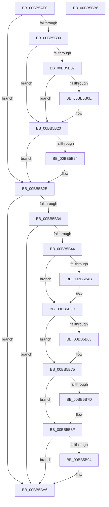

# VfPnpVerifyNewRequest

- RVA: `0x00BB5AE0`–`0x00BB5BB7` (길이 `215` bytes)
- VA: `0x0000000140BB5AE0`
- 실행 섹션: `PAGEVRFY`
- PDB 이름 있음: `예`; PDB Function 태그: `아니요`
- unwind 정보 RVA: `0x000927D0`
- 디코드: `60`개 명령, `215/215` bytes 표시
- 미해석 바이트: `0` (있으면 어셈블리에 `.byte`로 보존)

> 이 문서는 커널 이미지의 기계어와 PDB 기호를 분석해 생성했습니다. 4번과 5번은 함수 원형과 자료형을 바이너리 사용 방식에서 추정한 C 해석이며 원본 소스 복구 결과는 아닙니다.

## 1. Dependencies

- 직접 호출 지점: **6**; 고유 호출 대상: **2**
- 직접 호출자로 확인된 함수: **0**
- RIP 상대 이미지 참조: **0**

### Outgoing calls
- `0x00BB5B1B` → [ViErrorReport1](../../text/61/ViErrorReport1_function_00614584.md) (function, `0x00614584`)
- `0x00BB5B3B` → [MmIsNonPagedSystemAddressValid](../../text/4B/MmIsNonPagedSystemAddressValid_function_004B79F0.md) (function, `0x004B79F0`)
- `0x00BB5B58` → [ViErrorReport1](../../text/61/ViErrorReport1_function_00614584.md) (function, `0x00614584`)
- `0x00BB5B70` → [ViErrorReport1](../../text/61/ViErrorReport1_function_00614584.md) (function, `0x00614584`)
- `0x00BB5B8A` → [ViErrorReport1](../../text/61/ViErrorReport1_function_00614584.md) (function, `0x00614584`)
- `0x00BB5BA1` → [ViErrorReport1](../../text/61/ViErrorReport1_function_00614584.md) (function, `0x00614584`)

### Direct callers
- 이 함수 시작 RVA로 연결되는 직접 call은 확인되지 않았습니다. 간접 호출은 완전히 역산할 수 없습니다.

### Static image references
- 디코드된 RIP-relative 메모리 참조가 없습니다.

## 2. Other-region calls and transfers

- 다른 실행 섹션으로 향하는 call: **6**
  - `0x00BB5B1B` → [ViErrorReport1](../../text/61/ViErrorReport1_function_00614584.md) (`PAGEVRFY` → `.text`)
  - `0x00BB5B3B` → [MmIsNonPagedSystemAddressValid](../../text/4B/MmIsNonPagedSystemAddressValid_function_004B79F0.md) (`PAGEVRFY` → `.text`)
  - `0x00BB5B58` → [ViErrorReport1](../../text/61/ViErrorReport1_function_00614584.md) (`PAGEVRFY` → `.text`)
  - `0x00BB5B70` → [ViErrorReport1](../../text/61/ViErrorReport1_function_00614584.md) (`PAGEVRFY` → `.text`)
  - `0x00BB5B8A` → [ViErrorReport1](../../text/61/ViErrorReport1_function_00614584.md) (`PAGEVRFY` → `.text`)
  - `0x00BB5BA1` → [ViErrorReport1](../../text/61/ViErrorReport1_function_00614584.md) (`PAGEVRFY` → `.text`)
- 별도 외부 분기/꼬리 이동을 확인하지 못했습니다.

## 3. Assembly (complete function range)

```asm
00BB5AE0  48 89 5C 24 08                  mov qword ptr [rsp + 8], rbx
00BB5AE5  48 89 6C 24 10                  mov qword ptr [rsp + 0x10], rbp
00BB5AEA  57                              push rdi
00BB5AEB  48 83 EC 20                     sub rsp, 0x20
00BB5AEF  48 8B 39                        mov rdi, qword ptr [rcx]
00BB5AF2  49 8B D9                        mov rbx, r9
00BB5AF5  8B 6F 30                        mov ebp, dword ptr [rdi + 0x30]
00BB5AF8  81 FD BB 00 00 C0               cmp ebp, 0xc00000bb
00BB5AFE  74 2E                           je 0x140bb5b2e
00BB5B00  41 80 79 01 0D                  cmp byte ptr [r9 + 1], 0xd
00BB5B05  74 19                           je 0x140bb5b20
00BB5B07  8B 41 38                        mov eax, dword ptr [rcx + 0x38]
00BB5B0A  A8 20                           test al, 0x20
00BB5B0C  75 12                           jne 0x140bb5b20
00BB5B0E  48 8B 54 24 58                  mov rdx, qword ptr [rsp + 0x58]
00BB5B13  4C 8B C7                        mov r8, rdi
00BB5B16  B9 0E 02 00 00                  mov ecx, 0x20e
00BB5B1B  E8 64 EA A5 FF                  call 0x140614584
00BB5B20  85 ED                           test ebp, ebp
00BB5B22  79 0A                           jns 0x140bb5b2e
00BB5B24  48 8B 44 24 50                  mov rax, qword ptr [rsp + 0x50]
00BB5B29  0F BA 68 04 19                  bts dword ptr [rax + 4], 0x19
00BB5B2E  80 7B 01 09                     cmp byte ptr [rbx + 1], 9
00BB5B32  75 72                           jne 0x140bb5ba6
00BB5B34  48 8B 5B 08                     mov rbx, qword ptr [rbx + 8]
00BB5B38  48 8B CB                        mov rcx, rbx
00BB5B3B  E8 B0 1E 90 FF                  call 0x1404b79f0
00BB5B40  84 C0                           test al, al
00BB5B42  74 62                           je 0x140bb5ba6
00BB5B44  66 83 7B 02 01                  cmp word ptr [rbx + 2], 1
00BB5B49  73 12                           jae 0x140bb5b5d
00BB5B4B  48 8B 54 24 58                  mov rdx, qword ptr [rsp + 0x58]
00BB5B50  4C 8B C7                        mov r8, rdi
00BB5B53  B9 33 02 00 00                  mov ecx, 0x233
00BB5B58  E8 27 EA A5 FF                  call 0x140614584
00BB5B5D  66 83 3B 40                     cmp word ptr [rbx], 0x40
00BB5B61  73 12                           jae 0x140bb5b75
00BB5B63  48 8B 54 24 58                  mov rdx, qword ptr [rsp + 0x58]
00BB5B68  4C 8B C7                        mov r8, rdi
00BB5B6B  B9 34 02 00 00                  mov ecx, 0x234
00BB5B70  E8 0F EA A5 FF                  call 0x140614584
00BB5B75  83 CD FF                        or ebp, 0xffffffff
00BB5B78  39 6B 08                        cmp dword ptr [rbx + 8], ebp
00BB5B7B  74 12                           je 0x140bb5b8f
00BB5B7D  48 8B 54 24 58                  mov rdx, qword ptr [rsp + 0x58]
00BB5B82  4C 8B C7                        mov r8, rdi
00BB5B85  B9 35 02 00 00                  mov ecx, 0x235
00BB5B8A  E8 F5 E9 A5 FF                  call 0x140614584
00BB5B8F  39 6B 0C                        cmp dword ptr [rbx + 0xc], ebp
00BB5B92  74 12                           je 0x140bb5ba6
00BB5B94  48 8B 54 24 58                  mov rdx, qword ptr [rsp + 0x58]
00BB5B99  4C 8B C7                        mov r8, rdi
00BB5B9C  B9 36 02 00 00                  mov ecx, 0x236
00BB5BA1  E8 DE E9 A5 FF                  call 0x140614584
00BB5BA6  48 8B 5C 24 30                  mov rbx, qword ptr [rsp + 0x30]
00BB5BAB  48 8B 6C 24 38                  mov rbp, qword ptr [rsp + 0x38]
00BB5BB0  48 83 C4 20                     add rsp, 0x20
00BB5BB4  5F                              pop rdi
00BB5BB5  C3                              ret
00BB5BB6  CC                              int3
```

## 4. C-style interpretation (structured pseudocode)

```c
__int64 __fastcall VfPnpVerifyNewRequest(__int64 a1, __int64 a2, __int64 a3, __int64 a4, __int64 a5, __int64 a6)
{
    __int64 result;
    __int64 v_rbp;
    __int64 v_rsp;
    unsigned __int64 v_stack_p10;
    unsigned __int64 v_stack_p8;

    v_stack_p8 = v_rbx;
    v_stack_p10 = v_rbp;
    v_rsp = (v_rsp) - (32);
    if (((unsigned int)((unsigned int)(*(unsigned int *)(*(unsigned __int64 *)(a1) + 48)))) == 0xC00000BBULL) goto loc_00BB5B2E;
    if ((*(unsigned __int8 *)(a4 + 1)) == 13) goto loc_00BB5B20;
    result = (unsigned int)(*(unsigned int *)(a1 + 56));
    if ((((unsigned __int8)((unsigned int)(*(unsigned int *)(a1 + 56)))) & (32)) == 0) {
        a2 = a6;
        a3 = *(unsigned __int64 *)(a1);
        a1 = 526;
        result = ViErrorReport1(a1, a2, a3, a4);
    }
    if (sign_flag) {
        result = a5;
    }
    if ((*(unsigned __int8 *)(a4 + 1)) != 9) goto loc_00BB5BA6;
    result = MmIsNonPagedSystemAddressValid(*(unsigned __int64 *)(a4 + 8), a2, a3, a4);
    if ((unsigned __int8)(result) == 0) goto loc_00BB5BA6;
    if ((*(unsigned __int16 *)(*(unsigned __int64 *)(a4 + 8) + 2)) < 1) {
        a2 = a6;
        a3 = *(unsigned __int64 *)(a1);
        a1 = 563;
        result = ViErrorReport1(a1, a2, a3, a4);
    }
    if ((*(unsigned __int16 *)(*(unsigned __int64 *)(a4 + 8))) < 64) {
        a2 = a6;
        a3 = *(unsigned __int64 *)(a1);
        a1 = 564;
        result = ViErrorReport1(a1, a2, a3, a4);
    }
    v_rbp = (unsigned int)(((unsigned int)(*(unsigned int *)(*(unsigned __int64 *)(a1) + 48))) | (0xFFFFFFFFULL));
    if ((*(unsigned int *)(*(unsigned __int64 *)(a4 + 8) + 8)) != ((unsigned int)(v_rbp))) {
        a2 = a6;
        a3 = *(unsigned __int64 *)(a1);
        a1 = 565;
        result = ViErrorReport1(a1, a2, a3, a4);
    }
    if ((*(unsigned int *)(*(unsigned __int64 *)(a4 + 8) + 12)) != ((unsigned int)(v_rbp))) {
        a2 = a6;
        a3 = *(unsigned __int64 *)(a1);
        a1 = 566;
        result = ViErrorReport1(a1, a2, a3, a4);
    }
    v_rsp = (v_rsp) + (32);
    return result;
}
```

## 5. (Beta) C Style

```c
int64_t VfPnpVerifyNewRequest(void *Arg1, int64_t Arg2, int64_t Arg3, void *Arg4, void *Arg5, int64_t Arg6)
{
    uint8_t *arg1 = (uint8_t *)Arg1;
    uint8_t *arg4 = (uint8_t *)Arg4;
    uint8_t *arg5 = (uint8_t *)Arg5;

    int64_t result;
    int64_t local_rbp;
    int64_t local_rsp;
    uint64_t v_stack_p10;
    uint64_t v_stack_p8;

    v_stack_p8 = local_rbx;
    v_stack_p10 = local_rbp;
    local_rsp = (local_rsp) - (32);
    if (((uint32_t)((uint32_t)(*(uint32_t *)(*(uint64_t *)(arg1) + 0x30)))) == 0xC00000BBULL) goto loc_00BB5B2E;
    if ((*(uint8_t *)(arg4 + 0x1)) == 13) goto loc_00BB5B20;
    result = (uint32_t)(*(uint32_t *)(arg1 + 0x38));
    if ((((uint8_t)((uint32_t)(*(uint32_t *)(arg1 + 0x38)))) & (32)) == 0) {
        Arg2 = Arg6;
        Arg3 = *(uint64_t *)(arg1);
        Arg1 = 526;
        result = ViErrorReport1(Arg1, Arg2, Arg3, Arg4);
    }
    if (sign_flag) {
        result = Arg5;
    }
    if ((*(uint8_t *)(arg4 + 0x1)) != 9) goto loc_00BB5BA6;
    result = MmIsNonPagedSystemAddressValid(*(uint64_t *)(arg4 + 0x8), Arg2, Arg3, Arg4);
    if ((uint8_t)(result) == 0) goto loc_00BB5BA6;
    if ((*(uint16_t *)(*(uint64_t *)(arg4 + 0x8) + 0x2)) < 1) {
        Arg2 = Arg6;
        Arg3 = *(uint64_t *)(arg1);
        Arg1 = 563;
        result = ViErrorReport1(Arg1, Arg2, Arg3, Arg4);
    }
    if ((*(uint16_t *)(*(uint64_t *)(arg4 + 0x8))) < 64) {
        Arg2 = Arg6;
        Arg3 = *(uint64_t *)(arg1);
        Arg1 = 564;
        result = ViErrorReport1(Arg1, Arg2, Arg3, Arg4);
    }
    local_rbp = (uint32_t)(((uint32_t)(*(uint32_t *)(*(uint64_t *)(arg1) + 0x30))) | (0xFFFFFFFFULL));
    if ((*(uint32_t *)(*(uint64_t *)(arg4 + 0x8) + 0x8)) != ((uint32_t)(local_rbp))) {
        Arg2 = Arg6;
        Arg3 = *(uint64_t *)(arg1);
        Arg1 = 565;
        result = ViErrorReport1(Arg1, Arg2, Arg3, Arg4);
    }
    if ((*(uint32_t *)(*(uint64_t *)(arg4 + 0x8) + 0xC)) != ((uint32_t)(local_rbp))) {
        Arg2 = Arg6;
        Arg3 = *(uint64_t *)(arg1);
        Arg1 = 566;
        result = ViErrorReport1(Arg1, Arg2, Arg3, Arg4);
    }
    local_rsp = (local_rsp) + (32);
    return result;
}
```

### 관측된 메모리 오프셋

구조체 형식이 확인되지 않은 접근은 인자 기준의 오프셋으로만 기록했습니다.

| 기준 인자 | 오프셋 표현 | 폭 (bit) | 접근 |
|---|---:|---:|---|
| `Arg1` | `+ 0x0` | `64` | `R` |
| `Arg1` | `+ 0x38` | `32` | `R` |
| `Arg4` | `+ 0x1` | `8` | `R` |
| `Arg4` | `+ 0x8` | `64` | `R` |
| `Arg5` | `+ 0x4` | `32` | `R/W` |

## 6. Execution-region graph

[열기: 2D/3D 그래프와 함수 탐색 컨트롤 패널](../../../control-panel.html?section=pagevrfy&rva=0x00BB5AE0&view=graph)

- 2D 그래프는 위에서 아래로 흐르고, 3D 그래프는 빈 공간을 드래그해 회전합니다. Shift+드래그는 이동, 휠은 확대·축소, 함수 노드 선택은 대상 보고서 이동입니다.

### Static fallback


