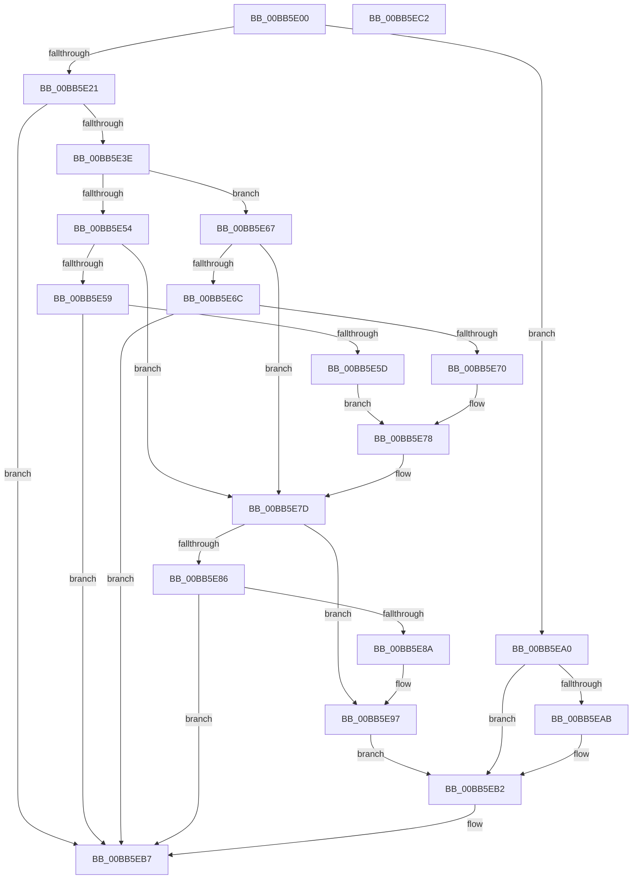

# VfPowerDumpIrpStack

- RVA: `0x00BB5E00`–`0x00BB5EC3` (길이 `195` bytes)
- VA: `0x0000000140BB5E00`
- 실행 섹션: `PAGEVRFY`
- PDB 이름 있음: `예`; PDB Function 태그: `아니요`
- unwind 정보 RVA: `0x0005CAAC`
- 디코드: `52`개 명령, `195/195` bytes 표시
- 미해석 바이트: `0` (있으면 어셈블리에 `.byte`로 보존)

> 이 문서는 커널 이미지의 기계어와 PDB 기호를 분석해 생성했습니다. 4번과 5번은 함수 원형과 자료형을 바이너리 사용 방식에서 추정한 C 해석이며 원본 소스 복구 결과는 아닙니다.

## 1. Dependencies

- 직접 호출 지점: **6**; 고유 호출 대상: **1**
- 직접 호출자로 확인된 함수: **0**
- RIP 상대 이미지 참조: **6**

### Outgoing calls
- `0x00BB5E14` → [VfUtilDbgPrint](../../text/61/VfUtilDbgPrint_function_006122AC.md) (function, `0x006122AC`)
- `0x00BB5E30` → [VfUtilDbgPrint](../../text/61/VfUtilDbgPrint_function_006122AC.md) (function, `0x006122AC`)
- `0x00BB5E45` → [VfUtilDbgPrint](../../text/61/VfUtilDbgPrint_function_006122AC.md) (function, `0x006122AC`)
- `0x00BB5E78` → [VfUtilDbgPrint](../../text/61/VfUtilDbgPrint_function_006122AC.md) (function, `0x006122AC`)
- `0x00BB5E92` → [VfUtilDbgPrint](../../text/61/VfUtilDbgPrint_function_006122AC.md) (function, `0x006122AC`)
- `0x00BB5EB2` → [VfUtilDbgPrint](../../text/61/VfUtilDbgPrint_function_006122AC.md) (function, `0x006122AC`)

### Direct callers
- 이 함수 시작 RVA로 연결되는 직접 call은 확인되지 않았습니다. 간접 호출은 완전히 역산할 수 없습니다.

### Static image references
- `0x00BB5E0D` → RVA `0x00BBBC20` (` ?? ::JKADOLAD::`string'`; read)
- `0x00BB5E21` → RVA `0x00000000` (`image boundary/outside`; read)
- `0x00BB5E3E` → RVA `0x00BBBC10` (` ?? ::JKADOLAD::`string'`; read)
- `0x00BB5E97` → RVA `0x00BBBC30` (` ?? ::JKADOLAD::`string'`; read)
- `0x00BB5EA0` → RVA `0x00BBBB10` (` ?? ::JKADOLAD::`string'`; read)
- `0x00BB5EAB` → RVA `0x00BBBB40` (` ?? ::JKADOLAD::`string'`; read)

## 2. Other-region calls and transfers

- 다른 실행 섹션으로 향하는 call: **6**
  - `0x00BB5E14` → [VfUtilDbgPrint](../../text/61/VfUtilDbgPrint_function_006122AC.md) (`PAGEVRFY` → `.text`)
  - `0x00BB5E30` → [VfUtilDbgPrint](../../text/61/VfUtilDbgPrint_function_006122AC.md) (`PAGEVRFY` → `.text`)
  - `0x00BB5E45` → [VfUtilDbgPrint](../../text/61/VfUtilDbgPrint_function_006122AC.md) (`PAGEVRFY` → `.text`)
  - `0x00BB5E78` → [VfUtilDbgPrint](../../text/61/VfUtilDbgPrint_function_006122AC.md) (`PAGEVRFY` → `.text`)
  - `0x00BB5E92` → [VfUtilDbgPrint](../../text/61/VfUtilDbgPrint_function_006122AC.md) (`PAGEVRFY` → `.text`)
  - `0x00BB5EB2` → [VfUtilDbgPrint](../../text/61/VfUtilDbgPrint_function_006122AC.md) (`PAGEVRFY` → `.text`)
- 별도 외부 분기/꼬리 이동을 확인하지 못했습니다.

## 3. Assembly (complete function range)

```asm
00BB5E00  48 89 5C 24 08                  mov qword ptr [rsp + 8], rbx
00BB5E05  57                              push rdi
00BB5E06  48 83 EC 20                     sub rsp, 0x20
00BB5E0A  48 8B D9                        mov rbx, rcx
00BB5E0D  48 8D 0D 0C 5E 00 00            lea rcx, [rip + 0x5e0c]
00BB5E14  E8 93 C4 A5 FF                  call 0x1406122ac
00BB5E19  0F B6 43 01                     movzx eax, byte ptr [rbx + 1]
00BB5E1D  3C 03                           cmp al, 3
00BB5E1F  77 7F                           ja 0x140bb5ea0
00BB5E21  48 8D 3D D8 A1 44 FF            lea rdi, [rip - 0xbb5e28]
00BB5E28  48 8B 8C C7 88 B1 B8 00         mov rcx, qword ptr [rdi + rax*8 + 0xb8b188]
00BB5E30  E8 77 C4 A5 FF                  call 0x1406122ac
00BB5E35  8A 43 01                        mov al, byte ptr [rbx + 1]
00BB5E38  2C 02                           sub al, 2
00BB5E3A  3C 01                           cmp al, 1
00BB5E3C  77 79                           ja 0x140bb5eb7
00BB5E3E  48 8D 0D CB 5D 00 00            lea rcx, [rip + 0x5dcb]
00BB5E45  E8 62 C4 A5 FF                  call 0x1406122ac
00BB5E4A  83 7B 10 00                     cmp dword ptr [rbx + 0x10], 0
00BB5E4E  48 63 43 18                     movsxd rax, dword ptr [rbx + 0x18]
00BB5E52  75 13                           jne 0x140bb5e67
00BB5E54  83 F8 06                        cmp eax, 6
00BB5E57  7F 24                           jg 0x140bb5e7d
00BB5E59  85 C0                           test eax, eax
00BB5E5B  78 5A                           js 0x140bb5eb7
00BB5E5D  48 8B 8C C7 70 B2 B8 00         mov rcx, qword ptr [rdi + rax*8 + 0xb8b270]
00BB5E65  EB 11                           jmp 0x140bb5e78
00BB5E67  83 F8 04                        cmp eax, 4
00BB5E6A  7F 11                           jg 0x140bb5e7d
00BB5E6C  85 C0                           test eax, eax
00BB5E6E  78 47                           js 0x140bb5eb7
00BB5E70  48 8B 8C C7 40 B2 B8 00         mov rcx, qword ptr [rdi + rax*8 + 0xb8b240]
00BB5E78  E8 2F C4 A5 FF                  call 0x1406122ac
00BB5E7D  48 63 43 20                     movsxd rax, dword ptr [rbx + 0x20]
00BB5E81  83 F8 07                        cmp eax, 7
00BB5E84  7F 11                           jg 0x140bb5e97
00BB5E86  85 C0                           test eax, eax
00BB5E88  78 2D                           js 0x140bb5eb7
00BB5E8A  48 8B 8C C7 B0 B2 B8 00         mov rcx, qword ptr [rdi + rax*8 + 0xb8b2b0]
00BB5E92  E8 15 C4 A5 FF                  call 0x1406122ac
00BB5E97  48 8D 0D 92 5D 00 00            lea rcx, [rip + 0x5d92]
00BB5E9E  EB 12                           jmp 0x140bb5eb2
00BB5EA0  48 8D 0D 69 5C 00 00            lea rcx, [rip + 0x5c69]
00BB5EA7  3C FF                           cmp al, 0xff
00BB5EA9  74 07                           je 0x140bb5eb2
00BB5EAB  48 8D 0D 8E 5C 00 00            lea rcx, [rip + 0x5c8e]
00BB5EB2  E8 F5 C3 A5 FF                  call 0x1406122ac
00BB5EB7  48 8B 5C 24 30                  mov rbx, qword ptr [rsp + 0x30]
00BB5EBC  48 83 C4 20                     add rsp, 0x20
00BB5EC0  5F                              pop rdi
00BB5EC1  C3                              ret
00BB5EC2  CC                              int3
```

## 4. C-style interpretation (structured pseudocode)

```c
__int64 __fastcall VfPowerDumpIrpStack(__int64 a1)
{
    __int64 result;
    __int64 v_rsp;
    unsigned __int64 v_stack_p8;

    v_stack_p8 = v_rbx;
    v_rsp = (v_rsp) - (32);
    result = VfUtilDbgPrint(v_rip + 24076, a2, a3, a4);
    if (((unsigned __int8)(*(unsigned __int8 *)(a1 + 1))) > 3) goto loc_00BB5EA0;
    result = VfUtilDbgPrint(*(unsigned __int64 *)(v_rip - 12279336 + *(unsigned __int8 *)(a1 + 1) * 8 + 12104072), a2, a3, a4);
    result = (unsigned __int8)((*(unsigned __int8 *)(a1 + 1)) - (2));
    if (((unsigned __int8)(result)) > 1) goto loc_00BB5EB7;
    result = VfUtilDbgPrint(v_rip + 24011, a2, a3, a4);
    if ((*(unsigned int *)(a1 + 16)) != 0) goto loc_00BB5E67;
    if (((unsigned int)((int)(*(unsigned int *)(a1 + 24)))) > 6) goto loc_00BB5E7D;
    if (sign_flag) goto loc_00BB5EB7;
    goto loc_00BB5E78;
loc_00BB5E67:
    if (((unsigned int)((int)(*(unsigned int *)(a1 + 24)))) > 4) goto loc_00BB5E7D;
    if (sign_flag) goto loc_00BB5EB7;
loc_00BB5E78:
    result = VfUtilDbgPrint(*(unsigned __int64 *)(v_rip - 12279336 + (int)(*(unsigned int *)(a1 + 24)) * 8 + 12104256), a2, a3, a4);
loc_00BB5E7D:
    if (((unsigned int)((int)(*(unsigned int *)(a1 + 32)))) > 7) goto loc_00BB5E97;
    if (sign_flag) goto loc_00BB5EB7;
    result = VfUtilDbgPrint(*(unsigned __int64 *)(v_rip - 12279336 + (int)(*(unsigned int *)(a1 + 32)) * 8 + 12104368), a2, a3, a4);
loc_00BB5E97:
    goto loc_00BB5EB2;
loc_00BB5EA0:
    if (((unsigned __int8)(result)) != 255) {
        a1 = v_rip + 23694;
    }
    result = VfUtilDbgPrint(a1, a2, a3, a4);
loc_00BB5EB7:
    v_rsp = (v_rsp) + (32);
    return result;
}
```

## 5. (Beta) C Style

```c
int64_t VfPowerDumpIrpStack(void *Arg1)
{
    uint8_t *arg1 = (uint8_t *)Arg1;

    int64_t result;
    int64_t local_rsp;
    uint64_t v_stack_p8;

    v_stack_p8 = local_rbx;
    local_rsp = (local_rsp) - (32);
    result = VfUtilDbgPrint(v_rip + 24076, a2, a3, a4);
    if (((uint8_t)(*(uint8_t *)(arg1 + 0x1))) > 3) goto loc_00BB5EA0;
    result = VfUtilDbgPrint(*(uint64_t *)(v_rip - 0xBB5E28 + *(uint8_t *)(arg1 + 0x1) * 8 + 0xB8B188), a2, a3, a4);
    result = (uint8_t)((*(uint8_t *)(arg1 + 0x1)) - (2));
    if (((uint8_t)(result)) > 1) goto loc_00BB5EB7;
    result = VfUtilDbgPrint(v_rip + 24011, a2, a3, a4);
    if ((*(uint32_t *)(arg1 + 0x10)) != 0) goto loc_00BB5E67;
    if (((uint32_t)((int32_t)(*(uint32_t *)(arg1 + 0x18)))) > 6) goto loc_00BB5E7D;
    if (sign_flag) goto loc_00BB5EB7;
    goto loc_00BB5E78;
loc_00BB5E67:
    if (((uint32_t)((int32_t)(*(uint32_t *)(arg1 + 0x18)))) > 4) goto loc_00BB5E7D;
    if (sign_flag) goto loc_00BB5EB7;
loc_00BB5E78:
    result = VfUtilDbgPrint(*(uint64_t *)(v_rip - 0xBB5E28 + (int32_t)(*(uint32_t *)(arg1 + 0x18)) * 8 + 0xB8B240), a2, a3, a4);
loc_00BB5E7D:
    if (((uint32_t)((int32_t)(*(uint32_t *)(arg1 + 0x20)))) > 7) goto loc_00BB5E97;
    if (sign_flag) goto loc_00BB5EB7;
    result = VfUtilDbgPrint(*(uint64_t *)(v_rip - 0xBB5E28 + (int32_t)(*(uint32_t *)(arg1 + 0x20)) * 8 + 0xB8B2B0), a2, a3, a4);
loc_00BB5E97:
    goto loc_00BB5EB2;
loc_00BB5EA0:
    if (((uint8_t)(result)) != 255) {
        Arg1 = v_rip + 23694;
    }
    result = VfUtilDbgPrint(Arg1, a2, a3, a4);
loc_00BB5EB7:
    local_rsp = (local_rsp) + (32);
    return result;
}
```

### 관측된 메모리 오프셋

구조체 형식이 확인되지 않은 접근은 인자 기준의 오프셋으로만 기록했습니다.

| 기준 인자 | 오프셋 표현 | 폭 (bit) | 접근 |
|---|---:|---:|---|
| `Arg1` | `+ 0x1` | `8` | `R` |
| `Arg1` | `+ 0x10` | `32` | `R` |
| `Arg1` | `+ 0x18` | `32` | `R` |
| `Arg1` | `+ 0x20` | `32` | `R` |

## 6. Execution-region graph

[열기: 2D/3D 그래프와 함수 탐색 컨트롤 패널](../../../control-panel.html?section=pagevrfy&rva=0x00BB5E00&view=graph)

- 2D 그래프는 위에서 아래로 흐르고, 3D 그래프는 빈 공간을 드래그해 회전합니다. Shift+드래그는 이동, 휠은 확대·축소, 함수 노드 선택은 대상 보고서 이동입니다.

### Static fallback


