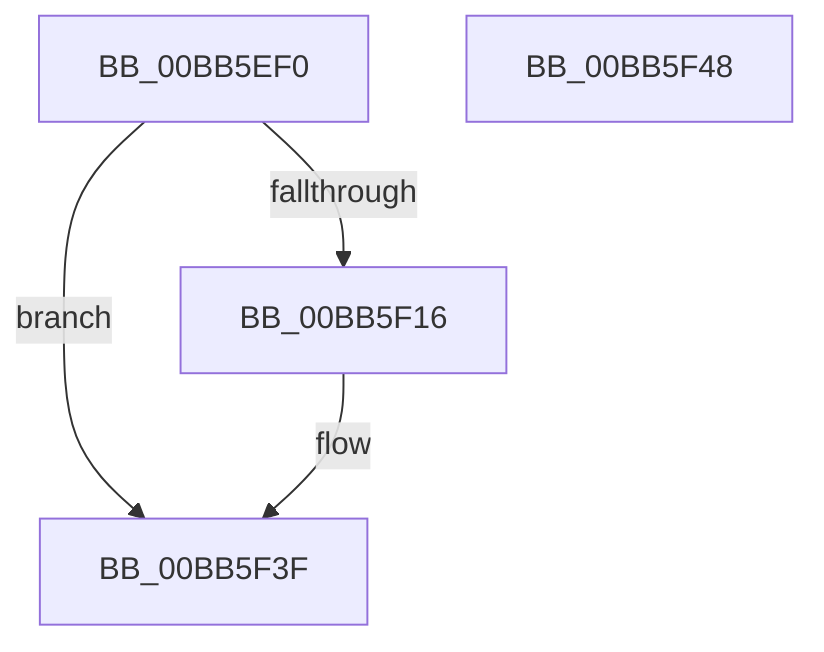

# VfPowerTestStartedPdoStack

- RVA: `0x00BB5EF0`–`0x00BB5F49` (길이 `89` bytes)
- VA: `0x0000000140BB5EF0`
- 실행 섹션: `PAGEVRFY`
- PDB 이름 있음: `예`; PDB Function 태그: `아니요`
- unwind 정보 RVA: `0x0008A5A0`
- 디코드: `23`개 명령, `89/89` bytes 표시
- 미해석 바이트: `0` (있으면 어셈블리에 `.byte`로 보존)

> 이 문서는 커널 이미지의 기계어와 PDB 기호를 분석해 생성했습니다. 4번과 5번은 함수 원형과 자료형을 바이너리 사용 방식에서 추정한 C 해석이며 원본 소스 복구 결과는 아닙니다.

## 1. Dependencies

- 직접 호출 지점: **2**; 고유 호출 대상: **2**
- 직접 호출자로 확인된 함수: **0**
- RIP 상대 이미지 참조: **1**

### Outgoing calls
- `0x00BB5F07` → [memset](../../text/6C/memset_function_006C6C40.md) (function, `0x006C6C40`)
- `0x00BB5F3A` → [VfIrpSendSynchronousIrp](../B9/VfIrpSendSynchronousIrp_function_00B9DEF0.md) (function, `0x00B9DEF0`)

### Direct callers
- 이 함수 시작 RVA로 연결되는 직접 call은 확인되지 않았습니다. 간접 호출은 완전히 역산할 수 없습니다.

### Static image references
- `0x00BB5F0C` → RVA `0x00F04A20` (`.data`; read)

## 2. Other-region calls and transfers

- 다른 실행 섹션으로 향하는 call: **1**
  - `0x00BB5F07` → [memset](../../text/6C/memset_function_006C6C40.md) (`PAGEVRFY` → `.text`)
- 별도 외부 분기/꼬리 이동을 확인하지 못했습니다.

## 3. Assembly (complete function range)

```asm
00BB5EF0  40 53                           push rbx
00BB5EF2  48 81 EC 90 00 00 00            sub rsp, 0x90
00BB5EF9  33 D2                           xor edx, edx
00BB5EFB  48 8B D9                        mov rbx, rcx
00BB5EFE  48 8D 4C 24 40                  lea rcx, [rsp + 0x40]
00BB5F03  44 8D 42 48                     lea r8d, [rdx + 0x48]
00BB5F07  E8 34 0D B1 FF                  call 0x1406c6c40
00BB5F0C  8B 05 0E EB 34 00               mov eax, dword ptr [rip + 0x34eb0e]
00BB5F12  A8 10                           test al, 0x10
00BB5F14  74 29                           je 0x140bb5f3f
00BB5F16  33 C0                           xor eax, eax
00BB5F18  66 C7 44 24 40 16 FF            mov word ptr [rsp + 0x40], 0xff16
00BB5F1F  48 89 44 24 30                  mov qword ptr [rsp + 0x30], rax
00BB5F24  48 8D 54 24 40                  lea rdx, [rsp + 0x40]
00BB5F29  48 89 44 24 28                  mov qword ptr [rsp + 0x28], rax
00BB5F2E  48 8B CB                        mov rcx, rbx
00BB5F31  48 89 44 24 20                  mov qword ptr [rsp + 0x20], rax
00BB5F36  44 8D 40 01                     lea r8d, [rax + 1]
00BB5F3A  E8 B1 7F FE FF                  call 0x140b9def0
00BB5F3F  48 81 C4 90 00 00 00            add rsp, 0x90
00BB5F46  5B                              pop rbx
00BB5F47  C3                              ret
00BB5F48  CC                              int3
```

## 4. C-style interpretation (structured pseudocode)

```c
__int64 __fastcall VfPowerTestStartedPdoStack(__int64 a1, int a2)
{
    __int64 result;
    __int64 v_rsp;
    unsigned __int64 v_stack_m58;
    unsigned __int64 v_stack_m68;
    unsigned __int64 v_stack_m70;
    unsigned __int64 v_stack_m78;

    v_rsp = (v_rsp) - (144);
    a2 = 0;
    result = memset(v_stack_m58, a2, a2 + 72, a4);
    result = (unsigned int)(*(unsigned int *)(v_rip + 3468046));
    if ((((unsigned __int8)((unsigned int)(*(unsigned int *)(v_rip + 3468046)))) & (16)) != 0) {
        result = 0;
        v_stack_m58 = 0xFF16ULL;
        v_stack_m68 = 0;
        a2 = v_stack_m58;
        v_stack_m70 = 0;
        a1 = a1;
        v_stack_m78 = 0;
        a3 = result + 1;
        result = VfIrpSendSynchronousIrp(a1, a2, a3, a4);
    }
    v_rsp = (v_rsp) + (144);
    return result;
}
```

## 5. (Beta) C Style

```c
int64_t VfPowerTestStartedPdoStack(int64_t Arg1, int32_t Arg2)
{
    int64_t result;
    int64_t local_rsp;
    uint64_t v_stack_m58;
    uint64_t v_stack_m68;
    uint64_t v_stack_m70;
    uint64_t v_stack_m78;

    local_rsp = (local_rsp) - (144);
    Arg2 = 0;
    result = memset(v_stack_m58, Arg2, Arg2 + 72, a4);
    result = (uint32_t)(*(uint32_t *)(v_rip + 0x34EB0E));
    if ((((uint8_t)((uint32_t)(*(uint32_t *)(v_rip + 0x34EB0E)))) & (16)) != 0) {
        result = 0;
        v_stack_m58 = 0xFF16ULL;
        v_stack_m68 = 0;
        Arg2 = v_stack_m58;
        v_stack_m70 = 0;
        Arg1 = Arg1;
        v_stack_m78 = 0;
        a3 = result + 1;
        result = VfIrpSendSynchronousIrp(Arg1, Arg2, a3, a4);
    }
    local_rsp = (local_rsp) + (144);
    return result;
}
```

## 6. Execution-region graph

[열기: 2D/3D 그래프와 함수 탐색 컨트롤 패널](../../../control-panel.html?section=pagevrfy&rva=0x00BB5EF0&view=graph)

- 2D 그래프는 위에서 아래로 흐르고, 3D 그래프는 빈 공간을 드래그해 회전합니다. Shift+드래그는 이동, 휠은 확대·축소, 함수 노드 선택은 대상 보고서 이동입니다.

### Static fallback


