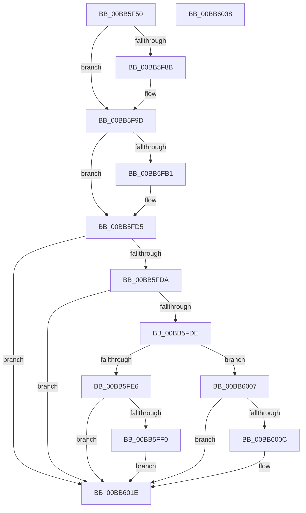

# VfPowerVerifyIrpStackDownward

- RVA: `0x00BB5F50`–`0x00BB6039` (길이 `233` bytes)
- VA: `0x0000000140BB5F50`
- 실행 섹션: `PAGEVRFY`
- PDB 이름 있음: `예`; PDB Function 태그: `아니요`
- unwind 정보 RVA: `0x000D79EC`
- 디코드: `62`개 명령, `233/233` bytes 표시
- 미해석 바이트: `0` (있으면 어셈블리에 `.byte`로 보존)

> 이 문서는 커널 이미지의 기계어와 PDB 기호를 분석해 생성했습니다. 4번과 5번은 함수 원형과 자료형을 바이너리 사용 방식에서 추정한 C 해석이며 원본 소스 복구 결과는 아닙니다.

## 1. Dependencies

- 직접 호출 지점: **5**; 고유 호출 대상: **2**
- 직접 호출자로 확인된 함수: **0**
- RIP 상대 이미지 참조: **1**

### Outgoing calls
- `0x00BB5F98` → [ViErrorReport1](../../text/61/ViErrorReport1_function_00614584.md) (function, `0x00614584`)
- `0x00BB5FB6` → [VfGetPristineDriverInit](../B9/VfGetPristineDriverInit_function_00B9D8CC.md) (function, `0x00B9D8CC`)
- `0x00BB5FC6` → [ViErrorReport1](../../text/61/ViErrorReport1_function_00614584.md) (function, `0x00614584`)
- `0x00BB5FFD` → [ViErrorReport1](../../text/61/ViErrorReport1_function_00614584.md) (function, `0x00614584`)
- `0x00BB6019` → [ViErrorReport1](../../text/61/ViErrorReport1_function_00614584.md) (function, `0x00614584`)

### Direct callers
- 이 함수 시작 RVA로 연결되는 직접 call은 확인되지 않았습니다. 간접 호출은 완전히 역산할 수 없습니다.

### Static image references
- `0x00BB5FA1` → RVA `0x0029B590` (`IopInvalidDeviceRequest`; read)

## 2. Other-region calls and transfers

- 다른 실행 섹션으로 향하는 call: **4**
  - `0x00BB5F98` → [ViErrorReport1](../../text/61/ViErrorReport1_function_00614584.md) (`PAGEVRFY` → `.text`)
  - `0x00BB5FC6` → [ViErrorReport1](../../text/61/ViErrorReport1_function_00614584.md) (`PAGEVRFY` → `.text`)
  - `0x00BB5FFD` → [ViErrorReport1](../../text/61/ViErrorReport1_function_00614584.md) (`PAGEVRFY` → `.text`)
  - `0x00BB6019` → [ViErrorReport1](../../text/61/ViErrorReport1_function_00614584.md) (`PAGEVRFY` → `.text`)
- 별도 외부 분기/꼬리 이동을 확인하지 못했습니다.

## 3. Assembly (complete function range)

```asm
00BB5F50  48 89 5C 24 08                  mov qword ptr [rsp + 8], rbx
00BB5F55  48 89 74 24 10                  mov qword ptr [rsp + 0x10], rsi
00BB5F5A  48 89 7C 24 18                  mov qword ptr [rsp + 0x18], rdi
00BB5F5F  41 54                           push r12
00BB5F61  41 56                           push r14
00BB5F63  41 57                           push r15
00BB5F65  48 83 EC 20                     sub rsp, 0x20
00BB5F69  48 8B 81 F0 00 00 00            mov rax, qword ptr [rcx + 0xf0]
00BB5F70  4D 8B E0                        mov r12, r8
00BB5F73  48 8B 5C 24 60                  mov rbx, qword ptr [rsp + 0x60]
00BB5F78  4C 8B F2                        mov r14, rdx
00BB5F7B  48 8B 39                        mov rdi, qword ptr [rcx]
00BB5F7E  83 78 38 03                     cmp dword ptr [rax + 0x38], 3
00BB5F82  44 8B 7B 60                     mov r15d, dword ptr [rbx + 0x60]
00BB5F86  8B 77 30                        mov esi, dword ptr [rdi + 0x30]
00BB5F89  75 12                           jne 0x140bb5f9d
00BB5F8B  48 8B 54 24 70                  mov rdx, qword ptr [rsp + 0x70]
00BB5F90  4C 8B C7                        mov r8, rdi
00BB5F93  B9 11 02 00 00                  mov ecx, 0x211
00BB5F98  E8 E7 E5 A5 FF                  call 0x140614584
00BB5F9D  49 8B 4E 08                     mov rcx, qword ptr [r14 + 8]
00BB5FA1  48 8D 05 E8 55 6E FF            lea rax, [rip - 0x91aa18]
00BB5FA8  48 39 81 20 01 00 00            cmp qword ptr [rcx + 0x120], rax
00BB5FAF  75 24                           jne 0x140bb5fd5
00BB5FB1  0F BA 6B 04 18                  bts dword ptr [rbx + 4], 0x18
00BB5FB6  E8 11 79 FE FF                  call 0x140b9d8cc
00BB5FBB  4C 8B C7                        mov r8, rdi
00BB5FBE  48 8B D0                        mov rdx, rax
00BB5FC1  B9 1F 02 00 00                  mov ecx, 0x21f
00BB5FC6  E8 B9 E5 A5 FF                  call 0x140614584
00BB5FCB  48 8B 44 24 68                  mov rax, qword ptr [rsp + 0x68]
00BB5FD0  0F BA 68 04 1F                  bts dword ptr [rax + 4], 0x1f
00BB5FD5  4D 85 E4                        test r12, r12
00BB5FD8  74 44                           je 0x140bb601e
00BB5FDA  85 F6                           test esi, esi
00BB5FDC  79 40                           jns 0x140bb601e
00BB5FDE  81 FE BB 00 00 C0               cmp esi, 0xc00000bb
00BB5FE4  74 21                           je 0x140bb6007
00BB5FE6  BE 00 00 00 02                  mov esi, 0x2000000
00BB5FEB  85 73 04                        test dword ptr [rbx + 4], esi
00BB5FEE  75 2E                           jne 0x140bb601e
00BB5FF0  48 8B 54 24 70                  mov rdx, qword ptr [rsp + 0x70]
00BB5FF5  4C 8B C7                        mov r8, rdi
00BB5FF8  B9 19 02 00 00                  mov ecx, 0x219
00BB5FFD  E8 82 E5 A5 FF                  call 0x140614584
00BB6002  09 73 04                        or dword ptr [rbx + 4], esi
00BB6005  EB 17                           jmp 0x140bb601e
00BB6007  41 3B F7                        cmp esi, r15d
00BB600A  74 12                           je 0x140bb601e
00BB600C  48 8B 54 24 70                  mov rdx, qword ptr [rsp + 0x70]
00BB6011  4C 8B C7                        mov r8, rdi
00BB6014  B9 1A 02 00 00                  mov ecx, 0x21a
00BB6019  E8 66 E5 A5 FF                  call 0x140614584
00BB601E  48 8B 5C 24 40                  mov rbx, qword ptr [rsp + 0x40]
00BB6023  48 8B 74 24 48                  mov rsi, qword ptr [rsp + 0x48]
00BB6028  48 8B 7C 24 50                  mov rdi, qword ptr [rsp + 0x50]
00BB602D  48 83 C4 20                     add rsp, 0x20
00BB6031  41 5F                           pop r15
00BB6033  41 5E                           pop r14
00BB6035  41 5C                           pop r12
00BB6037  C3                              ret
00BB6038  CC                              int3
```

## 4. C-style interpretation (structured pseudocode)

```c
__int64 __fastcall VfPowerVerifyIrpStackDownward(__int64 a1, __int64 a2, __int64 a3, __int64 a4, __int64 a5, __int64 a6, __int64 a7)
{
    __int64 result;
    __int64 v_rsp;
    unsigned __int64 v_stack_p10;
    unsigned __int64 v_stack_p18;
    unsigned __int64 v_stack_p8;

    v_stack_p8 = v_rbx;
    v_stack_p10 = v_rsi;
    v_stack_p18 = v_rdi;
    v_rsp = (v_rsp) - (32);
    result = *(unsigned __int64 *)(a1 + 240);
    if ((*(unsigned int *)(*(unsigned __int64 *)(a1 + 240) + 56)) == 3) {
        a2 = a7;
        a3 = *(unsigned __int64 *)(a1);
        a1 = 529;
        result = ViErrorReport1(a1, a2, a3, a4);
    }
    result = v_rip - 9546264;
    if ((*(unsigned __int64 *)(*(unsigned __int64 *)(a2 + 8) + 288)) == (v_rip - 9546264)) {
        result = VfGetPristineDriverInit(*(unsigned __int64 *)(a2 + 8), a2, a3, a4);
        a3 = *(unsigned __int64 *)(a1);
        a2 = result;
        a1 = 543;
        result = ViErrorReport1(a1, a2, a3, a4);
        result = a6;
    }
    if (a3 == 0) goto loc_00BB601E;
    if (!sign_flag) goto loc_00BB601E;
    if (((unsigned int)((unsigned int)(*(unsigned int *)(*(unsigned __int64 *)(a1) + 48)))) == 0xC00000BBULL) goto loc_00BB6007;
    if (((*(unsigned int *)(a5 + 4)) & ((unsigned int)((unsigned int)(0x2000000ULL)))) != 0) goto loc_00BB601E;
    result = ViErrorReport1(537, a7, *(unsigned __int64 *)(a1), a4);
    goto loc_00BB601E;
loc_00BB6007:
    if (((unsigned int)((unsigned int)(0x2000000ULL))) != ((unsigned int)((unsigned int)(*(unsigned int *)(a5 + 96))))) {
        a2 = a7;
        a3 = *(unsigned __int64 *)(a1);
        a1 = 538;
        result = ViErrorReport1(a1, a2, a3, a4);
    }
    v_rsp = (v_rsp) + (32);
    return result;
}
```

## 5. (Beta) C Style

```c
int64_t VfPowerVerifyIrpStackDownward(void *Arg1, void *Arg2, int64_t Arg3, int64_t Arg4, void *Arg5, void *Arg6, int64_t Arg7)
{
    uint8_t *arg1 = (uint8_t *)Arg1;
    uint8_t *arg2 = (uint8_t *)Arg2;
    uint8_t *arg5 = (uint8_t *)Arg5;
    uint8_t *arg6 = (uint8_t *)Arg6;

    int64_t result;
    int64_t local_rsp;
    uint64_t v_stack_p10;
    uint64_t v_stack_p18;
    uint64_t v_stack_p8;

    v_stack_p8 = local_rbx;
    v_stack_p10 = local_rsi;
    v_stack_p18 = local_rdi;
    local_rsp = (local_rsp) - (32);
    result = *(uint64_t *)(arg1 + 0xF0);
    if ((*(uint32_t *)(*(uint64_t *)(arg1 + 0xF0) + 0x38)) == 3) {
        Arg2 = Arg7;
        Arg3 = *(uint64_t *)(arg1);
        Arg1 = 529;
        result = ViErrorReport1(Arg1, Arg2, Arg3, Arg4);
    }
    result = v_rip - 9546264;
    if ((*(uint64_t *)(*(uint64_t *)(arg2 + 0x8) + 0x120)) == (v_rip - 9546264)) {
        result = VfGetPristineDriverInit(*(uint64_t *)(arg2 + 0x8), Arg2, Arg3, Arg4);
        Arg3 = *(uint64_t *)(arg1);
        Arg2 = result;
        Arg1 = 543;
        result = ViErrorReport1(Arg1, Arg2, Arg3, Arg4);
        result = Arg6;
    }
    if (Arg3 == 0) goto loc_00BB601E;
    if (!sign_flag) goto loc_00BB601E;
    if (((uint32_t)((uint32_t)(*(uint32_t *)(*(uint64_t *)(arg1) + 0x30)))) == 0xC00000BBULL) goto loc_00BB6007;
    if (((*(uint32_t *)(arg5 + 0x4)) & ((uint32_t)((uint32_t)(0x2000000ULL)))) != 0) goto loc_00BB601E;
    result = ViErrorReport1(537, Arg7, *(uint64_t *)(arg1), Arg4);
    goto loc_00BB601E;
loc_00BB6007:
    if (((uint32_t)((uint32_t)(0x2000000ULL))) != ((uint32_t)((uint32_t)(*(uint32_t *)(arg5 + 0x60))))) {
        Arg2 = Arg7;
        Arg3 = *(uint64_t *)(arg1);
        Arg1 = 538;
        result = ViErrorReport1(Arg1, Arg2, Arg3, Arg4);
    }
    local_rsp = (local_rsp) + (32);
    return result;
}
```

### 관측된 메모리 오프셋

구조체 형식이 확인되지 않은 접근은 인자 기준의 오프셋으로만 기록했습니다.

| 기준 인자 | 오프셋 표현 | 폭 (bit) | 접근 |
|---|---:|---:|---|
| `Arg1` | `+ 0x0` | `64` | `R` |
| `Arg1` | `+ 0xF0` | `64` | `R` |
| `Arg2` | `+ 0x8` | `64` | `R` |
| `Arg5` | `+ 0x4` | `32` | `R` |
| `Arg5` | `+ 0x4` | `32` | `R/W` |
| `Arg5` | `+ 0x60` | `32` | `R` |
| `Arg6` | `+ 0x4` | `32` | `R/W` |

## 6. Execution-region graph

[열기: 2D/3D 그래프와 함수 탐색 컨트롤 패널](../../../control-panel.html?section=pagevrfy&rva=0x00BB5F50&view=graph)

- 2D 그래프는 위에서 아래로 흐르고, 3D 그래프는 빈 공간을 드래그해 회전합니다. Shift+드래그는 이동, 휠은 확대·축소, 함수 노드 선택은 대상 보고서 이동입니다.

### Static fallback


