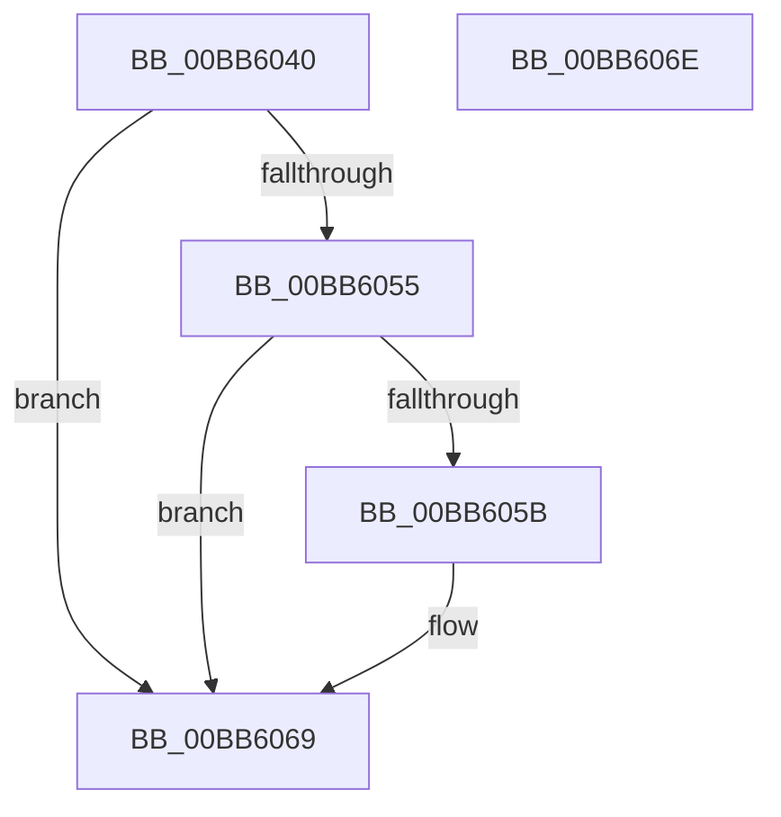

# VfPowerVerifyIrpStackUpward

- RVA: `0x00BB6040`–`0x00BB606F` (길이 `47` bytes)
- VA: `0x0000000140BB6040`
- 실행 섹션: `PAGEVRFY`
- PDB 이름 있음: `예`; PDB Function 태그: `아니요`
- unwind 정보 RVA: `0x0005C788`
- 디코드: `14`개 명령, `47/47` bytes 표시
- 미해석 바이트: `0` (있으면 어셈블리에 `.byte`로 보존)

> 이 문서는 커널 이미지의 기계어와 PDB 기호를 분석해 생성했습니다. 4번과 5번은 함수 원형과 자료형을 바이너리 사용 방식에서 추정한 C 해석이며 원본 소스 복구 결과는 아닙니다.

## 1. Dependencies

- 직접 호출 지점: **1**; 고유 호출 대상: **1**
- 직접 호출자로 확인된 함수: **0**
- RIP 상대 이미지 참조: **0**

### Outgoing calls
- `0x00BB6064` → [ViErrorReport1](../../text/61/ViErrorReport1_function_00614584.md) (function, `0x00614584`)

### Direct callers
- 이 함수 시작 RVA로 연결되는 직접 call은 확인되지 않았습니다. 간접 호출은 완전히 역산할 수 없습니다.

### Static image references
- 디코드된 RIP-relative 메모리 참조가 없습니다.

## 2. Other-region calls and transfers

- 다른 실행 섹션으로 향하는 call: **1**
  - `0x00BB6064` → [ViErrorReport1](../../text/61/ViErrorReport1_function_00614584.md) (`PAGEVRFY` → `.text`)
- 별도 외부 분기/꼬리 이동을 확인하지 못했습니다.

## 3. Assembly (complete function range)

```asm
00BB6040  48 83 EC 28                     sub rsp, 0x28
00BB6044  4D 8B D0                        mov r10, r8
00BB6047  4C 8B 01                        mov r8, qword ptr [rcx]
00BB604A  B9 BB 00 00 C0                  mov ecx, 0xc00000bb
00BB604F  41 39 48 30                     cmp dword ptr [r8 + 0x30], ecx
00BB6053  75 14                           jne 0x140bb6069
00BB6055  41 39 4A 60                     cmp dword ptr [r10 + 0x60], ecx
00BB6059  74 0E                           je 0x140bb6069
00BB605B  49 8B 51 28                     mov rdx, qword ptr [r9 + 0x28]
00BB605F  B9 1A 02 00 00                  mov ecx, 0x21a
00BB6064  E8 1B E5 A5 FF                  call 0x140614584
00BB6069  48 83 C4 28                     add rsp, 0x28
00BB606D  C3                              ret
00BB606E  CC                              int3
```

## 4. C-style interpretation (structured pseudocode)

```c
__int64 __fastcall VfPowerVerifyIrpStackUpward(__int64 a1, __int64 a2, __int64 a3, __int64 a4)
{
    __int64 result;
    __int64 v_rsp;

    v_rsp = (v_rsp) - (40);
    if ((*(unsigned int *)(*(unsigned __int64 *)(a1) + 48)) != ((unsigned int)((unsigned int)(0xC00000BBULL)))) goto loc_00BB6069;
    if ((*(unsigned int *)(a3 + 96)) != ((unsigned int)((unsigned int)(0xC00000BBULL)))) {
        a2 = *(unsigned __int64 *)(a4 + 40);
        a1 = 538;
        result = ViErrorReport1(a1, a2, *(unsigned __int64 *)(a1), a4);
    }
    v_rsp = (v_rsp) + (40);
    return result;
}
```

## 5. (Beta) C Style

```c
int64_t VfPowerVerifyIrpStackUpward(void *Arg1, int64_t Arg2, void *Arg3, void *Arg4)
{
    uint8_t *arg1 = (uint8_t *)Arg1;
    uint8_t *arg3 = (uint8_t *)Arg3;
    uint8_t *arg4 = (uint8_t *)Arg4;

    int64_t result;
    int64_t local_rsp;

    local_rsp = (local_rsp) - (40);
    if ((*(uint32_t *)(*(uint64_t *)(arg1) + 0x30)) != ((uint32_t)((uint32_t)(0xC00000BBULL)))) goto loc_00BB6069;
    if ((*(uint32_t *)(arg3 + 0x60)) != ((uint32_t)((uint32_t)(0xC00000BBULL)))) {
        Arg2 = *(uint64_t *)(arg4 + 0x28);
        Arg1 = 538;
        result = ViErrorReport1(Arg1, Arg2, *(uint64_t *)(arg1), Arg4);
    }
    local_rsp = (local_rsp) + (40);
    return result;
}
```

### 관측된 메모리 오프셋

구조체 형식이 확인되지 않은 접근은 인자 기준의 오프셋으로만 기록했습니다.

| 기준 인자 | 오프셋 표현 | 폭 (bit) | 접근 |
|---|---:|---:|---|
| `Arg1` | `+ 0x0` | `64` | `R` |
| `Arg3` | `+ 0x60` | `32` | `R` |
| `Arg4` | `+ 0x28` | `64` | `R` |

## 6. Execution-region graph

[열기: 2D/3D 그래프와 함수 탐색 컨트롤 패널](../../../control-panel.html?section=pagevrfy&rva=0x00BB6040&view=graph)

- 2D 그래프는 위에서 아래로 흐르고, 3D 그래프는 빈 공간을 드래그해 회전합니다. Shift+드래그는 이동, 휠은 확대·축소, 함수 노드 선택은 대상 보고서 이동입니다.

### Static fallback


