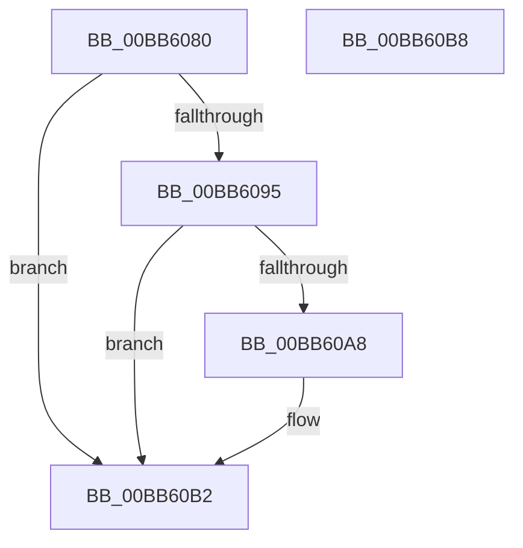

# VfPowerVerifyNewRequest

- RVA: `0x00BB6080`–`0x00BB60B9` (길이 `57` bytes)
- VA: `0x0000000140BB6080`
- 실행 섹션: `PAGEVRFY`
- PDB 이름 있음: `예`; PDB Function 태그: `아니요`
- unwind 정보 RVA: `0x0005CF00`
- 디코드: `17`개 명령, `57/57` bytes 표시
- 미해석 바이트: `0` (있으면 어셈블리에 `.byte`로 보존)

> 이 문서는 커널 이미지의 기계어와 PDB 기호를 분석해 생성했습니다. 4번과 5번은 함수 원형과 자료형을 바이너리 사용 방식에서 추정한 C 해석이며 원본 소스 복구 결과는 아닙니다.

## 1. Dependencies

- 직접 호출 지점: **1**; 고유 호출 대상: **1**
- 직접 호출자로 확인된 함수: **0**
- RIP 상대 이미지 참조: **0**

### Outgoing calls
- `0x00BB609F` → [ViErrorReport1](../../text/61/ViErrorReport1_function_00614584.md) (function, `0x00614584`)

### Direct callers
- 이 함수 시작 RVA로 연결되는 직접 call은 확인되지 않았습니다. 간접 호출은 완전히 역산할 수 없습니다.

### Static image references
- 디코드된 RIP-relative 메모리 참조가 없습니다.

## 2. Other-region calls and transfers

- 다른 실행 섹션으로 향하는 call: **1**
  - `0x00BB609F` → [ViErrorReport1](../../text/61/ViErrorReport1_function_00614584.md) (`PAGEVRFY` → `.text`)
- 별도 외부 분기/꼬리 이동을 확인하지 못했습니다.

## 3. Assembly (complete function range)

```asm
00BB6080  40 53                           push rbx
00BB6082  48 83 EC 20                     sub rsp, 0x20
00BB6086  4C 8B 01                        mov r8, qword ptr [rcx]
00BB6089  41 8B 58 30                     mov ebx, dword ptr [r8 + 0x30]
00BB608D  81 FB BB 00 00 C0               cmp ebx, 0xc00000bb
00BB6093  74 1D                           je 0x140bb60b2
00BB6095  48 8B 54 24 58                  mov rdx, qword ptr [rsp + 0x58]
00BB609A  B9 0F 02 00 00                  mov ecx, 0x20f
00BB609F  E8 E0 E4 A5 FF                  call 0x140614584
00BB60A4  85 DB                           test ebx, ebx
00BB60A6  79 0A                           jns 0x140bb60b2
00BB60A8  48 8B 44 24 50                  mov rax, qword ptr [rsp + 0x50]
00BB60AD  0F BA 68 04 19                  bts dword ptr [rax + 4], 0x19
00BB60B2  48 83 C4 20                     add rsp, 0x20
00BB60B6  5B                              pop rbx
00BB60B7  C3                              ret
00BB60B8  CC                              int3
```

## 4. C-style interpretation (structured pseudocode)

```c
__int64 __fastcall VfPowerVerifyNewRequest(__int64 a1, __int64 a2, __int64 a3, __int64 a4, __int64 a5, __int64 a6)
{
    __int64 result;
    __int64 v_rsp;

    v_rsp = (v_rsp) - (32);
    if (((unsigned int)((unsigned int)(*(unsigned int *)(*(unsigned __int64 *)(a1) + 48)))) == 0xC00000BBULL) goto loc_00BB60B2;
    result = ViErrorReport1(527, a6, *(unsigned __int64 *)(a1), a4);
    if (sign_flag) {
        result = a5;
    }
    v_rsp = (v_rsp) + (32);
    return result;
}
```

## 5. (Beta) C Style

```c
int64_t VfPowerVerifyNewRequest(void *Arg1, int64_t Arg2, int64_t Arg3, int64_t Arg4, void *Arg5, int64_t Arg6)
{
    uint8_t *arg1 = (uint8_t *)Arg1;
    uint8_t *arg5 = (uint8_t *)Arg5;

    int64_t result;
    int64_t local_rsp;

    local_rsp = (local_rsp) - (32);
    if (((uint32_t)((uint32_t)(*(uint32_t *)(*(uint64_t *)(arg1) + 0x30)))) == 0xC00000BBULL) goto loc_00BB60B2;
    result = ViErrorReport1(527, Arg6, *(uint64_t *)(arg1), Arg4);
    if (sign_flag) {
        result = Arg5;
    }
    local_rsp = (local_rsp) + (32);
    return result;
}
```

### 관측된 메모리 오프셋

구조체 형식이 확인되지 않은 접근은 인자 기준의 오프셋으로만 기록했습니다.

| 기준 인자 | 오프셋 표현 | 폭 (bit) | 접근 |
|---|---:|---:|---|
| `Arg1` | `+ 0x0` | `64` | `R` |
| `Arg5` | `+ 0x4` | `32` | `R/W` |

## 6. Execution-region graph

[열기: 2D/3D 그래프와 함수 탐색 컨트롤 패널](../../../control-panel.html?section=pagevrfy&rva=0x00BB6080&view=graph)

- 2D 그래프는 위에서 아래로 흐르고, 3D 그래프는 빈 공간을 드래그해 회전합니다. Shift+드래그는 이동, 휠은 확대·축소, 함수 노드 선택은 대상 보고서 이동입니다.

### Static fallback


