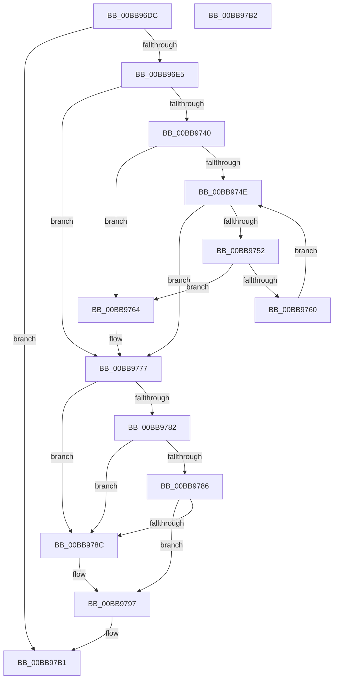

# VfPtFreePoolNotification

- RVA: `0x00BB96DC`–`0x00BB97B3` (길이 `215` bytes)
- VA: `0x0000000140BB96DC`
- 실행 섹션: `PAGEVRFY`
- PDB 이름 있음: `예`; PDB Function 태그: `아니요`
- unwind 정보 RVA: `0x000BF040`
- 디코드: `64`개 명령, `215/215` bytes 표시
- 미해석 바이트: `0` (있으면 어셈블리에 `.byte`로 보존)

> 이 문서는 커널 이미지의 기계어와 PDB 기호를 분석해 생성했습니다. 4번과 5번은 함수 원형과 자료형을 바이너리 사용 방식에서 추정한 C 해석이며 원본 소스 복구 결과는 아닙니다.

## 1. Dependencies

- 직접 호출 지점: **4**; 고유 호출 대상: **4**
- 직접 호출자로 확인된 함수: **4**
- RIP 상대 이미지 참조: **3**

### Outgoing calls
- `0x00BB9720` → [DifNotifyPluginSystemEvent](../../text/61/DifNotifyPluginSystemEvent_function_0061A9B8.md) (function, `0x0061A9B8`)
- `0x00BB9731` → [DifObjTrkQeuryInvokeDeleteRange](../../text/61/DifObjTrkQeuryInvokeDeleteRange_function_00619EA0.md) (function, `0x00619EA0`)
- `0x00BB9772` → [ViPtLogPoolTraceWrapper](../B9/ViPtLogPoolTraceWrapper_function_00B92100.md) (function, `0x00B92100`)
- `0x00BB9792` → [VfFreeMemoryNotification](VfFreeMemoryNotification_function_00BB7A6C.md) (function, `0x00BB7A6C`)

### Direct callers
- [ExAllocateHeapPool](../../text/35/ExAllocateHeapPool_function_0035BA30.md) at `0x0035C8F1`
- [ExpFreePoolChecks](../../text/35/ExpFreePoolChecks_function_0035F4F0.md) at `0x0035F52B`
- [sub_0035FB85](../../text/35/Unknown_function_0035FB85.md) at `0x0035FCD9`
- [sub_00B82950](../../poolcode/B8/Unknown_function_00B82950.md) at `0x00B82A9B`

### Static image references
- `0x00BB9736` → RVA `0x00E681A0` (`.data`; read)
- `0x00BB9740` → RVA `0x00E0EA70` (`.data`; read)
- `0x00BB9754` → RVA `0x00E681D8` (`.data`; read)

## 2. Other-region calls and transfers

- 다른 실행 섹션으로 향하는 call: **2**
  - `0x00BB9720` → [DifNotifyPluginSystemEvent](../../text/61/DifNotifyPluginSystemEvent_function_0061A9B8.md) (`PAGEVRFY` → `.text`)
  - `0x00BB9731` → [DifObjTrkQeuryInvokeDeleteRange](../../text/61/DifObjTrkQeuryInvokeDeleteRange_function_00619EA0.md) (`PAGEVRFY` → `.text`)
- 별도 외부 분기/꼬리 이동을 확인하지 못했습니다.

## 3. Assembly (complete function range)

```asm
00BB96DC  4D 85 C0                        test r8, r8
00BB96DF  0F 84 CC 00 00 00               je 0x140bb97b1
00BB96E5  48 8B C4                        mov rax, rsp
00BB96E8  48 89 58 08                     mov qword ptr [rax + 8], rbx
00BB96EC  48 89 68 10                     mov qword ptr [rax + 0x10], rbp
00BB96F0  48 89 70 18                     mov qword ptr [rax + 0x18], rsi
00BB96F4  48 89 78 20                     mov qword ptr [rax + 0x20], rdi
00BB96F8  41 56                           push r14
00BB96FA  48 83 EC 40                     sub rsp, 0x40
00BB96FE  33 DB                           xor ebx, ebx
00BB9700  89 50 E8                        mov dword ptr [rax - 0x18], edx
00BB9703  8B F2                           mov esi, edx
00BB9705  89 58 EC                        mov dword ptr [rax - 0x14], ebx
00BB9708  4C 8B F1                        mov r14, rcx
00BB970B  4C 89 48 D8                     mov qword ptr [rax - 0x28], r9
00BB970F  48 8D 50 D8                     lea rdx, [rax - 0x28]
00BB9713  4C 89 40 E0                     mov qword ptr [rax - 0x20], r8
00BB9717  8D 4B 01                        lea ecx, [rbx + 1]
00BB971A  49 8B E9                        mov rbp, r9
00BB971D  49 8B F8                        mov rdi, r8
00BB9720  E8 93 12 A6 FF                  call 0x14061a9b8
00BB9725  45 33 C9                        xor r9d, r9d
00BB9728  45 33 C0                        xor r8d, r8d
00BB972B  48 8B D7                        mov rdx, rdi
00BB972E  49 8B CE                        mov rcx, r14
00BB9731  E8 6A 07 A6 FF                  call 0x140619ea0
00BB9736  8B 05 64 EA 2A 00               mov eax, dword ptr [rip + 0x2aea64]
00BB973C  A8 08                           test al, 8
00BB973E  74 37                           je 0x140bb9777
00BB9740  8B 0D 2A 53 25 00               mov ecx, dword ptr [rip + 0x25532a]
00BB9746  8D 41 FF                        lea eax, [rcx - 1]
00BB9749  83 F8 09                        cmp eax, 9
00BB974C  77 16                           ja 0x140bb9764
00BB974E  3B D9                           cmp ebx, ecx
00BB9750  73 25                           jae 0x140bb9777
00BB9752  8B C3                           mov eax, ebx
00BB9754  48 8D 15 7D EA 2A 00            lea rdx, [rip + 0x2aea7d]
00BB975B  39 34 82                        cmp dword ptr [rdx + rax*4], esi
00BB975E  74 04                           je 0x140bb9764
00BB9760  FF C3                           inc ebx
00BB9762  EB EA                           jmp 0x140bb974e
00BB9764  41 B9 01 00 00 00               mov r9d, 1
00BB976A  4C 8B C7                        mov r8, rdi
00BB976D  8B D6                           mov edx, esi
00BB976F  48 8B CD                        mov rcx, rbp
00BB9772  E8 89 89 FD FF                  call 0x140b92100
00BB9777  48 8B 05 22 EA 2A 00            mov rax, qword ptr [rip + 0x2aea22]
00BB977E  A8 20                           test al, 0x20
00BB9780  75 0A                           jne 0x140bb978c
00BB9782  A8 10                           test al, 0x10
00BB9784  75 06                           jne 0x140bb978c
00BB9786  0F BA E0 0B                     bt eax, 0xb
00BB978A  73 0B                           jae 0x140bb9797
00BB978C  48 8B D7                        mov rdx, rdi
00BB978F  49 8B CE                        mov rcx, r14
00BB9792  E8 D5 E2 FF FF                  call 0x140bb7a6c
00BB9797  48 8B 5C 24 50                  mov rbx, qword ptr [rsp + 0x50]
00BB979C  48 8B 6C 24 58                  mov rbp, qword ptr [rsp + 0x58]
00BB97A1  48 8B 74 24 60                  mov rsi, qword ptr [rsp + 0x60]
00BB97A6  48 8B 7C 24 68                  mov rdi, qword ptr [rsp + 0x68]
00BB97AB  48 83 C4 40                     add rsp, 0x40
00BB97AF  41 5E                           pop r14
00BB97B1  C3                              ret
00BB97B2  CC                              int3
```

## 4. C-style interpretation (structured pseudocode)

```c
__int64 __fastcall VfPtFreePoolNotification(__int64 a1, int a2, __int64 a3, __int64 a4)
{
    __int64 result;
    __int64 v_rbx;
    __int64 v_rsp;
    unsigned __int64 v_stack_p10;
    unsigned __int64 v_stack_p18;
    unsigned __int64 v_stack_p20;
    unsigned __int64 v_stack_p8;

    if (a3 == 0) goto loc_00BB97B1;
    *(unsigned __int64 *)(v_rsp + 8) = v_rbx;
    *(unsigned __int64 *)(v_rsp + 16) = v_rbp;
    *(unsigned __int64 *)(v_rsp + 24) = v_rsi;
    *(unsigned __int64 *)(v_rsp + 32) = v_rdi;
    v_rsp = (v_rsp) - (64);
    v_rbx = 0;
    *(unsigned int *)(v_rsp - 24) = a2;
    *(unsigned int *)(v_rsp - 20) = 0;
    *(unsigned __int64 *)(v_rsp - 40) = a4;
    *(unsigned __int64 *)(v_rsp - 32) = a3;
    result = DifNotifyPluginSystemEvent(v_rbx + 1, v_rsp - 40, a3, a4);
    a4 = 0;
    a3 = 0;
    result = DifObjTrkQeuryInvokeDeleteRange(a1, 0, a3, a4);
    if ((((unsigned __int8)((unsigned int)(*(unsigned int *)(v_rip + 2812516)))) & (8)) == 0) goto loc_00BB9777;
    if (((unsigned int)((unsigned int)(*(unsigned int *)(v_rip + 2446122)) - 1)) > 9) goto loc_00BB9764;
loc_00BB974E:
    if (0 >= ((unsigned int)((unsigned int)(*(unsigned int *)(v_rip + 2446122))))) goto loc_00BB9777;
    if ((*(unsigned int *)(v_rip + 2812541 + 0 * 4)) == ((unsigned int)((unsigned int)(a2)))) goto loc_00BB9764;
    v_rbx = (unsigned int)((v_rbx) + 1);
    goto loc_00BB974E;
loc_00BB9764:
    result = ViPtLogPoolTraceWrapper(0, (unsigned int)((unsigned int)((unsigned int)(a2))), 0, 1);
loc_00BB9777:
    if ((((unsigned __int8)(*(unsigned __int64 *)(v_rip + 2812450))) & (32)) != 0) goto loc_00BB978C;
    if ((((unsigned __int8)(*(unsigned __int64 *)(v_rip + 2812450))) & (16)) != 0) goto loc_00BB978C;
    result = *(unsigned __int64 *)(v_rip + 2812450);
    if (!(condition_is_above_or_equal)) {
        a2 = 0;
        a1 = a1;
        result = VfFreeMemoryNotification(a1, a2, 0, 1);
    }
    v_rsp = (v_rsp) + (64);
loc_00BB97B1:
    return result;
}
```

## 5. (Beta) C Style

```c
int64_t VfPtFreePoolNotification(int64_t Arg1, int32_t Arg2, int64_t Arg3, int64_t Arg4)
{
    int64_t result;
    int64_t local_rbx;
    int64_t local_rsp;
    uint64_t v_stack_p10;
    uint64_t v_stack_p18;
    uint64_t v_stack_p20;
    uint64_t v_stack_p8;

    if (Arg3 == 0) goto loc_00BB97B1;
    *(uint64_t *)(local_rsp + 0x8) = local_rbx;
    *(uint64_t *)(local_rsp + 0x10) = local_rbp;
    *(uint64_t *)(local_rsp + 0x18) = local_rsi;
    *(uint64_t *)(local_rsp + 0x20) = local_rdi;
    local_rsp = (local_rsp) - (64);
    local_rbx = 0;
    *(uint32_t *)(local_rsp - 0x18) = Arg2;
    *(uint32_t *)(local_rsp - 0x14) = 0;
    *(uint64_t *)(local_rsp - 0x28) = Arg4;
    *(uint64_t *)(local_rsp - 0x20) = Arg3;
    result = DifNotifyPluginSystemEvent(local_rbx + 1, local_rsp - 40, Arg3, Arg4);
    Arg4 = 0;
    Arg3 = 0;
    result = DifObjTrkQeuryInvokeDeleteRange(Arg1, 0, Arg3, Arg4);
    if ((((uint8_t)((uint32_t)(*(uint32_t *)(v_rip + 0x2AEA64)))) & (8)) == 0) goto loc_00BB9777;
    if (((uint32_t)((uint32_t)(*(uint32_t *)(v_rip + 0x25532A)) - 1)) > 9) goto loc_00BB9764;
loc_00BB974E:
    if (0 >= ((uint32_t)((uint32_t)(*(uint32_t *)(v_rip + 0x25532A))))) goto loc_00BB9777;
    if ((*(uint32_t *)(v_rip + 0x2AEA7D + 0x0 * 4)) == ((uint32_t)((uint32_t)(Arg2)))) goto loc_00BB9764;
    local_rbx = (uint32_t)((local_rbx) + 1);
    goto loc_00BB974E;
loc_00BB9764:
    result = ViPtLogPoolTraceWrapper(0, (uint32_t)((uint32_t)((uint32_t)(Arg2))), 0, 1);
loc_00BB9777:
    if ((((uint8_t)(*(uint64_t *)(v_rip + 0x2AEA22))) & (32)) != 0) goto loc_00BB978C;
    if ((((uint8_t)(*(uint64_t *)(v_rip + 0x2AEA22))) & (16)) != 0) goto loc_00BB978C;
    result = *(uint64_t *)(v_rip + 0x2AEA22);
    if (!(condition_is_above_or_equal)) {
        Arg2 = 0;
        Arg1 = Arg1;
        result = VfFreeMemoryNotification(Arg1, Arg2, 0, 1);
    }
    local_rsp = (local_rsp) + (64);
loc_00BB97B1:
    return result;
}
```

## 6. Execution-region graph

[열기: 2D/3D 그래프와 함수 탐색 컨트롤 패널](../../../control-panel.html?section=pagevrfy&rva=0x00BB96DC&view=graph)

- 2D 그래프는 위에서 아래로 흐르고, 3D 그래프는 빈 공간을 드래그해 회전합니다. Shift+드래그는 이동, 휠은 확대·축소, 함수 노드 선택은 대상 보고서 이동입니다.

### Static fallback


