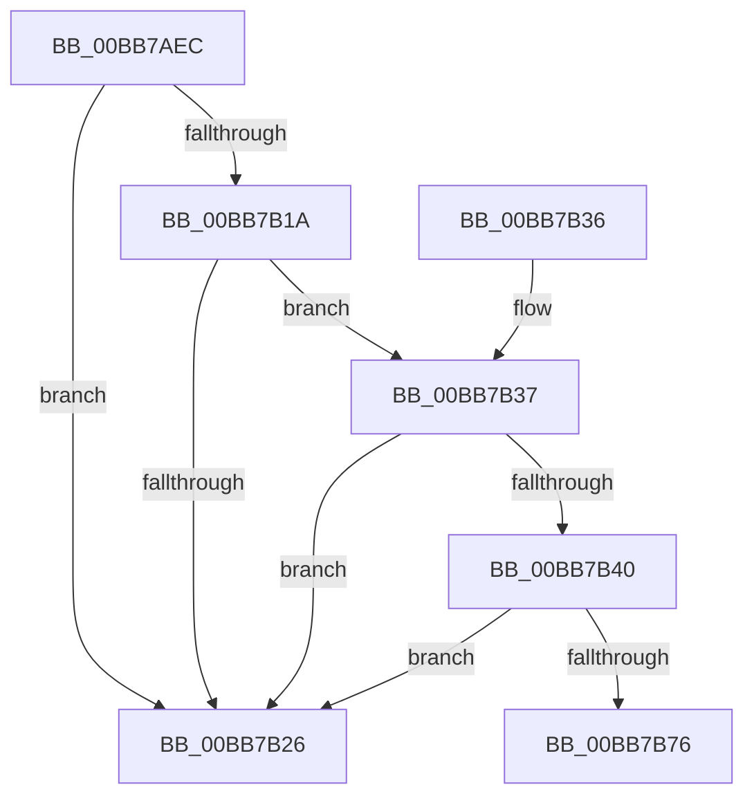

# VfRemLockDeleteMemoryRange

- RVA: `0x00BB7AEC`–`0x00BB7B7B` (길이 `143` bytes)
- VA: `0x0000000140BB7AEC`
- 실행 섹션: `PAGEVRFY`
- PDB 이름 있음: `예`; PDB Function 태그: `예`
- unwind 정보 RVA: `0x000B5138`
- 디코드: `39`개 명령, `143/143` bytes 표시
- 미해석 바이트: `0` (있으면 어셈블리에 `.byte`로 보존)

> 이 문서는 커널 이미지의 기계어와 PDB 기호를 분석해 생성했습니다. 4번과 5번은 함수 원형과 자료형을 바이너리 사용 방식에서 추정한 C 해석이며 원본 소스 복구 결과는 아닙니다.

## 1. Dependencies

- 직접 호출 지점: **4**; 고유 호출 대상: **4**
- 직접 호출자로 확인된 함수: **1**
- RIP 상대 이미지 참조: **3**

### Outgoing calls
- `0x00BB7B37` → [VfPoolIsInternalFree](../../text/49/VfPoolIsInternalFree_function_00498850.md) (function, `0x00498850`)
- `0x00BB7B48` → [VfAvlInitializeLockContext](../../text/4A/VfAvlInitializeLockContext_function_004A686C.md) (function, `0x004A686C`)
- `0x00BB7B5F` → [VfAvlLookupTreeNode](../../text/3E/VfAvlLookupTreeNode_function_003EF1B4.md) (function, `0x003EF1B4`)
- `0x00BB7B6C` → [VfAvlCleanupLockContext](../../text/3E/VfAvlCleanupLockContext_function_003EF56C.md) (function, `0x003EF56C`)

### Direct callers
- [VfFreeMemoryNotification](VfFreeMemoryNotification_function_00BB7A6C.md) at `0x00BB7A9B`

### Static image references
- `0x00BB7B08` → RVA `0x00FFDA28` (`PAGEVRFD`; read)
- `0x00BB7B1A` → RVA `0x00FFDCE8` (`PAGEVRFD`; read)
- `0x00BB7B58` → RVA `0x00FFDCE0` (`PAGEVRFD`; read)

## 2. Other-region calls and transfers

- 다른 실행 섹션으로 향하는 call: **4**
  - `0x00BB7B37` → [VfPoolIsInternalFree](../../text/49/VfPoolIsInternalFree_function_00498850.md) (`PAGEVRFY` → `.text`)
  - `0x00BB7B48` → [VfAvlInitializeLockContext](../../text/4A/VfAvlInitializeLockContext_function_004A686C.md) (`PAGEVRFY` → `.text`)
  - `0x00BB7B5F` → [VfAvlLookupTreeNode](../../text/3E/VfAvlLookupTreeNode_function_003EF1B4.md) (`PAGEVRFY` → `.text`)
  - `0x00BB7B6C` → [VfAvlCleanupLockContext](../../text/3E/VfAvlCleanupLockContext_function_003EF56C.md) (`PAGEVRFY` → `.text`)
- call이 아닌 외부 분기/꼬리 이동: **1**
  - `0x00BB7B76` → [sub_00BBC33A](Unknown_function_00BBC33A.md) (`tail-transfer`)

## 3. Assembly (complete function range)

```asm
00BB7AEC  48 89 5C 24 08                  mov qword ptr [rsp + 8], rbx
00BB7AF1  48 89 74 24 10                  mov qword ptr [rsp + 0x10], rsi
00BB7AF6  57                              push rdi
00BB7AF7  48 83 EC 40                     sub rsp, 0x40
00BB7AFB  33 C0                           xor eax, eax
00BB7AFD  0F 57 C0                        xorps xmm0, xmm0
00BB7B00  48 89 44 24 30                  mov qword ptr [rsp + 0x30], rax
00BB7B05  48 8B FA                        mov rdi, rdx
00BB7B08  8B 05 1A 5F 44 00               mov eax, dword ptr [rip + 0x445f1a]
00BB7B0E  48 8B F1                        mov rsi, rcx
00BB7B11  0F 11 44 24 20                  movups xmmword ptr [rsp + 0x20], xmm0
00BB7B16  85 C0                           test eax, eax
00BB7B18  74 0C                           je 0x140bb7b26
00BB7B1A  48 8B 05 C7 61 44 00            mov rax, qword ptr [rip + 0x4461c7]
00BB7B21  48 85 C0                        test rax, rax
00BB7B24  75 11                           jne 0x140bb7b37
00BB7B26  48 8B 5C 24 50                  mov rbx, qword ptr [rsp + 0x50]
00BB7B2B  48 8B 74 24 58                  mov rsi, qword ptr [rsp + 0x58]
00BB7B30  48 83 C4 40                     add rsp, 0x40
00BB7B34  5F                              pop rdi
00BB7B35  C3                              ret
00BB7B36  CC                              int3
00BB7B37  E8 14 0D 8E FF                  call 0x140498850
00BB7B3C  85 C0                           test eax, eax
00BB7B3E  75 E6                           jne 0x140bb7b26
00BB7B40  8D 50 01                        lea edx, [rax + 1]
00BB7B43  48 8D 4C 24 20                  lea rcx, [rsp + 0x20]
00BB7B48  E8 1F ED 8E FF                  call 0x1404a686c
00BB7B4D  4C 8B CF                        mov r9, rdi
00BB7B50  48 8D 54 24 20                  lea rdx, [rsp + 0x20]
00BB7B55  4C 8B C6                        mov r8, rsi
00BB7B58  48 8D 0D 81 61 44 00            lea rcx, [rip + 0x446181]
00BB7B5F  E8 50 76 83 FF                  call 0x1403ef1b4
00BB7B64  48 8D 4C 24 20                  lea rcx, [rsp + 0x20]
00BB7B69  48 8B D8                        mov rbx, rax
00BB7B6C  E8 FB 79 83 FF                  call 0x1403ef56c
00BB7B71  48 85 DB                        test rbx, rbx
00BB7B74  74 B0                           je 0x140bb7b26
00BB7B76  E9 BF 47 00 00                  jmp 0x140bbc33a
```

## 4. C-style interpretation (structured pseudocode)

```c
__int64 __fastcall VfRemLockDeleteMemoryRange(__int64 a1, __int64 a2)
{
    __int64 result;
    __int64 v_rsp;
    unsigned __int64 v_stack_m18;
    unsigned __int64 v_stack_m28;
    unsigned __int64 v_stack_p10;
    unsigned __int64 v_stack_p20;
    unsigned __int64 v_stack_p8;

    v_stack_p8 = v_rbx;
    v_stack_p10 = v_rsi;
    v_rsp = (v_rsp) - (64);
    result = 0;
    v_stack_m18 = 0;
    v_stack_m28 = v_xmm0;
    if ((unsigned int)((unsigned int)(*(unsigned int *)(v_rip + 4480794))) == 0) goto loc_00BB7B26;
    if (*(unsigned __int64 *)(v_rip + 4481479) != 0) goto loc_00BB7B37;
loc_00BB7B26:
    v_rsp = (v_rsp) + (64);
    return *(unsigned __int64 *)(v_rip + 4481479);
loc_00BB7B37:
    result = VfPoolIsInternalFree(a1, a2, a3, a4);
    if ((unsigned int)(result) != 0) goto loc_00BB7B26;
    result = VfAvlInitializeLockContext(v_stack_p20, result + 1, a3, a4);
    result = VfAvlLookupTreeNode(v_rip + 4481409, v_stack_p20, v_stack_p10, a2);
    result = VfAvlCleanupLockContext(v_stack_p20, v_stack_p20, v_stack_p10, a2);
    if (result == 0) goto loc_00BB7B26;
}
```

## 5. (Beta) C Style

```c
int64_t VfRemLockDeleteMemoryRange(int64_t Arg1, int64_t Arg2)
{
    int64_t result;
    int64_t local_rsp;
    uint64_t v_stack_m18;
    uint64_t v_stack_m28;
    uint64_t v_stack_p10;
    uint64_t v_stack_p20;
    uint64_t v_stack_p8;

    v_stack_p8 = local_rbx;
    v_stack_p10 = local_rsi;
    local_rsp = (local_rsp) - (64);
    result = 0;
    v_stack_m18 = 0;
    v_stack_m28 = v_xmm0;
    if ((uint32_t)((uint32_t)(*(uint32_t *)(v_rip + 0x445F1A))) == 0) goto loc_00BB7B26;
    if (*(uint64_t *)(v_rip + 0x4461C7) != 0) goto loc_00BB7B37;
loc_00BB7B26:
    local_rsp = (local_rsp) + (64);
    return *(uint64_t *)(v_rip + 0x4461C7);
loc_00BB7B37:
    result = VfPoolIsInternalFree(Arg1, Arg2, a3, a4);
    if ((uint32_t)(result) != 0) goto loc_00BB7B26;
    result = VfAvlInitializeLockContext(v_stack_p20, result + 1, a3, a4);
    result = VfAvlLookupTreeNode(v_rip + 4481409, v_stack_p20, v_stack_p10, Arg2);
    result = VfAvlCleanupLockContext(v_stack_p20, v_stack_p20, v_stack_p10, Arg2);
    if (result == 0) goto loc_00BB7B26;
}
```

## 6. Execution-region graph

[열기: 2D/3D 그래프와 함수 탐색 컨트롤 패널](../../../control-panel.html?section=pagevrfy&rva=0x00BB7AEC&view=graph)

- 2D 그래프는 위에서 아래로 흐르고, 3D 그래프는 빈 공간을 드래그해 회전합니다. Shift+드래그는 이동, 휠은 확대·축소, 함수 노드 선택은 대상 보고서 이동입니다.

### Static fallback


