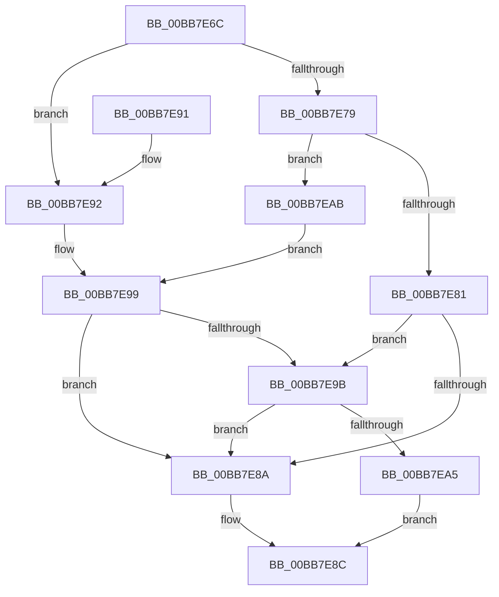

# VfTargetDriversGetVerifierData

- RVA: `0x00BB7E6C`–`0x00BB7EB4` (길이 `72` bytes)
- VA: `0x0000000140BB7E6C`
- 실행 섹션: `PAGEVRFY`
- PDB 이름 있음: `예`; PDB Function 태그: `아니요`
- unwind 정보 RVA: `0x00096940`
- 디코드: `21`개 명령, `72/72` bytes 표시
- 미해석 바이트: `0` (있으면 어셈블리에 `.byte`로 보존)

> 이 문서는 커널 이미지의 기계어와 PDB 기호를 분석해 생성했습니다. 4번과 5번은 함수 원형과 자료형을 바이너리 사용 방식에서 추정한 C 해석이며 원본 소스 복구 결과는 아닙니다.

## 1. Dependencies

- 직접 호출 지점: **2**; 고유 호출 대상: **2**
- 직접 호출자로 확인된 함수: **11**
- RIP 상대 이미지 참조: **2**

### Outgoing calls
- `0x00BB7E70` → [VfDriverIsKernelImageAddress](VfDriverIsKernelImageAddress_function_00BB7EBC.md) (function, `0x00BB7EBC`)
- `0x00BB7E9B` → [VfTargetDriversGetNode](../../text/3E/VfTargetDriversGetNode_function_003EE174.md) (function, `0x003EE174`)

### Direct callers
- [CarGetDriverInfoFromViolationStack](../../text/61/CarGetDriverInfoFromViolationStack_function_00617ED8.md) at `0x00617F44`
- [DifGetPluginPerDriverData](../../text/61/DifGetPluginPerDriverData_function_006199F0.md) at `0x00619A11`
- [DifDllInitializeWrapper](../../text/6A/DifDllInitializeWrapper_function_006AAEBC.md) at `0x006AAEF2`
- [DifDllUnloadWrapper](../../text/6A/DifDllUnloadWrapper_function_006AB030.md) at `0x006AB054`
- [VfUtilCheckRuleEnforcement](../B9/VfUtilCheckRuleEnforcement_function_00B931E0.md) at `0x00B931ED`
- [VfUtilGetDriverFullName](../B9/VfUtilGetDriverFullName_function_00B93280.md) at `0x00B93284`
- [VfUtilGetDriverName](../B9/VfUtilGetDriverName_function_00B932D0.md) at `0x00B932D4`
- [VfUtilGetSigningLevel](../B9/VfUtilGetSigningLevel_function_00B933B0.md) at `0x00B933B4`
- [VfUtilIsBootDriver](../B9/VfUtilIsBootDriver_function_00B933D0.md) at `0x00B933D4`
- [VfTargetDriversIsEnabled](VfTargetDriversIsEnabled_function_00BB7F20.md) at `0x00BB7F43`
- [VfHandlePoolAlloc](VfHandlePoolAlloc_function_00BB8A90.md) at `0x00BB8B39`
- [VfHandlePoolAlloc](VfHandlePoolAlloc_function_00BB8A90.md) at `0x00BB8C86`

### Static image references
- `0x00BB7E79` → RVA `0x00F04ABC` (`.data`; read)
- `0x00BB7E81` → RVA `0x00F049C0` (`.data`; read)

## 2. Other-region calls and transfers

- 다른 실행 섹션으로 향하는 call: **1**
  - `0x00BB7E9B` → [VfTargetDriversGetNode](../../text/3E/VfTargetDriversGetNode_function_003EE174.md) (`PAGEVRFY` → `.text`)
- 별도 외부 분기/꼬리 이동을 확인하지 못했습니다.

## 3. Assembly (complete function range)

```asm
00BB7E6C  48 83 EC 28                     sub rsp, 0x28
00BB7E70  E8 47 00 00 00                  call 0x140bb7ebc
00BB7E75  85 C0                           test eax, eax
00BB7E77  75 19                           jne 0x140bb7e92
00BB7E79  39 05 3D CC 34 00               cmp dword ptr [rip + 0x34cc3d], eax
00BB7E7F  74 2A                           je 0x140bb7eab
00BB7E81  83 3D 38 CB 34 00 02            cmp dword ptr [rip + 0x34cb38], 2
00BB7E88  7D 11                           jge 0x140bb7e9b
00BB7E8A  33 C0                           xor eax, eax
00BB7E8C  48 83 C4 28                     add rsp, 0x28
00BB7E90  C3                              ret
00BB7E91  CC                              int3
00BB7E92  83 3D 23 CC 34 00 00            cmp dword ptr [rip + 0x34cc23], 0
00BB7E99  74 EF                           je 0x140bb7e8a
00BB7E9B  E8 D4 62 83 FF                  call 0x1403ee174
00BB7EA0  48 85 C0                        test rax, rax
00BB7EA3  74 E5                           je 0x140bb7e8a
00BB7EA5  48 8B 40 40                     mov rax, qword ptr [rax + 0x40]
00BB7EA9  EB E1                           jmp 0x140bb7e8c
00BB7EAB  83 3D 0E CB 34 00 00            cmp dword ptr [rip + 0x34cb0e], 0
00BB7EB2  EB E5                           jmp 0x140bb7e99
```

## 4. C-style interpretation (structured pseudocode)

```c
__int64 __fastcall VfTargetDriversGetVerifierData(void)
{
    __int64 result;
    __int64 v_rsp;

    v_rsp = (v_rsp) - (40);
    result = VfDriverIsKernelImageAddress(a1, a2, a3, a4);
    if ((unsigned int)(result) != 0) goto loc_00BB7E92;
    if ((*(unsigned int *)(v_rip + 3460157)) == ((unsigned int)(result))) goto loc_00BB7EAB;
    if ((*(unsigned int *)(v_rip + 3459896)) >= 2) goto loc_00BB7E9B;
loc_00BB7E8A:
    result = 0;
loc_00BB7E8C:
    v_rsp = (v_rsp) + (40);
    return result;
loc_00BB7E92:
loc_00BB7E99:
    if ((*(unsigned int *)(v_rip + 3460131)) == 0) goto loc_00BB7E8A;
loc_00BB7E9B:
    result = VfTargetDriversGetNode(a1, a2, a3, a4);
    if (result == 0) goto loc_00BB7E8A;
    goto loc_00BB7E8C;
loc_00BB7EAB:
    goto loc_00BB7E99;
}
```

## 5. (Beta) C Style

```c
void VfTargetDriversGetVerifierData(void)
{
    int64_t result;
    int64_t local_rsp;

    local_rsp = (local_rsp) - (40);
    result = VfDriverIsKernelImageAddress(a1, a2, a3, a4);
    if ((uint32_t)(result) != 0) goto loc_00BB7E92;
    if ((*(uint32_t *)(v_rip + 0x34CC3D)) == ((uint32_t)(result))) goto loc_00BB7EAB;
    if ((*(uint32_t *)(v_rip + 0x34CB38)) >= 2) goto loc_00BB7E9B;
loc_00BB7E8A:
    result = 0;
loc_00BB7E8C:
    local_rsp = (local_rsp) + (40);
    return result;
loc_00BB7E92:
loc_00BB7E99:
    if ((*(uint32_t *)(v_rip + 0x34CC23)) == 0) goto loc_00BB7E8A;
loc_00BB7E9B:
    result = VfTargetDriversGetNode(a1, a2, a3, a4);
    if (result == 0) goto loc_00BB7E8A;
    goto loc_00BB7E8C;
loc_00BB7EAB:
    goto loc_00BB7E99;
}
```

## 6. Execution-region graph

[열기: 2D/3D 그래프와 함수 탐색 컨트롤 패널](../../../control-panel.html?section=pagevrfy&rva=0x00BB7E6C&view=graph)

- 2D 그래프는 위에서 아래로 흐르고, 3D 그래프는 빈 공간을 드래그해 회전합니다. Shift+드래그는 이동, 휠은 확대·축소, 함수 노드 선택은 대상 보고서 이동입니다.

### Static fallback


