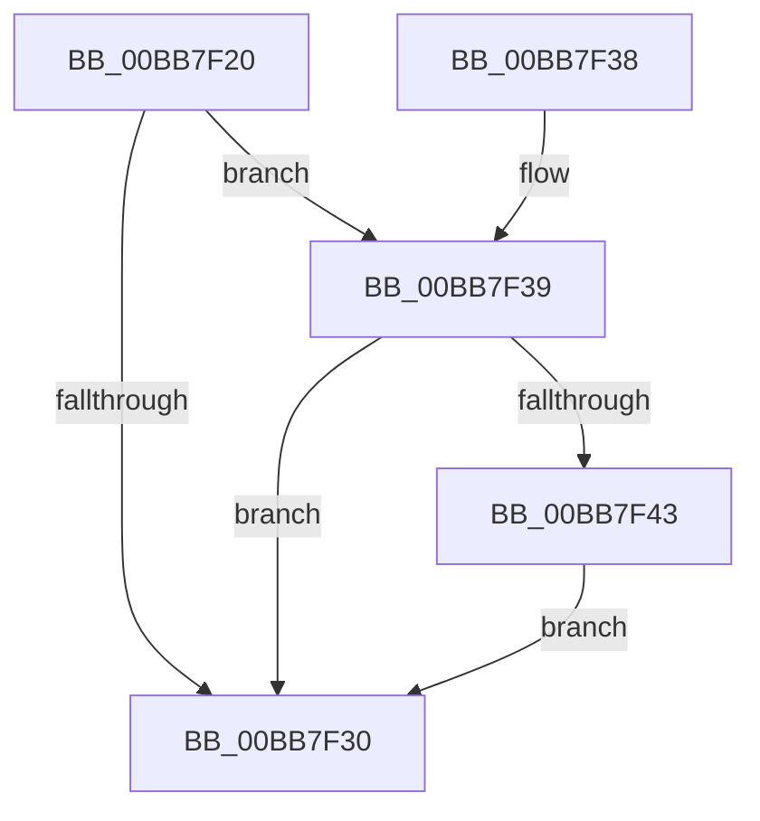

# VfTargetDriversIsEnabled

- RVA: `0x00BB7F20`–`0x00BB7F50` (길이 `48` bytes)
- VA: `0x0000000140BB7F20`
- 실행 섹션: `PAGEVRFY`
- PDB 이름 있음: `예`; PDB Function 태그: `아니요`
- unwind 정보 RVA: `0x0009D0AC`
- 디코드: `17`개 명령, `48/48` bytes 표시
- 미해석 바이트: `0` (있으면 어셈블리에 `.byte`로 보존)

> 이 문서는 커널 이미지의 기계어와 PDB 기호를 분석해 생성했습니다. 4번과 5번은 함수 원형과 자료형을 바이너리 사용 방식에서 추정한 C 해석이며 원본 소스 복구 결과는 아닙니다.

## 1. Dependencies

- 직접 호출 지점: **1**; 고유 호출 대상: **1**
- 직접 호출자로 확인된 함수: **6**
- RIP 상대 이미지 참조: **2**

### Outgoing calls
- `0x00BB7F43` → [VfTargetDriversGetVerifierData](VfTargetDriversGetVerifierData_function_00BB7E6C.md) (function, `0x00BB7E6C`)

### Direct callers
- [IoAllocateIrpEx](../../text/20/IoAllocateIrpEx_function_00207510.md) at `0x0020757E`
- [PipDmgIsDmaVerifierEnabled](../../page/73/PipDmgIsDmaVerifierEnabled_function_00730A84.md) at `0x00730AB0`
- [ViIrpCheckKernelAddressForIrp](../B9/ViIrpCheckKernelAddressForIrp_function_00B9E218.md) at `0x00B9E271`
- [VfPendingShouldForce](../BA/VfPendingShouldForce_function_00BA1BB8.md) at `0x00BA1C06`
- [ViWdBeforeCallDriver](../BA/ViWdBeforeCallDriver_function_00BACA00.md) at `0x00BACA1F`
- [VfCheckUserHandle](VfCheckUserHandle_function_00BB9218.md) at `0x00BB93DA`

### Static image references
- `0x00BB7F28` → RVA `0x00F044C0` (`.data`; read)
- `0x00BB7F39` → RVA `0x00F04954` (`.data`; read)

## 2. Other-region calls and transfers

- 다른 실행 섹션으로 향하는 call: **0**
- 별도 외부 분기/꼬리 이동을 확인하지 못했습니다.

## 3. Assembly (complete function range)

```asm
00BB7F20  40 53                           push rbx
00BB7F22  48 83 EC 20                     sub rsp, 0x20
00BB7F26  33 DB                           xor ebx, ebx
00BB7F28  39 1D 92 C5 34 00               cmp dword ptr [rip + 0x34c592], ebx
00BB7F2E  74 09                           je 0x140bb7f39
00BB7F30  8B C3                           mov eax, ebx
00BB7F32  48 83 C4 20                     add rsp, 0x20
00BB7F36  5B                              pop rbx
00BB7F37  C3                              ret
00BB7F38  CC                              int3
00BB7F39  8B 15 15 CA 34 00               mov edx, dword ptr [rip + 0x34ca15]
00BB7F3F  85 D2                           test edx, edx
00BB7F41  74 ED                           je 0x140bb7f30
00BB7F43  E8 24 FF FF FF                  call 0x140bb7e6c
00BB7F48  48 85 C0                        test rax, rax
00BB7F4B  0F 95 C3                        setne bl
00BB7F4E  EB E0                           jmp 0x140bb7f30
```

## 4. C-style interpretation (structured pseudocode)

```c
__int64 __fastcall VfTargetDriversIsEnabled(void)
{
    __int64 result;
    __int64 v_rbx;
    __int64 v_rsp;

    v_rsp = (v_rsp) - (32);
    v_rbx = 0;
    if ((*(unsigned int *)(v_rip + 3458450)) == 0) goto loc_00BB7F39;
loc_00BB7F30:
    v_rsp = (v_rsp) + (32);
    return 0;
loc_00BB7F39:
    if ((unsigned int)((unsigned int)(*(unsigned int *)(v_rip + 3459605))) == 0) goto loc_00BB7F30;
    result = VfTargetDriversGetVerifierData(a1, (unsigned int)(*(unsigned int *)(v_rip + 3459605)), a3, a4);
    v_rbx = (result != 0) ? 1 : 0;
    goto loc_00BB7F30;
}
```

## 5. (Beta) C Style

```c
void VfTargetDriversIsEnabled(void)
{
    int64_t result;
    int64_t local_rbx;
    int64_t local_rsp;

    local_rsp = (local_rsp) - (32);
    local_rbx = 0;
    if ((*(uint32_t *)(v_rip + 0x34C592)) == 0) goto loc_00BB7F39;
loc_00BB7F30:
    local_rsp = (local_rsp) + (32);
    return 0;
loc_00BB7F39:
    if ((uint32_t)((uint32_t)(*(uint32_t *)(v_rip + 0x34CA15))) == 0) goto loc_00BB7F30;
    result = VfTargetDriversGetVerifierData(a1, (uint32_t)(*(uint32_t *)(v_rip + 0x34CA15)), a3, a4);
    local_rbx = (result != 0) ? 1 : 0;
    goto loc_00BB7F30;
}
```

## 6. Execution-region graph

[열기: 2D/3D 그래프와 함수 탐색 컨트롤 패널](../../../control-panel.html?section=pagevrfy&rva=0x00BB7F20&view=graph)

- 2D 그래프는 위에서 아래로 흐르고, 3D 그래프는 빈 공간을 드래그해 회전합니다. Shift+드래그는 이동, 휠은 확대·축소, 함수 노드 선택은 대상 보고서 이동입니다.

### Static fallback


