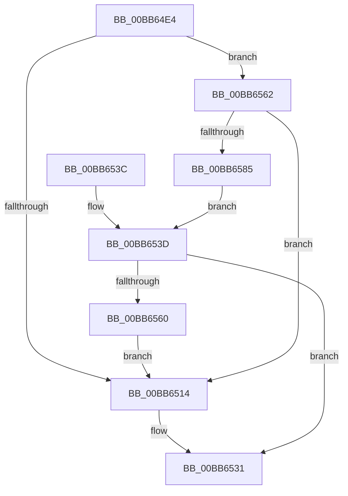

# VfThunkAddTargetNotify

- RVA: `0x00BB64E4`–`0x00BB6587` (길이 `163` bytes)
- VA: `0x0000000140BB64E4`
- 실행 섹션: `PAGEVRFY`
- PDB 이름 있음: `예`; PDB Function 태그: `아니요`
- unwind 정보 RVA: `0x000ADCA0`
- 디코드: `42`개 명령, `163/163` bytes 표시
- 미해석 바이트: `0` (있으면 어셈블리에 `.byte`로 보존)

> 이 문서는 커널 이미지의 기계어와 PDB 기호를 분석해 생성했습니다. 4번과 5번은 함수 원형과 자료형을 바이너리 사용 방식에서 추정한 C 해석이며 원본 소스 복구 결과는 아닙니다.

## 1. Dependencies

- 직접 호출 지점: **6**; 고유 호출 대상: **2**
- 직접 호출자로 확인된 함수: **1**
- RIP 상대 이미지 참조: **6**

### Outgoing calls
- `0x00BB650B` → [ViThunkCreateSharedExportInformation](ViThunkCreateSharedExportInformation_function_00BB637C.md) (function, `0x00BB637C`)
- `0x00BB6517` → [ViThunkFreeSharedThunksArray](ViThunkFreeSharedThunksArray_function_00BB6590.md) (function, `0x00BB6590`)
- `0x00BB6520` → [ViThunkFreeSharedThunksArray](ViThunkFreeSharedThunksArray_function_00BB6590.md) (function, `0x00BB6590`)
- `0x00BB6529` → [ViThunkFreeSharedThunksArray](ViThunkFreeSharedThunksArray_function_00BB6590.md) (function, `0x00BB6590`)
- `0x00BB6557` → [ViThunkCreateSharedExportInformation](ViThunkCreateSharedExportInformation_function_00BB637C.md) (function, `0x00BB637C`)
- `0x00BB657C` → [ViThunkCreateSharedExportInformation](ViThunkCreateSharedExportInformation_function_00BB637C.md) (function, `0x00BB637C`)

### Direct callers
- [VfTargetDriversAdd](../../text/3E/VfTargetDriversAdd_function_003EE2F4.md) at `0x003EE37B`

### Static image references
- `0x00BB64F8` → RVA `0x00FFDC80` (`PAGEVRFD`; read)
- `0x00BB64FF` → RVA `0x00FF51B0` (`PAGEVRFD`; read)
- `0x00BB6544` → RVA `0x00FFDC90` (`PAGEVRFD`; read)
- `0x00BB6550` → RVA `0x00FF5F20` (`PAGEVRFD`; read)
- `0x00BB6569` → RVA `0x00FFDC70` (`PAGEVRFD`; read)
- `0x00BB6575` → RVA `0x00FF4A40` (`PAGEVRFD`; read)

## 2. Other-region calls and transfers

- 다른 실행 섹션으로 향하는 call: **0**
- 별도 외부 분기/꼬리 이동을 확인하지 못했습니다.

## 3. Assembly (complete function range)

```asm
00BB64E4  48 89 5C 24 08                  mov qword ptr [rsp + 8], rbx
00BB64E9  57                              push rdi
00BB64EA  48 83 EC 30                     sub rsp, 0x30
00BB64EE  48 8D 79 10                     lea rdi, [rcx + 0x10]
00BB64F2  48 8B D9                        mov rbx, rcx
00BB64F5  48 8B 09                        mov rcx, qword ptr [rcx]
00BB64F8  4C 8D 0D 81 77 44 00            lea r9, [rip + 0x447781]
00BB64FF  48 8D 15 AA EC 43 00            lea rdx, [rip + 0x43ecaa]
00BB6506  48 89 7C 24 20                  mov qword ptr [rsp + 0x20], rdi
00BB650B  E8 6C FE FF FF                  call 0x140bb637c
00BB6510  85 C0                           test eax, eax
00BB6512  75 4E                           jne 0x140bb6562
00BB6514  48 8B CF                        mov rcx, rdi
00BB6517  E8 74 00 00 00                  call 0x140bb6590
00BB651C  48 8D 4B 18                     lea rcx, [rbx + 0x18]
00BB6520  E8 6B 00 00 00                  call 0x140bb6590
00BB6525  48 8D 4B 20                     lea rcx, [rbx + 0x20]
00BB6529  E8 62 00 00 00                  call 0x140bb6590
00BB652E  83 0F 01                        or dword ptr [rdi], 1
00BB6531  48 8B 5C 24 40                  mov rbx, qword ptr [rsp + 0x40]
00BB6536  48 83 C4 30                     add rsp, 0x30
00BB653A  5F                              pop rdi
00BB653B  C3                              ret
00BB653C  CC                              int3
00BB653D  48 8B 0B                        mov rcx, qword ptr [rbx]
00BB6540  48 8D 43 20                     lea rax, [rbx + 0x20]
00BB6544  4C 8D 0D 45 77 44 00            lea r9, [rip + 0x447745]
00BB654B  48 89 44 24 20                  mov qword ptr [rsp + 0x20], rax
00BB6550  48 8D 15 C9 F9 43 00            lea rdx, [rip + 0x43f9c9]
00BB6557  E8 20 FE FF FF                  call 0x140bb637c
00BB655C  85 C0                           test eax, eax
00BB655E  75 D1                           jne 0x140bb6531
00BB6560  EB B2                           jmp 0x140bb6514
00BB6562  48 8B 0B                        mov rcx, qword ptr [rbx]
00BB6565  48 8D 43 18                     lea rax, [rbx + 0x18]
00BB6569  4C 8D 0D 00 77 44 00            lea r9, [rip + 0x447700]
00BB6570  48 89 44 24 20                  mov qword ptr [rsp + 0x20], rax
00BB6575  48 8D 15 C4 E4 43 00            lea rdx, [rip + 0x43e4c4]
00BB657C  E8 FB FD FF FF                  call 0x140bb637c
00BB6581  85 C0                           test eax, eax
00BB6583  74 8F                           je 0x140bb6514
00BB6585  EB B6                           jmp 0x140bb653d
```

## 4. C-style interpretation (structured pseudocode)

```c
__int64 __fastcall VfThunkAddTargetNotify(__int64 a1)
{
    __int64 result;
    __int64 v_rsp;
    unsigned __int64 v_stack_m18;
    unsigned __int64 v_stack_p20;
    unsigned __int64 v_stack_p8;

    v_stack_p8 = v_rbx;
    v_rsp = (v_rsp) - (48);
    v_stack_m18 = a1 + 16;
    result = ViThunkCreateSharedExportInformation(*(unsigned __int64 *)(a1), v_rip + 4451498, a3, v_rip + 4487041);
    if ((unsigned int)(result) != 0) goto loc_00BB6562;
loc_00BB6514:
    result = ViThunkFreeSharedThunksArray(a1 + 16, v_rip + 4451498, a3, v_rip + 4487041);
    result = ViThunkFreeSharedThunksArray(a1 + 24, v_rip + 4451498, a3, v_rip + 4487041);
    result = ViThunkFreeSharedThunksArray(a1 + 32, v_rip + 4451498, a3, v_rip + 4487041);
loc_00BB6531:
    v_rsp = (v_rsp) + (48);
    return result;
loc_00BB653D:
    v_stack_p20 = v_stack_p8 + 32;
    result = ViThunkCreateSharedExportInformation(*(unsigned __int64 *)(v_stack_p8), v_rip + 4454857, a3, v_rip + 4486981);
    if ((unsigned int)(result) != 0) goto loc_00BB6531;
    goto loc_00BB6514;
loc_00BB6562:
    v_stack_p20 = v_stack_p8 + 24;
    result = ViThunkCreateSharedExportInformation(*(unsigned __int64 *)(v_stack_p8), v_rip + 4449476, a3, v_rip + 4486912);
    if ((unsigned int)(result) == 0) goto loc_00BB6514;
    goto loc_00BB653D;
}
```

## 5. (Beta) C Style

```c
int64_t VfThunkAddTargetNotify(void *Arg1)
{
    uint8_t *arg1 = (uint8_t *)Arg1;

    int64_t result;
    int64_t local_rsp;
    uint64_t v_stack_m18;
    uint64_t v_stack_p20;
    uint64_t v_stack_p8;

    v_stack_p8 = local_rbx;
    local_rsp = (local_rsp) - (48);
    v_stack_m18 = Arg1 + 16;
    result = ViThunkCreateSharedExportInformation(*(uint64_t *)(arg1), v_rip + 4451498, a3, v_rip + 4487041);
    if ((uint32_t)(result) != 0) goto loc_00BB6562;
loc_00BB6514:
    result = ViThunkFreeSharedThunksArray(Arg1 + 16, v_rip + 4451498, a3, v_rip + 4487041);
    result = ViThunkFreeSharedThunksArray(Arg1 + 24, v_rip + 4451498, a3, v_rip + 4487041);
    result = ViThunkFreeSharedThunksArray(Arg1 + 32, v_rip + 4451498, a3, v_rip + 4487041);
loc_00BB6531:
    local_rsp = (local_rsp) + (48);
    return result;
loc_00BB653D:
    v_stack_p20 = v_stack_p8 + 32;
    result = ViThunkCreateSharedExportInformation(*(uint64_t *)(v_stack_p8), v_rip + 4454857, a3, v_rip + 4486981);
    if ((uint32_t)(result) != 0) goto loc_00BB6531;
    goto loc_00BB6514;
loc_00BB6562:
    v_stack_p20 = v_stack_p8 + 24;
    result = ViThunkCreateSharedExportInformation(*(uint64_t *)(v_stack_p8), v_rip + 4449476, a3, v_rip + 4486912);
    if ((uint32_t)(result) == 0) goto loc_00BB6514;
    goto loc_00BB653D;
}
```

### 관측된 메모리 오프셋

구조체 형식이 확인되지 않은 접근은 인자 기준의 오프셋으로만 기록했습니다.

| 기준 인자 | 오프셋 표현 | 폭 (bit) | 접근 |
|---|---:|---:|---|
| `Arg1` | `+ 0x0` | `32` | `R/W` |
| `Arg1` | `+ 0x0` | `64` | `R` |
| `Arg1` | `+ 0x10` | `64` | `R` |
| `Arg1` | `+ 0x18` | `64` | `R` |
| `Arg1` | `+ 0x20` | `64` | `R` |

## 6. Execution-region graph

[열기: 2D/3D 그래프와 함수 탐색 컨트롤 패널](../../../control-panel.html?section=pagevrfy&rva=0x00BB64E4&view=graph)

- 2D 그래프는 위에서 아래로 흐르고, 3D 그래프는 빈 공간을 드래그해 회전합니다. Shift+드래그는 이동, 휠은 확대·축소, 함수 노드 선택은 대상 보고서 이동입니다.

### Static fallback


