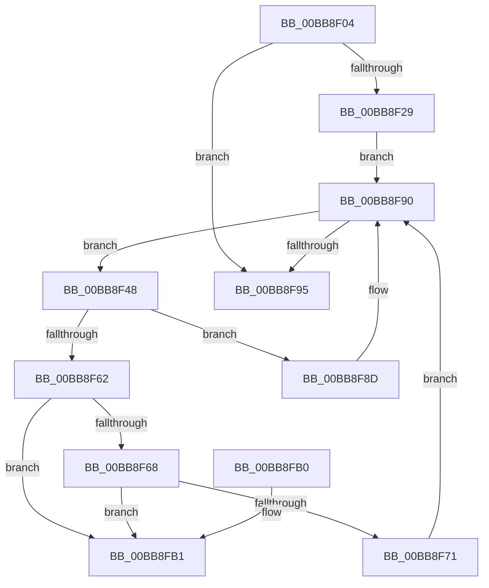

# VfThunkCheckDriverUnloading

- RVA: `0x00BB8F04`–`0x00BB8FB8` (길이 `180` bytes)
- VA: `0x0000000140BB8F04`
- 실행 섹션: `PAGEVRFY`
- PDB 이름 있음: `예`; PDB Function 태그: `아니요`
- unwind 정보 RVA: `0x0006B020`
- 디코드: `50`개 명령, `180/180` bytes 표시
- 미해석 바이트: `0` (있으면 어셈블리에 `.byte`로 보존)

> 이 문서는 커널 이미지의 기계어와 PDB 기호를 분석해 생성했습니다. 4번과 5번은 함수 원형과 자료형을 바이너리 사용 방식에서 추정한 C 해석이며 원본 소스 복구 결과는 아닙니다.

## 1. Dependencies

- 직접 호출 지점: **3**; 고유 호출 대상: **2**
- 직접 호출자로 확인된 함수: **1**
- RIP 상대 이미지 참조: **4**

### Outgoing calls
- `0x00BB8F33` → [ViThunkRemoveImportEntry](../BA/ViThunkRemoveImportEntry_function_00BA7AC0.md) (function, `0x00BA7AC0`)
- `0x00BB8F55` → [ViThunkRemoveImportEntry](../BA/ViThunkRemoveImportEntry_function_00BA7AC0.md) (function, `0x00BA7AC0`)
- `0x00BB8F80` → [ExFreePoolWithTag](../../poolcode/B8/ExFreePoolWithTag_function_00B82870.md) (function, `0x00B82870`)

### Direct callers
- [VfDriverUnloadImage](../B9/VfDriverUnloadImage_function_00B9A5B0.md) at `0x00B9A5E3`

### Static image references
- `0x00BB8F1D` → RVA `0x00F048B0` (`.data`; read)
- `0x00BB8F2C` → RVA `0x00F04890` (`.data`; read)
- `0x00BB8F38` → RVA `0x00F048A0` (`.data`; read)
- `0x00BB8F85` → RVA `0x00F048B4` (`.data`; read/write)

## 2. Other-region calls and transfers

- 다른 실행 섹션으로 향하는 call: **1**
  - `0x00BB8F80` → [ExFreePoolWithTag](../../poolcode/B8/ExFreePoolWithTag_function_00B82870.md) (`PAGEVRFY` → `POOLCODE`)
- 별도 외부 분기/꼬리 이동을 확인하지 못했습니다.

## 3. Assembly (complete function range)

```asm
00BB8F04  48 8B C4                        mov rax, rsp
00BB8F07  48 89 58 08                     mov qword ptr [rax + 8], rbx
00BB8F0B  48 89 68 10                     mov qword ptr [rax + 0x10], rbp
00BB8F0F  48 89 70 18                     mov qword ptr [rax + 0x18], rsi
00BB8F13  48 89 78 20                     mov qword ptr [rax + 0x20], rdi
00BB8F17  41 56                           push r14
00BB8F19  48 83 EC 20                     sub rsp, 0x20
00BB8F1D  83 3D 8C B9 34 00 00            cmp dword ptr [rip + 0x34b98c], 0
00BB8F24  48 8B F1                        mov rsi, rcx
00BB8F27  74 6C                           je 0x140bb8f95
00BB8F29  48 8B D1                        mov rdx, rcx
00BB8F2C  48 8D 0D 5D B9 34 00            lea rcx, [rip + 0x34b95d]
00BB8F33  E8 88 EB FE FF                  call 0x140ba7ac0
00BB8F38  48 8B 3D 61 B9 34 00            mov rdi, qword ptr [rip + 0x34b961]
00BB8F3F  4C 8D 35 5A B9 34 00            lea r14, [rip + 0x34b95a]
00BB8F46  EB 48                           jmp 0x140bb8f90
00BB8F48  48 8D 5F 18                     lea rbx, [rdi + 0x18]
00BB8F4C  48 8B D6                        mov rdx, rsi
00BB8F4F  48 8B CB                        mov rcx, rbx
00BB8F52  48 8B EF                        mov rbp, rdi
00BB8F55  E8 66 EB FE FF                  call 0x140ba7ac0
00BB8F5A  48 8B 07                        mov rax, qword ptr [rdi]
00BB8F5D  48 39 1B                        cmp qword ptr [rbx], rbx
00BB8F60  75 2B                           jne 0x140bb8f8d
00BB8F62  48 39 78 08                     cmp qword ptr [rax + 8], rdi
00BB8F66  75 49                           jne 0x140bb8fb1
00BB8F68  48 8B 57 08                     mov rdx, qword ptr [rdi + 8]
00BB8F6C  48 39 3A                        cmp qword ptr [rdx], rdi
00BB8F6F  75 40                           jne 0x140bb8fb1
00BB8F71  48 89 02                        mov qword ptr [rdx], rax
00BB8F74  48 8B CD                        mov rcx, rbp
00BB8F77  48 89 50 08                     mov qword ptr [rax + 8], rdx
00BB8F7B  33 D2                           xor edx, edx
00BB8F7D  48 8B 3F                        mov rdi, qword ptr [rdi]
00BB8F80  E8 EB 98 FC FF                  call 0x140b82870
00BB8F85  FF 0D 29 B9 34 00               dec dword ptr [rip + 0x34b929]
00BB8F8B  EB 03                           jmp 0x140bb8f90
00BB8F8D  48 8B F8                        mov rdi, rax
00BB8F90  49 3B FE                        cmp rdi, r14
00BB8F93  75 B3                           jne 0x140bb8f48
00BB8F95  48 8B 5C 24 30                  mov rbx, qword ptr [rsp + 0x30]
00BB8F9A  48 8B 6C 24 38                  mov rbp, qword ptr [rsp + 0x38]
00BB8F9F  48 8B 74 24 40                  mov rsi, qword ptr [rsp + 0x40]
00BB8FA4  48 8B 7C 24 48                  mov rdi, qword ptr [rsp + 0x48]
00BB8FA9  48 83 C4 20                     add rsp, 0x20
00BB8FAD  41 5E                           pop r14
00BB8FAF  C3                              ret
00BB8FB0  CC                              int3
00BB8FB1  B9 03 00 00 00                  mov ecx, 3
00BB8FB6  CD 29                           int 0x29
```

## 4. C-style interpretation (structured pseudocode)

```c
__int64 __fastcall VfThunkCheckDriverUnloading(__int64 a1)
{
    __int64 result;
    __int64 v_rsp;
    unsigned __int64 v_stack_p10;
    unsigned __int64 v_stack_p18;
    unsigned __int64 v_stack_p20;
    unsigned __int64 v_stack_p8;

    *(unsigned __int64 *)(v_rsp + 8) = v_rbx;
    *(unsigned __int64 *)(v_rsp + 16) = v_rbp;
    *(unsigned __int64 *)(v_rsp + 24) = v_rsi;
    *(unsigned __int64 *)(v_rsp + 32) = v_rdi;
    v_rsp = (v_rsp) - (32);
    if ((*(unsigned int *)(v_rip + 3455372)) == 0) goto loc_00BB8F95;
    result = ViThunkRemoveImportEntry(v_rip + 3455325, a1, a3, a4);
    goto loc_00BB8F90;
loc_00BB8F48:
    result = ViThunkRemoveImportEntry(*(unsigned __int64 *)(v_rip + 3455329) + 24, a1, a3, a4);
    if ((*(unsigned __int64 *)(*(unsigned __int64 *)(v_rip + 3455329) + 24)) != (*(unsigned __int64 *)(v_rip + 3455329) + 24)) goto loc_00BB8F8D;
    if ((*(unsigned __int64 *)(*(unsigned __int64 *)(*(unsigned __int64 *)(v_rip + 3455329)) + 8)) != (*(unsigned __int64 *)(v_rip + 3455329))) goto loc_00BB8FB1;
    if ((*(unsigned __int64 *)(*(unsigned __int64 *)(*(unsigned __int64 *)(v_rip + 3455329) + 8))) != (*(unsigned __int64 *)(v_rip + 3455329))) goto loc_00BB8FB1;
    *(unsigned __int64 *)(*(unsigned __int64 *)(*(unsigned __int64 *)(v_rip + 3455329) + 8)) = *(unsigned __int64 *)(*(unsigned __int64 *)(v_rip + 3455329));
    *(unsigned __int64 *)(*(unsigned __int64 *)(*(unsigned __int64 *)(v_rip + 3455329)) + 8) = *(unsigned __int64 *)(*(unsigned __int64 *)(v_rip + 3455329) + 8);
    a2 = 0;
    result = ExFreePoolWithTag(*(unsigned __int64 *)(v_rip + 3455329), a2, a3, a4);
    goto loc_00BB8F90;
loc_00BB8F8D:
loc_00BB8F90:
    if (result != (v_rip + 3455322)) goto loc_00BB8F48;
loc_00BB8F95:
    v_rsp = (v_rsp) + (32);
    return result;
loc_00BB8FB1:
    return result;
}
```

## 5. (Beta) C Style

```c
int64_t VfThunkCheckDriverUnloading(int64_t Arg1)
{
    int64_t result;
    int64_t local_rsp;
    uint64_t v_stack_p10;
    uint64_t v_stack_p18;
    uint64_t v_stack_p20;
    uint64_t v_stack_p8;

    *(uint64_t *)(local_rsp + 0x8) = local_rbx;
    *(uint64_t *)(local_rsp + 0x10) = local_rbp;
    *(uint64_t *)(local_rsp + 0x18) = local_rsi;
    *(uint64_t *)(local_rsp + 0x20) = local_rdi;
    local_rsp = (local_rsp) - (32);
    if ((*(uint32_t *)(v_rip + 0x34B98C)) == 0) goto loc_00BB8F95;
    result = ViThunkRemoveImportEntry(v_rip + 3455325, Arg1, a3, a4);
    goto loc_00BB8F90;
loc_00BB8F48:
    result = ViThunkRemoveImportEntry(*(uint64_t *)(v_rip + 0x34B961) + 24, Arg1, a3, a4);
    if ((*(uint64_t *)(*(uint64_t *)(v_rip + 0x34B961) + 0x18)) != (*(uint64_t *)(v_rip + 0x34B961) + 24)) goto loc_00BB8F8D;
    if ((*(uint64_t *)(*(uint64_t *)(*(uint64_t *)(v_rip + 0x34B961)) + 0x8)) != (*(uint64_t *)(v_rip + 0x34B961))) goto loc_00BB8FB1;
    if ((*(uint64_t *)(*(uint64_t *)(*(uint64_t *)(v_rip + 0x34B961) + 0x8))) != (*(uint64_t *)(v_rip + 0x34B961))) goto loc_00BB8FB1;
    *(uint64_t *)(*(uint64_t *)(*(uint64_t *)(v_rip + 0x34B961) + 0x8)) = *(uint64_t *)(*(uint64_t *)(v_rip + 0x34B961));
    *(uint64_t *)(*(uint64_t *)(*(uint64_t *)(v_rip + 0x34B961)) + 0x8) = *(uint64_t *)(*(uint64_t *)(v_rip + 0x34B961) + 0x8);
    a2 = 0;
    result = ExFreePoolWithTag(*(uint64_t *)(v_rip + 0x34B961), a2, a3, a4);
    goto loc_00BB8F90;
loc_00BB8F8D:
loc_00BB8F90:
    if (result != (v_rip + 3455322)) goto loc_00BB8F48;
loc_00BB8F95:
    local_rsp = (local_rsp) + (32);
    return result;
loc_00BB8FB1:
    return result;
}
```

## 6. Execution-region graph

[열기: 2D/3D 그래프와 함수 탐색 컨트롤 패널](../../../control-panel.html?section=pagevrfy&rva=0x00BB8F04&view=graph)

- 2D 그래프는 위에서 아래로 흐르고, 3D 그래프는 빈 공간을 드래그해 회전합니다. Shift+드래그는 이동, 휠은 확대·축소, 함수 노드 선택은 대상 보고서 이동입니다.

### Static fallback


