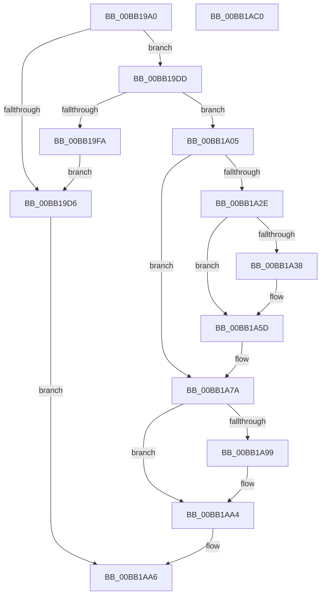

# VfTrackResource

- RVA: `0x00BB19A0`–`0x00BB1AC1` (길이 `289` bytes)
- VA: `0x0000000140BB19A0`
- 실행 섹션: `PAGEVRFY`
- PDB 이름 있음: `예`; PDB Function 태그: `아니요`
- unwind 정보 RVA: `0x0008CA40`
- 디코드: `82`개 명령, `289/289` bytes 표시
- 미해석 바이트: `0` (있으면 어셈블리에 `.byte`로 보존)

> 이 문서는 커널 이미지의 기계어와 PDB 기호를 분석해 생성했습니다. 4번과 5번은 함수 원형과 자료형을 바이너리 사용 방식에서 추정한 C 해석이며 원본 소스 복구 결과는 아닙니다.

## 1. Dependencies

- 직접 호출 지점: **8**; 고유 호출 대상: **8**
- 직접 호출자로 확인된 함수: **1**
- RIP 상대 이미지 참조: **5**

### Outgoing calls
- `0x00BB19ED` → [VfAvlReserveNode](../../text/3E/VfAvlReserveNode_function_003EF760.md) (function, `0x003EF760`)
- `0x00BB1A0E` → [VfAvlInitializeLockContext](../../text/4A/VfAvlInitializeLockContext_function_004A686C.md) (function, `0x004A686C`)
- `0x00BB1A21` → [VfAvlLookupTreeNode](../../text/3E/VfAvlLookupTreeNode_function_003EF1B4.md) (function, `0x003EF1B4`)
- `0x00BB1A58` → [CarReportRuleViolationFromNt](../B9/CarReportRuleViolationFromNt_function_00B9D904.md) (function, `0x00B9D904`)
- `0x00BB1A72` → [VfAvlDeleteTreeNode](../../text/3E/VfAvlDeleteTreeNode_function_003EE240.md) (function, `0x003EE240`)
- `0x00BB1A85` → [VfAvlInsertReservedTreeNode](../../text/3E/VfAvlInsertReservedTreeNode_function_003EE424.md) (function, `0x003EE424`)
- `0x00BB1A8F` → [VfAvlCleanupLockContext](../../text/3E/VfAvlCleanupLockContext_function_003EF56C.md) (function, `0x003EF56C`)
- `0x00BB1A9F` → [VfAvlFreeNodeNoLock](../../text/61/VfAvlFreeNodeNoLock_function_006126D8.md) (function, `0x006126D8`)

### Direct callers
- [VfMiscExInitializeResourceLite_Exit](../BA/VfMiscExInitializeResourceLite_Exit_function_00BAD9D0.md) at `0x00BAD9E1`

### Static image references
- `0x00BB19C9` → RVA `0x00FFDA80` (`PAGEVRFD`; read)
- `0x00BB19DD` → RVA `0x00FFDBC0` (`PAGEVRFD`; read)
- `0x00BB19FD` → RVA `0x00FFDAAC` (`PAGEVRFD`; read/write)
- `0x00BB1A2E` → RVA `0x00FFDA9C` (`PAGEVRFD`; read)
- `0x00BB1A5D` → RVA `0x00FFDB94` (`PAGEVRFD`; read/write)

## 2. Other-region calls and transfers

- 다른 실행 섹션으로 향하는 call: **7**
  - `0x00BB19ED` → [VfAvlReserveNode](../../text/3E/VfAvlReserveNode_function_003EF760.md) (`PAGEVRFY` → `.text`)
  - `0x00BB1A0E` → [VfAvlInitializeLockContext](../../text/4A/VfAvlInitializeLockContext_function_004A686C.md) (`PAGEVRFY` → `.text`)
  - `0x00BB1A21` → [VfAvlLookupTreeNode](../../text/3E/VfAvlLookupTreeNode_function_003EF1B4.md) (`PAGEVRFY` → `.text`)
  - `0x00BB1A72` → [VfAvlDeleteTreeNode](../../text/3E/VfAvlDeleteTreeNode_function_003EE240.md) (`PAGEVRFY` → `.text`)
  - `0x00BB1A85` → [VfAvlInsertReservedTreeNode](../../text/3E/VfAvlInsertReservedTreeNode_function_003EE424.md) (`PAGEVRFY` → `.text`)
  - `0x00BB1A8F` → [VfAvlCleanupLockContext](../../text/3E/VfAvlCleanupLockContext_function_003EF56C.md) (`PAGEVRFY` → `.text`)
  - `0x00BB1A9F` → [VfAvlFreeNodeNoLock](../../text/61/VfAvlFreeNodeNoLock_function_006126D8.md) (`PAGEVRFY` → `.text`)
- 별도 외부 분기/꼬리 이동을 확인하지 못했습니다.

## 3. Assembly (complete function range)

```asm
00BB19A0  4C 8B DC                        mov r11, rsp
00BB19A3  49 89 5B 08                     mov qword ptr [r11 + 8], rbx
00BB19A7  49 89 6B 10                     mov qword ptr [r11 + 0x10], rbp
00BB19AB  49 89 73 18                     mov qword ptr [r11 + 0x18], rsi
00BB19AF  57                              push rdi
00BB19B0  41 56                           push r14
00BB19B2  41 57                           push r15
00BB19B4  48 83 EC 60                     sub rsp, 0x60
00BB19B8  33 C0                           xor eax, eax
00BB19BA  0F 57 C0                        xorps xmm0, xmm0
00BB19BD  0F 11 44 24 40                  movups xmmword ptr [rsp + 0x40], xmm0
00BB19C2  49 89 43 D8                     mov qword ptr [r11 - 0x28], rax
00BB19C6  4C 8B F2                        mov r14, rdx
00BB19C9  8B 05 B1 C0 44 00               mov eax, dword ptr [rip + 0x44c0b1]
00BB19CF  48 8B F9                        mov rdi, rcx
00BB19D2  85 C0                           test eax, eax
00BB19D4  75 07                           jne 0x140bb19dd
00BB19D6  32 C0                           xor al, al
00BB19D8  E9 C9 00 00 00                  jmp 0x140bb1aa6
00BB19DD  4C 8D 3D DC C1 44 00            lea r15, [rip + 0x44c1dc]
00BB19E4  45 33 C0                        xor r8d, r8d
00BB19E7  49 8B CF                        mov rcx, r15
00BB19EA  48 8B D7                        mov rdx, rdi
00BB19ED  E8 6E DD 83 FF                  call 0x1403ef760
00BB19F2  48 8B E8                        mov rbp, rax
00BB19F5  48 85 C0                        test rax, rax
00BB19F8  75 0B                           jne 0x140bb1a05
00BB19FA  8D 58 01                        lea ebx, [rax + 1]
00BB19FD  87 1D A9 C0 44 00               xchg dword ptr [rip + 0x44c0a9], ebx
00BB1A03  EB D1                           jmp 0x140bb19d6
00BB1A05  33 D2                           xor edx, edx
00BB1A07  48 8D 4C 24 40                  lea rcx, [rsp + 0x40]
00BB1A0C  33 F6                           xor esi, esi
00BB1A0E  E8 59 4E 8F FF                  call 0x1404a686c
00BB1A13  45 33 C9                        xor r9d, r9d
00BB1A16  48 8D 54 24 40                  lea rdx, [rsp + 0x40]
00BB1A1B  4C 8B C7                        mov r8, rdi
00BB1A1E  49 8B CF                        mov rcx, r15
00BB1A21  E8 8E D7 83 FF                  call 0x1403ef1b4
00BB1A26  8D 5E 01                        lea ebx, [rsi + 1]
00BB1A29  48 85 C0                        test rax, rax
00BB1A2C  74 4C                           je 0x140bb1a7a
00BB1A2E  8B 05 68 C0 44 00               mov eax, dword ptr [rip + 0x44c068]
00BB1A34  85 C0                           test eax, eax
00BB1A36  75 25                           jne 0x140bb1a5d
00BB1A38  BA D0 00 00 00                  mov edx, 0xd0
00BB1A3D  4C 89 74 24 30                  mov qword ptr [rsp + 0x30], r14
00BB1A42  C7 44 24 28 0B 00 00 00         mov dword ptr [rsp + 0x28], 0xb
00BB1A4A  45 33 C9                        xor r9d, r9d
00BB1A4D  48 21 74 24 20                  and qword ptr [rsp + 0x20], rsi
00BB1A52  4C 8B C7                        mov r8, rdi
00BB1A55  8D 4A F4                        lea ecx, [rdx - 0xc]
00BB1A58  E8 A7 BE FE FF                  call 0x140b9d904
00BB1A5D  F0 01 1D 30 C1 44 00            lock add dword ptr [rip + 0x44c130], ebx
00BB1A64  45 33 C9                        xor r9d, r9d
00BB1A67  48 8D 54 24 40                  lea rdx, [rsp + 0x40]
00BB1A6C  4C 8B C7                        mov r8, rdi
00BB1A6F  49 8B CF                        mov rcx, r15
00BB1A72  E8 C9 C7 83 FF                  call 0x1403ee240
00BB1A77  48 8B F0                        mov rsi, rax
00BB1A7A  4C 8B C5                        mov r8, rbp
00BB1A7D  48 8D 54 24 40                  lea rdx, [rsp + 0x40]
00BB1A82  49 8B CF                        mov rcx, r15
00BB1A85  E8 9A C9 83 FF                  call 0x1403ee424
00BB1A8A  48 8D 4C 24 40                  lea rcx, [rsp + 0x40]
00BB1A8F  E8 D8 DA 83 FF                  call 0x1403ef56c
00BB1A94  48 85 F6                        test rsi, rsi
00BB1A97  74 0B                           je 0x140bb1aa4
00BB1A99  48 8B D6                        mov rdx, rsi
00BB1A9C  49 8B CF                        mov rcx, r15
00BB1A9F  E8 34 0C A6 FF                  call 0x1406126d8
00BB1AA4  8A C3                           mov al, bl
00BB1AA6  4C 8D 5C 24 60                  lea r11, [rsp + 0x60]
00BB1AAB  49 8B 5B 20                     mov rbx, qword ptr [r11 + 0x20]
00BB1AAF  49 8B 6B 28                     mov rbp, qword ptr [r11 + 0x28]
00BB1AB3  49 8B 73 30                     mov rsi, qword ptr [r11 + 0x30]
00BB1AB7  49 8B E3                        mov rsp, r11
00BB1ABA  41 5F                           pop r15
00BB1ABC  41 5E                           pop r14
00BB1ABE  5F                              pop rdi
00BB1ABF  C3                              ret
00BB1AC0  CC                              int3
```

## 4. C-style interpretation (structured pseudocode)

```c
__int64 __fastcall VfTrackResource(__int64 a1, __int64 a2, int a3, int a4)
{
    __int64 result;
    __int64 v_rsi;
    __int64 v_rsp;
    unsigned __int64 v_stack_m18;
    unsigned __int64 v_stack_m38;
    unsigned __int64 v_stack_m48;
    unsigned int v_stack_m50;
    unsigned __int64 v_stack_m58;

    *(unsigned __int64 *)(v_rsp + 8) = v_rbx;
    *(unsigned __int64 *)(v_rsp + 16) = v_rbp;
    *(unsigned __int64 *)(v_rsp + 24) = v_rsi;
    v_rsp = (v_rsp) - (96);
    result = 0;
    v_stack_m38 = v_xmm0;
    *(unsigned __int64 *)(v_rsp - 40) = 0;
    if ((unsigned int)((unsigned int)(*(unsigned int *)(v_rip + 4505777))) != 0) goto loc_00BB19DD;
loc_00BB19D6:
    result = 0;
    goto loc_00BB1AA6;
loc_00BB19DD:
    a3 = 0;
    result = VfAvlReserveNode(v_rip + 4506076, a1, a3, a4);
    if (result != 0) goto loc_00BB1A05;
    goto loc_00BB19D6;
loc_00BB1A05:
    a2 = 0;
    v_rsi = 0;
    result = VfAvlInitializeLockContext(v_stack_m38, a2, a3, a4);
    a4 = 0;
    result = VfAvlLookupTreeNode(v_rip + 4506076, v_stack_m38, a1, a4);
    if (result == 0) goto loc_00BB1A7A;
    result = (unsigned int)(*(unsigned int *)(v_rip + 4505704));
    if ((unsigned int)((unsigned int)(*(unsigned int *)(v_rip + 4505704))) == 0) {
        a2 = 208;
        v_stack_m48 = a2;
        v_stack_m50 = 11;
        a4 = 0;
        a3 = a1;
        a1 = a2 - 12;
        result = CarReportRuleViolationFromNt(a1, a2, a3, a4);
    }
    a4 = 0;
    result = VfAvlDeleteTreeNode(v_rip + 4506076, v_stack_m38, a1, a4);
loc_00BB1A7A:
    result = VfAvlInsertReservedTreeNode(v_rip + 4506076, v_stack_m38, result, a4);
    result = VfAvlCleanupLockContext(v_stack_m38, v_stack_m38, result, a4);
    if (result != 0) {
        a2 = result;
        a1 = v_rip + 4506076;
        result = VfAvlFreeNodeNoLock(a1, a2, result, a4);
    }
loc_00BB1AA6:
    return (unsigned __int8)(v_rsi + 1);
}
```

## 5. (Beta) C Style

```c
int64_t VfTrackResource(int64_t Arg1, int64_t Arg2, int32_t Arg3, int32_t Arg4)
{
    int64_t result;
    int64_t local_rsi;
    int64_t local_rsp;
    uint64_t v_stack_m18;
    uint64_t v_stack_m38;
    uint64_t v_stack_m48;
    uint32_t v_stack_m50;
    uint64_t v_stack_m58;

    *(uint64_t *)(local_rsp + 0x8) = local_rbx;
    *(uint64_t *)(local_rsp + 0x10) = local_rbp;
    *(uint64_t *)(local_rsp + 0x18) = local_rsi;
    local_rsp = (local_rsp) - (96);
    result = 0;
    v_stack_m38 = v_xmm0;
    *(uint64_t *)(local_rsp - 0x28) = 0;
    if ((uint32_t)((uint32_t)(*(uint32_t *)(v_rip + 0x44C0B1))) != 0) goto loc_00BB19DD;
loc_00BB19D6:
    result = 0;
    goto loc_00BB1AA6;
loc_00BB19DD:
    Arg3 = 0;
    result = VfAvlReserveNode(v_rip + 4506076, Arg1, Arg3, Arg4);
    if (result != 0) goto loc_00BB1A05;
    goto loc_00BB19D6;
loc_00BB1A05:
    Arg2 = 0;
    local_rsi = 0;
    result = VfAvlInitializeLockContext(v_stack_m38, Arg2, Arg3, Arg4);
    Arg4 = 0;
    result = VfAvlLookupTreeNode(v_rip + 4506076, v_stack_m38, Arg1, Arg4);
    if (result == 0) goto loc_00BB1A7A;
    result = (uint32_t)(*(uint32_t *)(v_rip + 0x44C068));
    if ((uint32_t)((uint32_t)(*(uint32_t *)(v_rip + 0x44C068))) == 0) {
        Arg2 = 208;
        v_stack_m48 = Arg2;
        v_stack_m50 = 11;
        Arg4 = 0;
        Arg3 = Arg1;
        Arg1 = Arg2 - 12;
        result = CarReportRuleViolationFromNt(Arg1, Arg2, Arg3, Arg4);
    }
    Arg4 = 0;
    result = VfAvlDeleteTreeNode(v_rip + 4506076, v_stack_m38, Arg1, Arg4);
loc_00BB1A7A:
    result = VfAvlInsertReservedTreeNode(v_rip + 4506076, v_stack_m38, result, Arg4);
    result = VfAvlCleanupLockContext(v_stack_m38, v_stack_m38, result, Arg4);
    if (result != 0) {
        Arg2 = result;
        Arg1 = v_rip + 4506076;
        result = VfAvlFreeNodeNoLock(Arg1, Arg2, result, Arg4);
    }
loc_00BB1AA6:
    return (uint8_t)(local_rsi + 1);
}
```

## 6. Execution-region graph

[열기: 2D/3D 그래프와 함수 탐색 컨트롤 패널](../../../control-panel.html?section=pagevrfy&rva=0x00BB19A0&view=graph)

- 2D 그래프는 위에서 아래로 흐르고, 3D 그래프는 빈 공간을 드래그해 회전합니다. Shift+드래그는 이동, 휠은 확대·축소, 함수 노드 선택은 대상 보고서 이동입니다.

### Static fallback


