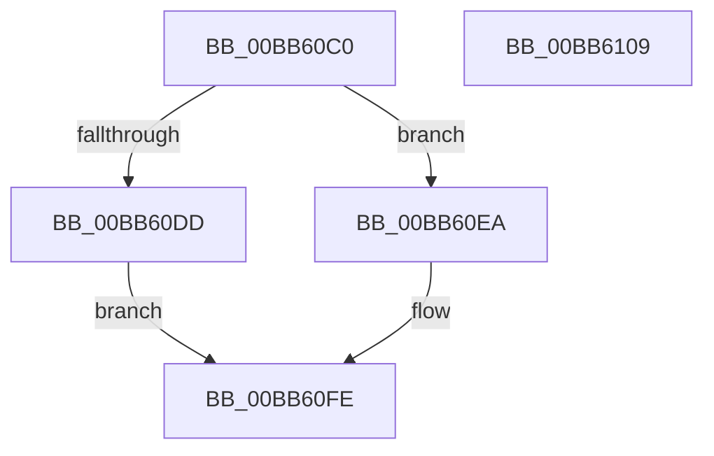

# VfWmiDumpIrpStack

- RVA: `0x00BB60C0`–`0x00BB610A` (길이 `74` bytes)
- VA: `0x0000000140BB60C0`
- 실행 섹션: `PAGEVRFY`
- PDB 이름 있음: `예`; PDB Function 태그: `아니요`
- unwind 정보 RVA: `0x0005CF00`
- 디코드: `20`개 명령, `74/74` bytes 표시
- 미해석 바이트: `0` (있으면 어셈블리에 `.byte`로 보존)

> 이 문서는 커널 이미지의 기계어와 PDB 기호를 분석해 생성했습니다. 4번과 5번은 함수 원형과 자료형을 바이너리 사용 방식에서 추정한 C 해석이며 원본 소스 복구 결과는 아닙니다.

## 1. Dependencies

- 직접 호출 지점: **2**; 고유 호출 대상: **1**
- 직접 호출자로 확인된 함수: **0**
- RIP 상대 이미지 참조: **4**

### Outgoing calls
- `0x00BB60D0` → [VfUtilDbgPrint](../../text/61/VfUtilDbgPrint_function_006122AC.md) (function, `0x006122AC`)
- `0x00BB60FE` → [VfUtilDbgPrint](../../text/61/VfUtilDbgPrint_function_006122AC.md) (function, `0x006122AC`)

### Direct callers
- 이 함수 시작 RVA로 연결되는 직접 call은 확인되지 않았습니다. 간접 호출은 완전히 역산할 수 없습니다.

### Static image references
- `0x00BB60C9` → RVA `0x00BBBC40` (` ?? ::JKADOLAD::`string'`; read)
- `0x00BB60DD` → RVA `0x00B8B300` (`WmiIrpNames`; read)
- `0x00BB60EC` → RVA `0x00BBBB10` (` ?? ::JKADOLAD::`string'`; read)
- `0x00BB60F3` → RVA `0x00BBBB40` (` ?? ::JKADOLAD::`string'`; read)

## 2. Other-region calls and transfers

- 다른 실행 섹션으로 향하는 call: **2**
  - `0x00BB60D0` → [VfUtilDbgPrint](../../text/61/VfUtilDbgPrint_function_006122AC.md) (`PAGEVRFY` → `.text`)
  - `0x00BB60FE` → [VfUtilDbgPrint](../../text/61/VfUtilDbgPrint_function_006122AC.md) (`PAGEVRFY` → `.text`)
- 별도 외부 분기/꼬리 이동을 확인하지 못했습니다.

## 3. Assembly (complete function range)

```asm
00BB60C0  40 53                           push rbx
00BB60C2  48 83 EC 20                     sub rsp, 0x20
00BB60C6  48 8B D9                        mov rbx, rcx
00BB60C9  48 8D 0D 70 5B 00 00            lea rcx, [rip + 0x5b70]
00BB60D0  E8 D7 C1 A5 FF                  call 0x1406122ac
00BB60D5  0F B6 43 01                     movzx eax, byte ptr [rbx + 1]
00BB60D9  3C 09                           cmp al, 9
00BB60DB  77 0D                           ja 0x140bb60ea
00BB60DD  48 8D 0D 1C 52 FD FF            lea rcx, [rip - 0x2ade4]
00BB60E4  48 8B 0C C1                     mov rcx, qword ptr [rcx + rax*8]
00BB60E8  EB 14                           jmp 0x140bb60fe
00BB60EA  3C FF                           cmp al, 0xff
00BB60EC  48 8D 0D 1D 5A 00 00            lea rcx, [rip + 0x5a1d]
00BB60F3  48 8D 15 46 5A 00 00            lea rdx, [rip + 0x5a46]
00BB60FA  48 0F 45 CA                     cmovne rcx, rdx
00BB60FE  E8 A9 C1 A5 FF                  call 0x1406122ac
00BB6103  48 83 C4 20                     add rsp, 0x20
00BB6107  5B                              pop rbx
00BB6108  C3                              ret
00BB6109  CC                              int3
```

## 4. C-style interpretation (structured pseudocode)

```c
__int64 __fastcall VfWmiDumpIrpStack(__int64 a1)
{
    __int64 result;
    __int64 v_rsp;

    v_rsp = (v_rsp) - (32);
    result = VfUtilDbgPrint(v_rip + 23408, a2, a3, a4);
    if (((unsigned __int8)(*(unsigned __int8 *)(a1 + 1))) > 9) goto loc_00BB60EA;
    goto loc_00BB60FE;
loc_00BB60EA:
    a1 = v_rip + 23069;
    if (((unsigned __int8)(*(unsigned __int8 *)(a1 + 1))) != 255) { a1 = v_rip + 23110; }
loc_00BB60FE:
    result = VfUtilDbgPrint(a1, v_rip + 23110, a3, a4);
    v_rsp = (v_rsp) + (32);
    return result;
}
```

## 5. (Beta) C Style

```c
int64_t VfWmiDumpIrpStack(void *Arg1)
{
    uint8_t *arg1 = (uint8_t *)Arg1;

    int64_t result;
    int64_t local_rsp;

    local_rsp = (local_rsp) - (32);
    result = VfUtilDbgPrint(v_rip + 23408, a2, a3, a4);
    if (((uint8_t)(*(uint8_t *)(arg1 + 0x1))) > 9) goto loc_00BB60EA;
    goto loc_00BB60FE;
loc_00BB60EA:
    Arg1 = v_rip + 23069;
    if (((uint8_t)(*(uint8_t *)(arg1 + 0x1))) != 255) { Arg1 = v_rip + 23110; }
loc_00BB60FE:
    result = VfUtilDbgPrint(Arg1, v_rip + 23110, a3, a4);
    local_rsp = (local_rsp) + (32);
    return result;
}
```

### 관측된 메모리 오프셋

구조체 형식이 확인되지 않은 접근은 인자 기준의 오프셋으로만 기록했습니다.

| 기준 인자 | 오프셋 표현 | 폭 (bit) | 접근 |
|---|---:|---:|---|
| `Arg1` | `+ 0x1` | `8` | `R` |

## 6. Execution-region graph

[열기: 2D/3D 그래프와 함수 탐색 컨트롤 패널](../../../control-panel.html?section=pagevrfy&rva=0x00BB60C0&view=graph)

- 2D 그래프는 위에서 아래로 흐르고, 3D 그래프는 빈 공간을 드래그해 회전합니다. Shift+드래그는 이동, 휠은 확대·축소, 함수 노드 선택은 대상 보고서 이동입니다.

### Static fallback


