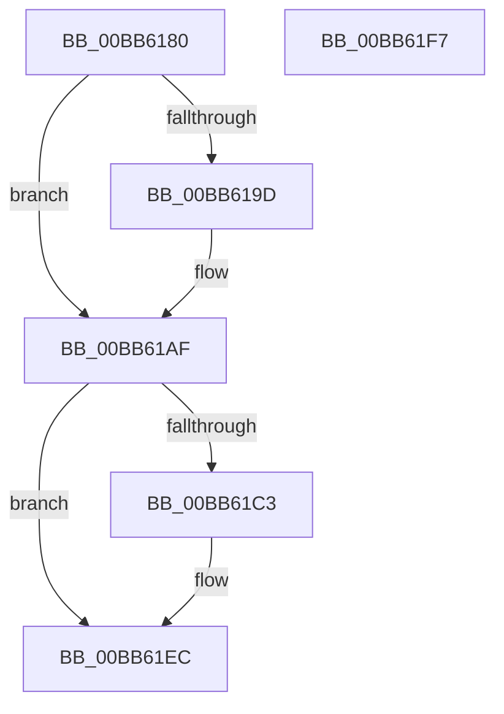

# VfWmiVerifyIrpStackDownward

- RVA: `0x00BB6180`–`0x00BB61F8` (길이 `120` bytes)
- VA: `0x0000000140BB6180`
- 실행 섹션: `PAGEVRFY`
- PDB 이름 있음: `예`; PDB Function 태그: `아니요`
- unwind 정보 RVA: `0x0005CAAC`
- 디코드: `30`개 명령, `120/120` bytes 표시
- 미해석 바이트: `0` (있으면 어셈블리에 `.byte`로 보존)

> 이 문서는 커널 이미지의 기계어와 PDB 기호를 분석해 생성했습니다. 4번과 5번은 함수 원형과 자료형을 바이너리 사용 방식에서 추정한 C 해석이며 원본 소스 복구 결과는 아닙니다.

## 1. Dependencies

- 직접 호출 지점: **3**; 고유 호출 대상: **2**
- 직접 호출자로 확인된 함수: **0**
- RIP 상대 이미지 참조: **1**

### Outgoing calls
- `0x00BB61AA` → [ViErrorReport1](../../text/61/ViErrorReport1_function_00614584.md) (function, `0x00614584`)
- `0x00BB61CD` → [VfGetPristineDriverInit](../B9/VfGetPristineDriverInit_function_00B9D8CC.md) (function, `0x00B9D8CC`)
- `0x00BB61DD` → [ViErrorReport1](../../text/61/ViErrorReport1_function_00614584.md) (function, `0x00614584`)

### Direct callers
- 이 함수 시작 RVA로 연결되는 직접 call은 확인되지 않았습니다. 간접 호출은 완전히 역산할 수 없습니다.

### Static image references
- `0x00BB61B3` → RVA `0x0029B590` (`IopInvalidDeviceRequest`; read)

## 2. Other-region calls and transfers

- 다른 실행 섹션으로 향하는 call: **2**
  - `0x00BB61AA` → [ViErrorReport1](../../text/61/ViErrorReport1_function_00614584.md) (`PAGEVRFY` → `.text`)
  - `0x00BB61DD` → [ViErrorReport1](../../text/61/ViErrorReport1_function_00614584.md) (`PAGEVRFY` → `.text`)
- 별도 외부 분기/꼬리 이동을 확인하지 못했습니다.

## 3. Assembly (complete function range)

```asm
00BB6180  48 89 5C 24 08                  mov qword ptr [rsp + 8], rbx
00BB6185  57                              push rdi
00BB6186  48 83 EC 20                     sub rsp, 0x20
00BB618A  48 8B 81 F0 00 00 00            mov rax, qword ptr [rcx + 0xf0]
00BB6191  48 8B FA                        mov rdi, rdx
00BB6194  48 8B 19                        mov rbx, qword ptr [rcx]
00BB6197  83 78 38 03                     cmp dword ptr [rax + 0x38], 3
00BB619B  75 12                           jne 0x140bb61af
00BB619D  48 8B 54 24 60                  mov rdx, qword ptr [rsp + 0x60]
00BB61A2  4C 8B C3                        mov r8, rbx
00BB61A5  B9 11 02 00 00                  mov ecx, 0x211
00BB61AA  E8 D5 E3 A5 FF                  call 0x140614584
00BB61AF  48 8B 4F 08                     mov rcx, qword ptr [rdi + 8]
00BB61B3  48 8D 05 D6 53 6E FF            lea rax, [rip - 0x91ac2a]
00BB61BA  48 39 81 28 01 00 00            cmp qword ptr [rcx + 0x128], rax
00BB61C1  75 29                           jne 0x140bb61ec
00BB61C3  48 8B 44 24 50                  mov rax, qword ptr [rsp + 0x50]
00BB61C8  0F BA 68 04 18                  bts dword ptr [rax + 4], 0x18
00BB61CD  E8 FA 76 FE FF                  call 0x140b9d8cc
00BB61D2  4C 8B C3                        mov r8, rbx
00BB61D5  48 8B D0                        mov rdx, rax
00BB61D8  B9 1F 02 00 00                  mov ecx, 0x21f
00BB61DD  E8 A2 E3 A5 FF                  call 0x140614584
00BB61E2  48 8B 44 24 58                  mov rax, qword ptr [rsp + 0x58]
00BB61E7  0F BA 68 04 1F                  bts dword ptr [rax + 4], 0x1f
00BB61EC  48 8B 5C 24 30                  mov rbx, qword ptr [rsp + 0x30]
00BB61F1  48 83 C4 20                     add rsp, 0x20
00BB61F5  5F                              pop rdi
00BB61F6  C3                              ret
00BB61F7  CC                              int3
```

## 4. C-style interpretation (structured pseudocode)

```c
__int64 __fastcall VfWmiVerifyIrpStackDownward(__int64 a1, __int64 a2, __int64 a3, __int64 a4, __int64 a5, __int64 a6, __int64 a7)
{
    __int64 result;
    __int64 v_rsp;
    unsigned __int64 v_stack_p8;

    v_stack_p8 = v_rbx;
    v_rsp = (v_rsp) - (32);
    result = *(unsigned __int64 *)(a1 + 240);
    if ((*(unsigned int *)(*(unsigned __int64 *)(a1 + 240) + 56)) == 3) {
        a2 = a7;
        a3 = *(unsigned __int64 *)(a1);
        a1 = 529;
        result = ViErrorReport1(a1, a2, a3, a4);
    }
    result = v_rip - 9546794;
    if ((*(unsigned __int64 *)(*(unsigned __int64 *)(a2 + 8) + 296)) == (v_rip - 9546794)) {
        result = a5;
        result = VfGetPristineDriverInit(*(unsigned __int64 *)(a2 + 8), a2, a3, a4);
        a3 = *(unsigned __int64 *)(a1);
        a2 = result;
        a1 = 543;
        result = ViErrorReport1(a1, a2, a3, a4);
        result = a6;
    }
    v_rsp = (v_rsp) + (32);
    return result;
}
```

## 5. (Beta) C Style

```c
int64_t VfWmiVerifyIrpStackDownward(void *Arg1, void *Arg2, int64_t Arg3, int64_t Arg4, void *Arg5, void *Arg6, int64_t Arg7)
{
    uint8_t *arg1 = (uint8_t *)Arg1;
    uint8_t *arg2 = (uint8_t *)Arg2;
    uint8_t *arg5 = (uint8_t *)Arg5;
    uint8_t *arg6 = (uint8_t *)Arg6;

    int64_t result;
    int64_t local_rsp;
    uint64_t v_stack_p8;

    v_stack_p8 = local_rbx;
    local_rsp = (local_rsp) - (32);
    result = *(uint64_t *)(arg1 + 0xF0);
    if ((*(uint32_t *)(*(uint64_t *)(arg1 + 0xF0) + 0x38)) == 3) {
        Arg2 = Arg7;
        Arg3 = *(uint64_t *)(arg1);
        Arg1 = 529;
        result = ViErrorReport1(Arg1, Arg2, Arg3, Arg4);
    }
    result = v_rip - 9546794;
    if ((*(uint64_t *)(*(uint64_t *)(arg2 + 0x8) + 0x128)) == (v_rip - 9546794)) {
        result = Arg5;
        result = VfGetPristineDriverInit(*(uint64_t *)(arg2 + 0x8), Arg2, Arg3, Arg4);
        Arg3 = *(uint64_t *)(arg1);
        Arg2 = result;
        Arg1 = 543;
        result = ViErrorReport1(Arg1, Arg2, Arg3, Arg4);
        result = Arg6;
    }
    local_rsp = (local_rsp) + (32);
    return result;
}
```

### 관측된 메모리 오프셋

구조체 형식이 확인되지 않은 접근은 인자 기준의 오프셋으로만 기록했습니다.

| 기준 인자 | 오프셋 표현 | 폭 (bit) | 접근 |
|---|---:|---:|---|
| `Arg1` | `+ 0x0` | `64` | `R` |
| `Arg1` | `+ 0xF0` | `64` | `R` |
| `Arg2` | `+ 0x8` | `64` | `R` |
| `Arg5` | `+ 0x4` | `32` | `R/W` |
| `Arg6` | `+ 0x4` | `32` | `R/W` |

## 6. Execution-region graph

[열기: 2D/3D 그래프와 함수 탐색 컨트롤 패널](../../../control-panel.html?section=pagevrfy&rva=0x00BB6180&view=graph)

- 2D 그래프는 위에서 아래로 흐르고, 3D 그래프는 빈 공간을 드래그해 회전합니다. Shift+드래그는 이동, 휠은 확대·축소, 함수 노드 선택은 대상 보고서 이동입니다.

### Static fallback


