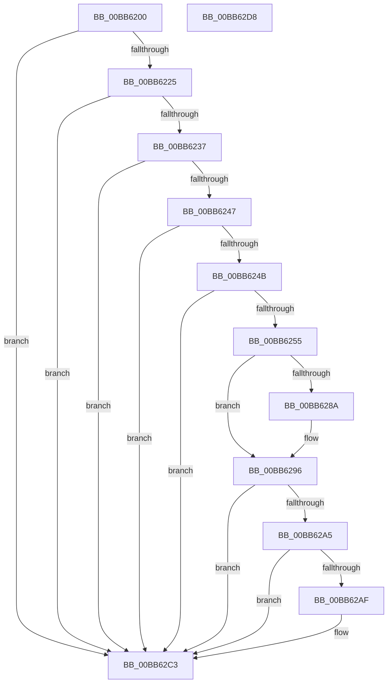

# VfWmiVerifyIrpStackUpward

- RVA: `0x00BB6200`–`0x00BB62D9` (길이 `217` bytes)
- VA: `0x0000000140BB6200`
- 실행 섹션: `PAGEVRFY`
- PDB 이름 있음: `예`; PDB Function 태그: `아니요`
- unwind 정보 RVA: `0x0007D3C0`
- 디코드: `62`개 명령, `217/217` bytes 표시
- 미해석 바이트: `0` (있으면 어셈블리에 `.byte`로 보존)

> 이 문서는 커널 이미지의 기계어와 PDB 기호를 분석해 생성했습니다. 4번과 5번은 함수 원형과 자료형을 바이너리 사용 방식에서 추정한 C 해석이며 원본 소스 복구 결과는 아닙니다.

## 1. Dependencies

- 직접 호출 지점: **4**; 고유 호출 대상: **4**
- 직접 호출자로 확인된 함수: **0**
- RIP 상대 이미지 참조: **3**

### Outgoing calls
- `0x00BB626C` → [VfAvlInitializeLockContext](../../text/4A/VfAvlInitializeLockContext_function_004A686C.md) (function, `0x004A686C`)
- `0x00BB6280` → [VfAvlLookupTreeNode](../../text/3E/VfAvlLookupTreeNode_function_003EF1B4.md) (function, `0x003EF1B4`)
- `0x00BB629B` → [VfAvlCleanupLockContext](../../text/3E/VfAvlCleanupLockContext_function_003EF56C.md) (function, `0x003EF56C`)
- `0x00BB62BE` → [ViErrorReport10](../../text/61/ViErrorReport10_function_00614608.md) (function, `0x00614608`)

### Direct callers
- 이 함수 시작 RVA로 연결되는 직접 call은 확인되지 않았습니다. 간접 호출은 완전히 역산할 수 없습니다.

### Static image references
- `0x00BB6214` → RVA `0x00F04A20` (`.data`; read)
- `0x00BB6279` → RVA `0x00FFDCC0` (`PAGEVRFD`; read)
- `0x00BB62A5` → RVA `0x00F04AC0` (`.data`; read)

## 2. Other-region calls and transfers

- 다른 실행 섹션으로 향하는 call: **4**
  - `0x00BB626C` → [VfAvlInitializeLockContext](../../text/4A/VfAvlInitializeLockContext_function_004A686C.md) (`PAGEVRFY` → `.text`)
  - `0x00BB6280` → [VfAvlLookupTreeNode](../../text/3E/VfAvlLookupTreeNode_function_003EF1B4.md) (`PAGEVRFY` → `.text`)
  - `0x00BB629B` → [VfAvlCleanupLockContext](../../text/3E/VfAvlCleanupLockContext_function_003EF56C.md) (`PAGEVRFY` → `.text`)
  - `0x00BB62BE` → [ViErrorReport10](../../text/61/ViErrorReport10_function_00614608.md) (`PAGEVRFY` → `.text`)
- 별도 외부 분기/꼬리 이동을 확인하지 못했습니다.

## 3. Assembly (complete function range)

```asm
00BB6200  4C 8B DC                        mov r11, rsp
00BB6203  49 89 5B 08                     mov qword ptr [r11 + 8], rbx
00BB6207  49 89 6B 10                     mov qword ptr [r11 + 0x10], rbp
00BB620B  49 89 73 18                     mov qword ptr [r11 + 0x18], rsi
00BB620F  57                              push rdi
00BB6210  48 83 EC 40                     sub rsp, 0x40
00BB6214  8B 05 06 E8 34 00               mov eax, dword ptr [rip + 0x34e806]
00BB621A  48 8B DA                        mov rbx, rdx
00BB621D  A8 10                           test al, 0x10
00BB621F  0F 84 9E 00 00 00               je 0x140bb62c3
00BB6225  83 7C 24 70 00                  cmp dword ptr [rsp + 0x70], 0
00BB622A  48 8B 31                        mov rsi, qword ptr [rcx]
00BB622D  49 8B 69 28                     mov rbp, qword ptr [r9 + 0x28]
00BB6231  0F 84 8C 00 00 00               je 0x140bb62c3
00BB6237  41 8B 41 04                     mov eax, dword ptr [r9 + 4]
00BB623B  8B C8                           mov ecx, eax
00BB623D  81 E1 00 00 00 10               and ecx, 0x10000000
00BB6243  85 C0                           test eax, eax
00BB6245  78 7C                           js 0x140bb62c3
00BB6247  85 C9                           test ecx, ecx
00BB6249  75 78                           jne 0x140bb62c3
00BB624B  4C 8B 42 28                     mov r8, qword ptr [rdx + 0x28]
00BB624F  4C 39 42 08                     cmp qword ptr [rdx + 8], r8
00BB6253  74 6E                           je 0x140bb62c3
00BB6255  0F 57 C0                        xorps xmm0, xmm0
00BB6258  8D 79 01                        lea edi, [rcx + 1]
00BB625B  33 C0                           xor eax, eax
00BB625D  49 8D 4B D8                     lea rcx, [r11 - 0x28]
00BB6261  0F 11 44 24 20                  movups xmmword ptr [rsp + 0x20], xmm0
00BB6266  8B D7                           mov edx, edi
00BB6268  49 89 43 E8                     mov qword ptr [r11 - 0x18], rax
00BB626C  E8 FB 05 8F FF                  call 0x1404a686c
00BB6271  45 33 C9                        xor r9d, r9d
00BB6274  48 8D 54 24 20                  lea rdx, [rsp + 0x20]
00BB6279  48 8D 0D 40 7A 44 00            lea rcx, [rip + 0x447a40]
00BB6280  E8 2F 8F 83 FF                  call 0x1403ef1b4
00BB6285  48 85 C0                        test rax, rax
00BB6288  74 0C                           je 0x140bb6296
00BB628A  8A 40 10                        mov al, byte ptr [rax + 0x10]
00BB628D  24 02                           and al, 2
00BB628F  F6 D8                           neg al
00BB6291  1A C0                           sbb al, al
00BB6293  40 22 F8                        and dil, al
00BB6296  48 8D 4C 24 20                  lea rcx, [rsp + 0x20]
00BB629B  E8 CC 92 83 FF                  call 0x1403ef56c
00BB62A0  40 84 FF                        test dil, dil
00BB62A3  75 1E                           jne 0x140bb62c3
00BB62A5  8B 05 15 E8 34 00               mov eax, dword ptr [rip + 0x34e815]
00BB62AB  85 C0                           test eax, eax
00BB62AD  75 14                           jne 0x140bb62c3
00BB62AF  4C 8B 4B 08                     mov r9, qword ptr [rbx + 8]
00BB62B3  4C 8B C6                        mov r8, rsi
00BB62B6  48 8B D5                        mov rdx, rbp
00BB62B9  B9 20 02 00 00                  mov ecx, 0x220
00BB62BE  E8 45 E3 A5 FF                  call 0x140614608
00BB62C3  48 8B 5C 24 50                  mov rbx, qword ptr [rsp + 0x50]
00BB62C8  48 8B 6C 24 58                  mov rbp, qword ptr [rsp + 0x58]
00BB62CD  48 8B 74 24 60                  mov rsi, qword ptr [rsp + 0x60]
00BB62D2  48 83 C4 40                     add rsp, 0x40
00BB62D6  5F                              pop rdi
00BB62D7  C3                              ret
00BB62D8  CC                              int3
```

## 4. C-style interpretation (structured pseudocode)

```c
__int64 __fastcall VfWmiVerifyIrpStackUpward(__int64 a1, __int64 a2, __int64 a3, __int64 a4, unsigned int a5)
{
    __int64 result;
    __int64 v_rdi;
    __int64 v_rsp;
    unsigned __int64 v_stack_m28;
    unsigned __int64 v_stack_p10;
    unsigned __int64 v_stack_p18;
    unsigned __int64 v_stack_p8;

    *(unsigned __int64 *)(v_rsp + 8) = v_rbx;
    *(unsigned __int64 *)(v_rsp + 16) = v_rbp;
    *(unsigned __int64 *)(v_rsp + 24) = v_rsi;
    v_rsp = (v_rsp) - (64);
    if ((((unsigned __int8)((unsigned int)(*(unsigned int *)(v_rip + 3467270)))) & (16)) == 0) goto loc_00BB62C3;
    if (a5 == 0) goto loc_00BB62C3;
    a1 = (unsigned int)(((unsigned int)((unsigned int)((unsigned int)(*(unsigned int *)(a4 + 4))))) & (0x10000000ULL));
    if (sign_flag) goto loc_00BB62C3;
    if ((unsigned int)(a1) != 0) goto loc_00BB62C3;
    if ((*(unsigned __int64 *)(a2 + 8)) == (*(unsigned __int64 *)(a2 + 40))) goto loc_00BB62C3;
    result = 0;
    v_stack_m28 = v_xmm0;
    *(unsigned __int64 *)(v_rsp - 24) = 0;
    result = VfAvlInitializeLockContext(v_rsp - 40, (unsigned int)((unsigned int)(a1 + 1)), *(unsigned __int64 *)(a2 + 40), a4);
    a4 = 0;
    result = VfAvlLookupTreeNode(v_rip + 4487744, v_stack_m28, *(unsigned __int64 *)(a2 + 40), a4);
    v_rdi = a1 + 1;
    if (result != 0) {
        result = *(unsigned __int8 *)(result + 16);
        result = (unsigned __int8)((result) & (2));
        result = (unsigned __int8)(-(result));
        v_rdi = (unsigned __int8)((a1 + 1) & ((unsigned __int8)(result)));
    }
    result = VfAvlCleanupLockContext(v_stack_m28, v_stack_m28, *(unsigned __int64 *)(a2 + 40), a4);
    if ((unsigned __int8)(v_rdi) != 0) goto loc_00BB62C3;
    result = (unsigned int)(*(unsigned int *)(v_rip + 3467285));
    if ((unsigned int)((unsigned int)(*(unsigned int *)(v_rip + 3467285))) == 0) {
        a4 = *(unsigned __int64 *)(a2 + 8);
        a3 = *(unsigned __int64 *)(a1);
        a2 = *(unsigned __int64 *)(a4 + 40);
        a1 = 544;
        result = ViErrorReport10(a1, a2, a3, a4);
    }
    v_rsp = (v_rsp) + (64);
    return result;
}
```

## 5. (Beta) C Style

```c
int64_t VfWmiVerifyIrpStackUpward(void *Arg1, void *Arg2, int64_t Arg3, void *Arg4, uint32_t Arg5)
{
    uint8_t *arg1 = (uint8_t *)Arg1;
    uint8_t *arg2 = (uint8_t *)Arg2;
    uint8_t *arg4 = (uint8_t *)Arg4;

    int64_t result;
    int64_t local_rdi;
    int64_t local_rsp;
    uint64_t v_stack_m28;
    uint64_t v_stack_p10;
    uint64_t v_stack_p18;
    uint64_t v_stack_p8;

    *(uint64_t *)(local_rsp + 0x8) = local_rbx;
    *(uint64_t *)(local_rsp + 0x10) = local_rbp;
    *(uint64_t *)(local_rsp + 0x18) = local_rsi;
    local_rsp = (local_rsp) - (64);
    if ((((uint8_t)((uint32_t)(*(uint32_t *)(v_rip + 0x34E806)))) & (16)) == 0) goto loc_00BB62C3;
    if (Arg5 == 0) goto loc_00BB62C3;
    Arg1 = (uint32_t)(((uint32_t)((uint32_t)((uint32_t)(*(uint32_t *)(arg4 + 0x4))))) & (0x10000000ULL));
    if (sign_flag) goto loc_00BB62C3;
    if ((uint32_t)(Arg1) != 0) goto loc_00BB62C3;
    if ((*(uint64_t *)(arg2 + 0x8)) == (*(uint64_t *)(arg2 + 0x28))) goto loc_00BB62C3;
    result = 0;
    v_stack_m28 = v_xmm0;
    *(uint64_t *)(local_rsp - 0x18) = 0;
    result = VfAvlInitializeLockContext(local_rsp - 40, (uint32_t)((uint32_t)(Arg1 + 1)), *(uint64_t *)(arg2 + 0x28), Arg4);
    Arg4 = 0;
    result = VfAvlLookupTreeNode(v_rip + 4487744, v_stack_m28, *(uint64_t *)(arg2 + 0x28), Arg4);
    local_rdi = Arg1 + 1;
    if (result != 0) {
        result = *(uint8_t *)(result + 0x10);
        result = (uint8_t)((result) & (2));
        result = (uint8_t)(-(result));
        local_rdi = (uint8_t)((Arg1 + 1) & ((uint8_t)(result)));
    }
    result = VfAvlCleanupLockContext(v_stack_m28, v_stack_m28, *(uint64_t *)(arg2 + 0x28), Arg4);
    if ((uint8_t)(local_rdi) != 0) goto loc_00BB62C3;
    result = (uint32_t)(*(uint32_t *)(v_rip + 0x34E815));
    if ((uint32_t)((uint32_t)(*(uint32_t *)(v_rip + 0x34E815))) == 0) {
        Arg4 = *(uint64_t *)(arg2 + 0x8);
        Arg3 = *(uint64_t *)(arg1);
        Arg2 = *(uint64_t *)(arg4 + 0x28);
        Arg1 = 544;
        result = ViErrorReport10(Arg1, Arg2, Arg3, Arg4);
    }
    local_rsp = (local_rsp) + (64);
    return result;
}
```

### 관측된 메모리 오프셋

구조체 형식이 확인되지 않은 접근은 인자 기준의 오프셋으로만 기록했습니다.

| 기준 인자 | 오프셋 표현 | 폭 (bit) | 접근 |
|---|---:|---:|---|
| `Arg1` | `+ 0x0` | `64` | `R` |
| `Arg2` | `+ 0x8` | `64` | `R` |
| `Arg2` | `+ 0x28` | `64` | `R` |
| `Arg4` | `+ 0x4` | `32` | `R` |
| `Arg4` | `+ 0x28` | `64` | `R` |

## 6. Execution-region graph

[열기: 2D/3D 그래프와 함수 탐색 컨트롤 패널](../../../control-panel.html?section=pagevrfy&rva=0x00BB6200&view=graph)

- 2D 그래프는 위에서 아래로 흐르고, 3D 그래프는 빈 공간을 드래그해 회전합니다. Shift+드래그는 이동, 휠은 확대·축소, 함수 노드 선택은 대상 보고서 이동입니다.

### Static fallback


