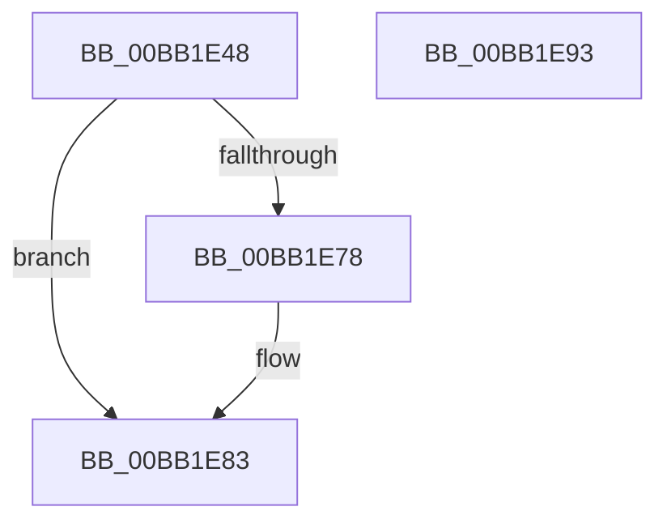

# ViCtxAllocateIsrContext

- RVA: `0x00BB1E48`–`0x00BB1E94` (길이 `76` bytes)
- VA: `0x0000000140BB1E48`
- 실행 섹션: `PAGEVRFY`
- PDB 이름 있음: `예`; PDB Function 태그: `아니요`
- unwind 정보 RVA: `0x00060BC4`
- 디코드: `22`개 명령, `76/76` bytes 표시
- 미해석 바이트: `0` (있으면 어셈블리에 `.byte`로 보존)

> 이 문서는 커널 이미지의 기계어와 PDB 기호를 분석해 생성했습니다. 4번과 5번은 함수 원형과 자료형을 바이너리 사용 방식에서 추정한 C 해석이며 원본 소스 복구 결과는 아닙니다.

## 1. Dependencies

- 직접 호출 지점: **1**; 고유 호출 대상: **1**
- 직접 호출자로 확인된 함수: **2**
- RIP 상대 이미지 참조: **0**

### Outgoing calls
- `0x00BB1E6E` → [ExAllocatePool2](../../poolcode/B8/ExAllocatePool2_function_00B820F0.md) (function, `0x00B820F0`)

### Direct callers
- [VerifierIoConnectInterrupt](VerifierIoConnectInterrupt_function_00BB1AD0.md) at `0x00BB1B11`
- [ViCtxSetPrivateConnectParameters](ViCtxSetPrivateConnectParameters_function_00BB224C.md) at `0x00BB22D0`

### Static image references
- 디코드된 RIP-relative 메모리 참조가 없습니다.

## 2. Other-region calls and transfers

- 다른 실행 섹션으로 향하는 call: **1**
  - `0x00BB1E6E` → [ExAllocatePool2](../../poolcode/B8/ExAllocatePool2_function_00B820F0.md) (`PAGEVRFY` → `POOLCODE`)
- 별도 외부 분기/꼬리 이동을 확인하지 못했습니다.

## 3. Assembly (complete function range)

```asm
00BB1E48  48 89 5C 24 08                  mov qword ptr [rsp + 8], rbx
00BB1E4D  48 89 74 24 10                  mov qword ptr [rsp + 0x10], rsi
00BB1E52  57                              push rdi
00BB1E53  48 83 EC 20                     sub rsp, 0x20
00BB1E57  48 8B FA                        mov rdi, rdx
00BB1E5A  49 8B D8                        mov rbx, r8
00BB1E5D  BA 18 00 00 00                  mov edx, 0x18
00BB1E62  48 8B F1                        mov rsi, rcx
00BB1E65  41 B8 56 49 73 72               mov r8d, 0x72734956
00BB1E6B  8D 4A 28                        lea ecx, [rdx + 0x28]
00BB1E6E  E8 7D 02 FD FF                  call 0x140b820f0
00BB1E73  48 85 C0                        test rax, rax
00BB1E76  74 0B                           je 0x140bb1e83
00BB1E78  48 89 30                        mov qword ptr [rax], rsi
00BB1E7B  48 89 78 08                     mov qword ptr [rax + 8], rdi
00BB1E7F  48 89 58 10                     mov qword ptr [rax + 0x10], rbx
00BB1E83  48 8B 5C 24 30                  mov rbx, qword ptr [rsp + 0x30]
00BB1E88  48 8B 74 24 38                  mov rsi, qword ptr [rsp + 0x38]
00BB1E8D  48 83 C4 20                     add rsp, 0x20
00BB1E91  5F                              pop rdi
00BB1E92  C3                              ret
00BB1E93  CC                              int3
```

## 4. C-style interpretation (structured pseudocode)

```c
__int64 __fastcall ViCtxAllocateIsrContext(__int64 a1, __int64 a2, __int64 a3)
{
    __int64 result;
    __int64 v_rsp;
    unsigned __int64 v_stack_p10;
    unsigned __int64 v_stack_p8;

    v_stack_p8 = v_rbx;
    v_stack_p10 = v_rsi;
    v_rsp = (v_rsp) - (32);
    result = ExAllocatePool2(24 + 40, 24, (unsigned int)(0x72734956ULL), a4);
    if (result != 0) {
        *(unsigned __int64 *)(result) = a1;
        *(unsigned __int64 *)(result + 8) = a2;
        *(unsigned __int64 *)(result + 16) = a3;
    }
    v_rsp = (v_rsp) + (32);
    return result;
}
```

## 5. (Beta) C Style

```c
int64_t ViCtxAllocateIsrContext(int64_t Arg1, int64_t Arg2, int64_t Arg3)
{
    int64_t result;
    int64_t local_rsp;
    uint64_t v_stack_p10;
    uint64_t v_stack_p8;

    v_stack_p8 = local_rbx;
    v_stack_p10 = local_rsi;
    local_rsp = (local_rsp) - (32);
    result = ExAllocatePool2(24 + 40, 24, (uint32_t)(0x72734956ULL), a4);
    if (result != 0) {
        *(uint64_t *)(result) = Arg1;
        *(uint64_t *)(result + 0x8) = Arg2;
        *(uint64_t *)(result + 0x10) = Arg3;
    }
    local_rsp = (local_rsp) + (32);
    return result;
}
```

## 6. Execution-region graph

[열기: 2D/3D 그래프와 함수 탐색 컨트롤 패널](../../../control-panel.html?section=pagevrfy&rva=0x00BB1E48&view=graph)

- 2D 그래프는 위에서 아래로 흐르고, 3D 그래프는 빈 공간을 드래그해 회전합니다. Shift+드래그는 이동, 휠은 확대·축소, 함수 노드 선택은 대상 보고서 이동입니다.

### Static fallback


