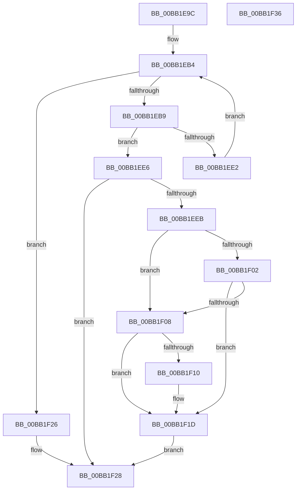

# ViCtxCaptureInitialIsrState

- RVA: `0x00BB1E9C`–`0x00BB1F37` (길이 `155` bytes)
- VA: `0x0000000140BB1E9C`
- 실행 섹션: `PAGEVRFY`
- PDB 이름 있음: `예`; PDB Function 태그: `아니요`
- unwind 정보 RVA: `0x0005CAAC`
- 디코드: `45`개 명령, `155/155` bytes 표시
- 미해석 바이트: `0` (있으면 어셈블리에 `.byte`로 보존)

> 이 문서는 커널 이미지의 기계어와 PDB 기호를 분석해 생성했습니다. 4번과 5번은 함수 원형과 자료형을 바이너리 사용 방식에서 추정한 C 해석이며 원본 소스 복구 결과는 아닙니다.

## 1. Dependencies

- 직접 호출 지점: **1**; 고유 호출 대상: **1**
- 직접 호출자로 확인된 함수: **2**
- RIP 상대 이미지 참조: **5**

### Outgoing calls
- `0x00BB1F14` → [RtlXSave](../../text/3D/RtlXSave_function_003D9D10.md) (function, `0x003D9D10`)

### Direct callers
- [ViCtxIsr](ViCtxIsr_function_00BB2180.md) at `0x00BB2195`
- [ViCtxIsrMessageBased](ViCtxIsrMessageBased_function_00BB21E0.md) at `0x00BB21FD`

### Static image references
- `0x00BB1EAB` → RVA `0x00FFDD14` (`PAGEVRFD`; read/write)
- `0x00BB1EBB` → RVA `0x00FFDD10` (`PAGEVRFD`; read/write)
- `0x00BB1ED0` → RVA `0x01000750` (`PAGEVRFD`; read)
- `0x00BB1EEF` → RVA `0x00FFDB50` (`PAGEVRFD`; read)
- `0x00BB1F1D` → RVA `0x00FFDD18` (`PAGEVRFD`; read/write)

## 2. Other-region calls and transfers

- 다른 실행 섹션으로 향하는 call: **1**
  - `0x00BB1F14` → [RtlXSave](../../text/3D/RtlXSave_function_003D9D10.md) (`PAGEVRFY` → `.text`)
- 별도 외부 분기/꼬리 이동을 확인하지 못했습니다.

## 3. Assembly (complete function range)

```asm
00BB1E9C  48 89 5C 24 08                  mov qword ptr [rsp + 8], rbx
00BB1EA1  57                              push rdi
00BB1EA2  48 83 EC 20                     sub rsp, 0x20
00BB1EA6  BF 01 00 00 00                  mov edi, 1
00BB1EAB  F0 01 3D 62 BE 44 00            lock add dword ptr [rip + 0x44be62], edi
00BB1EB2  33 D2                           xor edx, edx
00BB1EB4  83 FA 10                        cmp edx, 0x10
00BB1EB7  73 6D                           jae 0x140bb1f26
00BB1EB9  8B C7                           mov eax, edi
00BB1EBB  F0 0F C1 05 4D BE 44 00         lock xadd dword ptr [rip + 0x44be4d], eax
00BB1EC3  03 C7                           add eax, edi
00BB1EC5  83 E0 0F                        and eax, 0xf
00BB1EC8  48 8D 1C 80                     lea rbx, [rax + rax*4]
00BB1ECC  48 C1 E3 04                     shl rbx, 4
00BB1ED0  48 8D 05 79 E8 44 00            lea rax, [rip + 0x44e879]
00BB1ED7  48 03 D8                        add rbx, rax
00BB1EDA  33 C0                           xor eax, eax
00BB1EDC  F0 0F B1 3B                     lock cmpxchg dword ptr [rbx], edi
00BB1EE0  74 04                           je 0x140bb1ee6
00BB1EE2  03 D7                           add edx, edi
00BB1EE4  EB CE                           jmp 0x140bb1eb4
00BB1EE6  48 85 DB                        test rbx, rbx
00BB1EE9  74 3D                           je 0x140bb1f28
00BB1EEB  44 0F 20 C0                     mov rax, cr8
00BB1EEF  48 8B 15 5A BC 44 00            mov rdx, qword ptr [rip + 0x44bc5a]
00BB1EF6  88 43 08                        mov byte ptr [rbx + 8], al
00BB1EF9  48 F7 C2 FC FF FF FF            test rdx, -4
00BB1F00  75 06                           jne 0x140bb1f08
00BB1F02  80 79 5E 00                     cmp byte ptr [rcx + 0x5e], 0
00BB1F06  75 15                           jne 0x140bb1f1d
00BB1F08  8B 43 04                        mov eax, dword ptr [rbx + 4]
00BB1F0B  40 84 C7                        test dil, al
00BB1F0E  74 0D                           je 0x140bb1f1d
00BB1F10  48 8B 4B 20                     mov rcx, qword ptr [rbx + 0x20]
00BB1F14  E8 F7 7D 82 FF                  call 0x1403d9d10
00BB1F19  83 4B 04 02                     or dword ptr [rbx + 4], 2
00BB1F1D  F0 01 3D F4 BD 44 00            lock add dword ptr [rip + 0x44bdf4], edi
00BB1F24  EB 02                           jmp 0x140bb1f28
00BB1F26  33 DB                           xor ebx, ebx
00BB1F28  48 8B C3                        mov rax, rbx
00BB1F2B  48 8B 5C 24 30                  mov rbx, qword ptr [rsp + 0x30]
00BB1F30  48 83 C4 20                     add rsp, 0x20
00BB1F34  5F                              pop rdi
00BB1F35  C3                              ret
00BB1F36  CC                              int3
```

## 4. C-style interpretation (structured pseudocode)

```c
__int64 __fastcall ViCtxCaptureInitialIsrState(__int64 a1, int a2)
{
    __int64 result;
    __int64 v_rbx;
    __int64 v_rsp;
    unsigned __int64 v_stack_p8;

    v_stack_p8 = v_rbx;
    v_rsp = (v_rsp) - (32);
    a2 = 0;
loc_00BB1EB4:
    if (0 >= 16) goto loc_00BB1F26;
    result = (unsigned int)((1) + (1));
    result = (unsigned int)((result) & (15));
    v_rbx = (result + result * 4) << (4);
    v_rbx = (v_rbx) + (v_rip + 4515961);
    result = 0;
    if (condition_is_equal) goto loc_00BB1EE6;
    a2 = (unsigned int)((a2) + (1));
    goto loc_00BB1EB4;
loc_00BB1EE6:
    if (v_rbx == 0) goto loc_00BB1F28;
    *(unsigned __int8 *)(v_rbx + 8) = (unsigned __int8)(v_cr8);
    if (((*(unsigned __int64 *)(v_rip + 4504666)) & (-4)) != 0) goto loc_00BB1F08;
    if ((*(unsigned __int8 *)(a1 + 94)) != 0) goto loc_00BB1F1D;
loc_00BB1F08:
    result = (unsigned int)(*(unsigned int *)(v_rbx + 4));
    if (((1) & ((unsigned __int8)((unsigned int)(*(unsigned int *)(v_rbx + 4))))) != 0) {
        a1 = *(unsigned __int64 *)(v_rbx + 32);
        result = RtlXSave(a1, *(unsigned __int64 *)(v_rip + 4504666), a3, a4);
    }
    goto loc_00BB1F28;
loc_00BB1F26:
    v_rbx = 0;
loc_00BB1F28:
    v_rsp = (v_rsp) + (32);
    return 0;
}
```

## 5. (Beta) C Style

```c
int64_t ViCtxCaptureInitialIsrState(void *Arg1, int32_t Arg2)
{
    uint8_t *arg1 = (uint8_t *)Arg1;

    int64_t result;
    int64_t local_rbx;
    int64_t local_rsp;
    uint64_t v_stack_p8;

    v_stack_p8 = local_rbx;
    local_rsp = (local_rsp) - (32);
    Arg2 = 0;
loc_00BB1EB4:
    if (0 >= 16) goto loc_00BB1F26;
    result = (uint32_t)((1) + (1));
    result = (uint32_t)((result) & (15));
    local_rbx = (result + result * 4) << (4);
    local_rbx = (local_rbx) + (v_rip + 4515961);
    result = 0;
    if (condition_is_equal) goto loc_00BB1EE6;
    Arg2 = (uint32_t)((Arg2) + (1));
    goto loc_00BB1EB4;
loc_00BB1EE6:
    if (local_rbx == 0) goto loc_00BB1F28;
    *(uint8_t *)(local_rbx + 0x8) = (uint8_t)(v_cr8);
    if (((*(uint64_t *)(v_rip + 0x44BC5A)) & (-4)) != 0) goto loc_00BB1F08;
    if ((*(uint8_t *)(arg1 + 0x5E)) != 0) goto loc_00BB1F1D;
loc_00BB1F08:
    result = (uint32_t)(*(uint32_t *)(local_rbx + 0x4));
    if (((1) & ((uint8_t)((uint32_t)(*(uint32_t *)(local_rbx + 0x4))))) != 0) {
        Arg1 = *(uint64_t *)(local_rbx + 0x20);
        result = RtlXSave(Arg1, *(uint64_t *)(v_rip + 0x44BC5A), a3, a4);
    }
    goto loc_00BB1F28;
loc_00BB1F26:
    local_rbx = 0;
loc_00BB1F28:
    local_rsp = (local_rsp) + (32);
    return 0;
}
```

### 관측된 메모리 오프셋

구조체 형식이 확인되지 않은 접근은 인자 기준의 오프셋으로만 기록했습니다.

| 기준 인자 | 오프셋 표현 | 폭 (bit) | 접근 |
|---|---:|---:|---|
| `Arg1` | `+ 0x5E` | `8` | `R` |

## 6. Execution-region graph

[열기: 2D/3D 그래프와 함수 탐색 컨트롤 패널](../../../control-panel.html?section=pagevrfy&rva=0x00BB1E9C&view=graph)

- 2D 그래프는 위에서 아래로 흐르고, 3D 그래프는 빈 공간을 드래그해 회전합니다. Shift+드래그는 이동, 휠은 확대·축소, 함수 노드 선택은 대상 보고서 이동입니다.

### Static fallback


