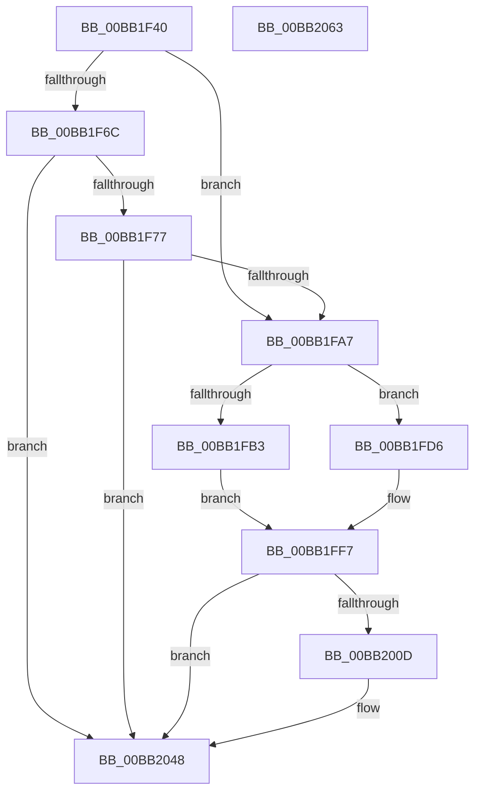

# ViCtxCheckAndReleaseIsrState

- RVA: `0x00BB1F40`–`0x00BB2064` (길이 `292` bytes)
- VA: `0x0000000140BB1F40`
- 실행 섹션: `PAGEVRFY`
- PDB 이름 있음: `예`; PDB Function 태그: `아니요`
- unwind 정보 RVA: `0x0007D3C0`
- 디코드: `71`개 명령, `292/292` bytes 표시
- 미해석 바이트: `0` (있으면 어셈블리에 `.byte`로 보존)

> 이 문서는 커널 이미지의 기계어와 PDB 기호를 분석해 생성했습니다. 4번과 5번은 함수 원형과 자료형을 바이너리 사용 방식에서 추정한 C 해석이며 원본 소스 복구 결과는 아닙니다.

## 1. Dependencies

- 직접 호출 지점: **6**; 고유 호출 대상: **5**
- 직접 호출자로 확인된 함수: **2**
- RIP 상대 이미지 참조: **8**

### Outgoing calls
- `0x00BB1F82` → [RtlXSave](../../text/3D/RtlXSave_function_003D9D10.md) (function, `0x003D9D10`)
- `0x00BB1F9A` → [ViCtxEqualExtendedState](ViCtxEqualExtendedState_function_00BB206C.md) (function, `0x00BB206C`)
- `0x00BB1FC1` → [VfUtilDbgPrint](../../text/61/VfUtilDbgPrint_function_006122AC.md) (function, `0x006122AC`)
- `0x00BB1FE5` → [VfUtilDbgPrint](../../text/61/VfUtilDbgPrint_function_006122AC.md) (function, `0x006122AC`)
- `0x00BB2004` → [VfErrorStoreTriageInformation](../BA/VfErrorStoreTriageInformation_function_00BA35D0.md) (function, `0x00BA35D0`)
- `0x00BB203B` → [CarReportRuleViolationFromNt](../B9/CarReportRuleViolationFromNt_function_00B9D904.md) (function, `0x00B9D904`)

### Direct callers
- [ViCtxIsr](ViCtxIsr_function_00BB2180.md) at `0x00BB21B9`
- [ViCtxIsrMessageBased](ViCtxIsrMessageBased_function_00BB21E0.md) at `0x00BB2226`

### Static image references
- `0x00BB1F77` → RVA `0x00FFDB50` (`PAGEVRFD`; read)
- `0x00BB1FBA` → RVA `0x00BBB880` (` ?? ::JKADOLAD::`string'`; read)
- `0x00BB1FDA` → RVA `0x00BBB8F0` (` ?? ::JKADOLAD::`string'`; read)
- `0x00BB200D` → RVA `0x00FFEFD0` (`PAGEVRFD`; read)
- `0x00BB2014` → RVA `0x00FFEFC8` (`PAGEVRFD`; read)
- `0x00BB201B` → RVA `0x00FFEFC0` (`PAGEVRFD`; read)
- `0x00BB2022` → RVA `0x00FFEFB8` (`PAGEVRFD`; read)
- `0x00BB2042` → RVA `0x00FFDB58` (`PAGEVRFD`; read/write)

## 2. Other-region calls and transfers

- 다른 실행 섹션으로 향하는 call: **3**
  - `0x00BB1F82` → [RtlXSave](../../text/3D/RtlXSave_function_003D9D10.md) (`PAGEVRFY` → `.text`)
  - `0x00BB1FC1` → [VfUtilDbgPrint](../../text/61/VfUtilDbgPrint_function_006122AC.md) (`PAGEVRFY` → `.text`)
  - `0x00BB1FE5` → [VfUtilDbgPrint](../../text/61/VfUtilDbgPrint_function_006122AC.md) (`PAGEVRFY` → `.text`)
- 별도 외부 분기/꼬리 이동을 확인하지 못했습니다.

## 3. Assembly (complete function range)

```asm
00BB1F40  48 89 5C 24 08                  mov qword ptr [rsp + 8], rbx
00BB1F45  48 89 6C 24 10                  mov qword ptr [rsp + 0x10], rbp
00BB1F4A  48 89 74 24 18                  mov qword ptr [rsp + 0x18], rsi
00BB1F4F  57                              push rdi
00BB1F50  48 83 EC 40                     sub rsp, 0x40
00BB1F54  48 8B EA                        mov rbp, rdx
00BB1F57  48 8B D9                        mov rbx, rcx
00BB1F5A  44 0F 20 C0                     mov rax, cr8
00BB1F5E  40 8A 71 08                     mov sil, byte ptr [rcx + 8]
00BB1F62  33 FF                           xor edi, edi
00BB1F64  88 41 09                        mov byte ptr [rcx + 9], al
00BB1F67  40 3A F0                        cmp sil, al
00BB1F6A  75 3B                           jne 0x140bb1fa7
00BB1F6C  8B 41 04                        mov eax, dword ptr [rcx + 4]
00BB1F6F  A8 02                           test al, 2
00BB1F71  0F 84 D1 00 00 00               je 0x140bb2048
00BB1F77  48 8B 15 D2 BB 44 00            mov rdx, qword ptr [rip + 0x44bbd2]
00BB1F7E  48 8B 49 40                     mov rcx, qword ptr [rcx + 0x40]
00BB1F82  E8 89 7D 82 FF                  call 0x1403d9d10
00BB1F87  40 8A 73 08                     mov sil, byte ptr [rbx + 8]
00BB1F8B  48 8B 53 40                     mov rdx, qword ptr [rbx + 0x40]
00BB1F8F  40 84 F6                        test sil, sil
00BB1F92  48 8B 4B 20                     mov rcx, qword ptr [rbx + 0x20]
00BB1F96  41 0F 94 C0                     sete r8b
00BB1F9A  E8 CD 00 00 00                  call 0x140bb206c
00BB1F9F  84 C0                           test al, al
00BB1FA1  0F 85 A1 00 00 00               jne 0x140bb2048
00BB1FA7  0F B6 43 09                     movzx eax, byte ptr [rbx + 9]
00BB1FAB  48 8B D5                        mov rdx, rbp
00BB1FAE  40 3A F0                        cmp sil, al
00BB1FB1  74 23                           je 0x140bb1fd6
00BB1FB3  44 8B C8                        mov r9d, eax
00BB1FB6  44 0F B6 C6                     movzx r8d, sil
00BB1FBA  48 8D 0D BF 98 00 00            lea rcx, [rip + 0x98bf]
00BB1FC1  E8 E6 02 A6 FF                  call 0x1406122ac
00BB1FC6  44 0F B6 4B 08                  movzx r9d, byte ptr [rbx + 8]
00BB1FCB  BA 11 01 00 00                  mov edx, 0x111
00BB1FD0  0F B6 43 09                     movzx eax, byte ptr [rbx + 9]
00BB1FD4  EB 21                           jmp 0x140bb1ff7
00BB1FD6  4C 8B 4B 40                     mov r9, qword ptr [rbx + 0x40]
00BB1FDA  48 8D 0D 0F 99 00 00            lea rcx, [rip + 0x990f]
00BB1FE1  4C 8B 43 20                     mov r8, qword ptr [rbx + 0x20]
00BB1FE5  E8 C2 02 A6 FF                  call 0x1406122ac
00BB1FEA  4C 8B 4B 20                     mov r9, qword ptr [rbx + 0x20]
00BB1FEE  BA 10 01 00 00                  mov edx, 0x110
00BB1FF3  48 8B 43 40                     mov rax, qword ptr [rbx + 0x40]
00BB1FF7  4C 8B C5                        mov r8, rbp
00BB1FFA  48 89 44 24 20                  mov qword ptr [rsp + 0x20], rax
00BB1FFF  B9 C4 00 00 00                  mov ecx, 0xc4
00BB2004  E8 C7 15 FF FF                  call 0x140ba35d0
00BB2009  85 C0                           test eax, eax
00BB200B  74 3B                           je 0x140bb2048
00BB200D  48 8B 05 BC CF 44 00            mov rax, qword ptr [rip + 0x44cfbc]
00BB2014  4C 8B 0D AD CF 44 00            mov r9, qword ptr [rip + 0x44cfad]
00BB201B  4C 8B 05 9E CF 44 00            mov r8, qword ptr [rip + 0x44cf9e]
00BB2022  48 8B 15 8F CF 44 00            mov rdx, qword ptr [rip + 0x44cf8f]
00BB2029  48 89 6C 24 30                  mov qword ptr [rsp + 0x30], rbp
00BB202E  C7 44 24 28 07 00 00 00         mov dword ptr [rsp + 0x28], 7
00BB2036  48 89 44 24 20                  mov qword ptr [rsp + 0x20], rax
00BB203B  E8 C4 B8 FE FF                  call 0x140b9d904
00BB2040  8B C7                           mov eax, edi
00BB2042  87 05 10 BB 44 00               xchg dword ptr [rip + 0x44bb10], eax
00BB2048  83 63 04 FD                     and dword ptr [rbx + 4], 0xfffffffd
00BB204C  87 3B                           xchg dword ptr [rbx], edi
00BB204E  48 8B 5C 24 50                  mov rbx, qword ptr [rsp + 0x50]
00BB2053  48 8B 6C 24 58                  mov rbp, qword ptr [rsp + 0x58]
00BB2058  48 8B 74 24 60                  mov rsi, qword ptr [rsp + 0x60]
00BB205D  48 83 C4 40                     add rsp, 0x40
00BB2061  5F                              pop rdi
00BB2062  C3                              ret
00BB2063  CC                              int3
```

## 4. C-style interpretation (structured pseudocode)

```c
__int64 __fastcall ViCtxCheckAndReleaseIsrState(__int64 a1, __int64 a2)
{
    __int64 result;
    __int64 v_rdi;
    __int64 v_rsp;
    unsigned __int64 v_stack_m18;
    unsigned int v_stack_m20;
    unsigned __int64 v_stack_m28;
    unsigned __int64 v_stack_p10;
    unsigned __int64 v_stack_p18;
    unsigned __int64 v_stack_p8;

    v_stack_p8 = v_rbx;
    v_stack_p10 = v_rbp;
    v_stack_p18 = v_rsi;
    v_rsp = (v_rsp) - (64);
    v_rdi = 0;
    *(unsigned __int8 *)(a1 + 9) = (unsigned __int8)(v_cr8);
    if (((unsigned __int8)(*(unsigned __int8 *)(a1 + 8))) != ((unsigned __int8)(v_cr8))) goto loc_00BB1FA7;
    if ((((unsigned __int8)((unsigned int)(*(unsigned int *)(a1 + 4)))) & (2)) == 0) goto loc_00BB2048;
    result = RtlXSave(*(unsigned __int64 *)(a1 + 64), *(unsigned __int64 *)(v_rip + 4504530), a3, a4);
    a3 = ((unsigned __int8)(*(unsigned __int8 *)(a1 + 8)) == 0) ? 1 : 0;
    result = ViCtxEqualExtendedState(*(unsigned __int64 *)(a1 + 32), *(unsigned __int64 *)(a1 + 64), a3, a4);
    if ((unsigned __int8)(result) != 0) goto loc_00BB2048;
loc_00BB1FA7:
    if (((unsigned __int8)(*(unsigned __int8 *)(a1 + 8))) == ((unsigned __int8)(*(unsigned __int8 *)(a1 + 9)))) goto loc_00BB1FD6;
    result = VfUtilDbgPrint(v_rip + 39103, a2, (unsigned __int8)(*(unsigned __int8 *)(a1 + 8)), (unsigned int)((unsigned int)(*(unsigned __int8 *)(a1 + 9))));
    goto loc_00BB1FF7;
loc_00BB1FD6:
    result = VfUtilDbgPrint(v_rip + 39183, 273, *(unsigned __int64 *)(a1 + 32), *(unsigned __int64 *)(a1 + 64));
loc_00BB1FF7:
    v_stack_m28 = *(unsigned __int64 *)(a1 + 64);
    result = VfErrorStoreTriageInformation(196, 272, a2, *(unsigned __int64 *)(a1 + 32));
    if ((unsigned int)(result) != 0) {
        result = *(unsigned __int64 *)(v_rip + 4509628);
        a4 = *(unsigned __int64 *)(v_rip + 4509613);
        a3 = *(unsigned __int64 *)(v_rip + 4509598);
        a2 = *(unsigned __int64 *)(v_rip + 4509583);
        v_stack_m18 = a2;
        v_stack_m20 = 7;
        v_stack_m28 = result;
        result = CarReportRuleViolationFromNt(196, a2, a3, a4);
        result = 0;
    }
    v_rsp = (v_rsp) + (64);
    return result;
}
```

## 5. (Beta) C Style

```c
int64_t ViCtxCheckAndReleaseIsrState(void *Arg1, int64_t Arg2)
{
    uint8_t *arg1 = (uint8_t *)Arg1;

    int64_t result;
    int64_t local_rdi;
    int64_t local_rsp;
    uint64_t v_stack_m18;
    uint32_t v_stack_m20;
    uint64_t v_stack_m28;
    uint64_t v_stack_p10;
    uint64_t v_stack_p18;
    uint64_t v_stack_p8;

    v_stack_p8 = local_rbx;
    v_stack_p10 = local_rbp;
    v_stack_p18 = local_rsi;
    local_rsp = (local_rsp) - (64);
    local_rdi = 0;
    *(uint8_t *)(arg1 + 0x9) = (uint8_t)(v_cr8);
    if (((uint8_t)(*(uint8_t *)(arg1 + 0x8))) != ((uint8_t)(v_cr8))) goto loc_00BB1FA7;
    if ((((uint8_t)((uint32_t)(*(uint32_t *)(arg1 + 0x4)))) & (2)) == 0) goto loc_00BB2048;
    result = RtlXSave(*(uint64_t *)(arg1 + 0x40), *(uint64_t *)(v_rip + 0x44BBD2), a3, a4);
    a3 = ((uint8_t)(*(uint8_t *)(arg1 + 0x8)) == 0) ? 1 : 0;
    result = ViCtxEqualExtendedState(*(uint64_t *)(arg1 + 0x20), *(uint64_t *)(arg1 + 0x40), a3, a4);
    if ((uint8_t)(result) != 0) goto loc_00BB2048;
loc_00BB1FA7:
    if (((uint8_t)(*(uint8_t *)(arg1 + 0x8))) == ((uint8_t)(*(uint8_t *)(arg1 + 0x9)))) goto loc_00BB1FD6;
    result = VfUtilDbgPrint(v_rip + 39103, Arg2, (uint8_t)(*(uint8_t *)(arg1 + 0x8)), (uint32_t)((uint32_t)(*(uint8_t *)(arg1 + 0x9))));
    goto loc_00BB1FF7;
loc_00BB1FD6:
    result = VfUtilDbgPrint(v_rip + 39183, 273, *(uint64_t *)(arg1 + 0x20), *(uint64_t *)(arg1 + 0x40));
loc_00BB1FF7:
    v_stack_m28 = *(uint64_t *)(arg1 + 0x40);
    result = VfErrorStoreTriageInformation(196, 272, Arg2, *(uint64_t *)(arg1 + 0x20));
    if ((uint32_t)(result) != 0) {
        result = *(uint64_t *)(v_rip + 0x44CFBC);
        a4 = *(uint64_t *)(v_rip + 0x44CFAD);
        a3 = *(uint64_t *)(v_rip + 0x44CF9E);
        Arg2 = *(uint64_t *)(v_rip + 0x44CF8F);
        v_stack_m18 = Arg2;
        v_stack_m20 = 7;
        v_stack_m28 = result;
        result = CarReportRuleViolationFromNt(196, Arg2, a3, a4);
        result = 0;
    }
    local_rsp = (local_rsp) + (64);
    return result;
}
```

### 관측된 메모리 오프셋

구조체 형식이 확인되지 않은 접근은 인자 기준의 오프셋으로만 기록했습니다.

| 기준 인자 | 오프셋 표현 | 폭 (bit) | 접근 |
|---|---:|---:|---|
| `Arg1` | `+ 0x0` | `32` | `R/W` |
| `Arg1` | `+ 0x4` | `32` | `R` |
| `Arg1` | `+ 0x4` | `32` | `R/W` |
| `Arg1` | `+ 0x8` | `8` | `R` |
| `Arg1` | `+ 0x9` | `8` | `R` |
| `Arg1` | `+ 0x9` | `8` | `W` |
| `Arg1` | `+ 0x20` | `64` | `R` |
| `Arg1` | `+ 0x40` | `64` | `R` |

## 6. Execution-region graph

[열기: 2D/3D 그래프와 함수 탐색 컨트롤 패널](../../../control-panel.html?section=pagevrfy&rva=0x00BB1F40&view=graph)

- 2D 그래프는 위에서 아래로 흐르고, 3D 그래프는 빈 공간을 드래그해 회전합니다. Shift+드래그는 이동, 휠은 확대·축소, 함수 노드 선택은 대상 보고서 이동입니다.

### Static fallback


