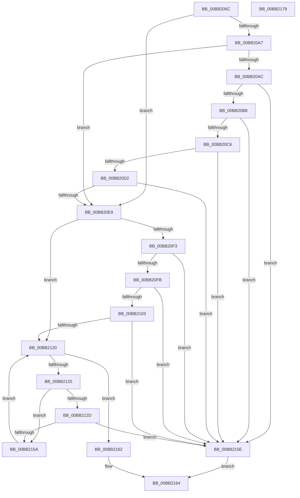

# ViCtxEqualExtendedState

- RVA: `0x00BB206C`–`0x00BB217A` (길이 `270` bytes)
- VA: `0x0000000140BB206C`
- 실행 섹션: `PAGEVRFY`
- PDB 이름 있음: `예`; PDB Function 태그: `아니요`
- unwind 정보 RVA: `0x0005C954`
- 디코드: `72`개 명령, `270/270` bytes 표시
- 미해석 바이트: `0` (있으면 어셈블리에 `.byte`로 보존)

> 이 문서는 커널 이미지의 기계어와 PDB 기호를 분석해 생성했습니다. 4번과 5번은 함수 원형과 자료형을 바이너리 사용 방식에서 추정한 C 해석이며 원본 소스 복구 결과는 아닙니다.

## 1. Dependencies

- 직접 호출 지점: **3**; 고유 호출 대상: **1**
- 직접 호출자로 확인된 함수: **1**
- RIP 상대 이미지 참조: **0**

### Outgoing calls
- `0x00BB20E0` → [memcmp](../../text/6C/memcmp_function_006C6B10.md) (function, `0x006C6B10`)
- `0x00BB2117` → [memcmp](../../text/6C/memcmp_function_006C6B10.md) (function, `0x006C6B10`)
- `0x00BB2151` → [memcmp](../../text/6C/memcmp_function_006C6B10.md) (function, `0x006C6B10`)

### Direct callers
- [ViCtxCheckAndReleaseIsrState](ViCtxCheckAndReleaseIsrState_function_00BB1F40.md) at `0x00BB1F9A`

### Static image references
- 디코드된 RIP-relative 메모리 참조가 없습니다.

## 2. Other-region calls and transfers

- 다른 실행 섹션으로 향하는 call: **3**
  - `0x00BB20E0` → [memcmp](../../text/6C/memcmp_function_006C6B10.md) (`PAGEVRFY` → `.text`)
  - `0x00BB2117` → [memcmp](../../text/6C/memcmp_function_006C6B10.md) (`PAGEVRFY` → `.text`)
  - `0x00BB2151` → [memcmp](../../text/6C/memcmp_function_006C6B10.md) (`PAGEVRFY` → `.text`)
- 별도 외부 분기/꼬리 이동을 확인하지 못했습니다.

## 3. Assembly (complete function range)

```asm
00BB206C  48 89 5C 24 08                  mov qword ptr [rsp + 8], rbx
00BB2071  48 89 6C 24 10                  mov qword ptr [rsp + 0x10], rbp
00BB2076  48 89 74 24 18                  mov qword ptr [rsp + 0x18], rsi
00BB207B  57                              push rdi
00BB207C  48 83 EC 20                     sub rsp, 0x20
00BB2080  48 8B A9 00 02 00 00            mov rbp, qword ptr [rcx + 0x200]
00BB2087  48 B8 D8 03 00 00 80 F7 FF FF   movabs rax, 0xfffff780000003d8
00BB2091  48 23 AA 00 02 00 00            and rbp, qword ptr [rdx + 0x200]
00BB2098  48 8B DA                        mov rbx, rdx
00BB209B  48 8B F9                        mov rdi, rcx
00BB209E  48 23 28                        and rbp, qword ptr [rax]
00BB20A1  40 F6 C5 01                     test bpl, 1
00BB20A5  74 42                           je 0x140bb20e9
00BB20A7  45 84 C0                        test r8b, r8b
00BB20AA  75 3D                           jne 0x140bb20e9
00BB20AC  0F B7 02                        movzx eax, word ptr [rdx]
00BB20AF  66 39 01                        cmp word ptr [rcx], ax
00BB20B2  0F 85 A6 00 00 00               jne 0x140bb215e
00BB20B8  0F B7 42 02                     movzx eax, word ptr [rdx + 2]
00BB20BC  66 39 41 02                     cmp word ptr [rcx + 2], ax
00BB20C0  0F 85 98 00 00 00               jne 0x140bb215e
00BB20C6  8A 42 04                        mov al, byte ptr [rdx + 4]
00BB20C9  38 41 04                        cmp byte ptr [rcx + 4], al
00BB20CC  0F 85 8C 00 00 00               jne 0x140bb215e
00BB20D2  48 83 C2 20                     add rdx, 0x20
00BB20D6  48 83 C1 20                     add rcx, 0x20
00BB20DA  41 B8 80 00 00 00               mov r8d, 0x80
00BB20E0  E8 2B 4A B1 FF                  call 0x1406c6b10
00BB20E5  85 C0                           test eax, eax
00BB20E7  75 75                           jne 0x140bb215e
00BB20E9  BE 02 00 00 00                  mov esi, 2
00BB20EE  40 84 EE                        test sil, bpl
00BB20F1  74 2D                           je 0x140bb2120
00BB20F3  8B 43 18                        mov eax, dword ptr [rbx + 0x18]
00BB20F6  39 47 18                        cmp dword ptr [rdi + 0x18], eax
00BB20F9  75 63                           jne 0x140bb215e
00BB20FB  8B 43 1C                        mov eax, dword ptr [rbx + 0x1c]
00BB20FE  39 47 1C                        cmp dword ptr [rdi + 0x1c], eax
00BB2101  75 5B                           jne 0x140bb215e
00BB2103  48 8D 93 00 01 00 00            lea rdx, [rbx + 0x100]
00BB210A  41 B8 A0 00 00 00               mov r8d, 0xa0
00BB2110  48 8D 8F 00 01 00 00            lea rcx, [rdi + 0x100]
00BB2117  E8 F4 49 B1 FF                  call 0x1406c6b10
00BB211C  85 C0                           test eax, eax
00BB211E  75 3E                           jne 0x140bb215e
00BB2120  83 FE 40                        cmp esi, 0x40
00BB2123  73 3D                           jae 0x140bb2162
00BB2125  8B C6                           mov eax, esi
00BB2127  48 0F A3 C5                     bt rbp, rax
00BB212B  73 2D                           jae 0x140bb215a
00BB212D  8B C6                           mov eax, esi
00BB212F  48 BA F4 03 00 00 80 F7 FF FF   movabs rdx, 0xfffff780000003f4
00BB2139  48 B9 F0 03 00 00 80 F7 FF FF   movabs rcx, 0xfffff780000003f0
00BB2143  44 8B 04 C2                     mov r8d, dword ptr [rdx + rax*8]
00BB2147  8B 0C C1                        mov ecx, dword ptr [rcx + rax*8]
00BB214A  48 8D 14 19                     lea rdx, [rcx + rbx]
00BB214E  48 03 CF                        add rcx, rdi
00BB2151  E8 BA 49 B1 FF                  call 0x1406c6b10
00BB2156  85 C0                           test eax, eax
00BB2158  75 04                           jne 0x140bb215e
00BB215A  FF C6                           inc esi
00BB215C  EB C2                           jmp 0x140bb2120
00BB215E  32 C0                           xor al, al
00BB2160  EB 02                           jmp 0x140bb2164
00BB2162  B0 01                           mov al, 1
00BB2164  48 8B 5C 24 30                  mov rbx, qword ptr [rsp + 0x30]
00BB2169  48 8B 6C 24 38                  mov rbp, qword ptr [rsp + 0x38]
00BB216E  48 8B 74 24 40                  mov rsi, qword ptr [rsp + 0x40]
00BB2173  48 83 C4 20                     add rsp, 0x20
00BB2177  5F                              pop rdi
00BB2178  C3                              ret
00BB2179  CC                              int3
```

## 4. C-style interpretation (structured pseudocode)

```c
__int64 __fastcall ViCtxEqualExtendedState(__int64 a1, __int64 a2, unsigned __int8 a3)
{
    __int64 result;
    __int64 v_rbp;
    __int64 v_rsi;
    __int64 v_rsp;
    unsigned __int64 v_stack_p10;
    unsigned __int64 v_stack_p18;
    unsigned __int64 v_stack_p8;

    v_stack_p8 = v_rbx;
    v_stack_p10 = v_rbp;
    v_stack_p18 = v_rsi;
    v_rsp = (v_rsp) - (32);
    v_rbp = (*(unsigned __int64 *)(a1 + 512)) & (*(unsigned __int64 *)(a2 + 512));
    v_rbp = (v_rbp) & (*(unsigned __int64 *)(result));
    if ((((unsigned __int8)(v_rbp)) & (1)) == 0) goto loc_00BB20E9;
    if (a3 != 0) goto loc_00BB20E9;
    if ((*(unsigned __int16 *)(a1)) != ((unsigned __int16)(*(unsigned __int16 *)(a2)))) goto loc_00BB215E;
    if ((*(unsigned __int16 *)(a1 + 2)) != ((unsigned __int16)(*(unsigned __int16 *)(a2 + 2)))) goto loc_00BB215E;
    if ((*(unsigned __int8 *)(a1 + 4)) != ((unsigned __int8)(*(unsigned __int8 *)(a2 + 4)))) goto loc_00BB215E;
    a2 = (a2) + (32);
    a1 = (a1) + (32);
    result = memcmp(a1, a2, 128, a4);
    if ((unsigned int)(result) != 0) goto loc_00BB215E;
loc_00BB20E9:
    if (((2) & ((unsigned __int8)(v_rbp))) == 0) goto loc_00BB2120;
    if ((*(unsigned int *)(a1 + 24)) != ((unsigned int)((unsigned int)(*(unsigned int *)(a2 + 24))))) goto loc_00BB215E;
    if ((*(unsigned int *)(a1 + 28)) != ((unsigned int)((unsigned int)(*(unsigned int *)(a2 + 28))))) goto loc_00BB215E;
    result = memcmp(a1 + 256, a2 + 256, 160, a4);
    if ((unsigned int)(result) != 0) goto loc_00BB215E;
loc_00BB2120:
    if (2 >= 64) goto loc_00BB2162;
    if (2 >= 64) goto loc_00BB215A;
    a1 = ((unsigned int)(*(unsigned int *)(a1 + 256 + 2 * 8))) + (a1);
    result = memcmp(a1, (unsigned int)(*(unsigned int *)(a1 + 256 + 2 * 8)) + a2 * 1, (unsigned int)(*(unsigned int *)(a2 + 256 + 2 * 8)), a4);
    if ((unsigned int)(result) != 0) goto loc_00BB215E;
loc_00BB215A:
    v_rsi = (unsigned int)((2) + 1);
    goto loc_00BB2120;
loc_00BB215E:
    result = 0;
    goto loc_00BB2164;
loc_00BB2162:
loc_00BB2164:
    v_rsp = (v_rsp) + (32);
    return 1;
}
```

## 5. (Beta) C Style

```c
int64_t ViCtxEqualExtendedState(void *Arg1, void *Arg2, uint8_t Arg3)
{
    uint8_t *arg1 = (uint8_t *)Arg1;
    uint8_t *arg2 = (uint8_t *)Arg2;

    int64_t result;
    int64_t local_rbp;
    int64_t local_rsi;
    int64_t local_rsp;
    uint64_t v_stack_p10;
    uint64_t v_stack_p18;
    uint64_t v_stack_p8;

    v_stack_p8 = local_rbx;
    v_stack_p10 = local_rbp;
    v_stack_p18 = local_rsi;
    local_rsp = (local_rsp) - (32);
    local_rbp = (*(uint64_t *)(arg1 + 0x200)) & (*(uint64_t *)(arg2 + 0x200));
    local_rbp = (local_rbp) & (*(uint64_t *)(result));
    if ((((uint8_t)(local_rbp)) & (1)) == 0) goto loc_00BB20E9;
    if (Arg3 != 0) goto loc_00BB20E9;
    if ((*(uint16_t *)(arg1)) != ((uint16_t)(*(uint16_t *)(arg2)))) goto loc_00BB215E;
    if ((*(uint16_t *)(arg1 + 0x2)) != ((uint16_t)(*(uint16_t *)(arg2 + 0x2)))) goto loc_00BB215E;
    if ((*(uint8_t *)(arg1 + 0x4)) != ((uint8_t)(*(uint8_t *)(arg2 + 0x4)))) goto loc_00BB215E;
    Arg2 = (Arg2) + (32);
    Arg1 = (Arg1) + (32);
    result = memcmp(Arg1, Arg2, 128, a4);
    if ((uint32_t)(result) != 0) goto loc_00BB215E;
loc_00BB20E9:
    if (((2) & ((uint8_t)(local_rbp))) == 0) goto loc_00BB2120;
    if ((*(uint32_t *)(arg1 + 0x18)) != ((uint32_t)((uint32_t)(*(uint32_t *)(arg2 + 0x18))))) goto loc_00BB215E;
    if ((*(uint32_t *)(arg1 + 0x1C)) != ((uint32_t)((uint32_t)(*(uint32_t *)(arg2 + 0x1C))))) goto loc_00BB215E;
    result = memcmp(Arg1 + 256, Arg2 + 256, 160, a4);
    if ((uint32_t)(result) != 0) goto loc_00BB215E;
loc_00BB2120:
    if (2 >= 64) goto loc_00BB2162;
    if (2 >= 64) goto loc_00BB215A;
    Arg1 = ((uint32_t)(*(uint32_t *)(arg1 + 0x100 + 0x2 * 8))) + (Arg1);
    result = memcmp(Arg1, (uint32_t)(*(uint32_t *)(arg1 + 0x100 + 0x2 * 8)) + Arg2 * 1, (uint32_t)(*(uint32_t *)(arg2 + 0x100 + 0x2 * 8)), a4);
    if ((uint32_t)(result) != 0) goto loc_00BB215E;
loc_00BB215A:
    local_rsi = (uint32_t)((2) + 1);
    goto loc_00BB2120;
loc_00BB215E:
    result = 0;
    goto loc_00BB2164;
loc_00BB2162:
loc_00BB2164:
    local_rsp = (local_rsp) + (32);
    return 1;
}
```

### 관측된 메모리 오프셋

구조체 형식이 확인되지 않은 접근은 인자 기준의 오프셋으로만 기록했습니다.

| 기준 인자 | 오프셋 표현 | 폭 (bit) | 접근 |
|---|---:|---:|---|
| `Arg1` | `+ 0x0` | `16` | `R` |
| `Arg1` | `+ 0x2` | `16` | `R` |
| `Arg1` | `+ 0x4` | `8` | `R` |
| `Arg1` | `+ 0x18` | `32` | `R` |
| `Arg1` | `+ 0x1C` | `32` | `R` |
| `Arg1` | `+ 0x100` | `64` | `R` |
| `Arg1` | `+ 0x200` | `64` | `R` |
| `Arg2` | `+ 0x0` | `16` | `R` |
| `Arg2` | `+ 0x2` | `16` | `R` |
| `Arg2` | `+ 0x4` | `8` | `R` |
| `Arg2` | `+ 0x18` | `32` | `R` |
| `Arg2` | `+ 0x1C` | `32` | `R` |
| `Arg2` | `+ 0x100` | `64` | `R` |
| `Arg2` | `+ 0x200` | `64` | `R` |

## 6. Execution-region graph

[열기: 2D/3D 그래프와 함수 탐색 컨트롤 패널](../../../control-panel.html?section=pagevrfy&rva=0x00BB206C&view=graph)

- 2D 그래프는 위에서 아래로 흐르고, 3D 그래프는 빈 공간을 드래그해 회전합니다. Shift+드래그는 이동, 휠은 확대·축소, 함수 노드 선택은 대상 보고서 이동입니다.

### Static fallback


