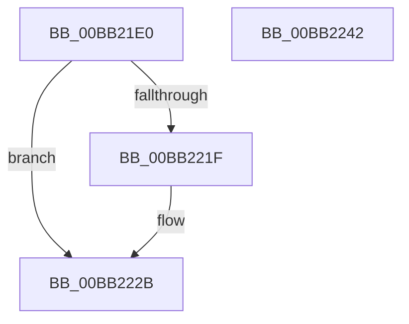

# ViCtxIsrMessageBased

- RVA: `0x00BB21E0`–`0x00BB2243` (길이 `99` bytes)
- VA: `0x0000000140BB21E0`
- 실행 섹션: `PAGEVRFY`
- PDB 이름 있음: `예`; PDB Function 태그: `아니요`
- unwind 정보 RVA: `0x0005C954`
- 디코드: `29`개 명령, `99/99` bytes 표시
- 미해석 바이트: `0` (있으면 어셈블리에 `.byte`로 보존)

> 이 문서는 커널 이미지의 기계어와 PDB 기호를 분석해 생성했습니다. 4번과 5번은 함수 원형과 자료형을 바이너리 사용 방식에서 추정한 C 해석이며 원본 소스 복구 결과는 아닙니다.

## 1. Dependencies

- 직접 호출 지점: **3**; 고유 호출 대상: **3**
- 직접 호출자로 확인된 함수: **0**
- RIP 상대 이미지 참조: **0**

### Outgoing calls
- `0x00BB21FD` → [ViCtxCaptureInitialIsrState](ViCtxCaptureInitialIsrState_function_00BB1E9C.md) (function, `0x00BB1E9C`)
- `0x00BB2213` → [guard_dispatch_icall](../../text/6B/guard_dispatch_icall_function_006BAAD0.md) (function, `0x006BAAD0`)
- `0x00BB2226` → [ViCtxCheckAndReleaseIsrState](ViCtxCheckAndReleaseIsrState_function_00BB1F40.md) (function, `0x00BB1F40`)

### Direct callers
- 이 함수 시작 RVA로 연결되는 직접 call은 확인되지 않았습니다. 간접 호출은 완전히 역산할 수 없습니다.

### Static image references
- 디코드된 RIP-relative 메모리 참조가 없습니다.

## 2. Other-region calls and transfers

- 다른 실행 섹션으로 향하는 call: **1**
  - `0x00BB2213` → [guard_dispatch_icall](../../text/6B/guard_dispatch_icall_function_006BAAD0.md) (`PAGEVRFY` → `.text`)
- 별도 외부 분기/꼬리 이동을 확인하지 못했습니다.

## 3. Assembly (complete function range)

```asm
00BB21E0  48 89 5C 24 08                  mov qword ptr [rsp + 8], rbx
00BB21E5  48 89 6C 24 10                  mov qword ptr [rsp + 0x10], rbp
00BB21EA  48 89 74 24 18                  mov qword ptr [rsp + 0x18], rsi
00BB21EF  57                              push rdi
00BB21F0  48 83 EC 20                     sub rsp, 0x20
00BB21F4  41 8B D8                        mov ebx, r8d
00BB21F7  48 8B F2                        mov rsi, rdx
00BB21FA  48 8B F9                        mov rdi, rcx
00BB21FD  E8 9A FC FF FF                  call 0x140bb1e9c
00BB2202  48 8B 56 08                     mov rdx, qword ptr [rsi + 8]
00BB2206  48 8B E8                        mov rbp, rax
00BB2209  48 8B 46 10                     mov rax, qword ptr [rsi + 0x10]
00BB220D  44 8B C3                        mov r8d, ebx
00BB2210  48 8B CF                        mov rcx, rdi
00BB2213  E8 B8 88 B0 FF                  call 0x1406baad0
00BB2218  8A D8                           mov bl, al
00BB221A  48 85 ED                        test rbp, rbp
00BB221D  74 0C                           je 0x140bb222b
00BB221F  48 8B 56 10                     mov rdx, qword ptr [rsi + 0x10]
00BB2223  48 8B CD                        mov rcx, rbp
00BB2226  E8 15 FD FF FF                  call 0x140bb1f40
00BB222B  48 8B 6C 24 38                  mov rbp, qword ptr [rsp + 0x38]
00BB2230  8A C3                           mov al, bl
00BB2232  48 8B 5C 24 30                  mov rbx, qword ptr [rsp + 0x30]
00BB2237  48 8B 74 24 40                  mov rsi, qword ptr [rsp + 0x40]
00BB223C  48 83 C4 20                     add rsp, 0x20
00BB2240  5F                              pop rdi
00BB2241  C3                              ret
00BB2242  CC                              int3
```

## 4. C-style interpretation (structured pseudocode)

```c
__int64 __fastcall ViCtxIsrMessageBased(__int64 a1, __int64 a2, int a3)
{
    __int64 result;
    __int64 v_rsp;
    unsigned __int64 v_stack_p10;
    unsigned __int64 v_stack_p18;
    unsigned __int64 v_stack_p8;

    v_stack_p8 = v_rbx;
    v_stack_p10 = v_rbp;
    v_stack_p18 = v_rsi;
    v_rsp = (v_rsp) - (32);
    result = ViCtxCaptureInitialIsrState(a1, a2, a3, a4);
    result = guard_dispatch_icall(a1, *(unsigned __int64 *)(a2 + 8), (unsigned int)((unsigned int)((unsigned int)(a3))), a4);
    if (result != 0) {
        a2 = *(unsigned __int64 *)(a2 + 16);
        a1 = result;
        result = ViCtxCheckAndReleaseIsrState(a1, a2, (unsigned int)((unsigned int)((unsigned int)(a3))), a4);
    }
    v_rsp = (v_rsp) + (32);
    return (unsigned __int8)((unsigned __int8)(result));
}
```

## 5. (Beta) C Style

```c
int64_t ViCtxIsrMessageBased(int64_t Arg1, void *Arg2, int32_t Arg3)
{
    uint8_t *arg2 = (uint8_t *)Arg2;

    int64_t result;
    int64_t local_rsp;
    uint64_t v_stack_p10;
    uint64_t v_stack_p18;
    uint64_t v_stack_p8;

    v_stack_p8 = local_rbx;
    v_stack_p10 = local_rbp;
    v_stack_p18 = local_rsi;
    local_rsp = (local_rsp) - (32);
    result = ViCtxCaptureInitialIsrState(Arg1, Arg2, Arg3, a4);
    result = guard_dispatch_icall(Arg1, *(uint64_t *)(arg2 + 0x8), (uint32_t)((uint32_t)((uint32_t)(Arg3))), a4);
    if (result != 0) {
        Arg2 = *(uint64_t *)(arg2 + 0x10);
        Arg1 = result;
        result = ViCtxCheckAndReleaseIsrState(Arg1, Arg2, (uint32_t)((uint32_t)((uint32_t)(Arg3))), a4);
    }
    local_rsp = (local_rsp) + (32);
    return (uint8_t)((uint8_t)(result));
}
```

### 관측된 메모리 오프셋

구조체 형식이 확인되지 않은 접근은 인자 기준의 오프셋으로만 기록했습니다.

| 기준 인자 | 오프셋 표현 | 폭 (bit) | 접근 |
|---|---:|---:|---|
| `Arg2` | `+ 0x8` | `64` | `R` |
| `Arg2` | `+ 0x10` | `64` | `R` |

## 6. Execution-region graph

[열기: 2D/3D 그래프와 함수 탐색 컨트롤 패널](../../../control-panel.html?section=pagevrfy&rva=0x00BB21E0&view=graph)

- 2D 그래프는 위에서 아래로 흐르고, 3D 그래프는 빈 공간을 드래그해 회전합니다. Shift+드래그는 이동, 휠은 확대·축소, 함수 노드 선택은 대상 보고서 이동입니다.

### Static fallback


