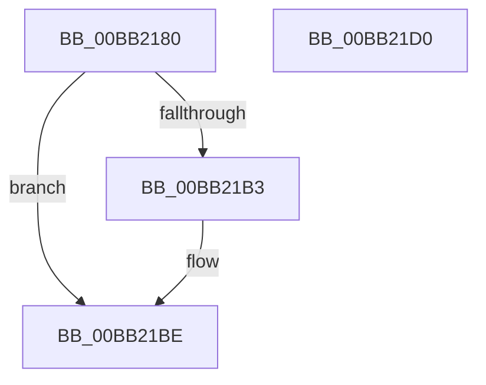

# ViCtxIsr

- RVA: `0x00BB2180`–`0x00BB21D1` (길이 `81` bytes)
- VA: `0x0000000140BB2180`
- 실행 섹션: `PAGEVRFY`
- PDB 이름 있음: `예`; PDB Function 태그: `아니요`
- unwind 정보 RVA: `0x00060BC4`
- 디코드: `25`개 명령, `81/81` bytes 표시
- 미해석 바이트: `0` (있으면 어셈블리에 `.byte`로 보존)

> 이 문서는 커널 이미지의 기계어와 PDB 기호를 분석해 생성했습니다. 4번과 5번은 함수 원형과 자료형을 바이너리 사용 방식에서 추정한 C 해석이며 원본 소스 복구 결과는 아닙니다.

## 1. Dependencies

- 직접 호출 지점: **3**; 고유 호출 대상: **3**
- 직접 호출자로 확인된 함수: **0**
- RIP 상대 이미지 참조: **0**

### Outgoing calls
- `0x00BB2195` → [ViCtxCaptureInitialIsrState](ViCtxCaptureInitialIsrState_function_00BB1E9C.md) (function, `0x00BB1E9C`)
- `0x00BB21A7` → [guard_dispatch_icall](../../text/6B/guard_dispatch_icall_function_006BAAD0.md) (function, `0x006BAAD0`)
- `0x00BB21B9` → [ViCtxCheckAndReleaseIsrState](ViCtxCheckAndReleaseIsrState_function_00BB1F40.md) (function, `0x00BB1F40`)

### Direct callers
- 이 함수 시작 RVA로 연결되는 직접 call은 확인되지 않았습니다. 간접 호출은 완전히 역산할 수 없습니다.

### Static image references
- 디코드된 RIP-relative 메모리 참조가 없습니다.

## 2. Other-region calls and transfers

- 다른 실행 섹션으로 향하는 call: **1**
  - `0x00BB21A7` → [guard_dispatch_icall](../../text/6B/guard_dispatch_icall_function_006BAAD0.md) (`PAGEVRFY` → `.text`)
- 별도 외부 분기/꼬리 이동을 확인하지 못했습니다.

## 3. Assembly (complete function range)

```asm
00BB2180  48 89 5C 24 08                  mov qword ptr [rsp + 8], rbx
00BB2185  48 89 74 24 10                  mov qword ptr [rsp + 0x10], rsi
00BB218A  57                              push rdi
00BB218B  48 83 EC 20                     sub rsp, 0x20
00BB218F  48 8B FA                        mov rdi, rdx
00BB2192  48 8B D9                        mov rbx, rcx
00BB2195  E8 02 FD FF FF                  call 0x140bb1e9c
00BB219A  48 8B 57 08                     mov rdx, qword ptr [rdi + 8]
00BB219E  48 8B F0                        mov rsi, rax
00BB21A1  48 8B 07                        mov rax, qword ptr [rdi]
00BB21A4  48 8B CB                        mov rcx, rbx
00BB21A7  E8 24 89 B0 FF                  call 0x1406baad0
00BB21AC  8A D8                           mov bl, al
00BB21AE  48 85 F6                        test rsi, rsi
00BB21B1  74 0B                           je 0x140bb21be
00BB21B3  48 8B 17                        mov rdx, qword ptr [rdi]
00BB21B6  48 8B CE                        mov rcx, rsi
00BB21B9  E8 82 FD FF FF                  call 0x140bb1f40
00BB21BE  48 8B 74 24 38                  mov rsi, qword ptr [rsp + 0x38]
00BB21C3  8A C3                           mov al, bl
00BB21C5  48 8B 5C 24 30                  mov rbx, qword ptr [rsp + 0x30]
00BB21CA  48 83 C4 20                     add rsp, 0x20
00BB21CE  5F                              pop rdi
00BB21CF  C3                              ret
00BB21D0  CC                              int3
```

## 4. C-style interpretation (structured pseudocode)

```c
__int64 __fastcall ViCtxIsr(__int64 a1, __int64 a2)
{
    __int64 result;
    __int64 v_rsp;
    unsigned __int64 v_stack_p10;
    unsigned __int64 v_stack_p8;

    v_stack_p8 = v_rbx;
    v_stack_p10 = v_rsi;
    v_rsp = (v_rsp) - (32);
    result = ViCtxCaptureInitialIsrState(a1, a2, a3, a4);
    result = guard_dispatch_icall(a1, *(unsigned __int64 *)(a2 + 8), a3, a4);
    if (result != 0) {
        a2 = *(unsigned __int64 *)(a2);
        a1 = result;
        result = ViCtxCheckAndReleaseIsrState(a1, a2, a3, a4);
    }
    v_rsp = (v_rsp) + (32);
    return (unsigned __int8)((unsigned __int8)(result));
}
```

## 5. (Beta) C Style

```c
int64_t ViCtxIsr(int64_t Arg1, void *Arg2)
{
    uint8_t *arg2 = (uint8_t *)Arg2;

    int64_t result;
    int64_t local_rsp;
    uint64_t v_stack_p10;
    uint64_t v_stack_p8;

    v_stack_p8 = local_rbx;
    v_stack_p10 = local_rsi;
    local_rsp = (local_rsp) - (32);
    result = ViCtxCaptureInitialIsrState(Arg1, Arg2, a3, a4);
    result = guard_dispatch_icall(Arg1, *(uint64_t *)(arg2 + 0x8), a3, a4);
    if (result != 0) {
        Arg2 = *(uint64_t *)(arg2);
        Arg1 = result;
        result = ViCtxCheckAndReleaseIsrState(Arg1, Arg2, a3, a4);
    }
    local_rsp = (local_rsp) + (32);
    return (uint8_t)((uint8_t)(result));
}
```

### 관측된 메모리 오프셋

구조체 형식이 확인되지 않은 접근은 인자 기준의 오프셋으로만 기록했습니다.

| 기준 인자 | 오프셋 표현 | 폭 (bit) | 접근 |
|---|---:|---:|---|
| `Arg2` | `+ 0x0` | `64` | `R` |
| `Arg2` | `+ 0x8` | `64` | `R` |

## 6. Execution-region graph

[열기: 2D/3D 그래프와 함수 탐색 컨트롤 패널](../../../control-panel.html?section=pagevrfy&rva=0x00BB2180&view=graph)

- 2D 그래프는 위에서 아래로 흐르고, 3D 그래프는 빈 공간을 드래그해 회전합니다. Shift+드래그는 이동, 휠은 확대·축소, 함수 노드 선택은 대상 보고서 이동입니다.

### Static fallback


