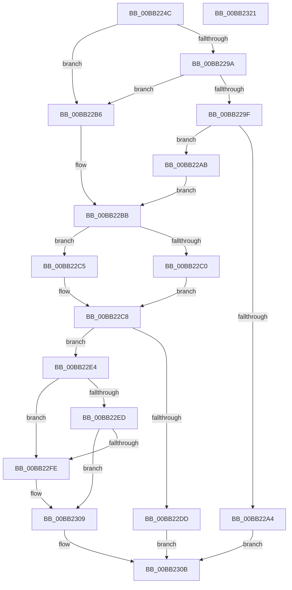

# ViCtxSetPrivateConnectParameters

- RVA: `0x00BB224C`–`0x00BB2322` (길이 `214` bytes)
- VA: `0x0000000140BB224C`
- 실행 섹션: `PAGEVRFY`
- PDB 이름 있음: `예`; PDB Function 태그: `아니요`
- unwind 정보 RVA: `0x0006F978`
- 디코드: `62`개 명령, `214/214` bytes 표시
- 미해석 바이트: `0` (있으면 어셈블리에 `.byte`로 보존)

> 이 문서는 커널 이미지의 기계어와 PDB 기호를 분석해 생성했습니다. 4번과 5번은 함수 원형과 자료형을 바이너리 사용 방식에서 추정한 C 해석이며 원본 소스 복구 결과는 아닙니다.

## 1. Dependencies

- 직접 호출 지점: **1**; 고유 호출 대상: **1**
- 직접 호출자로 확인된 함수: **1**
- RIP 상대 이미지 참조: **2**

### Outgoing calls
- `0x00BB22D0` → [ViCtxAllocateIsrContext](ViCtxAllocateIsrContext_function_00BB1E48.md) (function, `0x00BB1E48`)

### Direct callers
- [VerifierIoConnectInterruptEx](VerifierIoConnectInterruptEx_function_00BB1BD0.md) at `0x00BB1C28`

### Static image references
- `0x00BB22ED` → RVA `0x00BB21E0` (`ViCtxIsrMessageBased`; read)
- `0x00BB22FE` → RVA `0x00BB2180` (`ViCtxIsr`; read)

## 2. Other-region calls and transfers

- 다른 실행 섹션으로 향하는 call: **0**
- 별도 외부 분기/꼬리 이동을 확인하지 못했습니다.

## 3. Assembly (complete function range)

```asm
00BB224C  48 89 5C 24 08                  mov qword ptr [rsp + 8], rbx
00BB2251  48 89 74 24 10                  mov qword ptr [rsp + 0x10], rsi
00BB2256  48 89 7C 24 18                  mov qword ptr [rsp + 0x18], rdi
00BB225B  41 56                           push r14
00BB225D  48 83 EC 20                     sub rsp, 0x20
00BB2261  0F 10 02                        movups xmm0, xmmword ptr [rdx]
00BB2264  49 83 20 00                     and qword ptr [r8], 0
00BB2268  48 8B F9                        mov rdi, rcx
00BB226B  33 F6                           xor esi, esi
00BB226D  4D 8B F0                        mov r14, r8
00BB2270  0F 29 01                        movaps xmmword ptr [rcx], xmm0
00BB2273  0F 10 4A 10                     movups xmm1, xmmword ptr [rdx + 0x10]
00BB2277  0F 29 49 10                     movaps xmmword ptr [rcx + 0x10], xmm1
00BB227B  0F 10 42 20                     movups xmm0, xmmword ptr [rdx + 0x20]
00BB227F  0F 29 41 20                     movaps xmmword ptr [rcx + 0x20], xmm0
00BB2283  0F 10 4A 30                     movups xmm1, xmmword ptr [rdx + 0x30]
00BB2287  0F 29 49 30                     movaps xmmword ptr [rcx + 0x30], xmm1
00BB228B  0F 10 42 40                     movups xmm0, xmmword ptr [rdx + 0x40]
00BB228F  0F 29 41 40                     movaps xmmword ptr [rcx + 0x40], xmm0
00BB2293  8B 09                           mov ecx, dword ptr [rcx]
00BB2295  83 E9 01                        sub ecx, 1
00BB2298  74 1C                           je 0x140bb22b6
00BB229A  83 E9 01                        sub ecx, 1
00BB229D  74 17                           je 0x140bb22b6
00BB229F  83 F9 01                        cmp ecx, 1
00BB22A2  74 07                           je 0x140bb22ab
00BB22A4  B8 BB 00 00 C0                  mov eax, 0xc00000bb
00BB22A9  EB 60                           jmp 0x140bb230b
00BB22AB  48 8D 77 18                     lea rsi, [rdi + 0x18]
00BB22AF  BB 38 00 00 00                  mov ebx, 0x38
00BB22B4  EB 05                           jmp 0x140bb22bb
00BB22B6  BB 18 00 00 00                  mov ebx, 0x18
00BB22BB  48 85 F6                        test rsi, rsi
00BB22BE  74 05                           je 0x140bb22c5
00BB22C0  4C 8B 06                        mov r8, qword ptr [rsi]
00BB22C3  EB 03                           jmp 0x140bb22c8
00BB22C5  45 33 C0                        xor r8d, r8d
00BB22C8  48 8B 57 20                     mov rdx, qword ptr [rdi + 0x20]
00BB22CC  48 8B 0C 3B                     mov rcx, qword ptr [rbx + rdi]
00BB22D0  E8 73 FB FF FF                  call 0x140bb1e48
00BB22D5  49 89 06                        mov qword ptr [r14], rax
00BB22D8  48 85 C0                        test rax, rax
00BB22DB  75 07                           jne 0x140bb22e4
00BB22DD  B8 9A 00 00 C0                  mov eax, 0xc000009a
00BB22E2  EB 27                           jmp 0x140bb230b
00BB22E4  48 89 47 20                     mov qword ptr [rdi + 0x20], rax
00BB22E8  48 85 F6                        test rsi, rsi
00BB22EB  74 11                           je 0x140bb22fe
00BB22ED  48 8D 05 EC FE FF FF            lea rax, [rip - 0x114]
00BB22F4  48 89 06                        mov qword ptr [rsi], rax
00BB22F7  48 83 3C 3B 00                  cmp qword ptr [rbx + rdi], 0
00BB22FC  74 0B                           je 0x140bb2309
00BB22FE  48 8D 05 7B FE FF FF            lea rax, [rip - 0x185]
00BB2305  48 89 04 3B                     mov qword ptr [rbx + rdi], rax
00BB2309  33 C0                           xor eax, eax
00BB230B  48 8B 5C 24 30                  mov rbx, qword ptr [rsp + 0x30]
00BB2310  48 8B 74 24 38                  mov rsi, qword ptr [rsp + 0x38]
00BB2315  48 8B 7C 24 40                  mov rdi, qword ptr [rsp + 0x40]
00BB231A  48 83 C4 20                     add rsp, 0x20
00BB231E  41 5E                           pop r14
00BB2320  C3                              ret
00BB2321  CC                              int3
```

## 4. C-style interpretation (structured pseudocode)

```c
__int64 __fastcall ViCtxSetPrivateConnectParameters(__int64 a1, __int64 a2, __int64 a3)
{
    __int64 result;
    __int64 v_rsi;
    __int64 v_rsp;
    unsigned __int64 v_stack_p10;
    unsigned __int64 v_stack_p18;
    unsigned __int64 v_stack_p8;

    v_stack_p8 = v_rbx;
    v_stack_p10 = v_rsi;
    v_stack_p18 = v_rdi;
    v_rsp = (v_rsp) - (32);
    v_rsi = 0;
    *(unsigned __int64 *)(a1) = v_xmm0;
    *(unsigned __int64 *)(a1 + 16) = v_xmm1;
    *(unsigned __int64 *)(a1 + 32) = v_xmm0;
    *(unsigned __int64 *)(a1 + 48) = v_xmm1;
    *(unsigned __int64 *)(a1 + 64) = v_xmm0;
    a1 = (unsigned int)(((unsigned int)(*(unsigned int *)(a1))) - (1));
    if (condition_is_equal) goto loc_00BB22B6;
    a1 = (unsigned int)((a1) - (1));
    if (condition_is_equal) goto loc_00BB22B6;
    if (((unsigned int)(a1)) == 1) goto loc_00BB22AB;
    goto loc_00BB230B;
loc_00BB22AB:
    goto loc_00BB22BB;
loc_00BB22B6:
loc_00BB22BB:
    if (a1 + 24 == 0) goto loc_00BB22C5;
    goto loc_00BB22C8;
loc_00BB22C5:
    a3 = 0;
loc_00BB22C8:
    result = ViCtxAllocateIsrContext(*(unsigned __int64 *)(24 + a1 * 1), *(unsigned __int64 *)(a1 + 32), a3, a4);
    *(unsigned __int64 *)(a3) = result;
    if (result != 0) goto loc_00BB22E4;
    goto loc_00BB230B;
loc_00BB22E4:
    *(unsigned __int64 *)(a1 + 32) = (unsigned int)(0xC000009AULL);
    if (a1 + 24 == 0) goto loc_00BB22FE;
    *(unsigned __int64 *)(a1 + 24) = v_rip - 276;
    result = v_rip - 276;
    if ((*(unsigned __int64 *)(24 + a1 * 1)) != 0) {
        result = v_rip - 389;
        *(unsigned __int64 *)(24 + a1 * 1) = result;
    }
    result = 0;
loc_00BB230B:
    v_rsp = (v_rsp) + (32);
    return result;
}
```

## 5. (Beta) C Style

```c
int64_t ViCtxSetPrivateConnectParameters(void *Arg1, void *Arg2, void *Arg3)
{
    uint8_t *arg1 = (uint8_t *)Arg1;
    uint8_t *arg2 = (uint8_t *)Arg2;
    uint8_t *arg3 = (uint8_t *)Arg3;

    int64_t result;
    int64_t local_rsi;
    int64_t local_rsp;
    uint64_t v_stack_p10;
    uint64_t v_stack_p18;
    uint64_t v_stack_p8;

    v_stack_p8 = local_rbx;
    v_stack_p10 = local_rsi;
    v_stack_p18 = local_rdi;
    local_rsp = (local_rsp) - (32);
    local_rsi = 0;
    *(uint64_t *)(arg1) = v_xmm0;
    *(uint64_t *)(arg1 + 0x10) = v_xmm1;
    *(uint64_t *)(arg1 + 0x20) = v_xmm0;
    *(uint64_t *)(arg1 + 0x30) = v_xmm1;
    *(uint64_t *)(arg1 + 0x40) = v_xmm0;
    Arg1 = (uint32_t)(((uint32_t)(*(uint32_t *)(arg1))) - (1));
    if (condition_is_equal) goto loc_00BB22B6;
    Arg1 = (uint32_t)((Arg1) - (1));
    if (condition_is_equal) goto loc_00BB22B6;
    if (((uint32_t)(Arg1)) == 1) goto loc_00BB22AB;
    goto loc_00BB230B;
loc_00BB22AB:
    goto loc_00BB22BB;
loc_00BB22B6:
loc_00BB22BB:
    if (Arg1 + 24 == 0) goto loc_00BB22C5;
    goto loc_00BB22C8;
loc_00BB22C5:
    Arg3 = 0;
loc_00BB22C8:
    result = ViCtxAllocateIsrContext(*(uint64_t *)(24 + arg1 * 1), *(uint64_t *)(arg1 + 0x20), Arg3, a4);
    *(uint64_t *)(arg3) = result;
    if (result != 0) goto loc_00BB22E4;
    goto loc_00BB230B;
loc_00BB22E4:
    *(uint64_t *)(arg1 + 0x20) = (uint32_t)(0xC000009AULL);
    if (Arg1 + 24 == 0) goto loc_00BB22FE;
    *(uint64_t *)(arg1 + 0x18) = v_rip - 276;
    result = v_rip - 276;
    if ((*(uint64_t *)(24 + arg1 * 1)) != 0) {
        result = v_rip - 389;
        *(uint64_t *)(24 + arg1 * 1) = result;
    }
    result = 0;
loc_00BB230B:
    local_rsp = (local_rsp) + (32);
    return result;
}
```

### 관측된 메모리 오프셋

구조체 형식이 확인되지 않은 접근은 인자 기준의 오프셋으로만 기록했습니다.

| 기준 인자 | 오프셋 표현 | 폭 (bit) | 접근 |
|---|---:|---:|---|
| `Arg1` | `+ 0x0` | `32` | `R` |
| `Arg1` | `+ 0x0` | `128` | `W` |
| `Arg1` | `+ 0x10` | `128` | `W` |
| `Arg1` | `+ 0x18` | `64` | `R` |
| `Arg1` | `+ 0x20` | `64` | `R` |
| `Arg1` | `+ 0x20` | `64` | `W` |
| `Arg1` | `+ 0x20` | `128` | `W` |
| `Arg1` | `+ 0x30` | `128` | `W` |
| `Arg1` | `+ 0x40` | `128` | `W` |
| `Arg2` | `+ 0x0` | `128` | `R` |
| `Arg2` | `+ 0x10` | `128` | `R` |
| `Arg2` | `+ 0x20` | `128` | `R` |
| `Arg2` | `+ 0x30` | `128` | `R` |
| `Arg2` | `+ 0x40` | `128` | `R` |
| `Arg3` | `+ 0x0` | `64` | `R/W` |
| `Arg3` | `+ 0x0` | `64` | `W` |

## 6. Execution-region graph

[열기: 2D/3D 그래프와 함수 탐색 컨트롤 패널](../../../control-panel.html?section=pagevrfy&rva=0x00BB224C&view=graph)

- 2D 그래프는 위에서 아래로 흐르고, 3D 그래프는 빈 공간을 드래그해 회전합니다. Shift+드래그는 이동, 휠은 확대·축소, 함수 노드 선택은 대상 보고서 이동입니다.

### Static fallback


