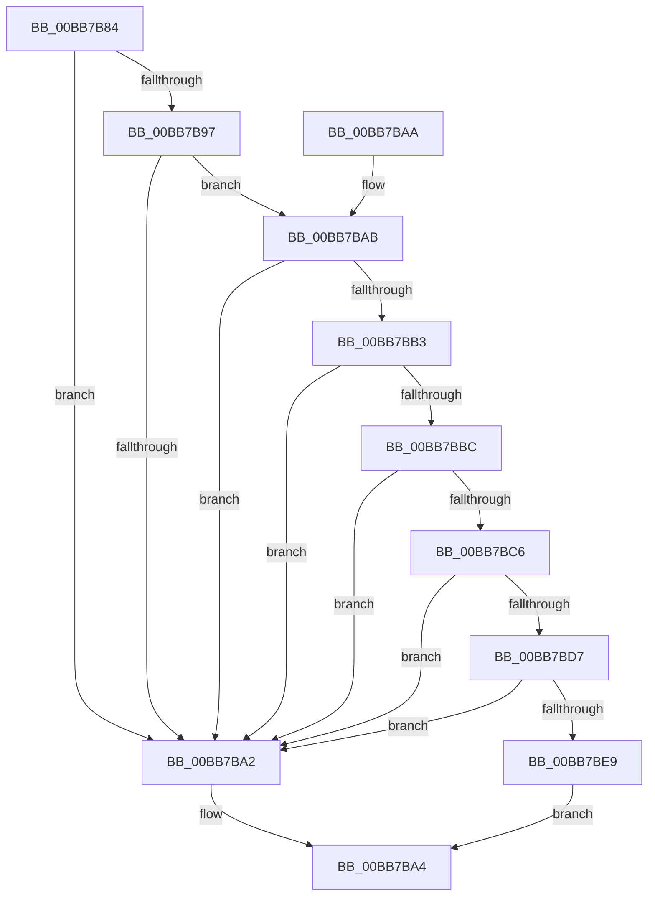

# ViDeadlockCanProceed

- RVA: `0x00BB7B84`–`0x00BB7BF0` (길이 `108` bytes)
- VA: `0x0000000140BB7B84`
- 실행 섹션: `PAGEVRFY`
- PDB 이름 있음: `예`; PDB Function 태그: `아니요`
- unwind 정보 RVA: `0x000B0168`
- 디코드: `31`개 명령, `108/108` bytes 표시
- 미해석 바이트: `0` (있으면 어셈블리에 `.byte`로 보존)

> 이 문서는 커널 이미지의 기계어와 PDB 기호를 분석해 생성했습니다. 4번과 5번은 함수 원형과 자료형을 바이너리 사용 방식에서 추정한 C 해석이며 원본 소스 복구 결과는 아닙니다.

## 1. Dependencies

- 직접 호출 지점: **2**; 고유 호출 대상: **2**
- 직접 호출자로 확인된 함수: **4**
- RIP 상대 이미지 참조: **5**

### Outgoing calls
- `0x00BB7BB3` → [KeAreInterruptsEnabled](../../text/2F/KeAreInterruptsEnabled_function_002F8060.md) (function, `0x002F8060`)
- `0x00BB7BC6` → [ViDeadlockCheckStackLimits](ViDeadlockCheckStackLimits_function_00BB7BF8.md) (function, `0x00BB7BF8`)

### Direct callers
- [VfDeadlockInitializeResource](../BA/VfDeadlockInitializeResource_function_00BA80A0.md) at `0x00BA80EA`
- [VfDeadlockReleaseResource](VfDeadlockReleaseResource_function_00BB759C.md) at `0x00BB75F2`
- [VfFreeMemoryNotification](VfFreeMemoryNotification_function_00BB7A6C.md) at `0x00BB7A8C`
- [VfDeadlockAcquireResource](VfDeadlockAcquireResource_function_00BB83B4.md) at `0x00BB844F`

### Static image references
- `0x00BB7B8A` → RVA `0x00FFDA78` (`PAGEVRFD`; read)
- `0x00BB7B97` → RVA `0x00FC6A80` (`ALMOSTRO`; read)
- `0x00BB7BBC` → RVA `0x00FFDA00` (`PAGEVRFD`; read)
- `0x00BB7BCB` → RVA `0x00F04060` (`.data`; read)
- `0x00BB7BE0` → RVA `0x00F04020` (`.data`; read)

## 2. Other-region calls and transfers

- 다른 실행 섹션으로 향하는 call: **1**
  - `0x00BB7BB3` → [KeAreInterruptsEnabled](../../text/2F/KeAreInterruptsEnabled_function_002F8060.md) (`PAGEVRFY` → `.text`)
- 별도 외부 분기/꼬리 이동을 확인하지 못했습니다.

## 3. Assembly (complete function range)

```asm
00BB7B84  40 53                           push rbx
00BB7B86  48 83 EC 20                     sub rsp, 0x20
00BB7B8A  8B 05 E8 5E 44 00               mov eax, dword ptr [rip + 0x445ee8]
00BB7B90  48 8B D9                        mov rbx, rcx
00BB7B93  85 C0                           test eax, eax
00BB7B95  74 0B                           je 0x140bb7ba2
00BB7B97  8B 05 E3 EE 40 00               mov eax, dword ptr [rip + 0x40eee3]
00BB7B9D  83 F8 04                        cmp eax, 4
00BB7BA0  76 09                           jbe 0x140bb7bab
00BB7BA2  33 C0                           xor eax, eax
00BB7BA4  48 83 C4 20                     add rsp, 0x20
00BB7BA8  5B                              pop rbx
00BB7BA9  C3                              ret
00BB7BAA  CC                              int3
00BB7BAB  44 0F 20 C0                     mov rax, cr8
00BB7BAF  3C 02                           cmp al, 2
00BB7BB1  77 EF                           ja 0x140bb7ba2
00BB7BB3  E8 A8 04 74 FF                  call 0x1402f8060
00BB7BB8  84 C0                           test al, al
00BB7BBA  74 E6                           je 0x140bb7ba2
00BB7BBC  48 83 3D 3C 5E 44 00 00         cmp qword ptr [rip + 0x445e3c], 0
00BB7BC4  74 DC                           je 0x140bb7ba2
00BB7BC6  E8 2D 00 00 00                  call 0x140bb7bf8
00BB7BCB  48 8D 05 8E C4 34 00            lea rax, [rip + 0x34c48e]
00BB7BD2  48 3B D8                        cmp rbx, rax
00BB7BD5  74 CB                           je 0x140bb7ba2
00BB7BD7  65 48 8B 04 25 88 01 00 00      mov rax, qword ptr gs:[0x188]
00BB7BE0  48 39 05 39 C4 34 00            cmp qword ptr [rip + 0x34c439], rax
00BB7BE7  74 B9                           je 0x140bb7ba2
00BB7BE9  B8 01 00 00 00                  mov eax, 1
00BB7BEE  EB B4                           jmp 0x140bb7ba4
```

## 4. C-style interpretation (structured pseudocode)

```c
__int64 __fastcall ViDeadlockCanProceed(__int64 a1)
{
    __int64 result;
    __int64 v_rsp;

    v_rsp = (v_rsp) - (32);
    if ((unsigned int)((unsigned int)(*(unsigned int *)(v_rip + 4480744))) == 0) goto loc_00BB7BA2;
    if (((unsigned int)((unsigned int)(*(unsigned int *)(v_rip + 4255459)))) <= 4) goto loc_00BB7BAB;
loc_00BB7BA2:
    result = 0;
loc_00BB7BA4:
    v_rsp = (v_rsp) + (32);
    return result;
loc_00BB7BAB:
    if (((unsigned __int8)(v_cr8)) > 2) goto loc_00BB7BA2;
    result = KeAreInterruptsEnabled(a1, a2, a3, a4);
    if ((unsigned __int8)(result) == 0) goto loc_00BB7BA2;
    if ((*(unsigned __int64 *)(v_rip + 4480572)) == 0) goto loc_00BB7BA2;
    result = ViDeadlockCheckStackLimits(a1, a2, a3, a4);
    if (a1 == (v_rip + 3458190)) goto loc_00BB7BA2;
    if ((*(unsigned __int64 *)(v_rip + 3458105)) == (*(unsigned __int64 *)(gs_base + (0 + 392)))) goto loc_00BB7BA2;
    goto loc_00BB7BA4;
}
```

## 5. (Beta) C Style

```c
int64_t ViDeadlockCanProceed(int64_t Arg1)
{
    int64_t result;
    int64_t local_rsp;

    local_rsp = (local_rsp) - (32);
    if ((uint32_t)((uint32_t)(*(uint32_t *)(v_rip + 0x445EE8))) == 0) goto loc_00BB7BA2;
    if (((uint32_t)((uint32_t)(*(uint32_t *)(v_rip + 0x40EEE3)))) <= 4) goto loc_00BB7BAB;
loc_00BB7BA2:
    result = 0;
loc_00BB7BA4:
    local_rsp = (local_rsp) + (32);
    return result;
loc_00BB7BAB:
    if (((uint8_t)(v_cr8)) > 2) goto loc_00BB7BA2;
    result = KeAreInterruptsEnabled(Arg1, a2, a3, a4);
    if ((uint8_t)(result) == 0) goto loc_00BB7BA2;
    if ((*(uint64_t *)(v_rip + 0x445E3C)) == 0) goto loc_00BB7BA2;
    result = ViDeadlockCheckStackLimits(Arg1, a2, a3, a4);
    if (Arg1 == (v_rip + 3458190)) goto loc_00BB7BA2;
    if ((*(uint64_t *)(v_rip + 0x34C439)) == (*(uint64_t *)(gs_base + (0 + 0x188)))) goto loc_00BB7BA2;
    goto loc_00BB7BA4;
}
```

## 6. Execution-region graph

[열기: 2D/3D 그래프와 함수 탐색 컨트롤 패널](../../../control-panel.html?section=pagevrfy&rva=0x00BB7B84&view=graph)

- 2D 그래프는 위에서 아래로 흐르고, 3D 그래프는 빈 공간을 드래그해 회전합니다. Shift+드래그는 이동, 휠은 확대·축소, 함수 노드 선택은 대상 보고서 이동입니다.

### Static fallback


