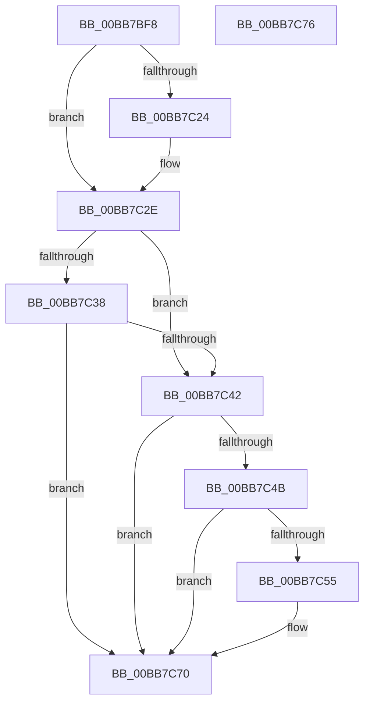

# ViDeadlockCheckStackLimits

- RVA: `0x00BB7BF8`–`0x00BB7C77` (길이 `127` bytes)
- VA: `0x0000000140BB7BF8`
- 실행 섹션: `PAGEVRFY`
- PDB 이름 있음: `예`; PDB Function 태그: `아니요`
- unwind 정보 RVA: `0x000B515C`
- 디코드: `34`개 명령, `127/127` bytes 표시
- 미해석 바이트: `0` (있으면 어셈블리에 `.byte`로 보존)

> 이 문서는 커널 이미지의 기계어와 PDB 기호를 분석해 생성했습니다. 4번과 5번은 함수 원형과 자료형을 바이너리 사용 방식에서 추정한 C 해석이며 원본 소스 복구 결과는 아닙니다.

## 1. Dependencies

- 직접 호출 지점: **2**; 고유 호출 대상: **2**
- 직접 호출자로 확인된 함수: **1**
- RIP 상대 이미지 참조: **4**

### Outgoing calls
- `0x00BB7C1B` → [RtlpGetStackLimits](../../text/2F/RtlpGetStackLimits_function_002F5F50.md) (function, `0x002F5F50`)
- `0x00BB7C61` → [DbgPrintEx](../../text/35/DbgPrintEx_function_00359290.md) (function, `0x00359290`)

### Direct callers
- [ViDeadlockCanProceed](ViDeadlockCanProceed_function_00BB7B84.md) at `0x00BB7BC6`

### Static image references
- `0x00BB7C42` → RVA `0x00E0E944` (`.data`; read)
- `0x00BB7C4B` → RVA `0x00FFDB78` (`PAGEVRFD`; read)
- `0x00BB7C55` → RVA `0x00BBAED0` (` ?? ::JKADOLAD::`string'`; read)
- `0x00BB7C66` → RVA `0x00FFDB78` (`PAGEVRFD`; write)

## 2. Other-region calls and transfers

- 다른 실행 섹션으로 향하는 call: **2**
  - `0x00BB7C1B` → [RtlpGetStackLimits](../../text/2F/RtlpGetStackLimits_function_002F5F50.md) (`PAGEVRFY` → `.text`)
  - `0x00BB7C61` → [DbgPrintEx](../../text/35/DbgPrintEx_function_00359290.md) (`PAGEVRFY` → `.text`)
- 별도 외부 분기/꼬리 이동을 확인하지 못했습니다.

## 3. Assembly (complete function range)

```asm
00BB7BF8  40 55                           push rbp
00BB7BFA  48 8B EC                        mov rbp, rsp
00BB7BFD  48 83 EC 20                     sub rsp, 0x20
00BB7C01  48 83 65 10 00                  and qword ptr [rbp + 0x10], 0
00BB7C06  48 8D 45 18                     lea rax, [rbp + 0x18]
00BB7C0A  48 83 65 20 00                  and qword ptr [rbp + 0x20], 0
00BB7C0F  48 8D 55 20                     lea rdx, [rbp + 0x20]
00BB7C13  48 8D 4D 10                     lea rcx, [rbp + 0x10]
00BB7C17  48 89 45 18                     mov qword ptr [rbp + 0x18], rax
00BB7C1B  E8 30 E3 73 FF                  call 0x1402f5f50
00BB7C20  84 C0                           test al, al
00BB7C22  75 0A                           jne 0x140bb7c2e
00BB7C24  48 83 65 10 00                  and qword ptr [rbp + 0x10], 0
00BB7C29  48 83 65 20 00                  and qword ptr [rbp + 0x20], 0
00BB7C2E  48 8B 45 18                     mov rax, qword ptr [rbp + 0x18]
00BB7C32  48 3B 45 10                     cmp rax, qword ptr [rbp + 0x10]
00BB7C36  72 0A                           jb 0x140bb7c42
00BB7C38  48 8B 45 18                     mov rax, qword ptr [rbp + 0x18]
00BB7C3C  48 3B 45 20                     cmp rax, qword ptr [rbp + 0x20]
00BB7C40  76 2E                           jbe 0x140bb7c70
00BB7C42  83 3D FB 6C 25 00 02            cmp dword ptr [rip + 0x256cfb], 2
00BB7C49  7E 25                           jle 0x140bb7c70
00BB7C4B  8B 05 27 5F 44 00               mov eax, dword ptr [rip + 0x445f27]
00BB7C51  85 C0                           test eax, eax
00BB7C53  75 1B                           jne 0x140bb7c70
00BB7C55  4C 8D 05 74 32 00 00            lea r8, [rip + 0x3274]
00BB7C5C  33 D2                           xor edx, edx
00BB7C5E  8D 48 5D                        lea ecx, [rax + 0x5d]
00BB7C61  E8 2A 16 7A FF                  call 0x140359290
00BB7C66  C7 05 08 5F 44 00 01 00 00 00   mov dword ptr [rip + 0x445f08], 1
00BB7C70  48 83 C4 20                     add rsp, 0x20
00BB7C74  5D                              pop rbp
00BB7C75  C3                              ret
00BB7C76  CC                              int3
```

## 4. C-style interpretation (structured pseudocode)

```c
__int64 __fastcall ViDeadlockCheckStackLimits(void)
{
    __int64 result;
    __int64 v_rsp;
    unsigned __int64 v_stack_p10;
    unsigned __int64 v_stack_p18;
    unsigned __int64 v_stack_p8;

    v_rsp = (v_rsp) - (32);
    v_stack_p10 = v_stack_p10;
    result = RtlpGetStackLimits(v_stack_p8, v_stack_p18, a3, a4);
    if ((unsigned __int8)(result) == 0) {
    }
    if (v_stack_p10 < v_stack_p8) goto loc_00BB7C42;
    if (v_stack_p10 <= v_stack_p18) goto loc_00BB7C70;
loc_00BB7C42:
    if ((*(unsigned int *)(v_rip + 2452731)) <= 2) goto loc_00BB7C70;
    result = (unsigned int)(*(unsigned int *)(v_rip + 4480807));
    if ((unsigned int)((unsigned int)(*(unsigned int *)(v_rip + 4480807))) == 0) {
        a3 = v_rip + 12916;
        a2 = 0;
        a1 = (unsigned int)(*(unsigned int *)(v_rip + 4480807)) + 93;
        result = DbgPrintEx(a1, a2, a3, a4);
        *(unsigned int *)(v_rip + 4480776) = 1;
    }
    v_rsp = (v_rsp) + (32);
    return result;
}
```

## 5. (Beta) C Style

```c
void ViDeadlockCheckStackLimits(void)
{
    int64_t result;
    int64_t local_rsp;
    uint64_t v_stack_p10;
    uint64_t v_stack_p18;
    uint64_t v_stack_p8;

    local_rsp = (local_rsp) - (32);
    v_stack_p10 = v_stack_p10;
    result = RtlpGetStackLimits(v_stack_p8, v_stack_p18, a3, a4);
    if ((uint8_t)(result) == 0) {
    }
    if (v_stack_p10 < v_stack_p8) goto loc_00BB7C42;
    if (v_stack_p10 <= v_stack_p18) goto loc_00BB7C70;
loc_00BB7C42:
    if ((*(uint32_t *)(v_rip + 0x256CFB)) <= 2) goto loc_00BB7C70;
    result = (uint32_t)(*(uint32_t *)(v_rip + 0x445F27));
    if ((uint32_t)((uint32_t)(*(uint32_t *)(v_rip + 0x445F27))) == 0) {
        a3 = v_rip + 12916;
        a2 = 0;
        a1 = (uint32_t)(*(uint32_t *)(v_rip + 0x445F27)) + 93;
        result = DbgPrintEx(a1, a2, a3, a4);
        *(uint32_t *)(v_rip + 0x445F08) = 1;
    }
    local_rsp = (local_rsp) + (32);
    return result;
}
```

## 6. Execution-region graph

[열기: 2D/3D 그래프와 함수 탐색 컨트롤 패널](../../../control-panel.html?section=pagevrfy&rva=0x00BB7BF8&view=graph)

- 2D 그래프는 위에서 아래로 흐르고, 3D 그래프는 빈 공간을 드래그해 회전합니다. Shift+드래그는 이동, 휠은 확대·축소, 함수 노드 선택은 대상 보고서 이동입니다.

### Static fallback


