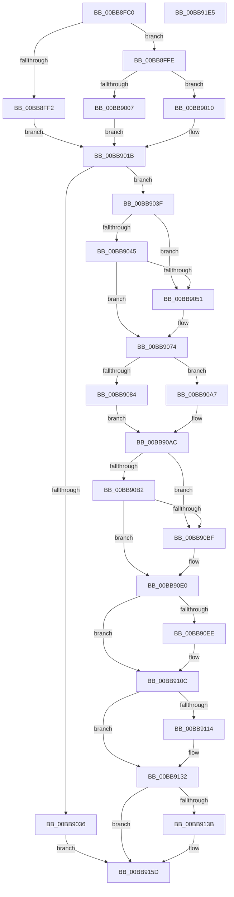

# ViFreeTrackedPool

- RVA: `0x00BB8FC0`–`0x00BB91E6` (길이 `550` bytes)
- VA: `0x0000000140BB8FC0`
- 실행 섹션: `PAGEVRFY`
- PDB 이름 있음: `예`; PDB Function 태그: `아니요`
- unwind 정보 RVA: `0x000AC264`
- 디코드: `145`개 명령, `550/550` bytes 표시
- 미해석 바이트: `0` (있으면 어셈블리에 `.byte`로 보존)

> 이 문서는 커널 이미지의 기계어와 PDB 기호를 분석해 생성했습니다. 4번과 5번은 함수 원형과 자료형을 바이너리 사용 방식에서 추정한 C 해석이며 원본 소스 복구 결과는 아닙니다.

## 1. Dependencies

- 직접 호출 지점: **9**; 고유 호출 대상: **3**
- 직접 호출자로 확인된 함수: **4**
- RIP 상대 이미지 참조: **6**

### Outgoing calls
- `0x00BB9048` → [MmIsAddressValidEx](../../text/27/MmIsAddressValidEx_function_0027FDD0.md) (function, `0x0027FDD0`)
- `0x00BB906F` → [CarReportRuleViolationFromNt](../B9/CarReportRuleViolationFromNt_function_00B9D904.md) (function, `0x00B9D904`)
- `0x00BB90A0` → [CarReportRuleViolationFromNt](../B9/CarReportRuleViolationFromNt_function_00B9D904.md) (function, `0x00B9D904`)
- `0x00BB90B6` → [MmIsAddressValidEx](../../text/27/MmIsAddressValidEx_function_0027FDD0.md) (function, `0x0027FDD0`)
- `0x00BB90DB` → [CarReportRuleViolationFromNt](../B9/CarReportRuleViolationFromNt_function_00B9D904.md) (function, `0x00B9D904`)
- `0x00BB9107` → [CarReportRuleViolationFromNt](../B9/CarReportRuleViolationFromNt_function_00B9D904.md) (function, `0x00B9D904`)
- `0x00BB912D` → [CarReportRuleViolationFromNt](../B9/CarReportRuleViolationFromNt_function_00B9D904.md) (function, `0x00B9D904`)
- `0x00BB9158` → [CarReportRuleViolationFromNt](../B9/CarReportRuleViolationFromNt_function_00B9D904.md) (function, `0x00B9D904`)
- `0x00BB9168` → [ExpInterlockedPushEntrySList](../../text/6B/ExpInterlockedPushEntrySList_function_006BA5B0.md) (function, `0x006BA5B0`)

### Direct callers
- [ExpFreeHeapSpecialPool](../../text/2E/ExpFreeHeapSpecialPool_function_002EE600.md) at `0x002EE71E`
- [ExAllocateHeapPool](../../text/35/ExAllocateHeapPool_function_0035BA30.md) at `0x0035CAA4`
- [ExAllocateHeapPool](../../text/35/ExAllocateHeapPool_function_0035BA30.md) at `0x0035EA79`
- [sub_0035FB85](../../text/35/Unknown_function_0035FB85.md) at `0x0035FE91`
- [sub_0035FB85](../../text/35/Unknown_function_0035FB85.md) at `0x00360210`
- [sub_00B82950](../../poolcode/B8/Unknown_function_00B82950.md) at `0x00B82C51`
- [sub_00B82950](../../poolcode/B8/Unknown_function_00B82950.md) at `0x00B82FC7`

### Static image references
- `0x00BB9024` → RVA `0x00E681A0` (`.data`; read)
- `0x00BB9171` → RVA `0x00F04A68` (`.data`; read)
- `0x00BB9181` → RVA `0x00F04A64` (`.data`; read)
- `0x00BB9188` → RVA `0x00F04A78` (`.data`; read)
- `0x00BB9193` → RVA `0x00F04A80` (`.data`; read)
- `0x00BB91C0` → RVA `0x00F04A50` (`.data`; read/write)

## 2. Other-region calls and transfers

- 다른 실행 섹션으로 향하는 call: **3**
  - `0x00BB9048` → [MmIsAddressValidEx](../../text/27/MmIsAddressValidEx_function_0027FDD0.md) (`PAGEVRFY` → `.text`)
  - `0x00BB90B6` → [MmIsAddressValidEx](../../text/27/MmIsAddressValidEx_function_0027FDD0.md) (`PAGEVRFY` → `.text`)
  - `0x00BB9168` → [ExpInterlockedPushEntrySList](../../text/6B/ExpInterlockedPushEntrySList_function_006BA5B0.md) (`PAGEVRFY` → `.text`)
- 별도 외부 분기/꼬리 이동을 확인하지 못했습니다.

## 3. Assembly (complete function range)

```asm
00BB8FC0  48 89 5C 24 08                  mov qword ptr [rsp + 8], rbx
00BB8FC5  48 89 6C 24 10                  mov qword ptr [rsp + 0x10], rbp
00BB8FCA  48 89 74 24 18                  mov qword ptr [rsp + 0x18], rsi
00BB8FCF  57                              push rdi
00BB8FD0  41 54                           push r12
00BB8FD2  41 55                           push r13
00BB8FD4  41 56                           push r14
00BB8FD6  41 57                           push r15
00BB8FD8  48 83 EC 40                     sub rsp, 0x40
00BB8FDC  45 8B E8                        mov r13d, r8d
00BB8FDF  48 8B EA                        mov rbp, rdx
00BB8FE2  48 8B D9                        mov rbx, rcx
00BB8FE5  48 C7 C0 00 F0 FF FF            mov rax, 0xfffffffffffff000
00BB8FEC  41 83 F9 01                     cmp r9d, 1
00BB8FF0  75 0C                           jne 0x140bb8ffe
00BB8FF2  48 8B F9                        mov rdi, rcx
00BB8FF5  48 23 F8                        and rdi, rax
00BB8FF8  48 83 C7 10                     add rdi, 0x10
00BB8FFC  EB 1D                           jmp 0x140bb901b
00BB8FFE  48 F7 C3 FF 0F 00 00            test rbx, 0xfff
00BB9005  75 09                           jne 0x140bb9010
00BB9007  48 8D 7A F8                     lea rdi, [rdx - 8]
00BB900B  48 03 FB                        add rdi, rbx
00BB900E  EB 0B                           jmp 0x140bb901b
00BB9010  48 83 ED 10                     sub rbp, 0x10
00BB9014  48 8D 79 F8                     lea rdi, [rcx - 8]
00BB9018  48 03 FD                        add rdi, rbp
00BB901B  48 8B 37                        mov rsi, qword ptr [rdi]
00BB901E  4C 8B FE                        mov r15, rsi
00BB9021  4C 23 F8                        and r15, rax
00BB9024  8B 05 76 F1 2A 00               mov eax, dword ptr [rip + 0x2af176]
00BB902A  4D 8D 67 08                     lea r12, [r15 + 8]
00BB902E  4D 8B 34 24                     mov r14, qword ptr [r12]
00BB9032  A8 01                           test al, 1
00BB9034  75 09                           jne 0x140bb903f
00BB9036  48 8D 7E 10                     lea rdi, [rsi + 0x10]
00BB903A  E9 1E 01 00 00                  jmp 0x140bb915d
00BB903F  40 F6 C6 03                     test sil, 3
00BB9043  75 0C                           jne 0x140bb9051
00BB9045  48 8B CE                        mov rcx, rsi
00BB9048  E8 83 6D 6C FF                  call 0x14027fdd0
00BB904D  84 C0                           test al, al
00BB904F  75 23                           jne 0x140bb9074
00BB9051  48 83 64 24 30 00               and qword ptr [rsp + 0x30], 0
00BB9057  BA 3A 01 00 00                  mov edx, 0x13a
00BB905C  83 64 24 28 00                  and dword ptr [rsp + 0x28], 0
00BB9061  4C 8B CE                        mov r9, rsi
00BB9064  4C 8B C3                        mov r8, rbx
00BB9067  48 89 7C 24 20                  mov qword ptr [rsp + 0x20], rdi
00BB906C  8D 4A 8A                        lea ecx, [rdx - 0x76]
00BB906F  E8 90 48 FE FF                  call 0x140b9d904
00BB9074  4D 8D 4F 10                     lea r9, [r15 + 0x10]
00BB9078  45 33 FF                        xor r15d, r15d
00BB907B  49 81 39 45 13 32 21            cmp qword ptr [r9], 0x21321345
00BB9082  74 23                           je 0x140bb90a7
00BB9084  BA 3B 01 00 00                  mov edx, 0x13b
00BB9089  4C 89 7C 24 30                  mov qword ptr [rsp + 0x30], r15
00BB908E  44 89 7C 24 28                  mov dword ptr [rsp + 0x28], r15d
00BB9093  4C 8B C3                        mov r8, rbx
00BB9096  48 89 7C 24 20                  mov qword ptr [rsp + 0x20], rdi
00BB909B  8D 7A 89                        lea edi, [rdx - 0x77]
00BB909E  8B CF                           mov ecx, edi
00BB90A0  E8 5F 48 FE FF                  call 0x140b9d904
00BB90A5  EB 05                           jmp 0x140bb90ac
00BB90A7  BF C4 00 00 00                  mov edi, 0xc4
00BB90AC  41 F6 C6 03                     test r14b, 3
00BB90B0  75 0D                           jne 0x140bb90bf
00BB90B2  49 8D 4E 28                     lea rcx, [r14 + 0x28]
00BB90B6  E8 15 6D 6C FF                  call 0x14027fdd0
00BB90BB  84 C0                           test al, al
00BB90BD  75 21                           jne 0x140bb90e0
00BB90BF  4C 89 7C 24 30                  mov qword ptr [rsp + 0x30], r15
00BB90C4  4D 8B CE                        mov r9, r14
00BB90C7  44 89 7C 24 28                  mov dword ptr [rsp + 0x28], r15d
00BB90CC  4C 8B C3                        mov r8, rbx
00BB90CF  BA 3C 01 00 00                  mov edx, 0x13c
00BB90D4  4C 89 64 24 20                  mov qword ptr [rsp + 0x20], r12
00BB90D9  8B CF                           mov ecx, edi
00BB90DB  E8 24 48 FE FF                  call 0x140b9d904
00BB90E0  4D 8D 4E 28                     lea r9, [r14 + 0x28]
00BB90E4  B8 40 19 76 98                  mov eax, 0x98761940
00BB90E9  49 39 01                        cmp qword ptr [r9], rax
00BB90EC  74 1E                           je 0x140bb910c
00BB90EE  4C 89 7C 24 30                  mov qword ptr [rsp + 0x30], r15
00BB90F3  4C 8B C3                        mov r8, rbx
00BB90F6  44 89 7C 24 28                  mov dword ptr [rsp + 0x28], r15d
00BB90FB  BA 3D 01 00 00                  mov edx, 0x13d
00BB9100  8B CF                           mov ecx, edi
00BB9102  48 89 44 24 20                  mov qword ptr [rsp + 0x20], rax
00BB9107  E8 F8 47 FE FF                  call 0x140b9d904
00BB910C  4C 8B 0E                        mov r9, qword ptr [rsi]
00BB910F  4C 3B CB                        cmp r9, rbx
00BB9112  74 1E                           je 0x140bb9132
00BB9114  4C 89 7C 24 30                  mov qword ptr [rsp + 0x30], r15
00BB9119  4C 8B C3                        mov r8, rbx
00BB911C  44 89 7C 24 28                  mov dword ptr [rsp + 0x28], r15d
00BB9121  BA 3E 01 00 00                  mov edx, 0x13e
00BB9126  8B CF                           mov ecx, edi
00BB9128  48 89 74 24 20                  mov qword ptr [rsp + 0x20], rsi
00BB912D  E8 D2 47 FE FF                  call 0x140b9d904
00BB9132  48 8D 7E 10                     lea rdi, [rsi + 0x10]
00BB9136  48 39 2F                        cmp qword ptr [rdi], rbp
00BB9139  74 22                           je 0x140bb915d
00BB913B  BA 3F 01 00 00                  mov edx, 0x13f
00BB9140  4C 89 7C 24 30                  mov qword ptr [rsp + 0x30], r15
00BB9145  44 89 7C 24 28                  mov dword ptr [rsp + 0x28], r15d
00BB914A  4C 8B CD                        mov r9, rbp
00BB914D  4C 8B C3                        mov r8, rbx
00BB9150  48 89 7C 24 20                  mov qword ptr [rsp + 0x20], rdi
00BB9155  8D 4A 85                        lea ecx, [rdx - 0x7b]
00BB9158  E8 A7 47 FE FF                  call 0x140b9d904
00BB915D  48 83 0F 01                     or qword ptr [rdi], 1
00BB9161  49 8D 4E 50                     lea rcx, [r14 + 0x50]
00BB9165  48 8B D6                        mov rdx, rsi
00BB9168  E8 43 14 B0 FF                  call 0x1406ba5b0
00BB916D  41 83 E5 01                     and r13d, 1
00BB9171  48 8D 05 F0 B8 34 00            lea rax, [rip + 0x34b8f0]
00BB9178  48 F7 DD                        neg rbp
00BB917B  41 8B D5                        mov edx, r13d
00BB917E  45 85 ED                        test r13d, r13d
00BB9181  4C 8D 05 DC B8 34 00            lea r8, [rip + 0x34b8dc]
00BB9188  48 8D 0D E9 B8 34 00            lea rcx, [rip + 0x34b8e9]
00BB918F  4C 0F 44 C0                     cmove r8, rax
00BB9193  48 8D 05 E6 B8 34 00            lea rax, [rip + 0x34b8e6]
00BB919A  48 0F 44 C8                     cmove rcx, rax
00BB919E  41 8B C5                        mov eax, r13d
00BB91A1  48 83 F0 01                     xor rax, 1
00BB91A5  48 83 F2 01                     xor rdx, 1
00BB91A9  F0 49 01 AC D6 80 00 00 00      lock add qword ptr [r14 + rdx*8 + 0x80], rbp
00BB91B2  F0 41 FF 4C 86 70               lock dec dword ptr [r14 + rax*4 + 0x70]
00BB91B8  F0 48 01 29                     lock add qword ptr [rcx], rbp
00BB91BC  F0 41 FF 08                     lock dec dword ptr [r8]
00BB91C0  F0 FF 05 89 B8 34 00            lock inc dword ptr [rip + 0x34b889]
00BB91C7  4C 8D 5C 24 40                  lea r11, [rsp + 0x40]
00BB91CC  49 8B 5B 30                     mov rbx, qword ptr [r11 + 0x30]
00BB91D0  49 8B 6B 38                     mov rbp, qword ptr [r11 + 0x38]
00BB91D4  49 8B 73 40                     mov rsi, qword ptr [r11 + 0x40]
00BB91D8  49 8B E3                        mov rsp, r11
00BB91DB  41 5F                           pop r15
00BB91DD  41 5E                           pop r14
00BB91DF  41 5D                           pop r13
00BB91E1  41 5C                           pop r12
00BB91E3  5F                              pop rdi
00BB91E4  C3                              ret
00BB91E5  CC                              int3
```

## 4. C-style interpretation (structured pseudocode)

```c
__int64 __fastcall ViFreeTrackedPool(__int64 a1, __int64 a2, int a3, int a4)
{
    __int64 result;
    __int64 v_r13;
    __int64 v_r15;
    __int64 v_rbp;
    __int64 v_rdi;
    __int64 v_rsp;
    unsigned __int64 v_stack_m28;
    unsigned __int64 v_stack_m38;
    unsigned int v_stack_m40;
    unsigned __int64 v_stack_m48;
    unsigned __int64 v_stack_p10;
    unsigned __int64 v_stack_p18;
    unsigned __int64 v_stack_p8;

    v_stack_p8 = v_rbx;
    v_stack_p10 = v_rbp;
    v_stack_p18 = v_rsi;
    v_rsp = (v_rsp) - (64);
    if (a4 != 1) goto loc_00BB8FFE;
    v_rdi = (a1) & (0xFFFFFFFFFFFFF000ULL);
    v_rdi = (v_rdi) + (16);
    goto loc_00BB901B;
loc_00BB8FFE:
    if (((a1) & (0xFFFULL)) != 0) goto loc_00BB9010;
    v_rdi = (a2 - 8) + (a1);
    goto loc_00BB901B;
loc_00BB9010:
    v_rbp = (a2) - (16);
    v_rdi = (a1 - 8) + (v_rbp);
loc_00BB901B:
    v_r15 = (*(unsigned __int64 *)(v_rdi)) & (0xFFFFFFFFFFFFF000ULL);
    if ((((unsigned __int8)((unsigned int)(*(unsigned int *)(v_rip + 2814326)))) & (1)) != 0) goto loc_00BB903F;
    goto loc_00BB915D;
loc_00BB903F:
    if ((((unsigned __int8)(*(unsigned __int64 *)(v_rdi))) & (3)) != 0) goto loc_00BB9051;
    result = MmIsAddressValidEx(*(unsigned __int64 *)(v_rdi), a2, a3, a4);
    if ((unsigned __int8)(result) == 0) {
        a2 = 314;
        a4 = *(unsigned __int64 *)(v_rdi);
        a3 = a1;
        v_stack_m48 = *(unsigned __int64 *)(v_rdi) + 16;
        a1 = a2 - 118;
        result = CarReportRuleViolationFromNt(a1, a2, a3, a4);
    }
    v_r15 = 0;
    if ((*(unsigned __int64 *)(v_r15 + 16)) == 0x21321345ULL) goto loc_00BB90A7;
    v_stack_m38 = 0;
    v_stack_m40 = 0;
    v_stack_m48 = *(unsigned __int64 *)(v_rdi) + 16;
    result = CarReportRuleViolationFromNt((unsigned int)((unsigned int)(315 - 119)), 315, a1, v_r15 + 16);
    goto loc_00BB90AC;
loc_00BB90A7:
loc_00BB90AC:
    if ((((unsigned __int8)(*(unsigned __int64 *)(v_r15 + 8))) & (3)) != 0) goto loc_00BB90BF;
    result = MmIsAddressValidEx(*(unsigned __int64 *)(v_r15 + 8) + 40, 315, a1, v_r15 + 16);
    if ((unsigned __int8)(result) == 0) {
        v_stack_m38 = 0;
        a4 = *(unsigned __int64 *)(v_r15 + 8);
        v_stack_m40 = 0;
        a3 = a1;
        a2 = 316;
        v_stack_m48 = v_r15 + 8;
        a1 = 196;
        result = CarReportRuleViolationFromNt(a1, a2, a3, a4);
    }
    result = (unsigned int)(0x98761940ULL);
    if ((*(unsigned __int64 *)(*(unsigned __int64 *)(v_r15 + 8) + 40)) != ((unsigned int)(0x98761940ULL))) {
        v_stack_m38 = 0;
        a3 = a1;
        v_stack_m40 = 0;
        a2 = 317;
        a1 = 196;
        v_stack_m48 = (unsigned int)(0x98761940ULL);
        result = CarReportRuleViolationFromNt(a1, a2, a3, *(unsigned __int64 *)(v_r15 + 8) + 40);
    }
    if ((*(unsigned __int64 *)(*(unsigned __int64 *)(v_rdi))) != a1) {
        v_stack_m38 = 0;
        a3 = a1;
        v_stack_m40 = 0;
        a2 = 318;
        a1 = 196;
        v_stack_m48 = *(unsigned __int64 *)(v_rdi);
        result = CarReportRuleViolationFromNt(a1, a2, a3, *(unsigned __int64 *)(*(unsigned __int64 *)(v_rdi)));
    }
    if ((*(unsigned __int64 *)(*(unsigned __int64 *)(v_rdi) + 16)) != v_rbp) {
        a2 = 319;
        v_stack_m38 = 0;
        v_stack_m40 = 0;
        a4 = v_rbp;
        a3 = a1;
        v_stack_m48 = *(unsigned __int64 *)(v_rdi) + 16;
        a1 = a2 - 123;
        result = CarReportRuleViolationFromNt(a1, a2, a3, a4);
    }
    result = ExpInterlockedPushEntrySList(*(unsigned __int64 *)(v_r15 + 8) + 80, *(unsigned __int64 *)(v_rdi), a3, a4);
    v_r13 = (unsigned int)(((unsigned int)(a3)) & (1));
    v_rbp = -(v_rbp);
    a3 = v_rip + 3455196;
    if ((unsigned int)(v_r13) == 0) { a3 = v_rip + 3455216; }
    a1 = v_rip + 3455209;
    if ((unsigned int)(v_r13) == 0) { a1 = v_rip + 3455206; }
    result = ((unsigned int)((unsigned int)(v_r13))) ^ (1);
    a2 = ((unsigned int)((unsigned int)(v_r13))) ^ (1);
    return result;
}
```

## 5. (Beta) C Style

```c
int64_t ViFreeTrackedPool(void *Arg1, void *Arg2, int32_t Arg3, int32_t Arg4)
{
    uint8_t *arg1 = (uint8_t *)Arg1;
    uint8_t *arg2 = (uint8_t *)Arg2;

    int64_t result;
    int64_t local_r13;
    int64_t local_r15;
    int64_t local_rbp;
    int64_t local_rdi;
    int64_t local_rsp;
    uint64_t v_stack_m28;
    uint64_t v_stack_m38;
    uint32_t v_stack_m40;
    uint64_t v_stack_m48;
    uint64_t v_stack_p10;
    uint64_t v_stack_p18;
    uint64_t v_stack_p8;

    v_stack_p8 = local_rbx;
    v_stack_p10 = local_rbp;
    v_stack_p18 = local_rsi;
    local_rsp = (local_rsp) - (64);
    if (Arg4 != 1) goto loc_00BB8FFE;
    local_rdi = (Arg1) & (0xFFFFFFFFFFFFF000ULL);
    local_rdi = (local_rdi) + (16);
    goto loc_00BB901B;
loc_00BB8FFE:
    if (((Arg1) & (0xFFFULL)) != 0) goto loc_00BB9010;
    local_rdi = (Arg2 - 8) + (Arg1);
    goto loc_00BB901B;
loc_00BB9010:
    local_rbp = (Arg2) - (16);
    local_rdi = (Arg1 - 8) + (local_rbp);
loc_00BB901B:
    local_r15 = (*(uint64_t *)(local_rdi)) & (0xFFFFFFFFFFFFF000ULL);
    if ((((uint8_t)((uint32_t)(*(uint32_t *)(v_rip + 0x2AF176)))) & (1)) != 0) goto loc_00BB903F;
    goto loc_00BB915D;
loc_00BB903F:
    if ((((uint8_t)(*(uint64_t *)(local_rdi))) & (3)) != 0) goto loc_00BB9051;
    result = MmIsAddressValidEx(*(uint64_t *)(local_rdi), Arg2, Arg3, Arg4);
    if ((uint8_t)(result) == 0) {
        Arg2 = 314;
        Arg4 = *(uint64_t *)(local_rdi);
        Arg3 = Arg1;
        v_stack_m48 = *(uint64_t *)(local_rdi) + 16;
        Arg1 = Arg2 - 118;
        result = CarReportRuleViolationFromNt(Arg1, Arg2, Arg3, Arg4);
    }
    local_r15 = 0;
    if ((*(uint64_t *)(local_r15 + 0x10)) == 0x21321345ULL) goto loc_00BB90A7;
    v_stack_m38 = 0;
    v_stack_m40 = 0;
    v_stack_m48 = *(uint64_t *)(local_rdi) + 16;
    result = CarReportRuleViolationFromNt((uint32_t)((uint32_t)(315 - 119)), 315, Arg1, local_r15 + 16);
    goto loc_00BB90AC;
loc_00BB90A7:
loc_00BB90AC:
    if ((((uint8_t)(*(uint64_t *)(local_r15 + 0x8))) & (3)) != 0) goto loc_00BB90BF;
    result = MmIsAddressValidEx(*(uint64_t *)(local_r15 + 0x8) + 40, 315, Arg1, local_r15 + 16);
    if ((uint8_t)(result) == 0) {
        v_stack_m38 = 0;
        Arg4 = *(uint64_t *)(local_r15 + 0x8);
        v_stack_m40 = 0;
        Arg3 = Arg1;
        Arg2 = 316;
        v_stack_m48 = local_r15 + 8;
        Arg1 = 196;
        result = CarReportRuleViolationFromNt(Arg1, Arg2, Arg3, Arg4);
    }
    result = (uint32_t)(0x98761940ULL);
    if ((*(uint64_t *)(*(uint64_t *)(local_r15 + 0x8) + 0x28)) != ((uint32_t)(0x98761940ULL))) {
        v_stack_m38 = 0;
        Arg3 = Arg1;
        v_stack_m40 = 0;
        Arg2 = 317;
        Arg1 = 196;
        v_stack_m48 = (uint32_t)(0x98761940ULL);
        result = CarReportRuleViolationFromNt(Arg1, Arg2, Arg3, *(uint64_t *)(local_r15 + 0x8) + 40);
    }
    if ((*(uint64_t *)(*(uint64_t *)(local_rdi))) != Arg1) {
        v_stack_m38 = 0;
        Arg3 = Arg1;
        v_stack_m40 = 0;
        Arg2 = 318;
        Arg1 = 196;
        v_stack_m48 = *(uint64_t *)(local_rdi);
        result = CarReportRuleViolationFromNt(Arg1, Arg2, Arg3, *(uint64_t *)(*(uint64_t *)(local_rdi)));
    }
    if ((*(uint64_t *)(*(uint64_t *)(local_rdi) + 0x10)) != local_rbp) {
        Arg2 = 319;
        v_stack_m38 = 0;
        v_stack_m40 = 0;
        Arg4 = local_rbp;
        Arg3 = Arg1;
        v_stack_m48 = *(uint64_t *)(local_rdi) + 16;
        Arg1 = Arg2 - 123;
        result = CarReportRuleViolationFromNt(Arg1, Arg2, Arg3, Arg4);
    }
    result = ExpInterlockedPushEntrySList(*(uint64_t *)(local_r15 + 0x8) + 80, *(uint64_t *)(local_rdi), Arg3, Arg4);
    local_r13 = (uint32_t)(((uint32_t)(Arg3)) & (1));
    local_rbp = -(local_rbp);
    Arg3 = v_rip + 3455196;
    if ((uint32_t)(local_r13) == 0) { Arg3 = v_rip + 3455216; }
    Arg1 = v_rip + 3455209;
    if ((uint32_t)(local_r13) == 0) { Arg1 = v_rip + 3455206; }
    result = ((uint32_t)((uint32_t)(local_r13))) ^ (1);
    Arg2 = ((uint32_t)((uint32_t)(local_r13))) ^ (1);
    return result;
}
```

### 관측된 메모리 오프셋

구조체 형식이 확인되지 않은 접근은 인자 기준의 오프셋으로만 기록했습니다.

| 기준 인자 | 오프셋 표현 | 폭 (bit) | 접근 |
|---|---:|---:|---|
| `Arg1` | `- 0x8` | `64` | `R` |
| `Arg2` | `- 0x8` | `64` | `R` |

## 6. Execution-region graph

[열기: 2D/3D 그래프와 함수 탐색 컨트롤 패널](../../../control-panel.html?section=pagevrfy&rva=0x00BB8FC0&view=graph)

- 2D 그래프는 위에서 아래로 흐르고, 3D 그래프는 빈 공간을 드래그해 회전합니다. Shift+드래그는 이동, 휠은 확대·축소, 함수 노드 선택은 대상 보고서 이동입니다.

### Static fallback


