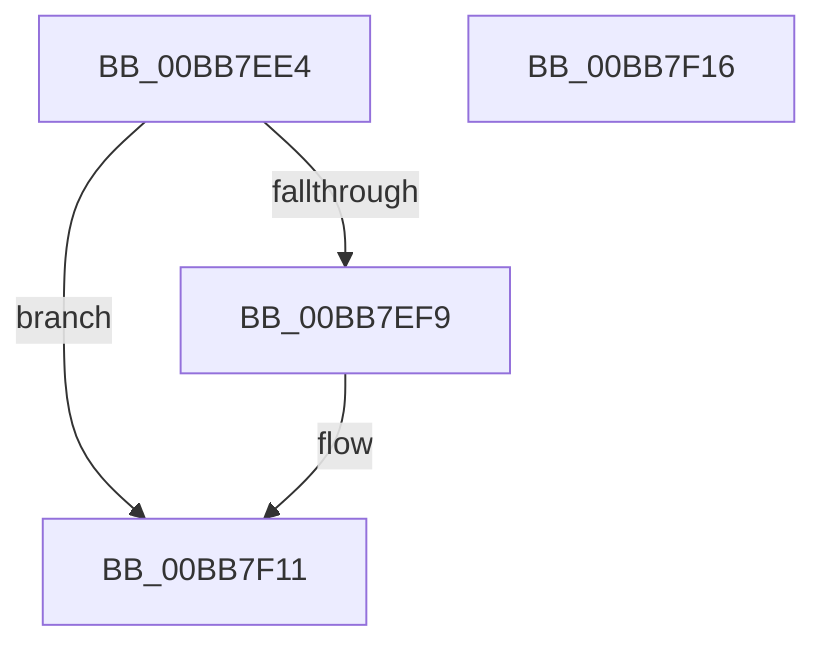

# ViIoCallbackSnapState

- RVA: `0x00BB7EE4`–`0x00BB7F17` (길이 `51` bytes)
- VA: `0x0000000140BB7EE4`
- 실행 섹션: `PAGEVRFY`
- PDB 이름 있음: `예`; PDB Function 태그: `아니요`
- unwind 정보 RVA: `0x0005C788`
- 디코드: `13`개 명령, `51/51` bytes 표시
- 미해석 바이트: `0` (있으면 어셈블리에 `.byte`로 보존)

> 이 문서는 커널 이미지의 기계어와 PDB 기호를 분석해 생성했습니다. 4번과 5번은 함수 원형과 자료형을 바이너리 사용 방식에서 추정한 C 해석이며 원본 소스 복구 결과는 아닙니다.

## 1. Dependencies

- 직접 호출 지점: **1**; 고유 호출 대상: **1**
- 직접 호출자로 확인된 함수: **2**
- RIP 상대 이미지 참조: **1**

### Outgoing calls
- `0x00BB7EEF` → [ExAllocateFromNPagedLookasideList](../../text/38/ExAllocateFromNPagedLookasideList_function_0038E6C0.md) (function, `0x0038E6C0`)

### Direct callers
- [IovpLocalCompletionRoutine](IovpLocalCompletionRoutine_function_00BB6B60.md) at `0x00BB6DAC`
- [VfFastIoSnapState](VfFastIoSnapState_function_00BB97BC.md) at `0x00BB980B`

### Static image references
- `0x00BB7EE8` → RVA `0x00FFF700` (`PAGEVRFD`; read)

## 2. Other-region calls and transfers

- 다른 실행 섹션으로 향하는 call: **1**
  - `0x00BB7EEF` → [ExAllocateFromNPagedLookasideList](../../text/38/ExAllocateFromNPagedLookasideList_function_0038E6C0.md) (`PAGEVRFY` → `.text`)
- 별도 외부 분기/꼬리 이동을 확인하지 못했습니다.

## 3. Assembly (complete function range)

```asm
00BB7EE4  48 83 EC 28                     sub rsp, 0x28
00BB7EE8  48 8D 0D 11 78 44 00            lea rcx, [rip + 0x447811]
00BB7EEF  E8 CC 67 7D FF                  call 0x14038e6c0
00BB7EF4  48 85 C0                        test rax, rax
00BB7EF7  74 18                           je 0x140bb7f11
00BB7EF9  44 0F 20 C1                     mov rcx, cr8
00BB7EFD  88 08                           mov byte ptr [rax], cl
00BB7EFF  65 48 8B 0C 25 88 01 00 00      mov rcx, qword ptr gs:[0x188]
00BB7F08  8B 91 E4 01 00 00               mov edx, dword ptr [rcx + 0x1e4]
00BB7F0E  89 50 04                        mov dword ptr [rax + 4], edx
00BB7F11  48 83 C4 28                     add rsp, 0x28
00BB7F15  C3                              ret
00BB7F16  CC                              int3
```

## 4. C-style interpretation (structured pseudocode)

```c
__int64 __fastcall ViIoCallbackSnapState(void)
{
    __int64 result;
    __int64 v_rsp;

    v_rsp = (v_rsp) - (40);
    result = ExAllocateFromNPagedLookasideList(v_rip + 4487185, a2, a3, a4);
    if (result != 0) {
        a1 = v_cr8;
        *(unsigned __int8 *)(result) = (unsigned __int8)(a1);
        a1 = *(unsigned __int64 *)(gs_base + (0 + 392));
        a2 = *(unsigned int *)(a1 + 484);
        *(unsigned int *)(result + 4) = (unsigned int)(a2);
    }
    v_rsp = (v_rsp) + (40);
    return result;
}
```

## 5. (Beta) C Style

```c
void ViIoCallbackSnapState(void)
{
    int64_t result;
    int64_t local_rsp;

    local_rsp = (local_rsp) - (40);
    result = ExAllocateFromNPagedLookasideList(v_rip + 4487185, a2, a3, a4);
    if (result != 0) {
        a1 = v_cr8;
        *(uint8_t *)(result) = (uint8_t)(a1);
        a1 = *(uint64_t *)(gs_base + (0 + 0x188));
        a2 = *(uint32_t *)(a1 + 0x1E4);
        *(uint32_t *)(result + 0x4) = (uint32_t)(a2);
    }
    local_rsp = (local_rsp) + (40);
    return result;
}
```

## 6. Execution-region graph

[열기: 2D/3D 그래프와 함수 탐색 컨트롤 패널](../../../control-panel.html?section=pagevrfy&rva=0x00BB7EE4&view=graph)

- 2D 그래프는 위에서 아래로 흐르고, 3D 그래프는 빈 공간을 드래그해 회전합니다. Shift+드래그는 이동, 휠은 확대·축소, 함수 노드 선택은 대상 보고서 이동입니다.

### Static fallback


