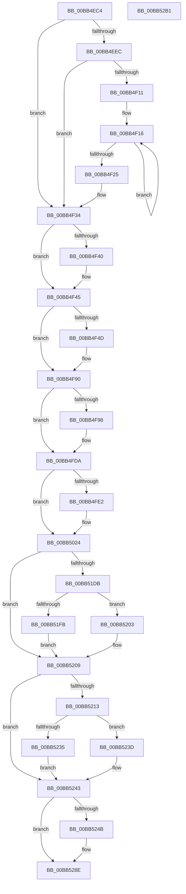

# ViIovInitialization

- RVA: `0x00BB4EC4`–`0x00BB52B2` (길이 `1,006` bytes)
- VA: `0x0000000140BB4EC4`
- 실행 섹션: `PAGEVRFY`
- PDB 이름 있음: `예`; PDB Function 태그: `아니요`
- unwind 정보 RVA: `0x000CA9E0`
- 디코드: `195`개 명령, `1,006/1,006` bytes 표시
- 미해석 바이트: `0` (있으면 어셈블리에 `.byte`로 보존)

> 이 문서는 커널 이미지의 기계어와 PDB 기호를 분석해 생성했습니다. 4번과 5번은 함수 원형과 자료형을 바이너리 사용 방식에서 추정한 C 해석이며 원본 소스 복구 결과는 아닙니다.

## 1. Dependencies

- 직접 호출 지점: **13**; 고유 호출 대상: **7**
- 직접 호출자로 확인된 함수: **1**
- RIP 상대 이미지 참조: **70**

### Outgoing calls
- `0x00BB4EDA` → [ExSetPoolFlags](../../text/65/ExSetPoolFlags_function_006567C4.md) (function, `0x006567C4`)
- `0x00BB4F00` → [ExAllocatePool2](../../poolcode/B8/ExAllocatePool2_function_00B820F0.md) (function, `0x00B820F0`)
- `0x00BB4F40` → [VfWdInit](../BA/VfWdInit_function_00BAC8E8.md) (function, `0x00BAC8E8`)
- `0x00BB4F83` → [ExInitializeNPagedLookasideListInternal](../../text/46/ExInitializeNPagedLookasideListInternal_function_00468720.md) (function, `0x00468720`)
- `0x00BB4FCE` → [ExInitializeNPagedLookasideListInternal](../../text/46/ExInitializeNPagedLookasideListInternal_function_00468720.md) (function, `0x00468720`)
- `0x00BB5018` → [ExInitializeNPagedLookasideListInternal](../../text/46/ExInitializeNPagedLookasideListInternal_function_00468720.md) (function, `0x00468720`)
- `0x00BB5084` → [VfMajorRegisterHandlers](../BA/VfMajorRegisterHandlers_function_00BA3020.md) (function, `0x00BA3020`)
- `0x00BB50E2` → [VfMajorRegisterHandlers](../BA/VfMajorRegisterHandlers_function_00BA3020.md) (function, `0x00BA3020`)
- `0x00BB5139` → [VfMajorRegisterHandlers](../BA/VfMajorRegisterHandlers_function_00BA3020.md) (function, `0x00BA3020`)
- `0x00BB51F0` → [VfAvlInitializeTree](../../text/61/VfAvlInitializeTree_function_00612704.md) (function, `0x00612704`)
- `0x00BB522A` → [VfAvlInitializeTree](../../text/61/VfAvlInitializeTree_function_00612704.md) (function, `0x00612704`)
- `0x00BB5281` → [ExInitializeNPagedLookasideListInternal](../../text/46/ExInitializeNPagedLookasideListInternal_function_00468720.md) (function, `0x00468720`)
- `0x00BB529A` → [IoVerifierInit](../B9/IoVerifierInit_function_00B92314.md) (function, `0x00B92314`)

### Direct callers
- [VfIovPluginEntry](../../text/6A/VfIovPluginEntry_function_006AAA80.md) at `0x006AACAA`

### Static image references
- `0x00BB4EE4` → RVA `0x00F04864` (`.data`; read)
- `0x00BB4EF1` → RVA `0x00F04888` (`.data`; write)
- `0x00BB4F05` → RVA `0x00F04878` (`.data`; write)
- `0x00BB4F25` → RVA `0x00F04880` (`.data`; write)
- `0x00BB4F2E` → RVA `0x00F04864` (`.data`; read/write)
- `0x00BB4F34` → RVA `0x00E681A0` (`.data`; read)
- `0x00BB4F45` → RVA `0x00FFDB08` (`PAGEVRFD`; read)
- `0x00BB4F4D` → RVA `0x00F04368` (`.data`; read)
- `0x00BB4F53` → RVA `0x00612300` (`VfUtilFreePoolDispatchLevel`; read)
- `0x00BB4F5E` → RVA `0x00FFF680` (`PAGEVRFD`; read)
- `0x00BB4F8A` → RVA `0x00FFDB08` (`PAGEVRFD`; read/write)
- `0x00BB4F90` → RVA `0x00F03FF8` (`.data`; read)
- `0x00BB4F9E` → RVA `0x004C65D0` (`VfUtilFreePoolCheckIRQL`; read)
- `0x00BB4FA9` → RVA `0x00FFF580` (`PAGEVRFD`; read)
- `0x00BB4FD3` → RVA `0x00F03FF8` (`.data`; write)
- `0x00BB4FDA` → RVA `0x00F04210` (`.data`; read)
- `0x00BB4FF3` → RVA `0x00FFF500` (`PAGEVRFD`; read)
- `0x00BB501D` → RVA `0x00F04210` (`.data`; write)
- `0x00BB5029` → RVA `0x00BB5590` (`VfPnpTestStartedPdoStack`; read)
- `0x00BB5035` → RVA `0x00BB5750` (`VfPnpVerifyIrpStackDownward`; read)
- `0x00BB5041` → RVA `0x00BB52E0` (`VfPnpAdvanceIrpStatus`; read)
- `0x00BB504D` → RVA `0x00BB5AE0` (`VfPnpVerifyNewRequest`; read)
- `0x00BB5059` → RVA `0x00BB5310` (`VfPnpDumpIrpStack`; read)
- `0x00BB506C` → RVA `0x00BB54F0` (`VfPnpIsSystemRestrictedIrp`; read)
- `0x00BB5078` → RVA `0x00BB58E0` (`VfPnpVerifyIrpStackUpward`; read)
- `0x00BB508E` → RVA `0x00BB5EF0` (`VfPowerTestStartedPdoStack`; read)
- `0x00BB509A` → RVA `0x00BB5F50` (`VfPowerVerifyIrpStackDownward`; read)
- `0x00BB50A6` → RVA `0x00BB5ED0` (`VfPowerIsSystemRestrictedIrp`; read)
- `0x00BB50B2` → RVA `0x00BB6080` (`VfPowerVerifyNewRequest`; read)
- `0x00BB50BE` → RVA `0x00BB5E00` (`VfPowerDumpIrpStack`; read)
- `0x00BB50D6` → RVA `0x00BB6040` (`VfPowerVerifyIrpStackUpward`; read)
- `0x00BB50EC` → RVA `0x00BB6110` (`VfWmiTestStartedPdoStack`; read)
- `0x00BB50F8` → RVA `0x00BB6180` (`VfWmiVerifyIrpStackDownward`; read)
- `0x00BB5104` → RVA `0x00BB6200` (`VfWmiVerifyIrpStackUpward`; read)
- `0x00BB5110` → RVA `0x00BB62E0` (`VfWmiVerifyNewRequest`; read)
- `0x00BB511C` → RVA `0x00BB60C0` (`VfWmiDumpIrpStack`; read)
- `0x00BB513E` → RVA `0x00B93F90` (`ViGenericVerifyIrpStackDownward`; read)
- `0x00BB5145` → RVA `0x010006B0` (`PAGEVRFD`; write)
- `0x00BB514C` → RVA `0x010006A0` (`PAGEVRFD`; write)
- `0x00BB5153` → RVA `0x00B93F80` (`VfMiscIoConnectInterruptEx_Entry`; read)
- `0x00BB515A` → RVA `0x00B94190` (`ViGenericVerifyIrpStackUpward`; read)
- `0x00BB5161` → RVA `0x01000698` (`PAGEVRFD`; write)
- `0x00BB5168` → RVA `0x010006A8` (`PAGEVRFD`; write)
- `0x00BB516F` → RVA `0x00B93EE0` (`ViGenericDumpIrpStack`; read)
- `0x00BB5176` → RVA `0x01000690` (`PAGEVRFD`; write)
- `0x00BB517D` → RVA `0x00B93F60` (`ViGenericIsValidIrpStatus`; read)
- `0x00BB5184` → RVA `0x010006C0` (`PAGEVRFD`; write)
- `0x00BB518B` → RVA `0x00B93F30` (`ViGenericIsNewRequest`; read)
- `0x00BB5192` → RVA `0x010006C8` (`PAGEVRFD`; write)
- `0x00BB5199` → RVA `0x00B94260` (`ViGenericVerifyNewIrp`; read)
- `0x00BB51A0` → RVA `0x010006D0` (`PAGEVRFD`; write)
- `0x00BB51AE` → RVA `0x010006D8` (`PAGEVRFD`; write)
- `0x00BB51B5` → RVA `0x00B93E70` (`ViGenericBuildIrpLogEntry`; read)
- `0x00BB51BC` → RVA `0x010006E8` (`PAGEVRFD`; write)
- `0x00BB51C3` → RVA `0x00FFDA28` (`PAGEVRFD`; read)
- `0x00BB51C9` → RVA `0x010006B8` (`PAGEVRFD`; write)
- `0x00BB51D0` → RVA `0x010006E0` (`PAGEVRFD`; write)
- `0x00BB51E2` → RVA `0x00BA2480` (`ViDevObjDelayFreeAvlNode`; read)
- `0x00BB51E9` → RVA `0x00FFDCE0` (`PAGEVRFD`; read)
- `0x00BB51FB` → RVA `0x00FFDA28` (`PAGEVRFD`; read/write)
- `0x00BB5203` → RVA `0x00FFDB8C` (`PAGEVRFD`; read/write)
- `0x00BB5209` → RVA `0x00FFDABC` (`PAGEVRFD`; read)
- `0x00BB5223` → RVA `0x00FFDCC0` (`PAGEVRFD`; read)
- `0x00BB5235` → RVA `0x00FFDABC` (`PAGEVRFD`; read/write)
- `0x00BB523D` → RVA `0x00FFDB90` (`PAGEVRFD`; read/write)
- `0x00BB5243` → RVA `0x00FFDAB8` (`PAGEVRFD`; read)
- `0x00BB525C` → RVA `0x00FFF700` (`PAGEVRFD`; read)
- `0x00BB5288` → RVA `0x00FFDAB8` (`PAGEVRFD`; read/write)
- `0x00BB528E` → RVA `0x00F04A20` (`.data`; read)
- `0x00BB5294` → RVA `0x00F048E0` (`.data`; write)

## 2. Other-region calls and transfers

- 다른 실행 섹션으로 향하는 call: **8**
  - `0x00BB4EDA` → [ExSetPoolFlags](../../text/65/ExSetPoolFlags_function_006567C4.md) (`PAGEVRFY` → `.text`)
  - `0x00BB4F00` → [ExAllocatePool2](../../poolcode/B8/ExAllocatePool2_function_00B820F0.md) (`PAGEVRFY` → `POOLCODE`)
  - `0x00BB4F83` → [ExInitializeNPagedLookasideListInternal](../../text/46/ExInitializeNPagedLookasideListInternal_function_00468720.md) (`PAGEVRFY` → `.text`)
  - `0x00BB4FCE` → [ExInitializeNPagedLookasideListInternal](../../text/46/ExInitializeNPagedLookasideListInternal_function_00468720.md) (`PAGEVRFY` → `.text`)
  - `0x00BB5018` → [ExInitializeNPagedLookasideListInternal](../../text/46/ExInitializeNPagedLookasideListInternal_function_00468720.md) (`PAGEVRFY` → `.text`)
  - `0x00BB51F0` → [VfAvlInitializeTree](../../text/61/VfAvlInitializeTree_function_00612704.md) (`PAGEVRFY` → `.text`)
  - `0x00BB522A` → [VfAvlInitializeTree](../../text/61/VfAvlInitializeTree_function_00612704.md) (`PAGEVRFY` → `.text`)
  - `0x00BB5281` → [ExInitializeNPagedLookasideListInternal](../../text/46/ExInitializeNPagedLookasideListInternal_function_00468720.md) (`PAGEVRFY` → `.text`)
- 별도 외부 분기/꼬리 이동을 확인하지 못했습니다.

## 3. Assembly (complete function range)

```asm
00BB4EC4  48 89 5C 24 08                  mov qword ptr [rsp + 8], rbx
00BB4EC9  48 89 74 24 10                  mov qword ptr [rsp + 0x10], rsi
00BB4ECE  57                              push rdi
00BB4ECF  48 83 EC 70                     sub rsp, 0x70
00BB4ED3  BE 10 00 00 00                  mov esi, 0x10
00BB4ED8  8B CE                           mov ecx, esi
00BB4EDA  E8 E5 18 AA FF                  call 0x1406567c4
00BB4EDF  33 DB                           xor ebx, ebx
00BB4EE1  8D 7E F1                        lea edi, [rsi - 0xf]
00BB4EE4  39 1D 7A F9 34 00               cmp dword ptr [rip + 0x34f97a], ebx
00BB4EEA  75 48                           jne 0x140bb4f34
00BB4EEC  BA 00 20 00 00                  mov edx, 0x2000
00BB4EF1  89 1D 91 F9 34 00               mov dword ptr [rip + 0x34f991], ebx
00BB4EF7  8D 4E 30                        lea ecx, [rsi + 0x30]
00BB4EFA  41 B8 49 6F 54 74               mov r8d, 0x74546f49
00BB4F00  E8 EB D1 FC FF                  call 0x140b820f0
00BB4F05  48 89 05 6C F9 34 00            mov qword ptr [rip + 0x34f96c], rax
00BB4F0C  48 85 C0                        test rax, rax
00BB4F0F  74 23                           je 0x140bb4f34
00BB4F11  B9 00 01 00 00                  mov ecx, 0x100
00BB4F16  48 89 40 08                     mov qword ptr [rax + 8], rax
00BB4F1A  48 89 00                        mov qword ptr [rax], rax
00BB4F1D  48 03 C6                        add rax, rsi
00BB4F20  48 2B CF                        sub rcx, rdi
00BB4F23  75 F1                           jne 0x140bb4f16
00BB4F25  48 89 05 54 F9 34 00            mov qword ptr [rip + 0x34f954], rax
00BB4F2C  8B C7                           mov eax, edi
00BB4F2E  87 05 30 F9 34 00               xchg dword ptr [rip + 0x34f930], eax
00BB4F34  F7 05 62 32 2B 00 00 00 40 00   test dword ptr [rip + 0x2b3262], 0x400000
00BB4F3E  75 05                           jne 0x140bb4f45
00BB4F40  E8 A3 79 FF FF                  call 0x140bac8e8
00BB4F45  39 1D BD 8B 44 00               cmp dword ptr [rip + 0x448bbd], ebx
00BB4F4B  75 43                           jne 0x140bb4f90
00BB4F4D  8B 05 15 F4 34 00               mov eax, dword ptr [rip + 0x34f415]
00BB4F53  4C 8D 05 A6 D3 A5 FF            lea r8, [rip - 0x5a2c5a]
00BB4F5A  89 44 24 38                     mov dword ptr [rsp + 0x38], eax
00BB4F5E  48 8D 0D 1B A7 44 00            lea rcx, [rip + 0x44a71b]
00BB4F65  66 89 74 24 30                  mov word ptr [rsp + 0x30], si
00BB4F6A  41 B9 00 02 00 00               mov r9d, 0x200
00BB4F70  C7 44 24 28 49 72 70 73         mov dword ptr [rsp + 0x28], 0x73707249
00BB4F78  33 D2                           xor edx, edx
00BB4F7A  48 C7 44 24 20 28 0A 00 00      mov qword ptr [rsp + 0x20], 0xa28
00BB4F83  E8 98 37 8B FF                  call 0x140468720
00BB4F88  8B C7                           mov eax, edi
00BB4F8A  87 05 78 8B 44 00               xchg dword ptr [rip + 0x448b78], eax
00BB4F90  38 1D 62 F0 34 00               cmp byte ptr [rip + 0x34f062], bl
00BB4F96  75 42                           jne 0x140bb4fda
00BB4F98  8B 05 CA F3 34 00               mov eax, dword ptr [rip + 0x34f3ca]
00BB4F9E  4C 8D 05 2B 16 91 FF            lea r8, [rip - 0x6ee9d5]
00BB4FA5  89 44 24 38                     mov dword ptr [rsp + 0x38], eax
00BB4FA9  48 8D 0D D0 A5 44 00            lea rcx, [rip + 0x44a5d0]
00BB4FB0  66 89 74 24 30                  mov word ptr [rsp + 0x30], si
00BB4FB5  41 B9 00 02 00 00               mov r9d, 0x200
00BB4FBB  C7 44 24 28 49 72 70 74         mov dword ptr [rsp + 0x28], 0x74707249
00BB4FC3  33 D2                           xor edx, edx
00BB4FC5  48 C7 44 24 20 00 01 00 00      mov qword ptr [rsp + 0x20], 0x100
00BB4FCE  E8 4D 37 8B FF                  call 0x140468720
00BB4FD3  40 88 3D 1E F0 34 00            mov byte ptr [rip + 0x34f01e], dil
00BB4FDA  38 1D 30 F2 34 00               cmp byte ptr [rip + 0x34f230], bl
00BB4FE0  75 42                           jne 0x140bb5024
00BB4FE2  8B 05 80 F3 34 00               mov eax, dword ptr [rip + 0x34f380]
00BB4FE8  4C 8D 05 E1 15 91 FF            lea r8, [rip - 0x6eea1f]
00BB4FEF  89 44 24 38                     mov dword ptr [rsp + 0x38], eax
00BB4FF3  48 8D 0D 06 A5 44 00            lea rcx, [rip + 0x44a506]
00BB4FFA  66 89 74 24 30                  mov word ptr [rsp + 0x30], si
00BB4FFF  41 B9 00 02 00 00               mov r9d, 0x200
00BB5005  C7 44 24 28 49 72 70 43         mov dword ptr [rsp + 0x28], 0x43707249
00BB500D  33 D2                           xor edx, edx
00BB500F  48 C7 44 24 20 C0 00 00 00      mov qword ptr [rsp + 0x20], 0xc0
00BB5018  E8 03 37 8B FF                  call 0x140468720
00BB501D  40 88 3D EC F1 34 00            mov byte ptr [rip + 0x34f1ec], dil
00BB5024  48 89 5C 24 60                  mov qword ptr [rsp + 0x60], rbx
00BB5029  48 8D 05 60 05 00 00            lea rax, [rip + 0x560]
00BB5030  48 89 44 24 58                  mov qword ptr [rsp + 0x58], rax
00BB5035  4C 8D 0D 14 07 00 00            lea r9, [rip + 0x714]
00BB503C  48 89 5C 24 50                  mov qword ptr [rsp + 0x50], rbx
00BB5041  48 8D 05 98 02 00 00            lea rax, [rip + 0x298]
00BB5048  48 89 5C 24 48                  mov qword ptr [rsp + 0x48], rbx
00BB504D  4C 8D 05 8C 0A 00 00            lea r8, [rip + 0xa8c]
00BB5054  48 89 5C 24 40                  mov qword ptr [rsp + 0x40], rbx
00BB5059  48 8D 15 B0 02 00 00            lea rdx, [rip + 0x2b0]
00BB5060  48 89 5C 24 38                  mov qword ptr [rsp + 0x38], rbx
00BB5065  B1 1B                           mov cl, 0x1b
00BB5067  48 89 44 24 30                  mov qword ptr [rsp + 0x30], rax
00BB506C  48 8D 05 7D 04 00 00            lea rax, [rip + 0x47d]
00BB5073  48 89 44 24 28                  mov qword ptr [rsp + 0x28], rax
00BB5078  48 8D 05 61 08 00 00            lea rax, [rip + 0x861]
00BB507F  48 89 44 24 20                  mov qword ptr [rsp + 0x20], rax
00BB5084  E8 97 DF FE FF                  call 0x140ba3020
00BB5089  48 89 5C 24 60                  mov qword ptr [rsp + 0x60], rbx
00BB508E  48 8D 05 5B 0E 00 00            lea rax, [rip + 0xe5b]
00BB5095  48 89 44 24 58                  mov qword ptr [rsp + 0x58], rax
00BB509A  4C 8D 0D AF 0E 00 00            lea r9, [rip + 0xeaf]
00BB50A1  48 89 5C 24 50                  mov qword ptr [rsp + 0x50], rbx
00BB50A6  48 8D 05 23 0E 00 00            lea rax, [rip + 0xe23]
00BB50AD  48 89 5C 24 48                  mov qword ptr [rsp + 0x48], rbx
00BB50B2  4C 8D 05 C7 0F 00 00            lea r8, [rip + 0xfc7]
00BB50B9  48 89 5C 24 40                  mov qword ptr [rsp + 0x40], rbx
00BB50BE  48 8D 15 3B 0D 00 00            lea rdx, [rip + 0xd3b]
00BB50C5  48 89 5C 24 38                  mov qword ptr [rsp + 0x38], rbx
00BB50CA  B1 16                           mov cl, 0x16
00BB50CC  48 89 5C 24 30                  mov qword ptr [rsp + 0x30], rbx
00BB50D1  48 89 44 24 28                  mov qword ptr [rsp + 0x28], rax
00BB50D6  48 8D 05 63 0F 00 00            lea rax, [rip + 0xf63]
00BB50DD  48 89 44 24 20                  mov qword ptr [rsp + 0x20], rax
00BB50E2  E8 39 DF FE FF                  call 0x140ba3020
00BB50E7  48 89 5C 24 60                  mov qword ptr [rsp + 0x60], rbx
00BB50EC  48 8D 05 1D 10 00 00            lea rax, [rip + 0x101d]
00BB50F3  48 89 44 24 58                  mov qword ptr [rsp + 0x58], rax
00BB50F8  4C 8D 0D 81 10 00 00            lea r9, [rip + 0x1081]
00BB50FF  48 89 5C 24 50                  mov qword ptr [rsp + 0x50], rbx
00BB5104  48 8D 05 F5 10 00 00            lea rax, [rip + 0x10f5]
00BB510B  48 89 5C 24 48                  mov qword ptr [rsp + 0x48], rbx
00BB5110  4C 8D 05 C9 11 00 00            lea r8, [rip + 0x11c9]
00BB5117  48 89 5C 24 40                  mov qword ptr [rsp + 0x40], rbx
00BB511C  48 8D 15 9D 0F 00 00            lea rdx, [rip + 0xf9d]
00BB5123  48 89 5C 24 38                  mov qword ptr [rsp + 0x38], rbx
00BB5128  B1 17                           mov cl, 0x17
00BB512A  48 89 5C 24 30                  mov qword ptr [rsp + 0x30], rbx
00BB512F  48 89 5C 24 28                  mov qword ptr [rsp + 0x28], rbx
00BB5134  48 89 44 24 20                  mov qword ptr [rsp + 0x20], rax
00BB5139  E8 E2 DE FE FF                  call 0x140ba3020
00BB513E  48 8D 05 4B EE FD FF            lea rax, [rip - 0x211b5]
00BB5145  48 89 1D 64 B5 44 00            mov qword ptr [rip + 0x44b564], rbx
00BB514C  48 89 05 4D B5 44 00            mov qword ptr [rip + 0x44b54d], rax
00BB5153  48 8D 15 26 EE FD FF            lea rdx, [rip - 0x211da]
00BB515A  48 8D 05 2F F0 FD FF            lea rax, [rip - 0x20fd1]
00BB5161  48 89 15 30 B5 44 00            mov qword ptr [rip + 0x44b530], rdx
00BB5168  48 89 05 39 B5 44 00            mov qword ptr [rip + 0x44b539], rax
00BB516F  48 8D 05 6A ED FD FF            lea rax, [rip - 0x21296]
00BB5176  48 89 05 13 B5 44 00            mov qword ptr [rip + 0x44b513], rax
00BB517D  48 8D 05 DC ED FD FF            lea rax, [rip - 0x21224]
00BB5184  48 89 05 35 B5 44 00            mov qword ptr [rip + 0x44b535], rax
00BB518B  48 8D 05 9E ED FD FF            lea rax, [rip - 0x21262]
00BB5192  48 89 05 2F B5 44 00            mov qword ptr [rip + 0x44b52f], rax
00BB5199  48 8D 05 C0 F0 FD FF            lea rax, [rip - 0x20f40]
00BB51A0  48 89 05 29 B5 44 00            mov qword ptr [rip + 0x44b529], rax
00BB51A7  48 8D 05 D2 ED FD FF            lea rax, [rip - 0x2122e]
00BB51AE  48 89 05 23 B5 44 00            mov qword ptr [rip + 0x44b523], rax
00BB51B5  48 8D 05 B4 EC FD FF            lea rax, [rip - 0x2134c]
00BB51BC  48 89 05 25 B5 44 00            mov qword ptr [rip + 0x44b525], rax
00BB51C3  8B 05 5F 88 44 00               mov eax, dword ptr [rip + 0x44885f]
00BB51C9  48 89 1D E8 B4 44 00            mov qword ptr [rip + 0x44b4e8], rbx
00BB51D0  48 89 1D 09 B5 44 00            mov qword ptr [rip + 0x44b509], rbx
00BB51D7  85 C0                           test eax, eax
00BB51D9  75 2E                           jne 0x140bb5209
00BB51DB  8D 50 20                        lea edx, [rax + 0x20]
00BB51DE  44 8D 42 68                     lea r8d, [rdx + 0x68]
00BB51E2  4C 8D 0D 97 D2 FE FF            lea r9, [rip - 0x12d69]
00BB51E9  48 8D 0D F0 8A 44 00            lea rcx, [rip + 0x448af0]
00BB51F0  E8 0F D5 A5 FF                  call 0x140612704
00BB51F5  85 C0                           test eax, eax
00BB51F7  8B C7                           mov eax, edi
00BB51F9  78 08                           js 0x140bb5203
00BB51FB  87 05 27 88 44 00               xchg dword ptr [rip + 0x448827], eax
00BB5201  EB 06                           jmp 0x140bb5209
00BB5203  87 05 83 89 44 00               xchg dword ptr [rip + 0x448983], eax
00BB5209  8B 05 AD 88 44 00               mov eax, dword ptr [rip + 0x4488ad]
00BB520F  85 C0                           test eax, eax
00BB5211  75 30                           jne 0x140bb5243
00BB5213  4C 8D 0D 66 D2 FE FF            lea r9, [rip - 0x12d9a]
00BB521A  BA 50 01 00 00                  mov edx, 0x150
00BB521F  44 8D 40 18                     lea r8d, [rax + 0x18]
00BB5223  48 8D 0D 96 8A 44 00            lea rcx, [rip + 0x448a96]
00BB522A  E8 D5 D4 A5 FF                  call 0x140612704
00BB522F  85 C0                           test eax, eax
00BB5231  8B C7                           mov eax, edi
00BB5233  78 08                           js 0x140bb523d
00BB5235  87 05 81 88 44 00               xchg dword ptr [rip + 0x448881], eax
00BB523B  EB 06                           jmp 0x140bb5243
00BB523D  87 05 4D 89 44 00               xchg dword ptr [rip + 0x44894d], eax
00BB5243  39 1D 6F 88 44 00               cmp dword ptr [rip + 0x44886f], ebx
00BB5249  75 43                           jne 0x140bb528e
00BB524B  8B 05 17 F1 34 00               mov eax, dword ptr [rip + 0x34f117]
00BB5251  4C 8D 05 78 13 91 FF            lea r8, [rip - 0x6eec88]
00BB5258  89 44 24 38                     mov dword ptr [rsp + 0x38], eax
00BB525C  48 8D 0D 9D A4 44 00            lea rcx, [rip + 0x44a49d]
00BB5263  66 89 74 24 30                  mov word ptr [rsp + 0x30], si
00BB5268  41 B9 00 02 00 00               mov r9d, 0x200
00BB526E  C7 44 24 28 56 46 49 4F         mov dword ptr [rsp + 0x28], 0x4f494656
00BB5276  33 D2                           xor edx, edx
00BB5278  48 C7 44 24 20 08 00 00 00      mov qword ptr [rsp + 0x20], 8
00BB5281  E8 9A 34 8B FF                  call 0x140468720
00BB5286  8B C7                           mov eax, edi
00BB5288  87 05 2A 88 44 00               xchg dword ptr [rip + 0x44882a], eax
00BB528E  8B 0D 8C F7 34 00               mov ecx, dword ptr [rip + 0x34f78c]
00BB5294  89 3D 46 F6 34 00               mov dword ptr [rip + 0x34f646], edi
00BB529A  E8 75 D0 FD FF                  call 0x140b92314
00BB529F  4C 8D 5C 24 70                  lea r11, [rsp + 0x70]
00BB52A4  49 8B 5B 10                     mov rbx, qword ptr [r11 + 0x10]
00BB52A8  49 8B 73 18                     mov rsi, qword ptr [r11 + 0x18]
00BB52AC  49 8B E3                        mov rsp, r11
00BB52AF  5F                              pop rdi
00BB52B0  C3                              ret
00BB52B1  CC                              int3
```

## 4. C-style interpretation (structured pseudocode)

```c
__int64 __fastcall ViIovInitialization(void)
{
    __int64 result;
    __int64 v_rbx;
    __int64 v_rsp;
    unsigned __int64 v_stack_m18;
    unsigned __int64 v_stack_m20;
    unsigned __int64 v_stack_m28;
    unsigned __int64 v_stack_m30;
    unsigned __int64 v_stack_m38;
    unsigned int v_stack_m40;
    unsigned __int16 v_stack_m48;
    unsigned int v_stack_m50;
    unsigned __int64 v_stack_m58;
    unsigned __int64 v_stack_m8;
    unsigned __int64 v_stack_p10;
    unsigned __int64 v_stack_p8;

    v_stack_p8 = v_rbx;
    v_stack_p10 = v_rsi;
    v_rsp = (v_rsp) - (112);
    result = ExSetPoolFlags(16, a2, a3, a4);
    v_rbx = 0;
    if ((*(unsigned int *)(v_rip + 3471738)) != 0) goto loc_00BB4F34;
    *(unsigned int *)(v_rip + 3471761) = 0;
    result = ExAllocatePool2(16 + 48, (unsigned int)(0x2000ULL), (unsigned int)(0x74546F49ULL), a4);
    *(unsigned __int64 *)(v_rip + 3471724) = result;
    if (result == 0) goto loc_00BB4F34;
loc_00BB4F16:
    *(unsigned __int64 *)(result + 8) = result;
    *(unsigned __int64 *)(result) = result;
    result = (result) + (16);
    a1 = (256) - (16 - 15);
    if (condition_is_not_equal) goto loc_00BB4F16;
    *(unsigned __int64 *)(v_rip + 3471700) = result;
loc_00BB4F34:
    result = (unsigned int)((unsigned int)(16 - 15));
    if (((*(unsigned int *)(v_rip + 2830946)) & (0x400000ULL)) == 0) {
        result = VfWdInit(a1, (unsigned int)(0x2000ULL), (unsigned int)(0x74546F49ULL), a4);
    }
    if ((*(unsigned int *)(v_rip + 4492221)) == 0) {
        result = *(unsigned int *)(v_rip + 3470357);
        a3 = v_rip - 5909594;
        v_stack_m40 = (unsigned int)(result);
        a1 = v_rip + 4499227;
        v_stack_m48 = 16;
        a4 = 512;
        v_stack_m50 = 0x73707249ULL;
        a2 = 0;
        v_stack_m58 = 0xA28ULL;
        result = ExInitializeNPagedLookasideListInternal(a1, a2, a3, a4);
        result = (unsigned int)(16 - 15);
    }
    if ((*(unsigned __int8 *)(v_rip + 3469410)) == 0) {
        result = *(unsigned int *)(v_rip + 3470282);
        a3 = v_rip - 7268821;
        v_stack_m40 = (unsigned int)(result);
        a1 = v_rip + 4498896;
        v_stack_m48 = 16;
        a4 = 512;
        v_stack_m50 = 0x74707249ULL;
        a2 = 0;
        v_stack_m58 = 256;
        result = ExInitializeNPagedLookasideListInternal(a1, a2, a3, a4);
        *(unsigned __int8 *)(v_rip + 3469342) = (unsigned __int8)(16 - 15);
    }
    if ((*(unsigned __int8 *)(v_rip + 3469872)) == 0) {
        result = *(unsigned int *)(v_rip + 3470208);
        a3 = v_rip - 7268895;
        v_stack_m40 = (unsigned int)(result);
        a1 = v_rip + 4498694;
        v_stack_m48 = 16;
        a4 = 512;
        v_stack_m50 = 0x43707249ULL;
        a2 = 0;
        v_stack_m58 = 192;
        result = ExInitializeNPagedLookasideListInternal(a1, a2, a3, a4);
        *(unsigned __int8 *)(v_rip + 3469804) = (unsigned __int8)(16 - 15);
    }
    v_stack_m18 = 0;
    v_stack_m20 = v_rip + 1376;
    v_stack_m28 = 0;
    v_stack_m30 = 0;
    v_stack_m38 = 0;
    v_stack_m40 = 0;
    v_stack_m48 = v_rip + 664;
    v_stack_m50 = v_rip + 1149;
    v_stack_m58 = v_rip + 2145;
    result = VfMajorRegisterHandlers(27, v_rip + 688, v_rip + 2700, v_rip + 1812);
    v_stack_m18 = 0;
    v_stack_m20 = v_rip + 3675;
    v_stack_m28 = 0;
    v_stack_m30 = 0;
    v_stack_m38 = 0;
    v_stack_m40 = 0;
    v_stack_m48 = 0;
    v_stack_m50 = v_rip + 3619;
    v_stack_m58 = v_rip + 3939;
    result = VfMajorRegisterHandlers(22, v_rip + 3387, v_rip + 4039, v_rip + 3759);
    v_stack_m18 = 0;
    v_stack_m20 = v_rip + 4125;
    v_stack_m28 = 0;
    v_stack_m30 = 0;
    v_stack_m38 = 0;
    v_stack_m40 = 0;
    v_stack_m48 = 0;
    v_stack_m50 = 0;
    v_stack_m58 = v_rip + 4341;
    result = VfMajorRegisterHandlers(23, v_rip + 3997, v_rip + 4553, v_rip + 4225);
    *(unsigned __int64 *)(v_rip + 4502884) = 0;
    *(unsigned __int64 *)(v_rip + 4502861) = v_rip - 135605;
    *(unsigned __int64 *)(v_rip + 4502832) = v_rip - 135642;
    *(unsigned __int64 *)(v_rip + 4502841) = v_rip - 135121;
    *(unsigned __int64 *)(v_rip + 4502803) = v_rip - 135830;
    *(unsigned __int64 *)(v_rip + 4502837) = v_rip - 135716;
    *(unsigned __int64 *)(v_rip + 4502831) = v_rip - 135778;
    *(unsigned __int64 *)(v_rip + 4502825) = v_rip - 134976;
    *(unsigned __int64 *)(v_rip + 4502819) = v_rip - 135726;
    *(unsigned __int64 *)(v_rip + 4502821) = v_rip - 136012;
    *(unsigned __int64 *)(v_rip + 4502760) = 0;
    *(unsigned __int64 *)(v_rip + 4502793) = 0;
    if ((unsigned int)((unsigned int)(*(unsigned int *)(v_rip + 4491359))) != 0) goto loc_00BB5209;
    result = VfAvlInitializeTree(v_rip + 4492016, (unsigned int)(*(unsigned int *)(v_rip + 4491359)) + 32, (unsigned int)(*(unsigned int *)(v_rip + 4491359)) + 32 + 104, v_rip - 77161);
    if (sign_flag) goto loc_00BB5203;
    goto loc_00BB5209;
loc_00BB5203:
loc_00BB5209:
    if ((unsigned int)((unsigned int)(*(unsigned int *)(v_rip + 4491437))) != 0) goto loc_00BB5243;
    result = VfAvlInitializeTree(v_rip + 4491926, 336, (unsigned int)(*(unsigned int *)(v_rip + 4491437)) + 24, v_rip - 77210);
    if (sign_flag) goto loc_00BB523D;
    goto loc_00BB5243;
loc_00BB523D:
loc_00BB5243:
    result = (unsigned int)((unsigned int)(16 - 15));
    if ((*(unsigned int *)(v_rip + 4491375)) == 0) {
        result = *(unsigned int *)(v_rip + 3469591);
        a3 = v_rip - 7269512;
        v_stack_m40 = (unsigned int)(result);
        a1 = v_rip + 4498589;
        v_stack_m48 = 16;
        a4 = 512;
        v_stack_m50 = 0x4F494656ULL;
        a2 = 0;
        v_stack_m58 = 8;
        result = ExInitializeNPagedLookasideListInternal(a1, a2, a3, a4);
        result = (unsigned int)(16 - 15);
    }
    *(unsigned int *)(v_rip + 3470918) = (unsigned int)(16 - 15);
    result = IoVerifierInit((unsigned int)(*(unsigned int *)(v_rip + 3471244)), a2, a3, a4);
    return result;
}
```

## 5. (Beta) C Style

```c
void ViIovInitialization(void)
{
    int64_t result;
    int64_t local_rbx;
    int64_t local_rsp;
    uint64_t v_stack_m18;
    uint64_t v_stack_m20;
    uint64_t v_stack_m28;
    uint64_t v_stack_m30;
    uint64_t v_stack_m38;
    uint32_t v_stack_m40;
    uint16_t v_stack_m48;
    uint32_t v_stack_m50;
    uint64_t v_stack_m58;
    uint64_t v_stack_m8;
    uint64_t v_stack_p10;
    uint64_t v_stack_p8;

    v_stack_p8 = local_rbx;
    v_stack_p10 = local_rsi;
    local_rsp = (local_rsp) - (112);
    result = ExSetPoolFlags(16, a2, a3, a4);
    local_rbx = 0;
    if ((*(uint32_t *)(v_rip + 0x34F97A)) != 0) goto loc_00BB4F34;
    *(uint32_t *)(v_rip + 0x34F991) = 0;
    result = ExAllocatePool2(16 + 48, (uint32_t)(0x2000ULL), (uint32_t)(0x74546F49ULL), a4);
    *(uint64_t *)(v_rip + 0x34F96C) = result;
    if (result == 0) goto loc_00BB4F34;
loc_00BB4F16:
    *(uint64_t *)(result + 0x8) = result;
    *(uint64_t *)(result) = result;
    result = (result) + (16);
    a1 = (256) - (16 - 15);
    if (condition_is_not_equal) goto loc_00BB4F16;
    *(uint64_t *)(v_rip + 0x34F954) = result;
loc_00BB4F34:
    result = (uint32_t)((uint32_t)(16 - 15));
    if (((*(uint32_t *)(v_rip + 0x2B3262)) & (0x400000ULL)) == 0) {
        result = VfWdInit(a1, (uint32_t)(0x2000ULL), (uint32_t)(0x74546F49ULL), a4);
    }
    if ((*(uint32_t *)(v_rip + 0x448BBD)) == 0) {
        result = *(uint32_t *)(v_rip + 0x34F415);
        a3 = v_rip - 5909594;
        v_stack_m40 = (uint32_t)(result);
        a1 = v_rip + 4499227;
        v_stack_m48 = 16;
        a4 = 512;
        v_stack_m50 = 0x73707249ULL;
        a2 = 0;
        v_stack_m58 = 0xA28ULL;
        result = ExInitializeNPagedLookasideListInternal(a1, a2, a3, a4);
        result = (uint32_t)(16 - 15);
    }
    if ((*(uint8_t *)(v_rip + 0x34F062)) == 0) {
        result = *(uint32_t *)(v_rip + 0x34F3CA);
        a3 = v_rip - 7268821;
        v_stack_m40 = (uint32_t)(result);
        a1 = v_rip + 4498896;
        v_stack_m48 = 16;
        a4 = 512;
        v_stack_m50 = 0x74707249ULL;
        a2 = 0;
        v_stack_m58 = 256;
        result = ExInitializeNPagedLookasideListInternal(a1, a2, a3, a4);
        *(uint8_t *)(v_rip + 0x34F01E) = (uint8_t)(16 - 15);
    }
    if ((*(uint8_t *)(v_rip + 0x34F230)) == 0) {
        result = *(uint32_t *)(v_rip + 0x34F380);
        a3 = v_rip - 7268895;
        v_stack_m40 = (uint32_t)(result);
        a1 = v_rip + 4498694;
        v_stack_m48 = 16;
        a4 = 512;
        v_stack_m50 = 0x43707249ULL;
        a2 = 0;
        v_stack_m58 = 192;
        result = ExInitializeNPagedLookasideListInternal(a1, a2, a3, a4);
        *(uint8_t *)(v_rip + 0x34F1EC) = (uint8_t)(16 - 15);
    }
    v_stack_m18 = 0;
    v_stack_m20 = v_rip + 1376;
    v_stack_m28 = 0;
    v_stack_m30 = 0;
    v_stack_m38 = 0;
    v_stack_m40 = 0;
    v_stack_m48 = v_rip + 664;
    v_stack_m50 = v_rip + 1149;
    v_stack_m58 = v_rip + 2145;
    result = VfMajorRegisterHandlers(27, v_rip + 688, v_rip + 2700, v_rip + 1812);
    v_stack_m18 = 0;
    v_stack_m20 = v_rip + 3675;
    v_stack_m28 = 0;
    v_stack_m30 = 0;
    v_stack_m38 = 0;
    v_stack_m40 = 0;
    v_stack_m48 = 0;
    v_stack_m50 = v_rip + 3619;
    v_stack_m58 = v_rip + 3939;
    result = VfMajorRegisterHandlers(22, v_rip + 3387, v_rip + 4039, v_rip + 3759);
    v_stack_m18 = 0;
    v_stack_m20 = v_rip + 4125;
    v_stack_m28 = 0;
    v_stack_m30 = 0;
    v_stack_m38 = 0;
    v_stack_m40 = 0;
    v_stack_m48 = 0;
    v_stack_m50 = 0;
    v_stack_m58 = v_rip + 4341;
    result = VfMajorRegisterHandlers(23, v_rip + 3997, v_rip + 4553, v_rip + 4225);
    *(uint64_t *)(v_rip + 0x44B564) = 0;
    *(uint64_t *)(v_rip + 0x44B54D) = v_rip - 135605;
    *(uint64_t *)(v_rip + 0x44B530) = v_rip - 135642;
    *(uint64_t *)(v_rip + 0x44B539) = v_rip - 135121;
    *(uint64_t *)(v_rip + 0x44B513) = v_rip - 135830;
    *(uint64_t *)(v_rip + 0x44B535) = v_rip - 135716;
    *(uint64_t *)(v_rip + 0x44B52F) = v_rip - 135778;
    *(uint64_t *)(v_rip + 0x44B529) = v_rip - 134976;
    *(uint64_t *)(v_rip + 0x44B523) = v_rip - 135726;
    *(uint64_t *)(v_rip + 0x44B525) = v_rip - 136012;
    *(uint64_t *)(v_rip + 0x44B4E8) = 0;
    *(uint64_t *)(v_rip + 0x44B509) = 0;
    if ((uint32_t)((uint32_t)(*(uint32_t *)(v_rip + 0x44885F))) != 0) goto loc_00BB5209;
    result = VfAvlInitializeTree(v_rip + 4492016, (uint32_t)(*(uint32_t *)(v_rip + 0x44885F)) + 32, (uint32_t)(*(uint32_t *)(v_rip + 0x44885F)) + 32 + 104, v_rip - 77161);
    if (sign_flag) goto loc_00BB5203;
    goto loc_00BB5209;
loc_00BB5203:
loc_00BB5209:
    if ((uint32_t)((uint32_t)(*(uint32_t *)(v_rip + 0x4488AD))) != 0) goto loc_00BB5243;
    result = VfAvlInitializeTree(v_rip + 4491926, 336, (uint32_t)(*(uint32_t *)(v_rip + 0x4488AD)) + 24, v_rip - 77210);
    if (sign_flag) goto loc_00BB523D;
    goto loc_00BB5243;
loc_00BB523D:
loc_00BB5243:
    result = (uint32_t)((uint32_t)(16 - 15));
    if ((*(uint32_t *)(v_rip + 0x44886F)) == 0) {
        result = *(uint32_t *)(v_rip + 0x34F117);
        a3 = v_rip - 7269512;
        v_stack_m40 = (uint32_t)(result);
        a1 = v_rip + 4498589;
        v_stack_m48 = 16;
        a4 = 512;
        v_stack_m50 = 0x4F494656ULL;
        a2 = 0;
        v_stack_m58 = 8;
        result = ExInitializeNPagedLookasideListInternal(a1, a2, a3, a4);
        result = (uint32_t)(16 - 15);
    }
    *(uint32_t *)(v_rip + 0x34F646) = (uint32_t)(16 - 15);
    result = IoVerifierInit((uint32_t)(*(uint32_t *)(v_rip + 0x34F78C)), a2, a3, a4);
    return result;
}
```

## 6. Execution-region graph

[열기: 2D/3D 그래프와 함수 탐색 컨트롤 패널](../../../control-panel.html?section=pagevrfy&rva=0x00BB4EC4&view=graph)

- 2D 그래프는 위에서 아래로 흐르고, 3D 그래프는 빈 공간을 드래그해 회전합니다. Shift+드래그는 이동, 휠은 확대·축소, 함수 노드 선택은 대상 보고서 이동입니다.

### Static fallback


