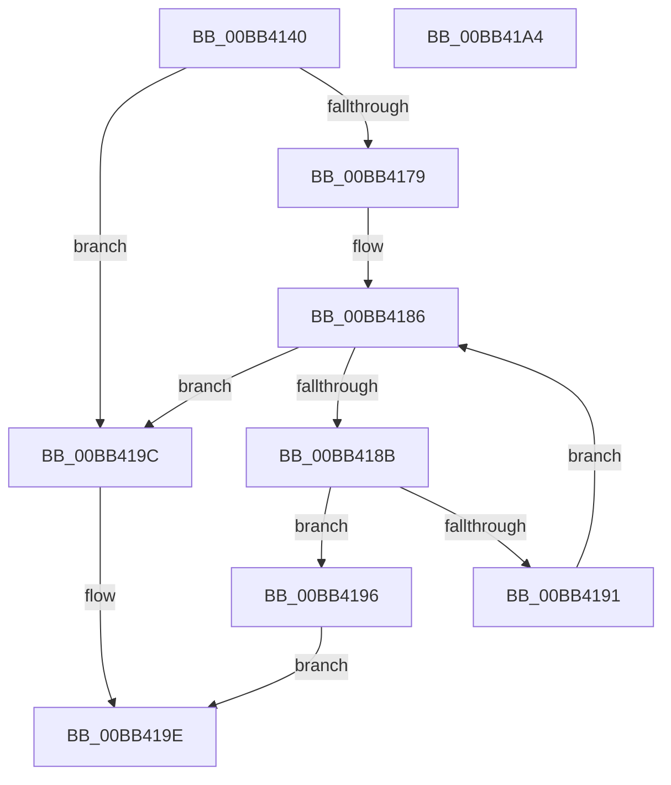

# ViIrpDatabaseFindPointer

- RVA: `0x00BB4140`–`0x00BB41A5` (길이 `101` bytes)
- VA: `0x0000000140BB4140`
- 실행 섹션: `PAGEVRFY`
- PDB 이름 있음: `예`; PDB Function 태그: `아니요`
- unwind 정보 RVA: `0x0005CF00`
- 디코드: `31`개 명령, `101/101` bytes 표시
- 미해석 바이트: `0` (있으면 어셈블리에 `.byte`로 보존)

> 이 문서는 커널 이미지의 기계어와 PDB 기호를 분석해 생성했습니다. 4번과 5번은 함수 원형과 자료형을 바이너리 사용 방식에서 추정한 C 해석이며 원본 소스 복구 결과는 아닙니다.

## 1. Dependencies

- 직접 호출 지점: **1**; 고유 호출 대상: **1**
- 직접 호출자로 확인된 함수: **2**
- RIP 상대 이미지 참조: **2**

### Outgoing calls
- `0x00BB4170` → [VfUtilAddressRangeFit](../B9/VfUtilAddressRangeFit_function_00B93138.md) (function, `0x00B93138`)

### Direct callers
- [VfIrpDatabaseCheckExFreePool](VfIrpDatabaseCheckExFreePool_function_00BB3E54.md) at `0x00BB3EA4`
- [VfIrpDatabaseEntryFindAndLock](VfIrpDatabaseEntryFindAndLock_function_00BB7074.md) at `0x00BB70D7`

### Static image references
- `0x00BB4157` → RVA `0x00F04880` (`.data`; read)
- `0x00BB4179` → RVA `0x00F04878` (`.data`; read)

## 2. Other-region calls and transfers

- 다른 실행 섹션으로 향하는 call: **0**
- 별도 외부 분기/꼬리 이동을 확인하지 못했습니다.

## 3. Assembly (complete function range)

```asm
00BB4140  40 53                           push rbx
00BB4142  48 83 EC 20                     sub rsp, 0x20
00BB4146  48 8B C1                        mov rax, rcx
00BB4149  4C 8D 81 D0 00 00 00            lea r8, [rcx + 0xd0]
00BB4150  48 8B D9                        mov rbx, rcx
00BB4153  48 C1 E8 0C                     shr rax, 0xc
00BB4157  48 8B 0D 22 07 35 00            mov rcx, qword ptr [rip + 0x350722]
00BB415E  48 8B D3                        mov rdx, rbx
00BB4161  48 6B C0 83                     imul rax, rax, -0x7d
00BB4165  44 0F B6 D8                     movzx r11d, al
00BB4169  49 C1 E3 04                     shl r11, 4
00BB416D  49 03 CB                        add rcx, r11
00BB4170  E8 C3 EF FD FF                  call 0x140b93138
00BB4175  85 C0                           test eax, eax
00BB4177  74 23                           je 0x140bb419c
00BB4179  48 8B 15 F8 06 35 00            mov rdx, qword ptr [rip + 0x3506f8]
00BB4180  49 03 D3                        add rdx, r11
00BB4183  48 8B 02                        mov rax, qword ptr [rdx]
00BB4186  48 3B C2                        cmp rax, rdx
00BB4189  74 11                           je 0x140bb419c
00BB418B  48 39 58 E0                     cmp qword ptr [rax - 0x20], rbx
00BB418F  74 05                           je 0x140bb4196
00BB4191  48 8B 00                        mov rax, qword ptr [rax]
00BB4194  EB F0                           jmp 0x140bb4186
00BB4196  48 83 C0 E0                     add rax, -0x20
00BB419A  EB 02                           jmp 0x140bb419e
00BB419C  33 C0                           xor eax, eax
00BB419E  48 83 C4 20                     add rsp, 0x20
00BB41A2  5B                              pop rbx
00BB41A3  C3                              ret
00BB41A4  CC                              int3
```

## 4. C-style interpretation (structured pseudocode)

```c
__int64 __fastcall ViIrpDatabaseFindPointer(__int64 a1)
{
    __int64 result;
    __int64 v_r11;
    __int64 v_rsp;

    v_rsp = (v_rsp) - (32);
    result = (a1) >> (12);
    result = (result) * (result);
    v_r11 = ((unsigned __int8)(result)) << (4);
    a1 = (*(unsigned __int64 *)(v_rip + 3475234)) + (v_r11);
    result = VfUtilAddressRangeFit(a1, a1, a1 + 208, a4);
    if ((unsigned int)(result) == 0) goto loc_00BB419C;
    a2 = (*(unsigned __int64 *)(v_rip + 3475192)) + (v_r11);
loc_00BB4186:
    if ((*(unsigned __int64 *)(a2)) == a2) goto loc_00BB419C;
    if ((*(unsigned __int64 *)(*(unsigned __int64 *)(a2) - 32)) == a1) goto loc_00BB4196;
    goto loc_00BB4186;
loc_00BB4196:
    result = (*(unsigned __int64 *)(*(unsigned __int64 *)(a2))) + (-32);
    goto loc_00BB419E;
loc_00BB419C:
    result = 0;
loc_00BB419E:
    v_rsp = (v_rsp) + (32);
    return result;
}
```

## 5. (Beta) C Style

```c
int64_t ViIrpDatabaseFindPointer(void *Arg1)
{
    uint8_t *arg1 = (uint8_t *)Arg1;

    int64_t result;
    int64_t local_r11;
    int64_t local_rsp;

    local_rsp = (local_rsp) - (32);
    result = (Arg1) >> (12);
    result = (result) * (result);
    local_r11 = ((uint8_t)(result)) << (4);
    Arg1 = (*(uint64_t *)(v_rip + 0x350722)) + (local_r11);
    result = VfUtilAddressRangeFit(Arg1, Arg1, Arg1 + 208, a4);
    if ((uint32_t)(result) == 0) goto loc_00BB419C;
    a2 = (*(uint64_t *)(v_rip + 0x3506F8)) + (local_r11);
loc_00BB4186:
    if ((*(uint64_t *)(a2)) == a2) goto loc_00BB419C;
    if ((*(uint64_t *)(*(uint64_t *)(a2) - 0x20)) == Arg1) goto loc_00BB4196;
    goto loc_00BB4186;
loc_00BB4196:
    result = (*(uint64_t *)(*(uint64_t *)(a2))) + (-32);
    goto loc_00BB419E;
loc_00BB419C:
    result = 0;
loc_00BB419E:
    local_rsp = (local_rsp) + (32);
    return result;
}
```

### 관측된 메모리 오프셋

구조체 형식이 확인되지 않은 접근은 인자 기준의 오프셋으로만 기록했습니다.

| 기준 인자 | 오프셋 표현 | 폭 (bit) | 접근 |
|---|---:|---:|---|
| `Arg1` | `+ 0xD0` | `64` | `R` |

## 6. Execution-region graph

[열기: 2D/3D 그래프와 함수 탐색 컨트롤 패널](../../../control-panel.html?section=pagevrfy&rva=0x00BB4140&view=graph)

- 2D 그래프는 위에서 아래로 흐르고, 3D 그래프는 빈 공간을 드래그해 회전합니다. Shift+드래그는 이동, 휠은 확대·축소, 함수 노드 선택은 대상 보고서 이동입니다.

### Static fallback


