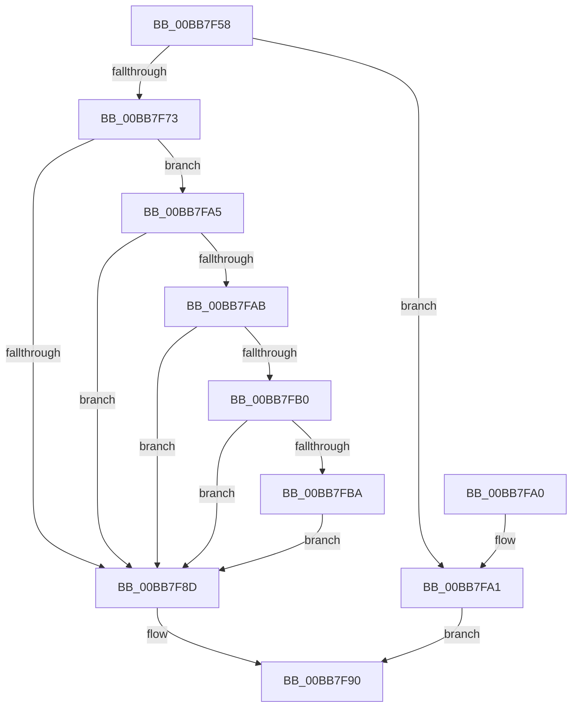

# ViKeIrqlLogAndTrimMemory

- RVA: `0x00BB7F58`–`0x00BB7FC8` (길이 `112` bytes)
- VA: `0x0000000140BB7F58`
- 실행 섹션: `PAGEVRFY`
- PDB 이름 있음: `예`; PDB Function 태그: `아니요`
- unwind 정보 RVA: `0x0009A534`
- 디코드: `35`개 명령, `112/112` bytes 표시
- 미해석 바이트: `0` (있으면 어셈블리에 `.byte`로 보존)

> 이 문서는 커널 이미지의 기계어와 PDB 기호를 분석해 생성했습니다. 4번과 5번은 함수 원형과 자료형을 바이너리 사용 방식에서 추정한 C 해석이며 원본 소스 복구 결과는 아닙니다.

## 1. Dependencies

- 직접 호출 지점: **3**; 고유 호출 대상: **3**
- 직접 호출자로 확인된 함수: **10**
- RIP 상대 이미지 참조: **2**

### Outgoing calls
- `0x00BB7F7C` → [VfKeIrqlLogRaise](VfKeIrqlLogRaise_function_00BB7FD0.md) (function, `0x00BB7FD0`)
- `0x00BB7F84` → [KeAreInterruptsEnabled](../../text/2F/KeAreInterruptsEnabled_function_002F8060.md) (function, `0x002F8060`)
- `0x00BB7FC1` → [MmVerifierTrimMemory](MmVerifierTrimMemory_function_00BB47E8.md) (function, `0x00BB47E8`)

### Direct callers
- [VerifierKeAcquireQueuedSpinLock](../B9/VerifierKeAcquireQueuedSpinLock_function_00B9FBD0.md) at `0x00B9FC72`
- [VerifierKeAcquireInStackQueuedSpinLockCommon](../BA/VerifierKeAcquireInStackQueuedSpinLockCommon_function_00BA4FD8.md) at `0x00BA5084`
- [VerifierKeAcquireInStackQueuedSpinLockRaiseToSynch](../BA/VerifierKeAcquireInStackQueuedSpinLockRaiseToSynch_function_00BA51C0.md) at `0x00BA526E`
- [VerifierKeAcquireQueuedSpinLockRaiseToSynch](../BA/VerifierKeAcquireQueuedSpinLockRaiseToSynch_function_00BA52C0.md) at `0x00BA5366`
- [VerifierKeSynchronizeExecution](../BA/VerifierKeSynchronizeExecution_function_00BA59A0.md) at `0x00BA5A4C`
- [VerifierKeTryToAcquireQueuedSpinLock](../BA/VerifierKeTryToAcquireQueuedSpinLock_function_00BA5A80.md) at `0x00BA5B2E`
- [VerifierKeTryToAcquireQueuedSpinLockRaiseToSynch](../BA/VerifierKeTryToAcquireQueuedSpinLockRaiseToSynch_function_00BA5B80.md) at `0x00BA5C2E`
- [VerifierPortKeAcquireSpinLockNoXdv](../BA/VerifierPortKeAcquireSpinLockNoXdv_function_00BA5E80.md) at `0x00BA5F49`
- [ViKeAcquireSpinLockCommon](../BA/ViKeAcquireSpinLockCommon_function_00BA60B0.md) at `0x00BA617C`
- [VerifierKeAcquireSpinLockRaiseToDpc](VerifierKeAcquireSpinLockRaiseToDpc_function_00BB8310.md) at `0x00BB8351`

### Static image references
- `0x00BB7F67` → RVA `0x00FFDA24` (`PAGEVRFD`; read)
- `0x00BB7FBA` → RVA `0x00F03F60` (`.data`; read)

## 2. Other-region calls and transfers

- 다른 실행 섹션으로 향하는 call: **1**
  - `0x00BB7F84` → [KeAreInterruptsEnabled](../../text/2F/KeAreInterruptsEnabled_function_002F8060.md) (`PAGEVRFY` → `.text`)
- 별도 외부 분기/꼬리 이동을 확인하지 못했습니다.

## 3. Assembly (complete function range)

```asm
00BB7F58  48 89 5C 24 08                  mov qword ptr [rsp + 8], rbx
00BB7F5D  48 89 74 24 10                  mov qword ptr [rsp + 0x10], rsi
00BB7F62  57                              push rdi
00BB7F63  48 83 EC 20                     sub rsp, 0x20
00BB7F67  8B 05 B7 5A 44 00               mov eax, dword ptr [rip + 0x445ab7]
00BB7F6D  8A D9                           mov bl, cl
00BB7F6F  85 C0                           test eax, eax
00BB7F71  74 2E                           je 0x140bb7fa1
00BB7F73  44 0F 20 C7                     mov rdi, cr8
00BB7F77  8A D1                           mov dl, cl
00BB7F79  40 8A CF                        mov cl, dil
00BB7F7C  E8 4F 00 00 00                  call 0x140bb7fd0
00BB7F81  48 8B F0                        mov rsi, rax
00BB7F84  E8 D7 00 74 FF                  call 0x1402f8060
00BB7F89  84 C0                           test al, al
00BB7F8B  75 18                           jne 0x140bb7fa5
00BB7F8D  48 8B C6                        mov rax, rsi
00BB7F90  48 8B 5C 24 30                  mov rbx, qword ptr [rsp + 0x30]
00BB7F95  48 8B 74 24 38                  mov rsi, qword ptr [rsp + 0x38]
00BB7F9A  48 83 C4 20                     add rsp, 0x20
00BB7F9E  5F                              pop rdi
00BB7F9F  C3                              ret
00BB7FA0  CC                              int3
00BB7FA1  33 C0                           xor eax, eax
00BB7FA3  EB EB                           jmp 0x140bb7f90
00BB7FA5  40 80 FF 02                     cmp dil, 2
00BB7FA9  73 E2                           jae 0x140bb7f8d
00BB7FAB  80 FB 02                        cmp bl, 2
00BB7FAE  72 DD                           jb 0x140bb7f8d
00BB7FB0  8B 0D 6E 5A 44 00               mov ecx, dword ptr [rip + 0x445a6e]
00BB7FB6  85 C9                           test ecx, ecx
00BB7FB8  74 D3                           je 0x140bb7f8d
00BB7FBA  0F B6 0D 9F BF 34 00            movzx ecx, byte ptr [rip + 0x34bf9f]
00BB7FC1  E8 22 C8 FF FF                  call 0x140bb47e8
00BB7FC6  EB C5                           jmp 0x140bb7f8d
```

## 4. C-style interpretation (structured pseudocode)

```c
__int64 __fastcall ViKeIrqlLogAndTrimMemory(unsigned __int8 a1)
{
    __int64 result;
    __int64 v_rsp;
    unsigned __int64 v_stack_p10;
    unsigned __int64 v_stack_p8;

    v_stack_p8 = v_rbx;
    v_stack_p10 = v_rsi;
    v_rsp = (v_rsp) - (32);
    if ((unsigned int)((unsigned int)(*(unsigned int *)(v_rip + 4479671))) == 0) goto loc_00BB7FA1;
    result = VfKeIrqlLogRaise((unsigned __int8)(v_cr8), a1, a3, a4);
    result = KeAreInterruptsEnabled((unsigned __int8)(v_cr8), a1, a3, a4);
    if ((unsigned __int8)(result) != 0) goto loc_00BB7FA5;
loc_00BB7F8D:
loc_00BB7F90:
    v_rsp = (v_rsp) + (32);
    return result;
loc_00BB7FA1:
    result = 0;
    goto loc_00BB7F90;
loc_00BB7FA5:
    if (((unsigned __int8)(v_cr8)) >= 2) goto loc_00BB7F8D;
    if (((unsigned __int8)(v_stack_p8)) < 2) goto loc_00BB7F8D;
    if ((unsigned int)((unsigned int)(*(unsigned int *)(v_rip + 4479598))) == 0) goto loc_00BB7F8D;
    result = MmVerifierTrimMemory(*(unsigned __int8 *)(v_rip + 3456927), a1, a3, a4);
    goto loc_00BB7F8D;
}
```

## 5. (Beta) C Style

```c
int64_t ViKeIrqlLogAndTrimMemory(uint8_t Arg1)
{
    int64_t result;
    int64_t local_rsp;
    uint64_t v_stack_p10;
    uint64_t v_stack_p8;

    v_stack_p8 = local_rbx;
    v_stack_p10 = local_rsi;
    local_rsp = (local_rsp) - (32);
    if ((uint32_t)((uint32_t)(*(uint32_t *)(v_rip + 0x445AB7))) == 0) goto loc_00BB7FA1;
    result = VfKeIrqlLogRaise((uint8_t)(v_cr8), Arg1, a3, a4);
    result = KeAreInterruptsEnabled((uint8_t)(v_cr8), Arg1, a3, a4);
    if ((uint8_t)(result) != 0) goto loc_00BB7FA5;
loc_00BB7F8D:
loc_00BB7F90:
    local_rsp = (local_rsp) + (32);
    return result;
loc_00BB7FA1:
    result = 0;
    goto loc_00BB7F90;
loc_00BB7FA5:
    if (((uint8_t)(v_cr8)) >= 2) goto loc_00BB7F8D;
    if (((uint8_t)(v_stack_p8)) < 2) goto loc_00BB7F8D;
    if ((uint32_t)((uint32_t)(*(uint32_t *)(v_rip + 0x445A6E))) == 0) goto loc_00BB7F8D;
    result = MmVerifierTrimMemory(*(uint8_t *)(v_rip + 0x34BF9F), Arg1, a3, a4);
    goto loc_00BB7F8D;
}
```

## 6. Execution-region graph

[열기: 2D/3D 그래프와 함수 탐색 컨트롤 패널](../../../control-panel.html?section=pagevrfy&rva=0x00BB7F58&view=graph)

- 2D 그래프는 위에서 아래로 흐르고, 3D 그래프는 빈 공간을 드래그해 회전합니다. Shift+드래그는 이동, 휠은 확대·축소, 함수 노드 선택은 대상 보고서 이동입니다.

### Static fallback


