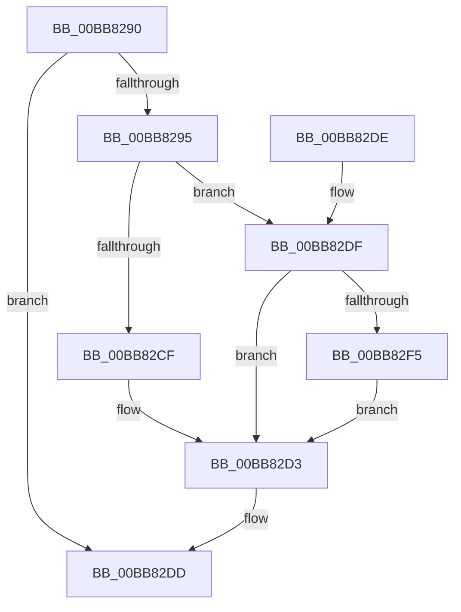

# ViKeIrqlLogCommon

- RVA: `0x00BB8290`–`0x00BB8300` (길이 `112` bytes)
- VA: `0x0000000140BB8290`
- 실행 섹션: `PAGEVRFY`
- PDB 이름 있음: `예`; PDB Function 태그: `아니요`
- unwind 정보 RVA: `0x000BCF8C`
- 디코드: `32`개 명령, `112/112` bytes 표시
- 미해석 바이트: `0` (있으면 어셈블리에 `.byte`로 보존)

> 이 문서는 커널 이미지의 기계어와 PDB 기호를 분석해 생성했습니다. 4번과 5번은 함수 원형과 자료형을 바이너리 사용 방식에서 추정한 C 해석이며 원본 소스 복구 결과는 아닙니다.

## 1. Dependencies

- 직접 호출 지점: **1**; 고유 호출 대상: **1**
- 직접 호출자로 확인된 함수: **2**
- RIP 상대 이미지 참조: **1**

### Outgoing calls
- `0x00BB82EB` → [RtlCaptureStackBackTrace](../../text/2F/RtlCaptureStackBackTrace_function_002F9FF0.md) (function, `0x002F9FF0`)

### Direct callers
- [VfKeIrqlLogRaise](VfKeIrqlLogRaise_function_00BB7FD0.md) at `0x00BB7FF4`
- [VfKeIrqlLogLower](VfKeIrqlLogLower_function_00BB91EC.md) at `0x00BB920A`

### Static image references
- `0x00BB82C5` → RVA `0x00F04980` (`.data`; read)

## 2. Other-region calls and transfers

- 다른 실행 섹션으로 향하는 call: **1**
  - `0x00BB82EB` → [RtlCaptureStackBackTrace](../../text/2F/RtlCaptureStackBackTrace_function_002F9FF0.md) (`PAGEVRFY` → `.text`)
- 별도 외부 분기/꼬리 이동을 확인하지 못했습니다.

## 3. Assembly (complete function range)

```asm
00BB8290  48 85 C9                        test rcx, rcx
00BB8293  74 48                           je 0x140bb82dd
00BB8295  48 89 5C 24 08                  mov qword ptr [rsp + 8], rbx
00BB829A  57                              push rdi
00BB829B  48 83 EC 20                     sub rsp, 0x20
00BB829F  65 48 8B 04 25 88 01 00 00      mov rax, qword ptr gs:[0x188]
00BB82A8  4C 8D 41 10                     lea r8, [rcx + 0x10]
00BB82AC  48 89 01                        mov qword ptr [rcx], rax
00BB82AF  44 8B D2                        mov r10d, edx
00BB82B2  48 B8 20 03 00 00 80 F7 FF FF   movabs rax, 0xfffff78000000320
00BB82BC  48 8B D9                        mov rbx, rcx
00BB82BF  48 8B 00                        mov rax, qword ptr [rax]
00BB82C2  89 41 0C                        mov dword ptr [rcx + 0xc], eax
00BB82C5  8B 05 B5 C6 34 00               mov eax, dword ptr [rip + 0x34c6b5]
00BB82CB  A8 40                           test al, 0x40
00BB82CD  74 10                           je 0x140bb82df
00BB82CF  49 83 20 00                     and qword ptr [r8], 0
00BB82D3  48 8B 5C 24 30                  mov rbx, qword ptr [rsp + 0x30]
00BB82D8  48 83 C4 20                     add rsp, 0x20
00BB82DC  5F                              pop rdi
00BB82DD  C3                              ret
00BB82DE  CC                              int3
00BB82DF  45 33 C9                        xor r9d, r9d
00BB82E2  41 8B CA                        mov ecx, r10d
00BB82E5  41 8D 79 05                     lea edi, [r9 + 5]
00BB82E9  8B D7                           mov edx, edi
00BB82EB  E8 00 1D 74 FF                  call 0x1402f9ff0
00BB82F0  66 3B C7                        cmp ax, di
00BB82F3  73 DE                           jae 0x140bb82d3
00BB82F5  0F B7 C0                        movzx eax, ax
00BB82F8  48 83 64 C3 10 00               and qword ptr [rbx + rax*8 + 0x10], 0
00BB82FE  EB D3                           jmp 0x140bb82d3
```

## 4. C-style interpretation (structured pseudocode)

```c
__int64 __fastcall ViKeIrqlLogCommon(__int64 a1, int a2, __int64 a3, int a4)
{
    __int64 result;
    __int64 v_rsp;
    unsigned __int64 v_stack_p8;

    if (a1 == 0) goto loc_00BB82DD;
    v_stack_p8 = v_rbx;
    v_rsp = (v_rsp) - (32);
    *(unsigned __int64 *)(a1) = *(unsigned __int64 *)(gs_base + (0 + 392));
    *(unsigned int *)(a1 + 12) = (unsigned int)(*(unsigned __int64 *)(*(unsigned __int64 *)(gs_base + (0 + 392))));
    if ((((unsigned __int8)((unsigned int)(*(unsigned int *)(v_rip + 3458741)))) & (64)) == 0) goto loc_00BB82DF;
loc_00BB82D3:
    v_rsp = (v_rsp) + (32);
loc_00BB82DD:
    return (unsigned int)(*(unsigned int *)(v_rip + 3458741));
loc_00BB82DF:
    a4 = 0;
    result = RtlCaptureStackBackTrace((unsigned int)((unsigned int)((unsigned int)(a2))), (unsigned int)((unsigned int)(a4 + 5)), a1 + 16, a4);
    if (((unsigned __int16)(result)) >= ((unsigned __int16)(a4 + 5))) goto loc_00BB82D3;
    goto loc_00BB82D3;
}
```

## 5. (Beta) C Style

```c
int64_t ViKeIrqlLogCommon(int64_t Arg1, int32_t Arg2, int64_t Arg3, int32_t Arg4)
{
    int64_t result;
    int64_t local_rsp;
    uint64_t v_stack_p8;

    if (Arg1 == 0) goto loc_00BB82DD;
    v_stack_p8 = local_rbx;
    local_rsp = (local_rsp) - (32);
    *(uint64_t *)(Arg1) = *(uint64_t *)(gs_base + (0 + 0x188));
    *(uint32_t *)(Arg1 + 0xC) = (uint32_t)(*(uint64_t *)(*(uint64_t *)(gs_base + (0 + 0x188))));
    if ((((uint8_t)((uint32_t)(*(uint32_t *)(v_rip + 0x34C6B5)))) & (64)) == 0) goto loc_00BB82DF;
loc_00BB82D3:
    local_rsp = (local_rsp) + (32);
loc_00BB82DD:
    return (uint32_t)(*(uint32_t *)(v_rip + 0x34C6B5));
loc_00BB82DF:
    Arg4 = 0;
    result = RtlCaptureStackBackTrace((uint32_t)((uint32_t)((uint32_t)(Arg2))), (uint32_t)((uint32_t)(Arg4 + 5)), Arg1 + 16, Arg4);
    if (((uint16_t)(result)) >= ((uint16_t)(Arg4 + 5))) goto loc_00BB82D3;
    goto loc_00BB82D3;
}
```

## 6. Execution-region graph

[열기: 2D/3D 그래프와 함수 탐색 컨트롤 패널](../../../control-panel.html?section=pagevrfy&rva=0x00BB8290&view=graph)

- 2D 그래프는 위에서 아래로 흐르고, 3D 그래프는 빈 공간을 드래그해 회전합니다. Shift+드래그는 이동, 휠은 확대·축소, 함수 노드 선택은 대상 보고서 이동입니다.

### Static fallback


