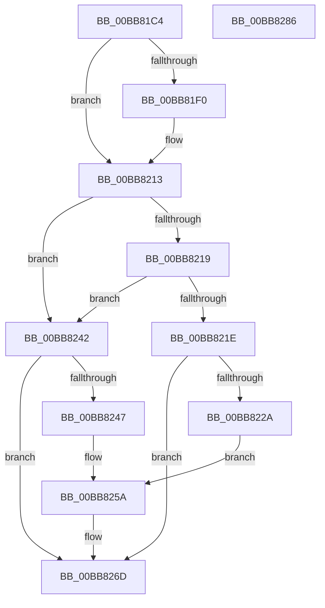

# ViMiscCheckKeLowerIrql

- RVA: `0x00BB81C4`–`0x00BB8287` (길이 `195` bytes)
- VA: `0x0000000140BB81C4`
- 실행 섹션: `PAGEVRFY`
- PDB 이름 있음: `예`; PDB Function 태그: `아니요`
- unwind 정보 RVA: `0x000BC898`
- 디코드: `52`개 명령, `195/195` bytes 표시
- 미해석 바이트: `0` (있으면 어셈블리에 `.byte`로 보존)

> 이 문서는 커널 이미지의 기계어와 PDB 기호를 분석해 생성했습니다. 4번과 5번은 함수 원형과 자료형을 바이너리 사용 방식에서 추정한 C 해석이며 원본 소스 복구 결과는 아닙니다.

## 1. Dependencies

- 직접 호출 지점: **2**; 고유 호출 대상: **1**
- 직접 호출자로 확인된 함수: **3**
- RIP 상대 이미지 참조: **0**

### Outgoing calls
- `0x00BB820E` → [CarReportRuleViolationFromNt](../B9/CarReportRuleViolationFromNt_function_00B9D904.md) (function, `0x00B9D904`)
- `0x00BB8268` → [CarReportRuleViolationFromNt](../B9/CarReportRuleViolationFromNt_function_00B9D904.md) (function, `0x00B9D904`)

### Direct callers
- [VfMiscKeReleaseInStackQueuedSpinLock_Entry](../BA/VfMiscKeReleaseInStackQueuedSpinLock_Entry_function_00BADE30.md) at `0x00BADE85`
- [VfMiscKeReleaseQueuedSpinLock_Entry](../BA/VfMiscKeReleaseQueuedSpinLock_Entry_function_00BADEE0.md) at `0x00BADEF1`
- [ViMiscCheckReleaseSpinlock](ViMiscCheckReleaseSpinlock_function_00BB8140.md) at `0x00BB81A3`

### Static image references
- 디코드된 RIP-relative 메모리 참조가 없습니다.

## 2. Other-region calls and transfers

- 다른 실행 섹션으로 향하는 call: **0**
- 별도 외부 분기/꼬리 이동을 확인하지 못했습니다.

## 3. Assembly (complete function range)

```asm
00BB81C4  48 8B C4                        mov rax, rsp
00BB81C7  48 89 58 08                     mov qword ptr [rax + 8], rbx
00BB81CB  48 89 68 10                     mov qword ptr [rax + 0x10], rbp
00BB81CF  48 89 70 18                     mov qword ptr [rax + 0x18], rsi
00BB81D3  57                              push rdi
00BB81D4  41 54                           push r12
00BB81D6  41 56                           push r14
00BB81D8  48 83 EC 40                     sub rsp, 0x40
00BB81DC  0F B6 DA                        movzx ebx, dl
00BB81DF  49 8B F0                        mov rsi, r8
00BB81E2  0F B6 F9                        movzx edi, cl
00BB81E5  41 BC 31 00 00 00               mov r12d, 0x31
00BB81EB  40 3A FB                        cmp dil, bl
00BB81EE  73 23                           jae 0x140bb8213
00BB81F0  4C 89 40 D8                     mov qword ptr [rax - 0x28], r8
00BB81F4  44 8B CB                        mov r9d, ebx
00BB81F7  C7 40 D0 0B 00 00 00            mov dword ptr [rax - 0x30], 0xb
00BB81FE  44 8B C7                        mov r8d, edi
00BB8201  48 83 60 C8 00                  and qword ptr [rax - 0x38], 0
00BB8206  41 8B D4                        mov edx, r12d
00BB8209  B9 C4 00 00 00                  mov ecx, 0xc4
00BB820E  E8 F1 56 FE FF                  call 0x140b9d904
00BB8213  40 80 FF 02                     cmp dil, 2
00BB8217  72 29                           jb 0x140bb8242
00BB8219  80 FB 02                        cmp bl, 2
00BB821C  73 24                           jae 0x140bb8242
00BB821E  65 8A 04 25 3C 3A 00 00         mov al, byte ptr gs:[0x3a3c]
00BB8226  A8 01                           test al, 1
00BB8228  74 43                           je 0x140bb826d
00BB822A  48 89 74 24 30                  mov qword ptr [rsp + 0x30], rsi
00BB822F  C7 44 24 28 0B 00 00 00         mov dword ptr [rsp + 0x28], 0xb
00BB8237  48 C7 44 24 20 01 00 00 00      mov qword ptr [rsp + 0x20], 1
00BB8240  EB 18                           jmp 0x140bb825a
00BB8242  80 FB 0F                        cmp bl, 0xf
00BB8245  76 26                           jbe 0x140bb826d
00BB8247  48 89 74 24 30                  mov qword ptr [rsp + 0x30], rsi
00BB824C  C7 44 24 28 0B 00 00 00         mov dword ptr [rsp + 0x28], 0xb
00BB8254  48 83 64 24 20 00               and qword ptr [rsp + 0x20], 0
00BB825A  4C 8B CB                        mov r9, rbx
00BB825D  4C 8B C7                        mov r8, rdi
00BB8260  49 8B D4                        mov rdx, r12
00BB8263  B9 C4 00 00 00                  mov ecx, 0xc4
00BB8268  E8 97 56 FE FF                  call 0x140b9d904
00BB826D  48 8B 5C 24 60                  mov rbx, qword ptr [rsp + 0x60]
00BB8272  48 8B 6C 24 68                  mov rbp, qword ptr [rsp + 0x68]
00BB8277  48 8B 74 24 70                  mov rsi, qword ptr [rsp + 0x70]
00BB827C  48 83 C4 40                     add rsp, 0x40
00BB8280  41 5E                           pop r14
00BB8282  41 5C                           pop r12
00BB8284  5F                              pop rdi
00BB8285  C3                              ret
00BB8286  CC                              int3
```

## 4. C-style interpretation (structured pseudocode)

```c
__int64 __fastcall ViMiscCheckKeLowerIrql(unsigned __int8 a1, unsigned __int8 a2, __int64 a3)
{
    __int64 result;
    __int64 v_rsp;
    unsigned __int64 v_stack_m28;
    unsigned int v_stack_m30;
    unsigned __int64 v_stack_m38;
    unsigned __int64 v_stack_p10;
    unsigned __int64 v_stack_p18;
    unsigned __int64 v_stack_p8;

    *(unsigned __int64 *)(v_rsp + 8) = v_rbx;
    *(unsigned __int64 *)(v_rsp + 16) = v_rbp;
    *(unsigned __int64 *)(v_rsp + 24) = v_rsi;
    v_rsp = (v_rsp) - (64);
    result = v_rsp;
    if (a1 < a2) {
        *(unsigned __int64 *)(v_rsp - 40) = a3;
        a4 = a2;
        *(unsigned int *)(v_rsp - 48) = 11;
        a3 = a1;
        a2 = 49;
        a1 = 196;
        result = CarReportRuleViolationFromNt(a1, a2, a3, a4);
    }
    if (a1 < 2) goto loc_00BB8242;
    if (a2 >= 2) goto loc_00BB8242;
    if ((((unsigned __int8)(*(unsigned __int8 *)(gs_base + (0 + 14908)))) & (1)) == 0) goto loc_00BB826D;
    v_stack_m28 = a3;
    v_stack_m30 = 11;
    v_stack_m38 = 1;
    goto loc_00BB825A;
loc_00BB8242:
    if (a2 <= 15) goto loc_00BB826D;
    v_stack_m28 = a3;
    v_stack_m30 = 11;
loc_00BB825A:
    result = CarReportRuleViolationFromNt(196, 49, a1, a2);
loc_00BB826D:
    v_rsp = (v_rsp) + (64);
    return result;
}
```

## 5. (Beta) C Style

```c
int64_t ViMiscCheckKeLowerIrql(uint8_t Arg1, uint8_t Arg2, int64_t Arg3)
{
    int64_t result;
    int64_t local_rsp;
    uint64_t v_stack_m28;
    uint32_t v_stack_m30;
    uint64_t v_stack_m38;
    uint64_t v_stack_p10;
    uint64_t v_stack_p18;
    uint64_t v_stack_p8;

    *(uint64_t *)(local_rsp + 0x8) = local_rbx;
    *(uint64_t *)(local_rsp + 0x10) = local_rbp;
    *(uint64_t *)(local_rsp + 0x18) = local_rsi;
    local_rsp = (local_rsp) - (64);
    result = local_rsp;
    if (Arg1 < Arg2) {
        *(uint64_t *)(local_rsp - 0x28) = Arg3;
        a4 = Arg2;
        *(uint32_t *)(local_rsp - 0x30) = 11;
        Arg3 = Arg1;
        Arg2 = 49;
        Arg1 = 196;
        result = CarReportRuleViolationFromNt(Arg1, Arg2, Arg3, a4);
    }
    if (Arg1 < 2) goto loc_00BB8242;
    if (Arg2 >= 2) goto loc_00BB8242;
    if ((((uint8_t)(*(uint8_t *)(gs_base + (0 + 0x3A3C)))) & (1)) == 0) goto loc_00BB826D;
    v_stack_m28 = Arg3;
    v_stack_m30 = 11;
    v_stack_m38 = 1;
    goto loc_00BB825A;
loc_00BB8242:
    if (Arg2 <= 15) goto loc_00BB826D;
    v_stack_m28 = Arg3;
    v_stack_m30 = 11;
loc_00BB825A:
    result = CarReportRuleViolationFromNt(196, 49, Arg1, Arg2);
loc_00BB826D:
    local_rsp = (local_rsp) + (64);
    return result;
}
```

## 6. Execution-region graph

[열기: 2D/3D 그래프와 함수 탐색 컨트롤 패널](../../../control-panel.html?section=pagevrfy&rva=0x00BB81C4&view=graph)

- 2D 그래프는 위에서 아래로 흐르고, 3D 그래프는 빈 공간을 드래그해 회전합니다. Shift+드래그는 이동, 휠은 확대·축소, 함수 노드 선택은 대상 보고서 이동입니다.

### Static fallback


