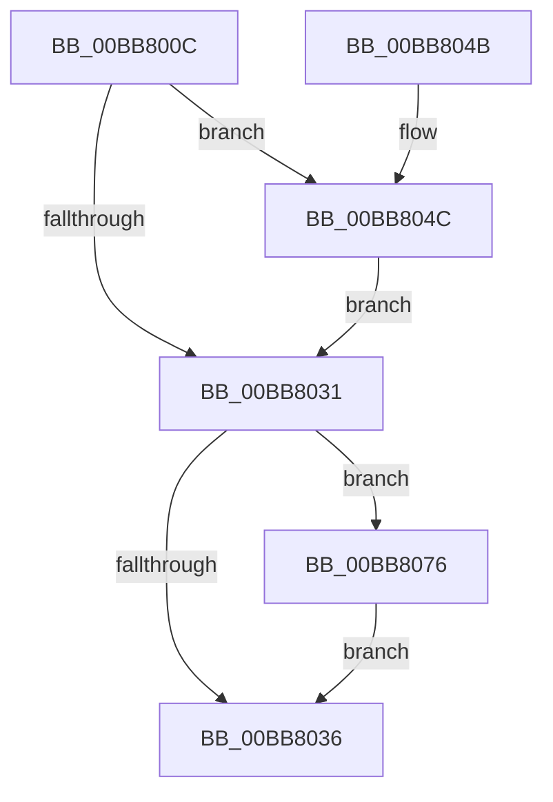

# ViMiscCheckKeRaiseIrql

- RVA: `0x00BB800C`–`0x00BB80A0` (길이 `148` bytes)
- VA: `0x0000000140BB800C`
- 실행 섹션: `PAGEVRFY`
- PDB 이름 있음: `예`; PDB Function 태그: `아니요`
- unwind 정보 RVA: `0x000BC650`
- 디코드: `38`개 명령, `148/148` bytes 표시
- 미해석 바이트: `0` (있으면 어셈블리에 `.byte`로 보존)

> 이 문서는 커널 이미지의 기계어와 PDB 기호를 분석해 생성했습니다. 4번과 5번은 함수 원형과 자료형을 바이너리 사용 방식에서 추정한 C 해석이며 원본 소스 복구 결과는 아닙니다.

## 1. Dependencies

- 직접 호출 지점: **2**; 고유 호출 대상: **1**
- 직접 호출자로 확인된 함수: **2**
- RIP 상대 이미지 참조: **0**

### Outgoing calls
- `0x00BB806F` → [CarReportRuleViolationFromNt](../B9/CarReportRuleViolationFromNt_function_00B9D904.md) (function, `0x00B9D904`)
- `0x00BB8099` → [CarReportRuleViolationFromNt](../B9/CarReportRuleViolationFromNt_function_00B9D904.md) (function, `0x00B9D904`)

### Direct callers
- [VfMiscKeAcquireSpinLockRaiseToDpc_Entry](../BA/VfMiscKeAcquireSpinLockRaiseToDpc_Entry_function_00BADCA0.md) at `0x00BADCBF`
- [VfMiscKeSynchronizeExecution_Entry](../BA/VfMiscKeSynchronizeExecution_Entry_function_00BADFA0.md) at `0x00BADFAE`

### Static image references
- 디코드된 RIP-relative 메모리 참조가 없습니다.

## 2. Other-region calls and transfers

- 다른 실행 섹션으로 향하는 call: **0**
- 별도 외부 분기/꼬리 이동을 확인하지 못했습니다.

## 3. Assembly (complete function range)

```asm
00BB800C  48 89 5C 24 08                  mov qword ptr [rsp + 8], rbx
00BB8011  48 89 6C 24 10                  mov qword ptr [rsp + 0x10], rbp
00BB8016  48 89 74 24 18                  mov qword ptr [rsp + 0x18], rsi
00BB801B  57                              push rdi
00BB801C  48 83 EC 40                     sub rsp, 0x40
00BB8020  48 8B FA                        mov rdi, rdx
00BB8023  0F B6 D9                        movzx ebx, cl
00BB8026  44 0F 20 C0                     mov rax, cr8
00BB802A  0F B6 E8                        movzx ebp, al
00BB802D  3A C3                           cmp al, bl
00BB802F  77 1B                           ja 0x140bb804c
00BB8031  80 FB 0F                        cmp bl, 0xf
00BB8034  77 40                           ja 0x140bb8076
00BB8036  48 8B 5C 24 50                  mov rbx, qword ptr [rsp + 0x50]
00BB803B  48 8B 6C 24 58                  mov rbp, qword ptr [rsp + 0x58]
00BB8040  48 8B 74 24 60                  mov rsi, qword ptr [rsp + 0x60]
00BB8045  48 83 C4 40                     add rsp, 0x40
00BB8049  5F                              pop rdi
00BB804A  C3                              ret
00BB804B  CC                              int3
00BB804C  48 89 7C 24 30                  mov qword ptr [rsp + 0x30], rdi
00BB8051  4C 8B CB                        mov r9, rbx
00BB8054  C7 44 24 28 0B 00 00 00         mov dword ptr [rsp + 0x28], 0xb
00BB805C  4C 8B C5                        mov r8, rbp
00BB805F  48 83 64 24 20 00               and qword ptr [rsp + 0x20], 0
00BB8065  BA 30 00 00 00                  mov edx, 0x30
00BB806A  B9 C4 00 00 00                  mov ecx, 0xc4
00BB806F  E8 90 58 FE FF                  call 0x140b9d904
00BB8074  EB BB                           jmp 0x140bb8031
00BB8076  48 89 7C 24 30                  mov qword ptr [rsp + 0x30], rdi
00BB807B  4C 8B CB                        mov r9, rbx
00BB807E  C7 44 24 28 0B 00 00 00         mov dword ptr [rsp + 0x28], 0xb
00BB8086  4C 8B C5                        mov r8, rbp
00BB8089  48 83 64 24 20 00               and qword ptr [rsp + 0x20], 0
00BB808F  BA 30 00 00 00                  mov edx, 0x30
00BB8094  B9 C4 00 00 00                  mov ecx, 0xc4
00BB8099  E8 66 58 FE FF                  call 0x140b9d904
00BB809E  EB 96                           jmp 0x140bb8036
```

## 4. C-style interpretation (structured pseudocode)

```c
__int64 __fastcall ViMiscCheckKeRaiseIrql(unsigned __int8 a1, __int64 a2)
{
    __int64 result;
    __int64 v_rsp;
    unsigned __int64 v_stack_p10;
    unsigned __int64 v_stack_p18;
    unsigned __int64 v_stack_p20;
    unsigned int v_stack_p28;
    unsigned __int64 v_stack_p30;
    unsigned __int64 v_stack_p8;

    v_stack_p8 = v_rbx;
    v_stack_p10 = v_rbp;
    v_stack_p18 = v_rsi;
    v_rsp = (v_rsp) - (64);
    if (((unsigned __int8)(v_cr8)) > a1) goto loc_00BB804C;
loc_00BB8031:
    if (a1 > 15) goto loc_00BB8076;
loc_00BB8036:
    v_rsp = (v_rsp) + (64);
    return v_cr8;
loc_00BB804C:
    v_stack_p30 = a2;
    v_stack_p28 = 11;
    result = CarReportRuleViolationFromNt(196, 48, v_stack_p10, v_stack_p8);
    goto loc_00BB8031;
loc_00BB8076:
    v_stack_p30 = a2;
    v_stack_p28 = 11;
    result = CarReportRuleViolationFromNt(196, 48, v_stack_p10, v_stack_p8);
    goto loc_00BB8036;
}
```

## 5. (Beta) C Style

```c
int64_t ViMiscCheckKeRaiseIrql(uint8_t Arg1, int64_t Arg2)
{
    int64_t result;
    int64_t local_rsp;
    uint64_t v_stack_p10;
    uint64_t v_stack_p18;
    uint64_t v_stack_p20;
    uint32_t v_stack_p28;
    uint64_t v_stack_p30;
    uint64_t v_stack_p8;

    v_stack_p8 = local_rbx;
    v_stack_p10 = local_rbp;
    v_stack_p18 = local_rsi;
    local_rsp = (local_rsp) - (64);
    if (((uint8_t)(v_cr8)) > Arg1) goto loc_00BB804C;
loc_00BB8031:
    if (Arg1 > 15) goto loc_00BB8076;
loc_00BB8036:
    local_rsp = (local_rsp) + (64);
    return v_cr8;
loc_00BB804C:
    v_stack_p30 = Arg2;
    v_stack_p28 = 11;
    result = CarReportRuleViolationFromNt(196, 48, v_stack_p10, v_stack_p8);
    goto loc_00BB8031;
loc_00BB8076:
    v_stack_p30 = Arg2;
    v_stack_p28 = 11;
    result = CarReportRuleViolationFromNt(196, 48, v_stack_p10, v_stack_p8);
    goto loc_00BB8036;
}
```

## 6. Execution-region graph

[열기: 2D/3D 그래프와 함수 탐색 컨트롤 패널](../../../control-panel.html?section=pagevrfy&rva=0x00BB800C&view=graph)

- 2D 그래프는 위에서 아래로 흐르고, 3D 그래프는 빈 공간을 드래그해 회전합니다. Shift+드래그는 이동, 휠은 확대·축소, 함수 노드 선택은 대상 보고서 이동입니다.

### Static fallback


