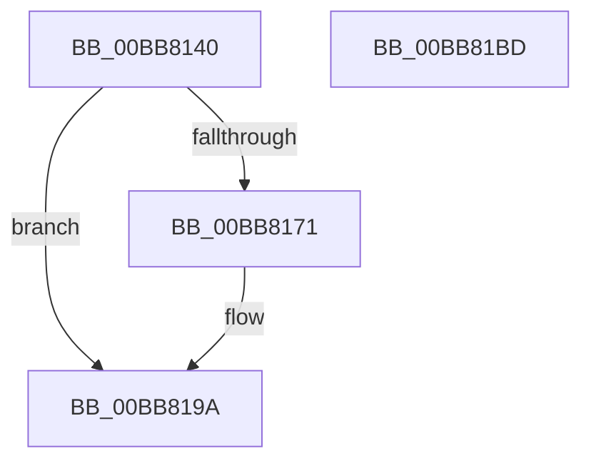

# ViMiscCheckReleaseSpinlock

- RVA: `0x00BB8140`–`0x00BB81BE` (길이 `126` bytes)
- VA: `0x0000000140BB8140`
- 실행 섹션: `PAGEVRFY`
- PDB 이름 있음: `예`; PDB Function 태그: `아니요`
- unwind 정보 RVA: `0x0007D3C0`
- 디코드: `32`개 명령, `126/126` bytes 표시
- 미해석 바이트: `0` (있으면 어셈블리에 `.byte`로 보존)

> 이 문서는 커널 이미지의 기계어와 PDB 기호를 분석해 생성했습니다. 4번과 5번은 함수 원형과 자료형을 바이너리 사용 방식에서 추정한 C 해석이며 원본 소스 복구 결과는 아닙니다.

## 1. Dependencies

- 직접 호출 지점: **3**; 고유 호출 대상: **3**
- 직접 호출자로 확인된 함수: **1**
- RIP 상대 이미지 참조: **0**

### Outgoing calls
- `0x00BB8162` → [VfMiscCheckKernelAddress](../../text/4B/VfMiscCheckKernelAddress_function_004BC694.md) (function, `0x004BC694`)
- `0x00BB8195` → [CarReportRuleViolationFromNt](../B9/CarReportRuleViolationFromNt_function_00B9D904.md) (function, `0x00B9D904`)
- `0x00BB81A3` → [ViMiscCheckKeLowerIrql](ViMiscCheckKeLowerIrql_function_00BB81C4.md) (function, `0x00BB81C4`)

### Direct callers
- [VfMiscKeReleaseSpinLock_Entry](VfMiscKeReleaseSpinLock_Entry_function_00BB8120.md) at `0x00BB812E`

### Static image references
- 디코드된 RIP-relative 메모리 참조가 없습니다.

## 2. Other-region calls and transfers

- 다른 실행 섹션으로 향하는 call: **1**
  - `0x00BB8162` → [VfMiscCheckKernelAddress](../../text/4B/VfMiscCheckKernelAddress_function_004BC694.md) (`PAGEVRFY` → `.text`)
- 별도 외부 분기/꼬리 이동을 확인하지 못했습니다.

## 3. Assembly (complete function range)

```asm
00BB8140  48 89 5C 24 08                  mov qword ptr [rsp + 8], rbx
00BB8145  48 89 6C 24 10                  mov qword ptr [rsp + 0x10], rbp
00BB814A  48 89 74 24 18                  mov qword ptr [rsp + 0x18], rsi
00BB814F  57                              push rdi
00BB8150  48 83 EC 40                     sub rsp, 0x40
00BB8154  40 8A EA                        mov bpl, dl
00BB8157  49 8B D8                        mov rbx, r8
00BB815A  BA 08 00 00 00                  mov edx, 8
00BB815F  48 8B F1                        mov rsi, rcx
00BB8162  E8 2D 45 90 FF                  call 0x1404bc694
00BB8167  44 0F 20 C7                     mov rdi, cr8
00BB816B  40 80 FF 02                     cmp dil, 2
00BB816F  73 29                           jae 0x140bb819a
00BB8171  48 89 5C 24 30                  mov qword ptr [rsp + 0x30], rbx
00BB8176  4C 8B CE                        mov r9, rsi
00BB8179  C7 44 24 28 0B 00 00 00         mov dword ptr [rsp + 0x28], 0xb
00BB8181  BA 32 00 00 00                  mov edx, 0x32
00BB8186  48 83 64 24 20 00               and qword ptr [rsp + 0x20], 0
00BB818C  B9 C4 00 00 00                  mov ecx, 0xc4
00BB8191  44 0F B6 C7                     movzx r8d, dil
00BB8195  E8 6A 57 FE FF                  call 0x140b9d904
00BB819A  4C 8B C3                        mov r8, rbx
00BB819D  40 8A D5                        mov dl, bpl
00BB81A0  40 8A CF                        mov cl, dil
00BB81A3  E8 1C 00 00 00                  call 0x140bb81c4
00BB81A8  48 8B 5C 24 50                  mov rbx, qword ptr [rsp + 0x50]
00BB81AD  48 8B 6C 24 58                  mov rbp, qword ptr [rsp + 0x58]
00BB81B2  48 8B 74 24 60                  mov rsi, qword ptr [rsp + 0x60]
00BB81B7  48 83 C4 40                     add rsp, 0x40
00BB81BB  5F                              pop rdi
00BB81BC  C3                              ret
00BB81BD  CC                              int3
```

## 4. C-style interpretation (structured pseudocode)

```c
__int64 __fastcall ViMiscCheckReleaseSpinlock(__int64 a1, unsigned __int8 a2, __int64 a3)
{
    __int64 result;
    __int64 v_rsp;
    unsigned __int64 v_stack_m18;
    unsigned int v_stack_m20;
    unsigned __int64 v_stack_m28;
    unsigned __int64 v_stack_p10;
    unsigned __int64 v_stack_p18;
    unsigned __int64 v_stack_p8;

    v_stack_p8 = v_rbx;
    v_stack_p10 = v_rbp;
    v_stack_p18 = v_rsi;
    v_rsp = (v_rsp) - (64);
    result = VfMiscCheckKernelAddress(a1, 8, a3, a4);
    if (((unsigned __int8)(v_cr8)) < 2) {
        v_stack_m18 = a3;
        a4 = a1;
        v_stack_m20 = 11;
        a2 = 50;
        a1 = 196;
        a3 = (unsigned __int8)(v_cr8);
        result = CarReportRuleViolationFromNt(a1, a2, a3, a4);
    }
    result = ViMiscCheckKeLowerIrql((unsigned __int8)(v_cr8), a2, a3, a4);
    v_rsp = (v_rsp) + (64);
    return result;
}
```

## 5. (Beta) C Style

```c
int64_t ViMiscCheckReleaseSpinlock(int64_t Arg1, uint8_t Arg2, int64_t Arg3)
{
    int64_t result;
    int64_t local_rsp;
    uint64_t v_stack_m18;
    uint32_t v_stack_m20;
    uint64_t v_stack_m28;
    uint64_t v_stack_p10;
    uint64_t v_stack_p18;
    uint64_t v_stack_p8;

    v_stack_p8 = local_rbx;
    v_stack_p10 = local_rbp;
    v_stack_p18 = local_rsi;
    local_rsp = (local_rsp) - (64);
    result = VfMiscCheckKernelAddress(Arg1, 8, Arg3, a4);
    if (((uint8_t)(v_cr8)) < 2) {
        v_stack_m18 = Arg3;
        a4 = Arg1;
        v_stack_m20 = 11;
        Arg2 = 50;
        Arg1 = 196;
        Arg3 = (uint8_t)(v_cr8);
        result = CarReportRuleViolationFromNt(Arg1, Arg2, Arg3, a4);
    }
    result = ViMiscCheckKeLowerIrql((uint8_t)(v_cr8), Arg2, Arg3, a4);
    local_rsp = (local_rsp) + (64);
    return result;
}
```

## 6. Execution-region graph

[열기: 2D/3D 그래프와 함수 탐색 컨트롤 패널](../../../control-panel.html?section=pagevrfy&rva=0x00BB8140&view=graph)

- 2D 그래프는 위에서 아래로 흐르고, 3D 그래프는 빈 공간을 드래그해 회전합니다. Shift+드래그는 이동, 휠은 확대·축소, 함수 노드 선택은 대상 보고서 이동입니다.

### Static fallback


