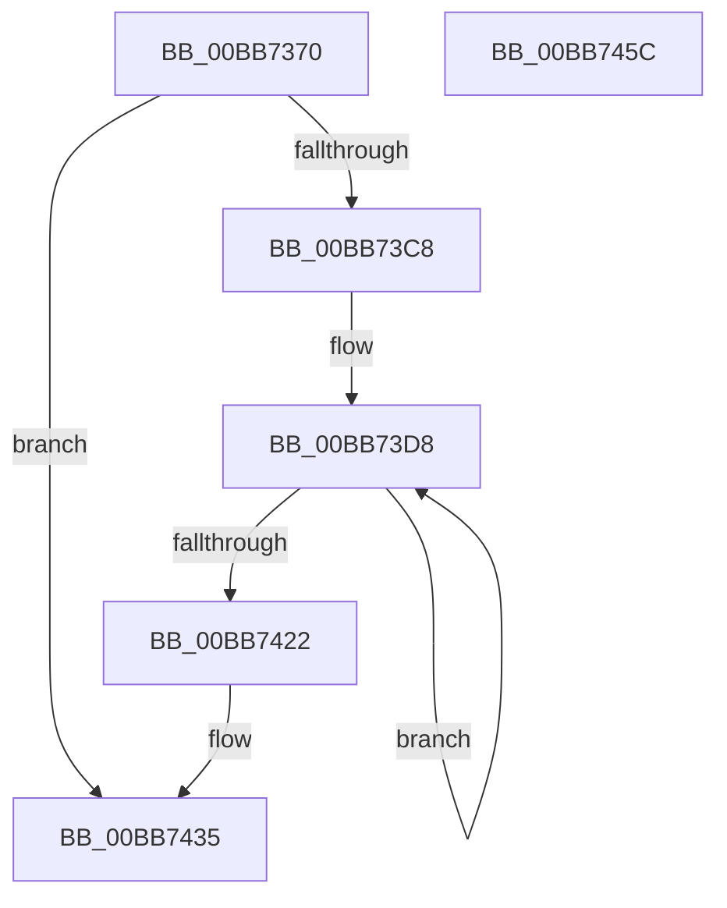

# ViPtCaptureStackTraceCallout

- RVA: `0x00BB7370`–`0x00BB745D` (길이 `237` bytes)
- VA: `0x0000000140BB7370`
- 실행 섹션: `PAGEVRFY`
- PDB 이름 있음: `예`; PDB Function 태그: `아니요`
- unwind 정보 RVA: `0x000B3E7C`
- 디코드: `59`개 명령, `237/237` bytes 표시
- 미해석 바이트: `0` (있으면 어셈블리에 `.byte`로 보존)

> 이 문서는 커널 이미지의 기계어와 PDB 기호를 분석해 생성했습니다. 4번과 5번은 함수 원형과 자료형을 바이너리 사용 방식에서 추정한 C 해석이며 원본 소스 복구 결과는 아닙니다.

## 1. Dependencies

- 직접 호출 지점: **3**; 고유 호출 대상: **3**
- 직접 호출자로 확인된 함수: **1**
- RIP 상대 이미지 참조: **1**

### Outgoing calls
- `0x00BB739F` → [memset](../../text/6C/memset_function_006C6C40.md) (function, `0x006C6C40`)
- `0x00BB73BA` → [RtlCaptureStackBackTrace](../../text/2F/RtlCaptureStackBackTrace_function_002F9FF0.md) (function, `0x002F9FF0`)
- `0x00BB7446` → [_security_check_cookie](../../text/6A/_security_check_cookie_function_006AC640.md) (function, `0x006AC640`)

### Direct callers
- [ViPtCaptureStackTrace](ViPtCaptureStackTrace_function_00BB7314.md) at `0x00BB732C`

### Static image references
- `0x00BB737D` → RVA `0x00E0A740` (`.data`; read)

## 2. Other-region calls and transfers

- 다른 실행 섹션으로 향하는 call: **3**
  - `0x00BB739F` → [memset](../../text/6C/memset_function_006C6C40.md) (`PAGEVRFY` → `.text`)
  - `0x00BB73BA` → [RtlCaptureStackBackTrace](../../text/2F/RtlCaptureStackBackTrace_function_002F9FF0.md) (`PAGEVRFY` → `.text`)
  - `0x00BB7446` → [_security_check_cookie](../../text/6A/_security_check_cookie_function_006AC640.md) (`PAGEVRFY` → `.text`)
- 별도 외부 분기/꼬리 이동을 확인하지 못했습니다.

## 3. Assembly (complete function range)

```asm
00BB7370  48 89 5C 24 10                  mov qword ptr [rsp + 0x10], rbx
00BB7375  57                              push rdi
00BB7376  48 81 EC D0 01 00 00            sub rsp, 0x1d0
00BB737D  48 8B 05 BC 33 25 00            mov rax, qword ptr [rip + 0x2533bc]
00BB7384  48 33 C4                        xor rax, rsp
00BB7387  48 89 84 24 C0 01 00 00         mov qword ptr [rsp + 0x1c0], rax
00BB738F  48 8B D9                        mov rbx, rcx
00BB7392  33 D2                           xor edx, edx
00BB7394  48 8D 4C 24 30                  lea rcx, [rsp + 0x30]
00BB7399  41 B8 90 01 00 00               mov r8d, 0x190
00BB739F  E8 9C F8 B0 FF                  call 0x1406c6c40
00BB73A4  33 FF                           xor edi, edi
00BB73A6  4C 8D 4C 24 20                  lea r9, [rsp + 0x20]
00BB73AB  4C 8D 44 24 30                  lea r8, [rsp + 0x30]
00BB73B0  89 7C 24 20                     mov dword ptr [rsp + 0x20], edi
00BB73B4  8D 57 32                        lea edx, [rdi + 0x32]
00BB73B7  8D 4F 04                        lea ecx, [rdi + 4]
00BB73BA  E8 31 2C 74 FF                  call 0x1402f9ff0
00BB73BF  44 0F B7 C0                     movzx r8d, ax
00BB73C3  45 85 C0                        test r8d, r8d
00BB73C6  74 6D                           je 0x140bb7435
00BB73C8  8D 57 03                        lea edx, [rdi + 3]
00BB73CB  44 8D 4A 7D                     lea r9d, [rdx + 0x7d]
00BB73CF  48 8D 43 18                     lea rax, [rbx + 0x18]
00BB73D3  48 8D 4C 24 30                  lea rcx, [rsp + 0x30]
00BB73D8  0F 10 01                        movups xmm0, xmmword ptr [rcx]
00BB73DB  0F 10 49 10                     movups xmm1, xmmword ptr [rcx + 0x10]
00BB73DF  0F 11 00                        movups xmmword ptr [rax], xmm0
00BB73E2  0F 10 41 20                     movups xmm0, xmmword ptr [rcx + 0x20]
00BB73E6  0F 11 48 10                     movups xmmword ptr [rax + 0x10], xmm1
00BB73EA  0F 10 49 30                     movups xmm1, xmmword ptr [rcx + 0x30]
00BB73EE  0F 11 40 20                     movups xmmword ptr [rax + 0x20], xmm0
00BB73F2  0F 10 41 40                     movups xmm0, xmmword ptr [rcx + 0x40]
00BB73F6  0F 11 48 30                     movups xmmword ptr [rax + 0x30], xmm1
00BB73FA  0F 10 49 50                     movups xmm1, xmmword ptr [rcx + 0x50]
00BB73FE  0F 11 40 40                     movups xmmword ptr [rax + 0x40], xmm0
00BB7402  0F 10 41 60                     movups xmm0, xmmword ptr [rcx + 0x60]
00BB7406  0F 11 48 50                     movups xmmword ptr [rax + 0x50], xmm1
00BB740A  0F 10 49 70                     movups xmm1, xmmword ptr [rcx + 0x70]
00BB740E  49 03 C9                        add rcx, r9
00BB7411  0F 11 40 60                     movups xmmword ptr [rax + 0x60], xmm0
00BB7415  49 03 C1                        add rax, r9
00BB7418  0F 11 48 F0                     movups xmmword ptr [rax - 0x10], xmm1
00BB741C  48 83 EA 01                     sub rdx, 1
00BB7420  75 B6                           jne 0x140bb73d8
00BB7422  0F 10 01                        movups xmm0, xmmword ptr [rcx]
00BB7425  41 8B F8                        mov edi, r8d
00BB7428  0F 11 00                        movups xmmword ptr [rax], xmm0
00BB742B  8B 44 24 20                     mov eax, dword ptr [rsp + 0x20]
00BB742F  89 83 A8 01 00 00               mov dword ptr [rbx + 0x1a8], eax
00BB7435  89 BB AC 01 00 00               mov dword ptr [rbx + 0x1ac], edi
00BB743B  48 8B 8C 24 C0 01 00 00         mov rcx, qword ptr [rsp + 0x1c0]
00BB7443  48 33 CC                        xor rcx, rsp
00BB7446  E8 F5 51 AF FF                  call 0x1406ac640
00BB744B  48 8B 9C 24 E8 01 00 00         mov rbx, qword ptr [rsp + 0x1e8]
00BB7453  48 81 C4 D0 01 00 00            add rsp, 0x1d0
00BB745A  5F                              pop rdi
00BB745B  C3                              ret
00BB745C  CC                              int3
```

## 4. C-style interpretation (structured pseudocode)

```c
__int64 __fastcall ViPtCaptureStackTraceCallout(__int64 a1, int a2)
{
    __int64 result;
    __int64 v_rdi;
    __int64 v_rsp;
    unsigned __int64 v_stack_m18;
    unsigned __int64 v_stack_m1A8;
    unsigned __int64 v_stack_m1B8;
    unsigned __int64 v_stack_p10;

    v_stack_p10 = v_rbx;
    v_rsp = (v_rsp) - (464);
    result = (*(unsigned __int64 *)(v_rip + 2438076)) ^ (v_rsp);
    v_stack_m18 = result;
    a2 = 0;
    result = memset(v_stack_m1A8, a2, 400, a4);
    v_rdi = 0;
    v_stack_m1B8 = 0;
    result = RtlCaptureStackBackTrace(v_rdi + 4, v_rdi + 50, v_stack_m1A8, v_stack_m1B8);
    if ((unsigned int)((unsigned __int16)(result)) == 0) goto loc_00BB7435;
loc_00BB73D8:
    *(unsigned __int64 *)(a1 + 24) = v_xmm0;
    *(unsigned __int64 *)(a1 + 24 + 16) = v_xmm1;
    *(unsigned __int64 *)(a1 + 24 + 32) = v_xmm0;
    *(unsigned __int64 *)(a1 + 24 + 48) = v_xmm1;
    *(unsigned __int64 *)(a1 + 24 + 64) = v_xmm0;
    *(unsigned __int64 *)(a1 + 24 + 80) = v_xmm1;
    a1 = (v_stack_m1A8) + (v_rdi + 3 + 125);
    *(unsigned __int64 *)(a1 + 24 + 96) = v_xmm0;
    result = (a1 + 24) + (v_rdi + 3 + 125);
    *(unsigned __int64 *)(result - 16) = v_xmm1;
    a2 = (v_rdi + 3) - (1);
    if (condition_is_not_equal) goto loc_00BB73D8;
    *(unsigned __int64 *)(result) = v_xmm0;
    *(unsigned int *)(a1 + 424) = (unsigned int)((unsigned int)(v_stack_m1B8));
loc_00BB7435:
    *(unsigned int *)(a1 + 428) = (unsigned int)((unsigned int)((unsigned int)((unsigned __int16)(result))));
    a1 = (v_stack_m18) ^ (v_rsp);
    result = _security_check_cookie(a1, a2, (unsigned __int16)(result), v_rdi + 3 + 125);
    v_rsp = (v_rsp) + (464);
    return result;
}
```

## 5. (Beta) C Style

```c
int64_t ViPtCaptureStackTraceCallout(void *Arg1, int32_t Arg2)
{
    uint8_t *arg1 = (uint8_t *)Arg1;

    int64_t result;
    int64_t local_rdi;
    int64_t local_rsp;
    uint64_t v_stack_m18;
    uint64_t v_stack_m1A8;
    uint64_t v_stack_m1B8;
    uint64_t v_stack_p10;

    v_stack_p10 = local_rbx;
    local_rsp = (local_rsp) - (464);
    result = (*(uint64_t *)(v_rip + 0x2533BC)) ^ (local_rsp);
    v_stack_m18 = result;
    Arg2 = 0;
    result = memset(v_stack_m1A8, Arg2, 400, a4);
    local_rdi = 0;
    v_stack_m1B8 = 0;
    result = RtlCaptureStackBackTrace(local_rdi + 4, local_rdi + 50, v_stack_m1A8, v_stack_m1B8);
    if ((uint32_t)((uint16_t)(result)) == 0) goto loc_00BB7435;
loc_00BB73D8:
    *(uint64_t *)(arg1 + 0x18) = v_xmm0;
    *(uint64_t *)(arg1 + 0x18 + 0x10) = v_xmm1;
    *(uint64_t *)(arg1 + 0x18 + 0x20) = v_xmm0;
    *(uint64_t *)(arg1 + 0x18 + 0x30) = v_xmm1;
    *(uint64_t *)(arg1 + 0x18 + 0x40) = v_xmm0;
    *(uint64_t *)(arg1 + 0x18 + 0x50) = v_xmm1;
    Arg1 = (v_stack_m1A8) + (local_rdi + 3 + 125);
    *(uint64_t *)(arg1 + 0x18 + 0x60) = v_xmm0;
    result = (Arg1 + 24) + (local_rdi + 3 + 125);
    *(uint64_t *)(result - 0x10) = v_xmm1;
    Arg2 = (local_rdi + 3) - (1);
    if (condition_is_not_equal) goto loc_00BB73D8;
    *(uint64_t *)(result) = v_xmm0;
    *(uint32_t *)(arg1 + 0x1A8) = (uint32_t)((uint32_t)(v_stack_m1B8));
loc_00BB7435:
    *(uint32_t *)(arg1 + 0x1AC) = (uint32_t)((uint32_t)((uint32_t)((uint16_t)(result))));
    Arg1 = (v_stack_m18) ^ (local_rsp);
    result = _security_check_cookie(Arg1, Arg2, (uint16_t)(result), local_rdi + 3 + 125);
    local_rsp = (local_rsp) + (464);
    return result;
}
```

### 관측된 메모리 오프셋

구조체 형식이 확인되지 않은 접근은 인자 기준의 오프셋으로만 기록했습니다.

| 기준 인자 | 오프셋 표현 | 폭 (bit) | 접근 |
|---|---:|---:|---|
| `Arg1` | `- 0x10` | `128` | `R` |
| `Arg1` | `+ 0x0` | `128` | `R` |
| `Arg1` | `+ 0x10` | `128` | `R` |
| `Arg1` | `+ 0x18` | `64` | `R` |
| `Arg1` | `+ 0x20` | `128` | `R` |
| `Arg1` | `+ 0x30` | `128` | `R` |
| `Arg1` | `+ 0x40` | `128` | `R` |
| `Arg1` | `+ 0x50` | `128` | `R` |
| `Arg1` | `+ 0x60` | `128` | `R` |
| `Arg1` | `+ 0x1A8` | `32` | `W` |
| `Arg1` | `+ 0x1AC` | `32` | `W` |

## 6. Execution-region graph

[열기: 2D/3D 그래프와 함수 탐색 컨트롤 패널](../../../control-panel.html?section=pagevrfy&rva=0x00BB7370&view=graph)

- 2D 그래프는 위에서 아래로 흐르고, 3D 그래프는 빈 공간을 드래그해 회전합니다. Shift+드래그는 이동, 휠은 확대·축소, 함수 노드 선택은 대상 보고서 이동입니다.

### Static fallback


