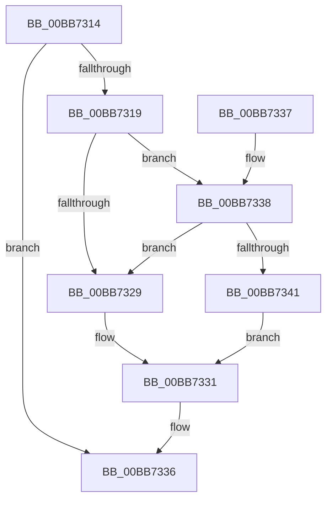

# ViPtCaptureStackTrace

- RVA: `0x00BB7314`–`0x00BB7361` (길이 `77` bytes)
- VA: `0x0000000140BB7314`
- 실행 섹션: `PAGEVRFY`
- PDB 이름 있음: `예`; PDB Function 태그: `아니요`
- unwind 정보 RVA: `0x000B3E70`
- 디코드: `24`개 명령, `77/77` bytes 표시
- 미해석 바이트: `0` (있으면 어셈블리에 `.byte`로 보존)

> 이 문서는 커널 이미지의 기계어와 PDB 기호를 분석해 생성했습니다. 4번과 5번은 함수 원형과 자료형을 바이너리 사용 방식에서 추정한 C 해석이며 원본 소스 복구 결과는 아닙니다.

## 1. Dependencies

- 직접 호출 지점: **3**; 고유 호출 대상: **3**
- 직접 호출자로 확인된 함수: **1**
- RIP 상대 이미지 참조: **1**

### Outgoing calls
- `0x00BB732C` → [ViPtCaptureStackTraceCallout](ViPtCaptureStackTraceCallout_function_00BB7370.md) (function, `0x00BB7370`)
- `0x00BB7338` → [RtlEnoughStackSpaceForStackCapture](../../text/43/RtlEnoughStackSpaceForStackCapture_function_004341D0.md) (function, `0x004341D0`)
- `0x00BB735A` → [KeExpandKernelStackAndCalloutEx](../../text/2F/KeExpandKernelStackAndCalloutEx_function_002F85B0.md) (function, `0x002F85B0`)

### Direct callers
- [ViPtLogPoolTraceWrapper](../B9/ViPtLogPoolTraceWrapper_function_00B92100.md) at `0x00B92160`

### Static image references
- `0x00BB7347` → RVA `0x00BB7370` (`ViPtCaptureStackTraceCallout`; read)

## 2. Other-region calls and transfers

- 다른 실행 섹션으로 향하는 call: **2**
  - `0x00BB7338` → [RtlEnoughStackSpaceForStackCapture](../../text/43/RtlEnoughStackSpaceForStackCapture_function_004341D0.md) (`PAGEVRFY` → `.text`)
  - `0x00BB735A` → [KeExpandKernelStackAndCalloutEx](../../text/2F/KeExpandKernelStackAndCalloutEx_function_002F85B0.md) (`PAGEVRFY` → `.text`)
- 별도 외부 분기/꼬리 이동을 확인하지 못했습니다.

## 3. Assembly (complete function range)

```asm
00BB7314  48 85 C9                        test rcx, rcx
00BB7317  74 1D                           je 0x140bb7336
00BB7319  53                              push rbx
00BB731A  48 83 EC 30                     sub rsp, 0x30
00BB731E  48 8B D9                        mov rbx, rcx
00BB7321  44 0F 20 C0                     mov rax, cr8
00BB7325  3C 01                           cmp al, 1
00BB7327  76 0F                           jbe 0x140bb7338
00BB7329  48 8B CB                        mov rcx, rbx
00BB732C  E8 3F 00 00 00                  call 0x140bb7370
00BB7331  48 83 C4 30                     add rsp, 0x30
00BB7335  5B                              pop rbx
00BB7336  C3                              ret
00BB7337  CC                              int3
00BB7338  E8 93 CE 87 FF                  call 0x1404341d0
00BB733D  85 C0                           test eax, eax
00BB733F  75 E8                           jne 0x140bb7329
00BB7341  48 83 64 24 20 00               and qword ptr [rsp + 0x20], 0
00BB7347  48 8D 0D 22 00 00 00            lea rcx, [rip + 0x22]
00BB734E  41 B1 01                        mov r9b, 1
00BB7351  41 B8 30 0E 00 00               mov r8d, 0xe30
00BB7357  48 8B D3                        mov rdx, rbx
00BB735A  E8 51 12 74 FF                  call 0x1402f85b0
00BB735F  EB D0                           jmp 0x140bb7331
```

## 4. C-style interpretation (structured pseudocode)

```c
__int64 __fastcall ViPtCaptureStackTrace(__int64 a1)
{
    __int64 result;
    __int64 v_rsp;
    unsigned __int64 v_stack_p20;

    if (a1 == 0) goto loc_00BB7336;
    v_rsp = (v_rsp) - (48);
    if (((unsigned __int8)(v_cr8)) <= 1) goto loc_00BB7338;
loc_00BB7329:
    result = ViPtCaptureStackTraceCallout(a1, a2, a3, a4);
loc_00BB7331:
    v_rsp = (v_rsp) + (48);
loc_00BB7336:
    return result;
loc_00BB7338:
    result = RtlEnoughStackSpaceForStackCapture(a1, a2, a3, a4);
    if ((unsigned int)(result) != 0) goto loc_00BB7329;
    result = KeExpandKernelStackAndCalloutEx(v_rip + 34, a1, (unsigned int)(0xE30ULL), 1);
    goto loc_00BB7331;
}
```

## 5. (Beta) C Style

```c
int64_t ViPtCaptureStackTrace(int64_t Arg1)
{
    int64_t result;
    int64_t local_rsp;
    uint64_t v_stack_p20;

    if (Arg1 == 0) goto loc_00BB7336;
    local_rsp = (local_rsp) - (48);
    if (((uint8_t)(v_cr8)) <= 1) goto loc_00BB7338;
loc_00BB7329:
    result = ViPtCaptureStackTraceCallout(Arg1, a2, a3, a4);
loc_00BB7331:
    local_rsp = (local_rsp) + (48);
loc_00BB7336:
    return result;
loc_00BB7338:
    result = RtlEnoughStackSpaceForStackCapture(Arg1, a2, a3, a4);
    if ((uint32_t)(result) != 0) goto loc_00BB7329;
    result = KeExpandKernelStackAndCalloutEx(v_rip + 34, Arg1, (uint32_t)(0xE30ULL), 1);
    goto loc_00BB7331;
}
```

## 6. Execution-region graph

[열기: 2D/3D 그래프와 함수 탐색 컨트롤 패널](../../../control-panel.html?section=pagevrfy&rva=0x00BB7314&view=graph)

- 2D 그래프는 위에서 아래로 흐르고, 3D 그래프는 빈 공간을 드래그해 회전합니다. Shift+드래그는 이동, 휠은 확대·축소, 함수 노드 선택은 대상 보고서 이동입니다.

### Static fallback


