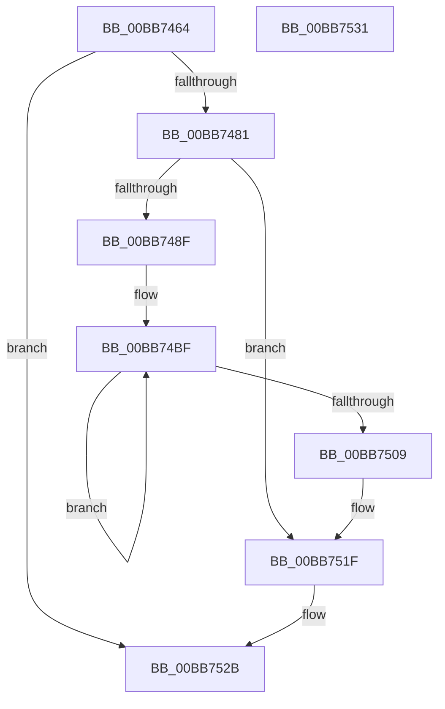

# ViPtLogPoolTrace

- RVA: `0x00BB7464`–`0x00BB7532` (길이 `206` bytes)
- VA: `0x0000000140BB7464`
- 실행 섹션: `PAGEVRFY`
- PDB 이름 있음: `예`; PDB Function 태그: `아니요`
- unwind 정보 RVA: `0x0005CF00`
- 디코드: `51`개 명령, `206/206` bytes 표시
- 미해석 바이트: `0` (있으면 어셈블리에 `.byte`로 보존)

> 이 문서는 커널 이미지의 기계어와 PDB 기호를 분석해 생성했습니다. 4번과 5번은 함수 원형과 자료형을 바이너리 사용 방식에서 추정한 C 해석이며 원본 소스 복구 결과는 아닙니다.

## 1. Dependencies

- 직접 호출 지점: **2**; 고유 호출 대상: **2**
- 직접 호출자로 확인된 함수: **1**
- RIP 상대 이미지 참조: **4**

### Outgoing calls
- `0x00BB7474` → [ExAcquireRundownProtection](../../text/21/ExAcquireRundownProtection_function_00216620.md) (function, `0x00216620`)
- `0x00BB7526` → [ExReleaseRundownProtection](../../text/34/ExReleaseRundownProtection_function_00349E80.md) (function, `0x00349E80`)

### Direct callers
- [ViPtLogPoolTraceWrapper](../B9/ViPtLogPoolTraceWrapper_function_00B92100.md) at `0x00B921B9`

### Static image references
- `0x00BB746D` → RVA `0x00F04218` (`.data`; read)
- `0x00BB7481` → RVA `0x00FFDAC8` (`PAGEVRFD`; read)
- `0x00BB7494` → RVA `0x00FFDBA0` (`PAGEVRFD`; read/write)
- `0x00BB749C` → RVA `0x00FFDA0C` (`PAGEVRFD`; read)

## 2. Other-region calls and transfers

- 다른 실행 섹션으로 향하는 call: **2**
  - `0x00BB7474` → [ExAcquireRundownProtection](../../text/21/ExAcquireRundownProtection_function_00216620.md) (`PAGEVRFY` → `.text`)
  - `0x00BB7526` → [ExReleaseRundownProtection](../../text/34/ExReleaseRundownProtection_function_00349E80.md) (`PAGEVRFY` → `.text`)
- 별도 외부 분기/꼬리 이동을 확인하지 못했습니다.

## 3. Assembly (complete function range)

```asm
00BB7464  40 53                           push rbx
00BB7466  48 83 EC 20                     sub rsp, 0x20
00BB746A  48 8B D9                        mov rbx, rcx
00BB746D  48 8D 0D A4 CD 34 00            lea rcx, [rip + 0x34cda4]
00BB7474  E8 A7 F1 65 FF                  call 0x140216620
00BB7479  84 C0                           test al, al
00BB747B  0F 84 AA 00 00 00               je 0x140bb752b
00BB7481  48 83 3D 3F 66 44 00 00         cmp qword ptr [rip + 0x44663f], 0
00BB7489  0F 84 90 00 00 00               je 0x140bb751f
00BB748F  B8 01 00 00 00                  mov eax, 1
00BB7494  F0 0F C1 05 04 67 44 00         lock xadd dword ptr [rip + 0x446704], eax
00BB749C  8B 0D 6A 65 44 00               mov ecx, dword ptr [rip + 0x44656a]
00BB74A2  FF C0                           inc eax
00BB74A4  FF C9                           dec ecx
00BB74A6  48 23 C8                        and rcx, rax
00BB74A9  B8 03 00 00 00                  mov eax, 3
00BB74AE  48 69 D1 A8 01 00 00            imul rdx, rcx, 0x1a8
00BB74B5  8D 48 7D                        lea ecx, [rax + 0x7d]
00BB74B8  48 03 15 09 66 44 00            add rdx, qword ptr [rip + 0x446609]
00BB74BF  0F 10 03                        movups xmm0, xmmword ptr [rbx]
00BB74C2  0F 11 02                        movups xmmword ptr [rdx], xmm0
00BB74C5  0F 10 4B 10                     movups xmm1, xmmword ptr [rbx + 0x10]
00BB74C9  0F 11 4A 10                     movups xmmword ptr [rdx + 0x10], xmm1
00BB74CD  0F 10 43 20                     movups xmm0, xmmword ptr [rbx + 0x20]
00BB74D1  0F 11 42 20                     movups xmmword ptr [rdx + 0x20], xmm0
00BB74D5  0F 10 4B 30                     movups xmm1, xmmword ptr [rbx + 0x30]
00BB74D9  0F 11 4A 30                     movups xmmword ptr [rdx + 0x30], xmm1
00BB74DD  0F 10 43 40                     movups xmm0, xmmword ptr [rbx + 0x40]
00BB74E1  0F 11 42 40                     movups xmmword ptr [rdx + 0x40], xmm0
00BB74E5  0F 10 4B 50                     movups xmm1, xmmword ptr [rbx + 0x50]
00BB74E9  0F 11 4A 50                     movups xmmword ptr [rdx + 0x50], xmm1
00BB74ED  0F 10 43 60                     movups xmm0, xmmword ptr [rbx + 0x60]
00BB74F1  0F 11 42 60                     movups xmmword ptr [rdx + 0x60], xmm0
00BB74F5  48 03 D1                        add rdx, rcx
00BB74F8  0F 10 4B 70                     movups xmm1, xmmword ptr [rbx + 0x70]
00BB74FC  48 03 D9                        add rbx, rcx
00BB74FF  0F 11 4A F0                     movups xmmword ptr [rdx - 0x10], xmm1
00BB7503  48 83 E8 01                     sub rax, 1
00BB7507  75 B6                           jne 0x140bb74bf
00BB7509  0F 10 03                        movups xmm0, xmmword ptr [rbx]
00BB750C  0F 11 02                        movups xmmword ptr [rdx], xmm0
00BB750F  0F 10 4B 10                     movups xmm1, xmmword ptr [rbx + 0x10]
00BB7513  0F 11 4A 10                     movups xmmword ptr [rdx + 0x10], xmm1
00BB7517  48 8B 43 20                     mov rax, qword ptr [rbx + 0x20]
00BB751B  48 89 42 20                     mov qword ptr [rdx + 0x20], rax
00BB751F  48 8D 0D F2 CC 34 00            lea rcx, [rip + 0x34ccf2]
00BB7526  E8 55 29 79 FF                  call 0x140349e80
00BB752B  48 83 C4 20                     add rsp, 0x20
00BB752F  5B                              pop rbx
00BB7530  C3                              ret
00BB7531  CC                              int3
```

## 4. C-style interpretation (structured pseudocode)

```c
__int64 __fastcall ViPtLogPoolTrace(__int64 a1)
{
    __int64 result;
    __int64 v_rbx;
    __int64 v_rsp;

    v_rsp = (v_rsp) - (32);
    result = ExAcquireRundownProtection(v_rip + 3460516, a2, a3, a4);
    if ((unsigned __int8)(result) == 0) goto loc_00BB752B;
    if ((*(unsigned __int64 *)(v_rip + 4482623)) == 0) goto loc_00BB751F;
    result = (unsigned int)((1) + 1);
    a1 = (unsigned int)(((unsigned int)(*(unsigned int *)(v_rip + 4482410))) - 1);
    a1 = (a1) & (result);
    a2 = (a2) * (a1);
    a2 = (a2) + (*(unsigned __int64 *)(v_rip + 4482569));
loc_00BB74BF:
    *(unsigned __int64 *)(a2) = v_xmm0;
    *(unsigned __int64 *)(a2 + 16) = v_xmm1;
    *(unsigned __int64 *)(a2 + 32) = v_xmm0;
    *(unsigned __int64 *)(a2 + 48) = v_xmm1;
    *(unsigned __int64 *)(a2 + 64) = v_xmm0;
    *(unsigned __int64 *)(a2 + 80) = v_xmm1;
    *(unsigned __int64 *)(a2 + 96) = v_xmm0;
    a2 = (a2) + (3 + 125);
    v_rbx = (a1) + (3 + 125);
    *(unsigned __int64 *)(a2 - 16) = v_xmm1;
    result = (3) - (1);
    if (condition_is_not_equal) goto loc_00BB74BF;
    *(unsigned __int64 *)(a2) = v_xmm0;
    *(unsigned __int64 *)(a2 + 16) = v_xmm1;
    *(unsigned __int64 *)(a2 + 32) = *(unsigned __int64 *)(v_rbx + 32);
loc_00BB751F:
    result = ExReleaseRundownProtection(v_rip + 3460338, a2, a3, a4);
loc_00BB752B:
    v_rsp = (v_rsp) + (32);
    return result;
}
```

## 5. (Beta) C Style

```c
int64_t ViPtLogPoolTrace(void *Arg1)
{
    uint8_t *arg1 = (uint8_t *)Arg1;

    int64_t result;
    int64_t local_rbx;
    int64_t local_rsp;

    local_rsp = (local_rsp) - (32);
    result = ExAcquireRundownProtection(v_rip + 3460516, a2, a3, a4);
    if ((uint8_t)(result) == 0) goto loc_00BB752B;
    if ((*(uint64_t *)(v_rip + 0x44663F)) == 0) goto loc_00BB751F;
    result = (uint32_t)((1) + 1);
    Arg1 = (uint32_t)(((uint32_t)(*(uint32_t *)(v_rip + 0x44656A))) - 1);
    Arg1 = (Arg1) & (result);
    a2 = (a2) * (Arg1);
    a2 = (a2) + (*(uint64_t *)(v_rip + 0x446609));
loc_00BB74BF:
    *(uint64_t *)(a2) = v_xmm0;
    *(uint64_t *)(a2 + 0x10) = v_xmm1;
    *(uint64_t *)(a2 + 0x20) = v_xmm0;
    *(uint64_t *)(a2 + 0x30) = v_xmm1;
    *(uint64_t *)(a2 + 0x40) = v_xmm0;
    *(uint64_t *)(a2 + 0x50) = v_xmm1;
    *(uint64_t *)(a2 + 0x60) = v_xmm0;
    a2 = (a2) + (3 + 125);
    local_rbx = (Arg1) + (3 + 125);
    *(uint64_t *)(a2 - 0x10) = v_xmm1;
    result = (3) - (1);
    if (condition_is_not_equal) goto loc_00BB74BF;
    *(uint64_t *)(a2) = v_xmm0;
    *(uint64_t *)(a2 + 0x10) = v_xmm1;
    *(uint64_t *)(a2 + 0x20) = *(uint64_t *)(local_rbx + 0x20);
loc_00BB751F:
    result = ExReleaseRundownProtection(v_rip + 3460338, a2, a3, a4);
loc_00BB752B:
    local_rsp = (local_rsp) + (32);
    return result;
}
```

### 관측된 메모리 오프셋

구조체 형식이 확인되지 않은 접근은 인자 기준의 오프셋으로만 기록했습니다.

| 기준 인자 | 오프셋 표현 | 폭 (bit) | 접근 |
|---|---:|---:|---|
| `Arg1` | `+ 0x0` | `128` | `R` |
| `Arg1` | `+ 0x10` | `128` | `R` |
| `Arg1` | `+ 0x20` | `64` | `R` |
| `Arg1` | `+ 0x20` | `128` | `R` |
| `Arg1` | `+ 0x30` | `128` | `R` |
| `Arg1` | `+ 0x40` | `128` | `R` |
| `Arg1` | `+ 0x50` | `128` | `R` |
| `Arg1` | `+ 0x60` | `128` | `R` |
| `Arg1` | `+ 0x70` | `128` | `R` |

## 6. Execution-region graph

[열기: 2D/3D 그래프와 함수 탐색 컨트롤 패널](../../../control-panel.html?section=pagevrfy&rva=0x00BB7464&view=graph)

- 2D 그래프는 위에서 아래로 흐르고, 3D 그래프는 빈 공간을 드래그해 회전합니다. Shift+드래그는 이동, 휠은 확대·축소, 함수 노드 선택은 대상 보고서 이동입니다.

### Static fallback


