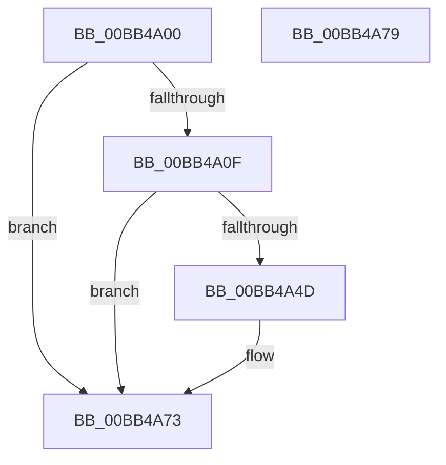

# ViSpIoSetCompletionRoutineEx_Exit

- RVA: `0x00BB4A00`–`0x00BB4A7A` (길이 `122` bytes)
- VA: `0x0000000140BB4A00`
- 실행 섹션: `PAGEVRFY`
- PDB 이름 있음: `예`; PDB Function 태그: `아니요`
- unwind 정보 RVA: `0x000697A4`
- 디코드: `31`개 명령, `122/122` bytes 표시
- 미해석 바이트: `0` (있으면 어셈블리에 `.byte`로 보존)

> 이 문서는 커널 이미지의 기계어와 PDB 기호를 분석해 생성했습니다. 4번과 5번은 함수 원형과 자료형을 바이너리 사용 방식에서 추정한 C 해석이며 원본 소스 복구 결과는 아닙니다.

## 1. Dependencies

- 직접 호출 지점: **2**; 고유 호출 대상: **2**
- 직접 호출자로 확인된 함수: **0**
- RIP 상대 이미지 참조: **1**

### Outgoing calls
- `0x00BB4A43` → [VfHandlePoolAlloc](VfHandlePoolAlloc_function_00BB8A90.md) (function, `0x00BB8A90`)
- `0x00BB4A6E` → [VfUtilFreePoolCheckIRQL](../../text/4C/VfUtilFreePoolCheckIRQL_function_004C65D0.md) (function, `0x004C65D0`)

### Direct callers
- 이 함수 시작 RVA로 연결되는 직접 call은 확인되지 않았습니다. 간접 호출은 완전히 역산할 수 없습니다.

### Static image references
- `0x00BB4A20` → RVA `0x00E681B0` (`.data`; read)

## 2. Other-region calls and transfers

- 다른 실행 섹션으로 향하는 call: **1**
  - `0x00BB4A6E` → [VfUtilFreePoolCheckIRQL](../../text/4C/VfUtilFreePoolCheckIRQL_function_004C65D0.md) (`PAGEVRFY` → `.text`)
- 별도 외부 분기/꼬리 이동을 확인하지 못했습니다.

## 3. Assembly (complete function range)

```asm
00BB4A00  40 53                           push rbx
00BB4A02  48 83 EC 40                     sub rsp, 0x40
00BB4A06  83 79 30 00                     cmp dword ptr [rcx + 0x30], 0
00BB4A0A  48 8B D9                        mov rbx, rcx
00BB4A0D  7C 64                           jl 0x140bb4a73
00BB4A0F  48 8B 44 24 48                  mov rax, qword ptr [rsp + 0x48]
00BB4A14  33 C9                           xor ecx, ecx
00BB4A16  48 89 44 24 38                  mov qword ptr [rsp + 0x38], rax
00BB4A1B  BA 40 02 00 00                  mov edx, 0x240
00BB4A20  48 8D 05 89 37 2B 00            lea rax, [rip + 0x2b3789]
00BB4A27  C7 44 24 30 01 00 00 00         mov dword ptr [rsp + 0x30], 1
00BB4A2F  48 89 44 24 28                  mov qword ptr [rsp + 0x28], rax
00BB4A34  41 B9 56 66 55 73               mov r9d, 0x73556656
00BB4A3A  83 64 24 20 00                  and dword ptr [rsp + 0x20], 0
00BB4A3F  44 8D 41 20                     lea r8d, [rcx + 0x20]
00BB4A43  E8 48 40 00 00                  call 0x140bb8a90
00BB4A48  48 85 C0                        test rax, rax
00BB4A4B  74 26                           je 0x140bb4a73
00BB4A4D  48 8B 4B 20                     mov rcx, qword ptr [rbx + 0x20]
00BB4A51  48 8B 91 B8 00 00 00            mov rdx, qword ptr [rcx + 0xb8]
00BB4A58  48 8B 4A F8                     mov rcx, qword ptr [rdx - 8]
00BB4A5C  0F 10 01                        movups xmm0, xmmword ptr [rcx]
00BB4A5F  0F 11 00                        movups xmmword ptr [rax], xmm0
00BB4A62  0F 10 49 10                     movups xmm1, xmmword ptr [rcx + 0x10]
00BB4A66  0F 11 48 10                     movups xmmword ptr [rax + 0x10], xmm1
00BB4A6A  48 89 42 F8                     mov qword ptr [rdx - 8], rax
00BB4A6E  E8 5D 1B 91 FF                  call 0x1404c65d0
00BB4A73  48 83 C4 40                     add rsp, 0x40
00BB4A77  5B                              pop rbx
00BB4A78  C3                              ret
00BB4A79  CC                              int3
```

## 4. C-style interpretation (structured pseudocode)

```c
__int64 __fastcall ViSpIoSetCompletionRoutineEx_Exit(__int64 a1)
{
    __int64 result;
    __int64 v_rsp;
    unsigned __int64 v_stack_m10;
    unsigned int v_stack_m18;
    unsigned __int64 v_stack_m20;
    unsigned int v_stack_m28;
    unsigned __int64 v_stack_p0;

    v_rsp = (v_rsp) - (64);
    if ((*(unsigned int *)(a1 + 48)) < 0) goto loc_00BB4A73;
    a1 = 0;
    v_stack_m10 = v_stack_p0;
    v_stack_m18 = 1;
    v_stack_m20 = v_rip + 2832265;
    result = VfHandlePoolAlloc(a1, 576, a1 + 32, (unsigned int)(0x73556656ULL));
    if (result != 0) {
        a1 = *(unsigned __int64 *)(a1 + 32);
        a2 = *(unsigned __int64 *)(a1 + 184);
        a1 = *(unsigned __int64 *)(a2 - 8);
        *(unsigned __int64 *)(result) = v_xmm0;
        *(unsigned __int64 *)(result + 16) = v_xmm1;
        *(unsigned __int64 *)(a2 - 8) = result;
        result = VfUtilFreePoolCheckIRQL(a1, a2, a1 + 32, (unsigned int)(0x73556656ULL));
    }
    v_rsp = (v_rsp) + (64);
    return result;
}
```

## 5. (Beta) C Style

```c
int64_t ViSpIoSetCompletionRoutineEx_Exit(void *Arg1)
{
    uint8_t *arg1 = (uint8_t *)Arg1;

    int64_t result;
    int64_t local_rsp;
    uint64_t v_stack_m10;
    uint32_t v_stack_m18;
    uint64_t v_stack_m20;
    uint32_t v_stack_m28;
    uint64_t v_stack_p0;

    local_rsp = (local_rsp) - (64);
    if ((*(uint32_t *)(arg1 + 0x30)) < 0) goto loc_00BB4A73;
    Arg1 = 0;
    v_stack_m10 = v_stack_p0;
    v_stack_m18 = 1;
    v_stack_m20 = v_rip + 2832265;
    result = VfHandlePoolAlloc(Arg1, 576, Arg1 + 32, (uint32_t)(0x73556656ULL));
    if (result != 0) {
        Arg1 = *(uint64_t *)(arg1 + 0x20);
        a2 = *(uint64_t *)(arg1 + 0xB8);
        Arg1 = *(uint64_t *)(a2 - 0x8);
        *(uint64_t *)(result) = v_xmm0;
        *(uint64_t *)(result + 0x10) = v_xmm1;
        *(uint64_t *)(a2 - 0x8) = result;
        result = VfUtilFreePoolCheckIRQL(Arg1, a2, Arg1 + 32, (uint32_t)(0x73556656ULL));
    }
    local_rsp = (local_rsp) + (64);
    return result;
}
```

### 관측된 메모리 오프셋

구조체 형식이 확인되지 않은 접근은 인자 기준의 오프셋으로만 기록했습니다.

| 기준 인자 | 오프셋 표현 | 폭 (bit) | 접근 |
|---|---:|---:|---|
| `Arg1` | `+ 0x20` | `64` | `R` |
| `Arg1` | `+ 0x30` | `32` | `R` |

## 6. Execution-region graph

[열기: 2D/3D 그래프와 함수 탐색 컨트롤 패널](../../../control-panel.html?section=pagevrfy&rva=0x00BB4A00&view=graph)

- 2D 그래프는 위에서 아래로 흐르고, 3D 그래프는 빈 공간을 드래그해 회전합니다. Shift+드래그는 이동, 휠은 확대·축소, 함수 노드 선택은 대상 보고서 이동입니다.

### Static fallback


