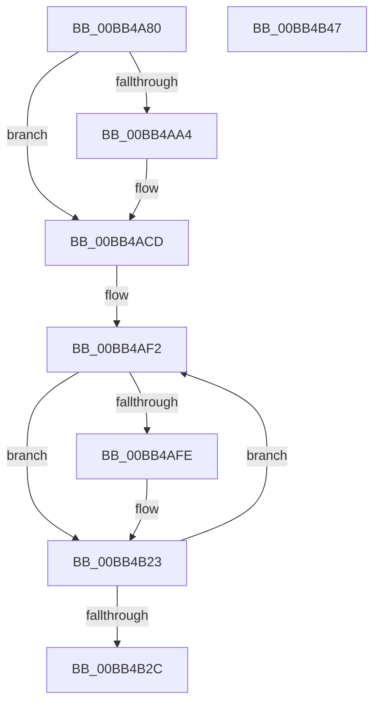

# ViSpMmMapIoSpace_Entry

- RVA: `0x00BB4A80`–`0x00BB4B48` (길이 `200` bytes)
- VA: `0x0000000140BB4A80`
- 실행 섹션: `PAGEVRFY`
- PDB 이름 있음: `예`; PDB Function 태그: `아니요`
- unwind 정보 RVA: `0x00060130`
- 디코드: `54`개 명령, `200/200` bytes 표시
- 미해석 바이트: `0` (있으면 어셈블리에 `.byte`로 보존)

> 이 문서는 커널 이미지의 기계어와 PDB 기호를 분석해 생성했습니다. 4번과 5번은 함수 원형과 자료형을 바이너리 사용 방식에서 추정한 C 해석이며 원본 소스 복구 결과는 아닙니다.

## 1. Dependencies

- 직접 호출 지점: **3**; 고유 호출 대상: **2**
- 직접 호출자로 확인된 함수: **0**
- RIP 상대 이미지 참조: **0**

### Outgoing calls
- `0x00BB4AC8` → [CarReportRuleViolationFromNt](../B9/CarReportRuleViolationFromNt_function_00B9D904.md) (function, `0x00B9D904`)
- `0x00BB4AF5` → [MmIsMdlPageLocked](MmIsMdlPageLocked_function_00BB46E8.md) (function, `0x00BB46E8`)
- `0x00BB4B1E` → [CarReportRuleViolationFromNt](../B9/CarReportRuleViolationFromNt_function_00B9D904.md) (function, `0x00B9D904`)

### Direct callers
- 이 함수 시작 RVA로 연결되는 직접 call은 확인되지 않았습니다. 간접 호출은 완전히 역산할 수 없습니다.

### Static image references
- 디코드된 RIP-relative 메모리 참조가 없습니다.

## 2. Other-region calls and transfers

- 다른 실행 섹션으로 향하는 call: **0**
- 별도 외부 분기/꼬리 이동을 확인하지 못했습니다.

## 3. Assembly (complete function range)

```asm
00BB4A80  4C 8B DC                        mov r11, rsp
00BB4A83  49 89 5B 08                     mov qword ptr [r11 + 8], rbx
00BB4A87  49 89 6B 10                     mov qword ptr [r11 + 0x10], rbp
00BB4A8B  49 89 73 18                     mov qword ptr [r11 + 0x18], rsi
00BB4A8F  49 89 7B 20                     mov qword ptr [r11 + 0x20], rdi
00BB4A93  41 56                           push r14
00BB4A95  48 83 EC 40                     sub rsp, 0x40
00BB4A99  48 8B F1                        mov rsi, rcx
00BB4A9C  44 0F 20 C0                     mov rax, cr8
00BB4AA0  3C 02                           cmp al, 2
00BB4AA2  76 29                           jbe 0x140bb4acd
00BB4AA4  44 8B 49 18                     mov r9d, dword ptr [rcx + 0x18]
00BB4AA8  BA 73 00 00 00                  mov edx, 0x73
00BB4AAD  44 0F B6 C0                     movzx r8d, al
00BB4AB1  48 8B 01                        mov rax, qword ptr [rcx]
00BB4AB4  49 89 43 E8                     mov qword ptr [r11 - 0x18], rax
00BB4AB8  48 8B 41 10                     mov rax, qword ptr [rcx + 0x10]
00BB4ABC  8D 4A 51                        lea ecx, [rdx + 0x51]
00BB4ABF  83 64 24 28 00                  and dword ptr [rsp + 0x28], 0
00BB4AC4  49 89 43 D8                     mov qword ptr [r11 - 0x28], rax
00BB4AC8  E8 37 8E FE FF                  call 0x140b9d904
00BB4ACD  48 8B 5E 18                     mov rbx, qword ptr [rsi + 0x18]
00BB4AD1  4C 8B 76 10                     mov r14, qword ptr [rsi + 0x10]
00BB4AD5  48 8B C3                        mov rax, rbx
00BB4AD8  25 FF 0F 00 00                  and eax, 0xfff
00BB4ADD  48 8B FB                        mov rdi, rbx
00BB4AE0  48 C1 EF 0C                     shr rdi, 0xc
00BB4AE4  49 8D AE FF 0F 00 00            lea rbp, [r14 + 0xfff]
00BB4AEB  48 03 E8                        add rbp, rax
00BB4AEE  48 C1 ED 0C                     shr rbp, 0xc
00BB4AF2  48 8B CF                        mov rcx, rdi
00BB4AF5  E8 EE FB FF FF                  call 0x140bb46e8
00BB4AFA  85 C0                           test eax, eax
00BB4AFC  75 25                           jne 0x140bb4b23
00BB4AFE  48 8B 06                        mov rax, qword ptr [rsi]
00BB4B01  BA 83 00 00 00                  mov edx, 0x83
00BB4B06  48 89 44 24 30                  mov qword ptr [rsp + 0x30], rax
00BB4B0B  4D 8B CE                        mov r9, r14
00BB4B0E  83 64 24 28 00                  and dword ptr [rsp + 0x28], 0
00BB4B13  4C 8B C3                        mov r8, rbx
00BB4B16  48 89 7C 24 20                  mov qword ptr [rsp + 0x20], rdi
00BB4B1B  8D 4A 41                        lea ecx, [rdx + 0x41]
00BB4B1E  E8 E1 8D FE FF                  call 0x140b9d904
00BB4B23  48 FF C7                        inc rdi
00BB4B26  48 83 ED 01                     sub rbp, 1
00BB4B2A  75 C6                           jne 0x140bb4af2
00BB4B2C  48 8B 5C 24 50                  mov rbx, qword ptr [rsp + 0x50]
00BB4B31  48 8B 6C 24 58                  mov rbp, qword ptr [rsp + 0x58]
00BB4B36  48 8B 74 24 60                  mov rsi, qword ptr [rsp + 0x60]
00BB4B3B  48 8B 7C 24 68                  mov rdi, qword ptr [rsp + 0x68]
00BB4B40  48 83 C4 40                     add rsp, 0x40
00BB4B44  41 5E                           pop r14
00BB4B46  C3                              ret
00BB4B47  CC                              int3
```

## 4. C-style interpretation (structured pseudocode)

```c
__int64 __fastcall ViSpMmMapIoSpace_Entry(__int64 a1)
{
    __int64 result;
    __int64 v_rbp;
    __int64 v_rdi;
    __int64 v_rsp;
    unsigned __int64 v_stack_m18;
    unsigned int v_stack_m20;
    unsigned __int64 v_stack_m28;
    unsigned __int64 v_stack_p10;
    unsigned __int64 v_stack_p18;
    unsigned __int64 v_stack_p20;
    unsigned __int64 v_stack_p8;

    *(unsigned __int64 *)(v_rsp + 8) = v_rbx;
    *(unsigned __int64 *)(v_rsp + 16) = v_rbp;
    *(unsigned __int64 *)(v_rsp + 24) = v_rsi;
    *(unsigned __int64 *)(v_rsp + 32) = v_rdi;
    v_rsp = (v_rsp) - (64);
    result = v_cr8;
    if (((unsigned __int8)(v_cr8)) >= = 2) {
        a4 = *(unsigned int *)(a1 + 24);
        a2 = 115;
        a3 = (unsigned __int8)(v_cr8);
        result = *(unsigned __int64 *)(a1);
        *(unsigned __int64 *)(v_rsp - 24) = result;
        result = *(unsigned __int64 *)(a1 + 16);
        a1 = a2 + 81;
        *(unsigned __int64 *)(v_rsp - 40) = result;
        result = CarReportRuleViolationFromNt(a1, a2, a3, a4);
    }
    result = (unsigned int)((*(unsigned __int64 *)(a1 + 24)) & (0xFFFULL));
    v_rdi = (*(unsigned __int64 *)(a1 + 24)) >> (12);
    v_rbp = (*(unsigned __int64 *)(a1 + 16) + 4095) + (result);
    v_rbp = (v_rbp) >> (12);
loc_00BB4AF2:
    result = MmIsMdlPageLocked(v_rdi, a2, a3, a4);
    if ((unsigned int)(result) == 0) {
        result = *(unsigned __int64 *)(a1);
        a2 = 131;
        v_stack_m18 = result;
        a4 = *(unsigned __int64 *)(a1 + 16);
        a3 = *(unsigned __int64 *)(a1 + 24);
        v_stack_m28 = v_rdi;
        a1 = a2 + 65;
        result = CarReportRuleViolationFromNt(a1, a2, a3, a4);
    }
    v_rdi = (v_rdi) + 1;
    v_rbp = (v_rbp) - (1);
    if (condition_is_not_equal) goto loc_00BB4AF2;
    v_rsp = (v_rsp) + (64);
    return result;
}
```

## 5. (Beta) C Style

```c
int64_t ViSpMmMapIoSpace_Entry(void *Arg1)
{
    uint8_t *arg1 = (uint8_t *)Arg1;

    int64_t result;
    int64_t local_rbp;
    int64_t local_rdi;
    int64_t local_rsp;
    uint64_t v_stack_m18;
    uint32_t v_stack_m20;
    uint64_t v_stack_m28;
    uint64_t v_stack_p10;
    uint64_t v_stack_p18;
    uint64_t v_stack_p20;
    uint64_t v_stack_p8;

    *(uint64_t *)(local_rsp + 0x8) = local_rbx;
    *(uint64_t *)(local_rsp + 0x10) = local_rbp;
    *(uint64_t *)(local_rsp + 0x18) = local_rsi;
    *(uint64_t *)(local_rsp + 0x20) = local_rdi;
    local_rsp = (local_rsp) - (64);
    result = v_cr8;
    if (((uint8_t)(v_cr8)) >= = 2) {
        a4 = *(uint32_t *)(arg1 + 0x18);
        a2 = 115;
        a3 = (uint8_t)(v_cr8);
        result = *(uint64_t *)(arg1);
        *(uint64_t *)(local_rsp - 0x18) = result;
        result = *(uint64_t *)(arg1 + 0x10);
        Arg1 = a2 + 81;
        *(uint64_t *)(local_rsp - 0x28) = result;
        result = CarReportRuleViolationFromNt(Arg1, a2, a3, a4);
    }
    result = (uint32_t)((*(uint64_t *)(arg1 + 0x18)) & (0xFFFULL));
    local_rdi = (*(uint64_t *)(arg1 + 0x18)) >> (12);
    local_rbp = (*(uint64_t *)(arg1 + 0x10) + 4095) + (result);
    local_rbp = (local_rbp) >> (12);
loc_00BB4AF2:
    result = MmIsMdlPageLocked(local_rdi, a2, a3, a4);
    if ((uint32_t)(result) == 0) {
        result = *(uint64_t *)(arg1);
        a2 = 131;
        v_stack_m18 = result;
        a4 = *(uint64_t *)(arg1 + 0x10);
        a3 = *(uint64_t *)(arg1 + 0x18);
        v_stack_m28 = local_rdi;
        Arg1 = a2 + 65;
        result = CarReportRuleViolationFromNt(Arg1, a2, a3, a4);
    }
    local_rdi = (local_rdi) + 1;
    local_rbp = (local_rbp) - (1);
    if (condition_is_not_equal) goto loc_00BB4AF2;
    local_rsp = (local_rsp) + (64);
    return result;
}
```

### 관측된 메모리 오프셋

구조체 형식이 확인되지 않은 접근은 인자 기준의 오프셋으로만 기록했습니다.

| 기준 인자 | 오프셋 표현 | 폭 (bit) | 접근 |
|---|---:|---:|---|
| `Arg1` | `+ 0x0` | `64` | `R` |
| `Arg1` | `+ 0x10` | `64` | `R` |
| `Arg1` | `+ 0x18` | `32` | `R` |
| `Arg1` | `+ 0x18` | `64` | `R` |

## 6. Execution-region graph

[열기: 2D/3D 그래프와 함수 탐색 컨트롤 패널](../../../control-panel.html?section=pagevrfy&rva=0x00BB4A80&view=graph)

- 2D 그래프는 위에서 아래로 흐르고, 3D 그래프는 빈 공간을 드래그해 회전합니다. Shift+드래그는 이동, 휠은 확대·축소, 함수 노드 선택은 대상 보고서 이동입니다.

### Static fallback


